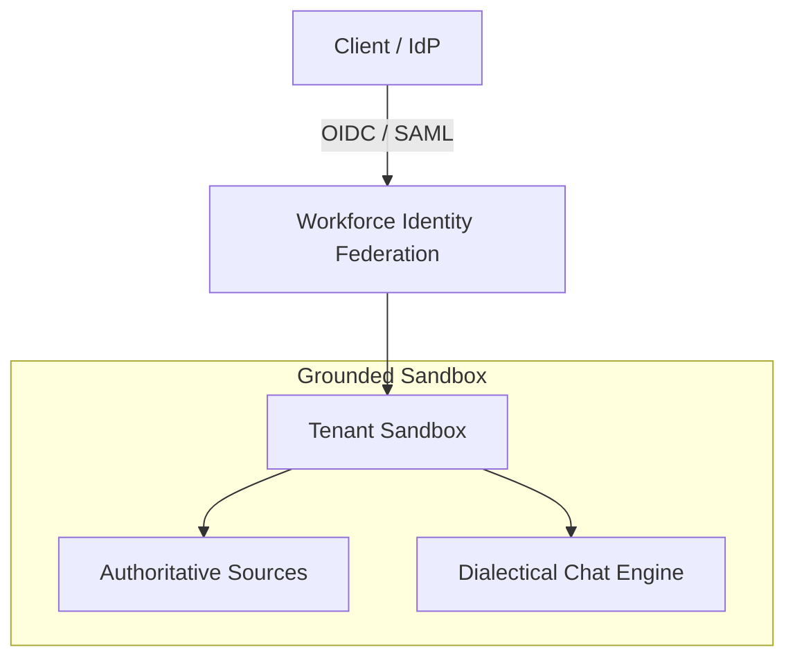

# Wiki Format Skill

## Objective
Detect, audit, and refactor non-standard visual formatting across the vault—specifically raw ASCII box-drawing characters (`+---+`, `|`, `+===+`), faux monospace tables, and crude text diagrams inside code fences (` ``` `). Replace them with native, responsive Obsidian components:
1. **GitHub-Flavored Markdown (GFM) Tables** for tabular data and comparison matrices.
2. **Mermaid.js Diagrams** for architectures, information flows, timelines, funnels, and relational models.
3. **Obsidian Callouts** for UI mockups, configuration panels, blueprints, and emphasized scenario cards.

---

## Why ASCII Boxes Fail in Obsidian

1. **Broken Responsiveness**: Raw monospace text blocks inside code fences (` ``` `) do not wrap. On mobile devices, tablets, or split-pane desktop views, they overflow horizontally, forcing awkward horizontal scrolling.
2. **Theme Incompatibility**: ASCII art uses fixed text spacing and looks identical in light and dark modes, whereas native Obsidian components automatically inherit custom typography, CSS variables, and community theme accents.
3. **Accessibility & Search**: Screen readers and search indexers struggle to parse information fragmented across ASCII vertical pipes and hyphens, whereas standard GFM tables and Mermaid node labels are fully accessible and indexable.

---

## Transformation Heuristics & Standards

### 1. Tabular Comparisons & Matrices $\rightarrow$ GFM Tables

Whenever a code block contains a multi-column table formatted with `+---+` or `|` grid dividers:
- Extract headers and column data.
- Convert to standard Markdown syntax:
  ```markdown
  | Header 1 | Header 2 | Header 3 |
  | :--- | :--- | :--- |
  | Cell 1 | Cell 2 | Cell 3 |
  ```
- Use bold text for key terms and backticks for technical symbols/paths.
- Maintain column text alignment (`:---` left, `:---:` center, `---:` right).
- **Table Pipe Escaping Invariant**: Never leave an unescaped pipe `|` inside a wikilink in a table cell (e.g., `| [[Target|Alias]] |`). Always escape it as `\|` (e.g., `| [[Target\|Alias]] |`) or use unaliased `[[Target]]`.

### 2. Architectures, Flowcharts, & Funnels $\rightarrow$ Mermaid.js Diagrams

Whenever a code block depicts directional arrows (`-->`, `| v |`), multi-tier architectures, component trees, or lifecycle funnels:
- Convert to a native fenced `mermaid` block.
- Supported and recommended diagram types in Obsidian:
  - `flowchart TD` (Top-Down architecture/process)
  - `flowchart LR` (Left-to-Right data pipelines)
  - `sequenceDiagram` (Multi-party protocols or API exchanges)
  - `stateDiagram-v2` (Finite state machine transitions)
- Syntax Rules:
  - **Mermaid Clean Label Invariant**: NEVER author wikilinks (`[[...]]`) inside Mermaid diagram node labels or edge text. Double brackets denote subroutine shapes in Mermaid and cause parse failures and broken SVG rendering in Obsidian. Wikilinks belong exclusively in markdown prose and tables.
  - Always quote node labels containing special characters, parentheses, colons, or ampersands: `nodeA["Label (Detail)"]`. Unquoted colons, parentheses, or ampersands in `nodeA[Text: Detail]` break Mermaid parsing.
  - Ensure balanced double quotes on every line.
  - Use clear node identifiers (`id1`, `id2`).
  - Use subgraphs (`subgraph Name ... end`) to visually group related components or tenants.

Example:


### 3. UI Panels, Forms, & Blueprints $\rightarrow$ Obsidian Callouts

Whenever a code block depicts a software UI window, configuration screen, multi-step scenario card, or implementation blueprint:
- Convert to an Obsidian Callout using appropriate type tags:
  - `> [!SETTINGS]` or `> [!NOTE]` for configuration forms, panels, and menus.
  - `> [!EXAMPLE]` or `> [!TIP]` for implementation blueprints and walk-throughs.
  - `> [!WARNING]` or `> [!CAUTION]` for operational risks and restrictions.
- Format fields with bold labels, bullet points, checkboxes (`- [x]`, `- [ ]`), or sub-sections.

Example:
```markdown
> [!SETTINGS] Notebook Chat Configuration
> **1. Conversational Goal**
> - ( ) **Default**: Standard factual retrieval assistant.
> - ( ) **Learning Guide**: Native tutor mode asking guided questions.
> - (x) **Custom**: System prompt injection (up to 10,000 characters).
> 
> **2. Response Length**
> - (x) **Shorter** | ( ) **Default** | ( ) **Longer**
```

### 4. Wikilink Syntax Normalization & Backtick Removal

Whenever wikilinks are wrapped in inline code backticks (e.g., `` `[[sources/slug]]` `` or ``(`[[sources/slug]]`)``):
- Obsidian treats them as inline `<code>` blocks instead of active, clickable bidirectional links.
- Strip surrounding backticks so citations resolve cleanly:
  - ``(`[[sources/foo]]`)`` $\rightarrow$ `([[sources/foo]])`
  - `` `[[Concept Name]]` `` $\rightarrow$ `[[Concept Name]]`
  - Regex pattern: `re.sub(r'`(\[\[[^`\r\n]+?\]\])`', r'\1', line)` (excluding fenced code blocks).

### 5. Table Pipe Escaping & Shortest Canonical Wikilinks

#### Table Pipe Escaping
In GitHub-Flavored Markdown (GFM) and Obsidian, tables use vertical pipes (`|`) as column separators. When a wikilink with an alias (e.g. `[[Target|Alias]]`) is placed inside a table cell, the markdown parser interprets the alias pipe as a column divider:
- The cell is split into two separate cells: `[[Target` in one column, and `Alias]]` in the next column.
- The table gains an unintended extra column, distorting the layout.
- Obsidian fails to recognize either fragment as a wikilink, breaking graph indexing, hover previews, and backlink tracking.

**Remediation Rule**:
- Always escape alias pipes inside table rows: `| [[Target\|Display Text]] |`.
- Or use canonical direct wikilinks without aliases: `| [[Target]] |`.
- Automated regex fix on table lines:
  ```python
  if line.strip().startswith("|") and line.strip().endswith("|"):
      # Escape any unescaped pipe inside a wikilink: [[Target|Alias]] -> [[Target\|Alias]]
      line = re.sub(r'(\[\[[^\]\r\n]+?)(?<!\\)\|([^\]\r\n]+?\]\])', r'\1\\|\2', line)
  ```

#### Shortest Canonical Wikilinks
Obsidian automatically resolves notes by stem across the vault. Redundant directory prefixes must be stripped from wikilinks to maintain clean, portable markdown:
- Avoid: `[[wiki/events/Event Title]]` $\rightarrow$ Use: `[[Event Title]]`
- Avoid: `[[wiki/actors/Actor Name]]` $\rightarrow$ Use: `[[Actor Name]]`
- Avoid: `[[wiki/locations/Location Name]]` $\rightarrow$ Use: `[[Location Name]]`
- Avoid: `[[wiki/themes/Theme Name]]` $\rightarrow$ Use: `[[Theme Name]]`
- Sources retain canonical subfolder prefix: `[[sources/<source-slug>]]`

---

## Execution Protocol

When asked to audit or format a file (or when performing automated vault linting):
1. **Detection**:
   - Scan target files for code blocks (` ``` `) containing ASCII borders (`+---`, `|---`, `+===`, `|   |`).
   - Scan target files for malformed backticked wikilinks (` `[[...]]` `).
   - Scan table rows (`| ... |`) for unescaped pipes inside wikilinks (`\[\[[^\]\n]*?(?<!\\)\|[^\]\n]*?\]\]`).
   - Scan for non-canonical wikilink path prefixes (`[[wiki/events/...]]`, `[[wiki/actors/...]]`, `[[wiki/locations/...]]`, `[[wiki/themes/...]]`).
   - Validate table column counts against delimiter rows (`| :--- | ... |`).
2. **Classification**: Determine whether the issue represents a data table, an architecture/flow diagram, a UI panel/blueprint, a malformed backticked link, an unescaped table pipe, or a prefixed path.
3. **Refactoring**: Replace the block in-place with its native Obsidian equivalent, escape table pipes (`\|`), strip malformed backticks, and shorten path prefixes.
4. **Validation**:
   - Verify that all `[[wikilinks]]` within the transformed block are preserved, unbackticked, and unescaped outside tables / properly escaped inside tables.
   - Verify that Mermaid syntax is valid and error-free.
   - Verify that no content or data points were lost during translation.
   - Run `python3 scripts/lint_vault.py` to ensure complete compliance.
