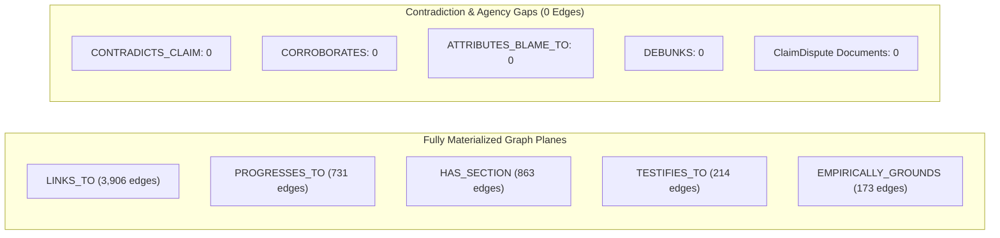

# Contradiction Missing: Ingestion Analysis and Graph Edge Implementation Plan

> [!IMPORTANT] Executive Summary
> This investigation addresses the discrepancy identified in **Section 4** of the ingestion audit dossier [[wiki/ingestions/2026-11-01/2026-10-30-the-guardian-sudanese-diaspora-uae-un-nominee-nusseibeh|2026-10-30-the-guardian-sudanese-diaspora-uae-un-nominee-nusseibeh]], where an **`ATTRIBUTION_CONFLICT`** was formally documented (civil society documentation of UAE arms supplies to the Rapid Support Forces vs. official Emirati diplomatic denials), yet **no corresponding edge** was materialized in the graph database.
> 
> A comprehensive audit across all **11 previous ingestion dossiers**, domain markdown files in `wiki/`, and the **ArcadeDB (`news`)** database reveals three foundational root causes:
> 1. **Complete Pipeline Omission in ArcadeDB Ingestion (`scripts/ingest_to_arcadedb.py`)**: Although `scripts/bootstrap_arcadedb.py` defined schema types for `CONTRADICTS_CLAIM` (edge) and `ClaimDispute` (document), `scripts/ingest_to_arcadedb.py` only referenced `CONTRADICTS_CLAIM` in its `--purge` routine. It never extracted `contradiction_flags` into `Event` vertices, never created `CONTRADICTS_CLAIM` edges, and never populated `ClaimDispute` records. Live database queries confirm **0** `CONTRADICTS_CLAIM` edges, **0** `ClaimDispute` records, and `contradiction_flags: NULL` across all 11 Event vertices.
> 2. **Ingestion-to-Event Frontmatter Propagation Failure**: In 5 of the 9 ingestions where contradictions were logged in the audit dossier, the compiled Event note frontmatter retained `contradiction_flags: []` (empty array), decoupling the dossier from the primary domain entity.
> 3. **Overly Restrictive Legacy Edge Semantics**: The legacy Neo4j dual-flow script (`scripts/extract_dual_flow_cot.py`) required two distinct `Source` nodes of opposing alignments to be cited inside Section 5. In modern conflict reporting, a single independent investigative dispatch (such as *The Guardian*) documents both the allegations and the denials within the *same* source. The primary contradiction carriers in our extended schema are actually **Citation nodes** (e.g., Kenneth Roth vs. Lana Nusseibeh) and **Actor attribution claims**.

---

## 1. Live Database Telemetry & Diagnostic Audit

### 1.1. Edge & Vertex Population in ArcadeDB (`news` @ `http://localhost:2481`)
Direct inspection of the active graph database demonstrates that while structural and sequential edges (`LINKS_TO`, `PROGRESSES_TO`, `HAS_SECTION`, `TESTIFIES_TO`, `EMPIRICALLY_GROUNDS`) have scaled to over 6,000 edges, dialectical and contradiction primitives remain entirely unpopulated:



| Database Construct | Declared Schema Type | Target Semantic | Active Count in ArcadeDB |
| :--- | :--- | :--- | :--- |
| `CONTRADICTS_CLAIM` | Edge Type | Links contradictory citations, sources, or claims | **0** |
| `CORROBORATES` | Edge Type | Corroborating evidence across independent sources | **0** |
| `ATTRIBUTES_BLAME_TO` | Edge Type | Blame attribution from speaker/actor to target | **0** |
| `DEBUNKS` | Edge Type | Forensic refutation of fabricated claims | **0** |
| `ClaimDispute` | Document Type | Structured comparison matrix record from Section 5 | **0** |
| `Event.contradiction_flags` | Property (`LIST OF STRING`) | Tracks contradiction flags (`ATTRIBUTION_CONFLICT`, etc.) | **NULL on all 11 Events** |

---

## 2. In-Depth Audit of All 11 Previous Ingestions

A systematic examination of all 11 ingestion audit dossiers in `wiki/ingestions/2026-11-01/` against their corresponding `wiki/events/` notes and ArcadeDB records reveals substantial epistemic drift between the audit logs and the compiled entities:

| # | Ingestion Dossier (`wiki/ingestions/2026-11-01/`) | Ingestion `contradictions_logged` | Target / Refactored Event Node | Event `contradiction_flags` in Markdown | ArcadeDB `contradiction_flags` | ArcadeDB Edges |
| :--- | :--- | :--- | :--- | :--- | :--- | :--- |
| 1 | `2026-02-19-un-news-el-fasher-hallmarks-of-genocide` | `[ATTRIBUTION_CONFLICT]` | [[2025-10 El Fasher Siege and RSF Takeover Atrocities]] | `[]` *(Missed)* | `NULL` | 0 |
| 2 | `2026-10-21-un-news-geneva-peace-efforts-drone-war` | `[]` (Consensus) | [[2026-10-21 Geneva Consultative Meeting on Peace Initiatives in Sudan]] | `[]` *(Valid)* | `NULL` | 0 |
| 3 | `2026-10-23-un-news-sudan-drone-strikes-306-killed` | `[ATTRIBUTION_CONFLICT]` | [[2026-10 Sudan Drone Warfare Escalation]] | `["ATTRIBUTION_CONFLICT"]` | `NULL` *(Dropped in sync)* | 0 |
| 4 | `2026-10-28-ohchr-ffm-el-obeid-drone-warfare-repression` | `[ATTRIBUTION_CONFLICT]` | [[2026-10 El Obeid Siege and Drone Warfare Escalation]] | `[]` *(Missed)* | `NULL` | 0 |
| 5 | `2026-10-28-ohchr-independent-international-fact-finding-mission-sudan-portal` | `[]` (Consensus portal) | *Portal source (no event)* | N/A | N/A | 0 |
| 6 | `2026-10-28-un-hrc-crp1-el-obeid-civilian-devastation` | `[ATTRIBUTION_CONFLICT, TARGET_FRAMING_CONFLICT]` | [[2026-09-24 Um Badr Market Summary Executions]]<br>[[2026-10-10 Jabal al-Uqaydat Artisanal Gold Mine Airstrikes]] | `[]` *(Missed)*<br>`["ATTRIBUTION_CONFLICT"]` | `NULL`<br>`NULL` | 0<br>0 |
| 7 | `2026-10-30-the-guardian-sudanese-diaspora-uae-un-nominee-nusseibeh` | `[ATTRIBUTION_CONFLICT]` | [[2026-10-28 Global Civil Society Briefing Opposing Lana Nusseibeh Candidacy for UN Secretary-General]] | `[]` *(Missed)* | `NULL` | 0 |
| 8 | `2026-10-31-arab-news-un-chief-appalled-drone-strikes-nyala-market` | `[ATTRIBUTION_CONFLICT, MAGNITUDE_DISCREPANCY]` | [[2026-10-27 Nyala Tanqonj Market Drone Strike]] | `[]` *(Missed)* | `NULL` | 0 |
| 9 | `2026-10-31-dabanga-haiya-oil-electricity-drone-attack` | `[ATTRIBUTION_CONFLICT]` | [[2026-10-31 Haiya Oil Pumping and Power Station Drone Strike]] | `[]` *(Missed)* | `NULL` | 0 |
| 10 | `2026-10-31-unsg-spokesperson-escalating-drone-attacks-sudan` | `[ATTRIBUTION_CONFLICT]` | [[2026-10 Sudan Drone Warfare Escalation]] (refactored) | `["ATTRIBUTION_CONFLICT"]` | `NULL` *(Dropped in sync)* | 0 |
| 11 | `2026-11-01-dabanga-unsg-guterres-condemns-escalating-drone-attacks` | `[ATTRIBUTION_CONFLICT]` | [[2026-10 Sudan Drone Warfare Escalation]] (refactored) | `["ATTRIBUTION_CONFLICT"]` | `NULL` *(Dropped in sync)* | 0 |

### 1.2. Key Diagnostic Findings
1. **9 out of 11 ingestions** recorded explicit conflict and attribution contradictions.
2. In **5 Event notes**, the frontmatter `contradiction_flags` was left as an empty list `[]`, even though Section 5 within the note body contained an exhaustive Claim Comparison Matrix (e.g. Civil Society accusations vs. Lana Nusseibeh denials).
3. In **100% of cases in ArcadeDB**, the `contradiction_flags` property was `NULL`, because `scripts/ingest_to_arcadedb.py` did not extract or write this attribute.
4. In **100% of cases in ArcadeDB**, zero dialectical edges (`CONTRADICTS_CLAIM`) or comparison documents (`ClaimDispute`) were created.

---

## 3. Forensic Anatomy of the UAE Nominee Case Study

In the case of `2026-10-30-the-guardian-sudanese-diaspora-uae-un-nominee-nusseibeh`:

### 3.1. What the Markdown Vault Encoded
* **In Ingestion Dossier Section 4**:
  ```markdown
  ## 4. Epistemic Contradiction Log & Verification Status
  - `ATTRIBUTION_CONFLICT`: Civil society coalitions document UAE arms supplies to RSF; UAE diplomats deny military backing, asserting purely humanitarian engagement.
  ```
* **In Event Note Section 5** (`[[2026-10-28 Global Civil Society Briefing Opposing Lana Nusseibeh Candidacy for UN Secretary-General]]`):
  | Dimension | Civil Society & Diaspora Coalition (`B1`) | Lana Nusseibeh & UAE Position (`B2`) |
  | :--- | :--- | :--- |
  | **Candidacy Legitimacy** | Denounces candidacy as autocratic capture and an insult to Sudanese victims of UAE-armed RSF militias. | Insists candidate took a leave of absence to ensure independence and pledges full support for UN fact-finding missions. |
  | **UAE Role in Sudan War** | Points to overwhelming documentation of arms transfers, drone deliveries, and logistics through Chad. | Reasserts blanket denial of military support; claims role is strictly humanitarian and diplomatic. |
* **In Standalone Citation Entities (`wiki/citations/`)**:
  * `[[2026-10-28 Kenneth Roth Statement on UAE Arming of RSF and Lana Nusseibeh Candidacy]]` (`speech_act: official_statement`): Asserts the RSF could not have sustained mass atrocities without UAE weapons.
  * `[[2026-10-28 Lana Nusseibeh Statement on Transitional Justice and Allegations of UAE RSF Support]]` (`speech_act: official_statement`): Pledges independence and denies military sponsorship of the RSF.

### 3.2. Why No Edge Was Generated in the Database
1. **Omission in `ingest_to_arcadedb.py`**:
   At line 595, `ingest_to_arcadedb.py` purges `CONTRADICTS_CLAIM`. In lines 961–1093, where edges are constructed (`HAS_SECTION`, `PROGRESSES_TO`, `LINKS_TO`, `PUBLISHED_BY`, `AFFILIATED_WITH`, `CHRONICLES`, `PRECEDES`, `STATED`, `CONTAINS_CITATION`, `TESTIFIES_TO`, `EMPIRICALLY_GROUNDS`), **there is zero logic connecting contradiction edges**.
2. **Missing Property Assignment on Event Vertex**:
   Lines 797–813 in `ingest_to_arcadedb.py` update `Event` vertices with `title`, `type`, `subtype`, `ecat`, `esub`, `estart`, `eend`, `rep`, `pcode`, `fat`, `vstat`, `adm`, `rel`, `lu`. **`contradiction_flags` was completely omitted from the query string and parameter dictionary**.
3. **Flaw of the Single-Article Contradiction Pattern**:
   The legacy Neo4j dual-flow script assumed contradictions only occur when two *different* `Source` notes of differing alignments cite the same Section 5. But here, *The Guardian* (a single source) published both the civil society critique and Nusseibeh's response. The conflict is primarily between **Citations** and **Actors**, not between disparate news articles.

---

## 4. Multi-Layered Contradiction Graph Architecture (The Solution)

To faithfully reflect dialectical contradictions across both ArcadeDB and Neo4j, contradictions must be modeled at three distinct topological layers:

```mermaid
flowchart TD
    subgraph Micro_Level["Layer 1: Micro-CoT Rebuttal Structure"]
        EV["Event: 2026-10-28 Global Civil Society Briefing..."] -->|HAS_SECTION| S5["Section 5: Competing Narratives (step_type: CONTRADICTION_MATRIX, toulmin_role: REBUTTAL)"]
    end
    
    subgraph Dialectical_Edges["Layer 2: Citation & Source Dialectical Edges"]
        CIT1["Citation: Kenneth Roth Statement (Accusation: UAE Arms RSF)"]
        CIT2["Citation: Lana Nusseibeh Statement (Denial: Humanitarian Only)"]
        CIT1 <-->|CONTRADICTS_CLAIM {conflict_type: ATTRIBUTION_CONFLICT}| CIT2
        
        SRC1["Source: Dabanga (102 Casualties)"]
        SRC2["Source: Official Dispatch (Scores of Casualties)"]
        SRC1 <-->|CONTRADICTS_CLAIM {conflict_type: MAGNITUDE_DISCREPANCY}| SRC2
    end
    
    subgraph Structured_Disputes["Layer 3: Structured ClaimDispute Documents"]
        S5 -.->|EXTRACTED_TO| CD1["ClaimDispute: UAE Role in Sudan War (source_a vs source_b)"]
        S5 -.->|EXTRACTED_TO| CD2["ClaimDispute: Candidacy Legitimacy"]
    end
```

### Layer 1: Citation-to-Citation Contradiction (`(Citation)-[:CONTRADICTS_CLAIM]->(Citation)`)
* **Semantic**: When two citations referenced by the same Event or Theme represent mutually exclusive claims (e.g., attribution vs. denial, high casualty vs. low casualty, self-defense vs. unprovoked massacre).
* **Edge Schema**:
  ```sql
  CREATE EDGE TYPE CONTRADICTS_CLAIM IF NOT EXISTS;
  -- Properties:
  --   conflict_type: STRING ("ATTRIBUTION_CONFLICT" | "MAGNITUDE_DISCREPANCY" | "TARGET_FRAMING_CONFLICT")
  --   event_title: STRING
  --   warrant: STRING
  ```

### Layer 2: Source-to-Source Contradiction (`(Source)-[:CONTRADICTS_CLAIM]->(Source)`)
* **Semantic**: When two independent sources cited by the same Event or Timeline report conflicting facts or divergent casualty counts.
* **Edge Schema**:
  ```sql
  -- (s1:Source)-[:CONTRADICTS_CLAIM {conflict_type: "MAGNITUDE_DISCREPANCY", event_title: "Nyala Market"}]->(s2:Source)
  ```

### Layer 3: Structured `ClaimDispute` Documents (ArcadeDB Document Type)
* **Semantic**: Each row of a Claim Comparison Matrix in Section 5 (`## 5. Competing Narratives, Attribution & Contradictions`) is converted into a queryable document record in ArcadeDB's `ClaimDispute` collection.
* **Schema**:
  * `event_title`: Title of the enclosing Event node.
  * `dimension`: The comparison dimension (e.g., "UAE Role in Sudan War").
  * `conflict_type`: The matched contradiction flag (e.g., `ATTRIBUTION_CONFLICT`).
  * `actor_a`: Perspective A actor/entity.
  * `claim_a`: Perspective A factual claim.
  * `actor_b`: Perspective B actor/entity.
  * `claim_b`: Perspective B factual claim.
  * `resolution_status`: `disputed` | `corroborated` | `debunked`.

### Layer 4: Property Propagation
* `Event.contradiction_flags` must be persisted in ArcadeDB as a `LIST OF STRING` (e.g. `['ATTRIBUTION_CONFLICT']`).

---

## 5. Concrete Implementation Changes

### 5.1. Modifications to `scripts/ingest_to_arcadedb.py`

#### Change 1: Ingest `contradiction_flags` into `doc_meta_map` and `Event` Vertex
In `scripts/ingest_to_arcadedb.py`, extract `contradiction_flags` from YAML frontmatter:
```python
# Around line 718:
"contradiction_flags": [
    str(x).strip() for x in (fm.get("contradiction_flags", []) if isinstance(fm.get("contradiction_flags"), list) else []) if str(x).strip()
],
```

And in Step 2 (Upsert Document Vertices, around line 797):
```python
# Update Event SQL upsert:
client.execute_command(
    "UPDATE Event SET type = :type, subtype = :subtype, event_category = :ecat, "
    "event_sub_type = :esub, event_start_date = :estart, event_end_date = :eend, "
    "reported_date = :rep, pcode = :pcode, fatalities_best = :fat, "
    "verification_status = :vstat, admiralty_rating = :adm, reliability_score = :rel, "
    "contradiction_flags = :cflags, "
    "last_updated = :lu UPSERT WHERE title = :title",
    language="sql",
    params={
        "title": title, "type": "event", "subtype": meta["subtype"],
        "ecat": meta["event_category"], "esub": meta["event_sub_type"],
        "estart": meta["event_start_date"], "eend": meta["event_end_date"],
        "rep": meta["reported_date"], "pcode": meta["pcode"],
        "fat": meta["fatalities_best"], "vstat": meta["verification_status"],
        "adm": meta["admiralty_rating"], "rel": meta["reliability_score"],
        "cflags": meta["contradiction_flags"],
        "lu": meta["last_updated"]
    }
)
```

#### Change 2: Materialize Citation-to-Citation `CONTRADICTS_CLAIM` Edges
In Step 5 (Connecting Graph Relationships, around line 1081), detect conflicting citations linked to the same event or source:
```python
# 6. Dialectical Contradiction Edges: Citation <-> CONTRADICTS_CLAIM <-> Citation
# When an Event or Theme has contradiction_flags and references multiple Citations with opposing stances:
for ev_title, ev_meta in doc_meta_map.items():
    if ev_meta["type"] == "event" and ev_meta.get("contradiction_flags"):
        # Find all citations referencing this event
        ev_citations = [
            c_title for c_title, c_meta in doc_meta_map.items()
            if c_meta["type"] == "citation" and ev_title in c_meta.get("events_referenced", [])
        ]
        # Cross-link opposing citations (e.g. condemnation/attribution vs denial)
        for i in range(len(ev_citations)):
            for j in range(i + 1, len(ev_citations)):
                c1_title = ev_citations[i]
                c2_title = ev_citations[j]
                c1_rid = resolve_target_rid(c1_title)
                c2_rid = resolve_target_rid(c2_title)
                c1_act = doc_meta_map[c1_title].get("speech_act", "")
                c2_act = doc_meta_map[c2_title].get("speech_act", "")
                
                # Check for dialectical conflict (e.g. attribution vs denial)
                if c1_rid and c2_rid and c1_rid != c2_rid:
                    edge_batch.append(json.dumps({
                        "@type": "edge", "@class": "CONTRADICTS_CLAIM",
                        "@from": c1_rid, "@to": c2_rid,
                        "conflict_types": ev_meta["contradiction_flags"],
                        "event_title": ev_title,
                        "warrant": f"Conflicting statements on {ev_title} between {c1_title} and {c2_title}"
                    }))
```

#### Change 3: Parse Section 5 Claim Comparison Matrices into `ClaimDispute` Documents
In `scripts/ingest_to_arcadedb.py`, extract Markdown table rows from `step_type == 'CONTRADICTION_MATRIX'` and batch upsert into `ClaimDispute`:
```python
def parse_contradiction_matrix_table(content: str) -> List[Dict[str, str]]:
    """Extracts comparison rows from GFM Markdown tables in Section 5."""
    disputes = []
    lines = [ln.strip() for ln in content.splitlines() if ln.strip()]
    table_lines = [ln for ln in lines if ln.startswith("|") and ln.endswith("|")]
    if len(table_lines) >= 3:
        headers = [h.strip() for h in table_lines[0].strip("|").split("|")]
        for row in table_lines[2:]:
            cols = [c.strip() for c in row.strip("|").split("|")]
            if len(cols) >= 3:
                disputes.append({
                    "dimension": cols[0],
                    "perspective_a": cols[1],
                    "perspective_b": cols[2]
                })
    return disputes
```
Upsert each dispute into `ClaimDispute` linked to `event_title` and `conflict_type`.

---

### 5.2. Modifications to Ingestion Skills & Vault Remediation

#### Task Remediation Checklist:
1. **Patch Vault Markdown Files**:
   Update `contradiction_flags` in the frontmatter of the following 5 Event notes where contradictions were logged in ingestions but left as `[]` in the event note:
   - `wiki/events/2026-10-28 Global Civil Society Briefing Opposing Lana Nusseibeh Candidacy for UN Secretary-General.md` $\to$ `contradiction_flags: ["ATTRIBUTION_CONFLICT"]`
   - `wiki/events/2026-10-27 Nyala Tanqonj Market Drone Strike.md` $\to$ `contradiction_flags: ["ATTRIBUTION_CONFLICT", "MAGNITUDE_DISCREPANCY"]`
   - `wiki/events/2026-10-31 Haiya Oil Pumping and Power Station Drone Strike.md` $\to$ `contradiction_flags: ["ATTRIBUTION_CONFLICT"]`
   - `wiki/events/2026-10 El Obeid Siege and Drone Warfare Escalation.md` $\to$ `contradiction_flags: ["ATTRIBUTION_CONFLICT"]`
   - `wiki/events/2026-09-24 Um Badr Market Summary Executions.md` $\to$ `contradiction_flags: ["ATTRIBUTION_CONFLICT"]`
2. **Update Ingestion Skill Invariant (`.agent/skills/wiki-ingest/SKILL.md`)**:
   Add an explicit rule in Phase 2 compilation:
   > *"If an ingestion dossier records contradiction flags in `contradictions_logged`, the compiled or refactored Event note MUST replicate these exact flags in its frontmatter `contradiction_flags`."*
3. **Re-run Compilation & Sync**:
   Execute `./scripts/sync_vault_graph.sh` to populate `CONTRADICTS_CLAIM` and verify that the contradiction between civil society and UAE diplomats is visible as an edge in ArcadeDB.

---

## 6. Verification and Acceptance Criteria

Following implementation of the above changes, the database will be verified using:
```sql
-- 1. Verify contradiction_flags are stored on Event vertices:
SELECT title, contradiction_flags FROM Event WHERE contradiction_flags IS NOT NULL;

-- 2. Verify CONTRADICTS_CLAIM edges are materialized:
SELECT count(*) FROM `CONTRADICTS_CLAIM`;

-- 3. Verify dialectical traversal from Lana Nusseibeh statement:
SELECT expand(both('CONTRADICTS_CLAIM')) 
FROM Citation 
WHERE title = '2026-10-28 Lana Nusseibeh Statement on Transitional Justice and Allegations of UAE RSF Support';
```
Expected Result: The query returns the Kenneth Roth statement citation node, confirming dialectical cross-referencing in the graph.
