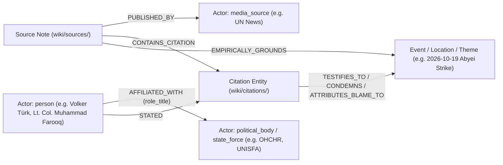

# Implementation Plan: Direct Citations, Quoted Person Actors & Source Outlet Entities

> [!IMPORTANT] Executive Summary
> Following the review of our first Phase 1 draft source note ([[sources/2026-10-23-un-news-sudan-drone-strikes-306-killed]]), this plan extends the **Sudan News & OSINT Knowledge Graph (`wiki/`)** and **ArcadeDB (`news`) multi-model schema** across three dimensions:
> 1. **Quoted Persons as Institutional/Role-Bound Actor Entities (`wiki/actors/`, `type: "actor"`, `subtype: "person"`)**: Every named official, military commander, spokesperson, or key eyewitness cited in `## 3. Bilingual Direct Citations & Forensic Evidence` is extracted as a first-class Actor node (`subtype: "person"`) linked to their parent organization (`[[OHCHR]]`, `[[UNISFA]]`, `[[Sudanese Armed Forces]]`, `[[Rapid Support Forces]]`, etc.) with explicit `role_title` and `affiliated_organization` properties.
> 2. **Direct Citations & Forensic Statements as Standalone Wiki Entities (`wiki/citations/`, `type: "citation"`)**: Key verbatim statements, official condemnations, military communiqués, and eyewitness testimonies in Section 3 are compiled into atomic nodes in a new vault directory **`wiki/citations/`** (`type: "citation"`), connecting the **Speaker (`Actor: person`)**, the **Originating Source (`Source`)**, the **Media Outlet (`Actor: media_source`)**, and the **Referenced Events/Actors/Locations/Themes**.
> 3. **Source Outlet as a First-Class Wiki Entity (`wiki/actors/`, `type: "actor"`, `subtype: "media_source"`)**: Every `source_outlet` declared in a source note's YAML frontmatter (e.g., `[[UN News]]`, `[[Radio Dabanga]]`, `[[Sudan Tribune]]`) is automatically scoped into `actors_to_create` (if not already present in `wiki/actors/`) and compiled as an `Actor` (`subtype: "media_source"`) node tracking editorial alignment, institutional parent, and baseline NATO Admiralty Source Reliability (`A`–`F`).

---

## 1. Relational Graph Architecture Overview



---

## 2. Detailed Specification of the Three Schema Extensions

### 2.1. Extension 1A: Quoted Persons as `Actor` (`subtype: "person"`) Connected to Their Organization & Role

Whenever `## 3. Bilingual Direct Citations & Forensic Evidence` in a source note contains a direct quote or forensic testimony from a named individual:
1. **Scoping Rule (`wiki-scope` & `wiki-ingest` Phase 1)**:
   - Extract the speaker into `actors_to_create` (or `nodes_to_refactor` if the person already exists in `wiki/actors/`).
   - Assign `type: "actor"` and `subtype: "person"`.
   - Record their institutional role and parent entity using two mandatory frontmatter fields for `subtype: "person"` notes:
     - `role_title`: Official title or capacity at the time of the statement (e.g., `"UN High Commissioner for Human Rights"`, `"Spokesperson for the UN High Commissioner for Human Rights"`, `"Acting Force Commander, UNISFA"`, `"Commander, UNISFA Pakistani Battalion"`, `"Trader and Eyewitness at Amiet Market"`).
     - `affiliated_organization`: Canonical wikilink to the parent organization or force in `wiki/actors/` (e.g., `"[[OHCHR]]"`, `"[[UNISFA]]"`, `"[[Sudanese Armed Forces]]"`, `"[[Rapid Support Forces]]"`, or `null` for unaffiliated civilian survivors).
2. **YAML Frontmatter Schema for `wiki/actors/<Person Name>.md` (`subtype: "person"`)**:
   ```yaml
   ---
   title: "Volker Türk"
   type: "actor"
   subtype: "person"
   acled_actor_type: "International Organization / Official"
   role_title: "United Nations High Commissioner for Human Rights"
   affiliated_organization: "[[OHCHR]]"
   leader: null
   allies: []
   opponents: []
   areas_of_operation: ["[[Sudan]]"]
   admiralty_rating: "A2"
   reliability_score: 0.90
   last_updated: 2026-11-01
   tags: [person, un-official, ohchr, human-rights, ihl]
   sources: ["[[sources/2026-10-23-un-news-sudan-drone-strikes-306-killed]]"]
   aliases: ["Mr. Türk", "High Commissioner Volker Türk", "فولكر تورك"]
   ---
   ```
3. **6-Stage Dual-Flow CoT Arc for `Actor` (`subtype: "person"`)**:
   - Uses the canonical 6-stage `Actor` section structure (`1. Identity, Classification & Leadership Anchor`, `2. Historical Lineage, Factions & Command Structure` [covering institutional mandate and reporting chain to `[[OHCHR]]` / `[[UNISFA]]`], `3. Strategic Objectives, Ideology & Political Economy ("Why")`, `4. Operational Capabilities, Alliances & Foreign Backing`, `5. Chronological Event Footprint & Accountability Record` [listing all `[[Citation]]` entities and `[[Event]]` touchpoints], and `## Related Primitives`).

---

### 2.2. Extension 1B: Direct Citations as Standalone Wiki Entities (`wiki/citations/`, `type: "citation"`)

Direct quotes and forensic statements are promoted from embedded blockquotes into standalone, linkable **Citation Entities** in a new top-level vault directory: **`wiki/citations/`**.

1. **Naming Convention**:
   - File path: `wiki/citations/YYYY-MM-DD <Speaker Name> — <Concise Topic Title>.md` (or `YYYY-MM-DD <Speaker Name> on <Topic>.md`, e.g., `wiki/citations/2026-10-23 Volker Türk Condemnation of Sudan Drone Escalation and Arms Influx.md`).
   - Shortest canonical wikilink: `[[2026-10-23 Volker Türk Condemnation of Sudan Drone Escalation and Arms Influx]]`.
2. **YAML Frontmatter Schema (`wiki/citations/*.md`)**:
   ```yaml
   ---
   title: "2026-10-23 Volker Türk Condemnation of Sudan Drone Escalation and Arms Influx"
   type: "citation"
   subtype: "official_statement" # Options: official_statement | eyewitness_testimony | military_communique | forensic_finding | diplomatic_resolution
   speaker: "[[Volker Türk]]"
   speaker_role: "UN High Commissioner for Human Rights"
   affiliated_organization: "[[OHCHR]]"
   source_note: "[[sources/2026-10-23-un-news-sudan-drone-strikes-306-killed]]"
   source_outlet: "[[UN News]]"
   citation_date: 2026-10-23
   original_language: "en" # Options: ar | en | fr | de
   speech_act: "condemnation" # Options: condemnation | attribution_claim | denial | eyewitness_account | casualty_report | ceasefire_call | war_crimes_warning
   events_referenced:
     - "[[2026-10 Sudan Drone Warfare Escalation]]"
   actors_referenced:
     - "[[Sudanese Armed Forces]]"
     - "[[Rapid Support Forces]]"
   locations_referenced: []
   themes_referenced:
     - "[[Drone Proliferation and Double-Tap Strike Doctrine in Sudan]]"
   admiralty_rating: "A2"
   reliability_score: 0.90
   last_updated: 2026-11-01
   tags: [citation, official-statement, ohchr, drone-warfare, arms-embargo, ihl]
   sources: ["[[sources/2026-10-23-un-news-sudan-drone-strikes-306-killed]]"]
   aliases: ["Volker Türk 23 Oct 2026 Statement on Sudan Drone Strikes"]
   ---
   ```
3. **4-Stage Dual-Flow Micro-CoT Section Arc for Citation Notes (`wiki/citations/`)**:
   Every note in `wiki/citations/` follows a concise, forensic 4-stage epistemic arc:
   - **Lead Callout (`> [!QUOTE] Forensic Citation Anchor`)**: Summarizes Speaker, Role, Organization, Date, Source Outlet, Speech Act, and Admiralty Rating.
   - `## 1. Speaker Provenance, Institutional Role & Context` (`CITATION_ANCHOR`) $\to$ establishes `[:STATED]` from `[[Speaker]]` and `[:AFFILIATED_WITH]` to `[[Organization]]`.
   - `## 2. Verbatim Bilingual Citation & Forensic Text` (`VERBATIM_EVIDENCE`) $\to$ preserves the exact English quote and original Arabic/foreign quote in blockquotes.
   - `## 3. Substantive Claims, Event Grounding & Contradiction Impact` (`FORENSIC_GROUNDING`) $\to$ links to the specific `[[Event]]`, `[[Actor]]`, `[[Location]]`, and `[[Theme]]` nodes via `[:TESTIFIES_TO]`, `[:CONDEMNS]`, or `[:ATTRIBUTES_BLAME_TO]`.
   - `## Related Primitives` (`SYNTHESIS_CATALOG`).

---

### 2.3. Extension 2: `source_outlet` as a First-Class Wiki Entity (`wiki/actors/`, `type: "actor"`, `subtype: "media_source"`)

1. **Mandatory Scoping Rule**:
   - Every source note in `wiki/sources/` has `source_outlet: "[[Outlet Name]]"` in its YAML frontmatter.
   - During Phase 1 (`wiki-scope` / `wiki-ingest`), the agent checks whether `wiki/actors/<Outlet Name>.md` exists:
     - If it **does not exist**, `[[Outlet Name]]` (`subtype: "media_source"`) MUST be added to `actors_to_create` in the draft source note.
     - If it **already exists**, `[[Outlet Name]]` is added to `nodes_to_refactor` (to log the newly ingested source in Section 5 `## 5. Chronological Event Footprint & Accountability Record`).
2. **YAML Frontmatter Schema for `wiki/actors/<Outlet Name>.md` (`subtype: "media_source"`)**:
   ```yaml
   ---
   title: "UN News"
   type: "actor"
   subtype: "media_source"
   acled_actor_type: "Media / International Organization"
   parent_organization: "[[United Nations]]"
   editorial_alignment: "international_org" # Options: independent | pro_saf | pro_rsf | state_media | civil_society_err | international_org | osint_verified
   baseline_admiralty_reliability: "A"
   url: "https://news.un.org"
   admiralty_rating: "A1"
   reliability_score: 0.95
   last_updated: 2026-11-01
   tags: [media-source, un, international-org, osint-source]
   sources: ["[[sources/2026-10-23-un-news-sudan-drone-strikes-306-killed]]"]
   aliases: ["UN News Service", "United Nations News", "أخبار الأمم المتحدة"]
   ---
   ```

---

## 3. Updates to the Draft Source Note (`wiki/sources/<source-slug>.md`)

In Phase 1 (`status: "draft"`), the source note schema is extended with:
1. **Frontmatter Target Array**: `citations_to_create` alongside `events_to_create`, `actors_to_create` (which now explicitly includes the `source_outlet` as `subtype: media_source` and quoted individuals as `subtype: person`), `locations_to_create`, `themes_to_create`, and `nodes_to_refactor`.
2. **Section 3 (`## 3. Bilingual Direct Citations & Forensic Evidence`)**:
   - Each blockquote in Section 3 explicitly links to:
     - The **Speaker Actor** (`[[Volker Türk]]`) and their **Organization** (`[[OHCHR]]`).
     - The planned **Standalone Citation Entity** (`[[2026-10-23 Volker Türk Condemnation of Sudan Drone Escalation and Arms Influx]]`).
3. **Section 4 (`## 4. Scoped Ingestion Plan (Pending Approval)`)**:
   - Adds subsection `### 4.5. Candidate New Citations (citations_to_create)` (and shifts `Existing Nodes to Refactor` to `### 4.6`).

### Concrete Preview for `[[sources/2026-10-23-un-news-sudan-drone-strikes-306-killed]]`

When applied to `wiki/sources/2026-10-23-un-news-sudan-drone-strikes-306-killed.md`, the Scoped Ingestion Plan expands to capture the full provenance chain:

| Primitive Category | Planned Wiki Nodes (`status: "draft"` $\to$ Phase 2 Compilation) |
| :--- | :--- |
| **Events (`3`)** | [[2026-10 Sudan Drone Warfare Escalation]], [[2026-10-18 Dibab Double-Tap Drone Strike]], [[2026-10-19 Abyei Amiet Market and Todach Drone Strike]] |
| **Actors — Institutional & Armed (`4`)** | [[Sudanese Armed Forces]] (`state_force`), [[Rapid Support Forces]] (`armed_group`), [[OHCHR]] (`political_body`), [[UNISFA]] (`state_force`) |
| **Actors — Source Outlet (`1`)** | [[UN News]] (`media_source`, `alignment: international_org`) |
| **Actors — Quoted Persons (`5`)** | [[Volker Türk]] (`person` — UN High Commissioner for Human Rights, [[OHCHR]]), [[Seif Magango]] (`person` — Spokesperson, [[OHCHR]]), [[Muhammad Farooq]] (`person` — Lt. Col., Pakistani Battalion Commander, [[UNISFA]]), [[Adebowale Ajabge]] (`person` — Brig. Gen., Acting Force Commander, [[UNISFA]]), [[Angelina Musa Diaw]] (`person` — Civilian Trader & Survivor at Amiet Market, [[Abyei]]) |
| **Standalone Citations (`5`)** | [[2026-10-23 Volker Türk Condemnation of Sudan Drone Escalation and Arms Influx]], [[2026-10-23 Seif Magango Statement on Evisceration of Civilian Infrastructure in Sudan]], [[2026-10-23 Muhammad Farooq First-Responder Account of Amiet Market Fire]], [[2026-10-23 Adebowale Ajabge Report on UNISFA Emergency Response and Todach Evacuations]], [[2026-10-23 Angelina Musa Diaw Survivor Testimony on Amiet Market Destruction]] |
| **Locations (`3`)** | [[West Kordofan]] (`SD18`), [[Blue Nile State]] (`SD17`), [[Abyei]] (`SD18001`) |
| **Themes (`1`)** | [[Drone Proliferation and Double-Tap Strike Doctrine in Sudan]] (`military_doctrine`) |

---

## 4. ArcadeDB (`news`) Multi-Model Graph Schema Extensions

### 4.1. New & Extended Vertex Types (`scripts/bootstrap_arcadedb.py`)

| Vertex Type | New / Updated Properties | Indexes |
| :--- | :--- | :--- |
| **`Citation`** *(New Vertex Type)* | `title` (`STRING`), `subtype` (`STRING`), `speaker` (`STRING`), `speaker_role` (`STRING`), `affiliated_organization` (`STRING`), `source_note` (`STRING`), `source_outlet` (`STRING`), `citation_date` (`STRING`), `original_language` (`STRING`), `speech_act` (`STRING`), `quote_en` (`STRING`), `quote_original` (`STRING`), `admiralty_rating` (`STRING`), `reliability_score` (`DOUBLE`), `last_updated` (`STRING`) | `Citation (title) UNIQUE`, `Citation (citation_date) NOTUNIQUE`, `Citation (speech_act) NOTUNIQUE` |
| **`Actor`** *(Extended Properties)* | Add `role_title` (`STRING`), `affiliated_organization` (`STRING`), `editorial_alignment` (`STRING`), `baseline_admiralty_reliability` (`STRING`) | Existing `Actor (title) UNIQUE` |

### 4.2. New & Extended Edge Types (`scripts/bootstrap_arcadedb.py` & `scripts/ingest_to_arcadedb.py`)

| Edge Type | Source Vertex $\to$ Target Vertex | Properties & Semantics |
| :--- | :--- | :--- |
| **`PUBLISHED_BY`** | `Source` $\to$ `Actor` (`subtype: 'media_source'`) | Links every source note to its publishing `source_outlet` entity (`[[UN News]]`). |
| **`AFFILIATED_WITH`** | `Actor` (`subtype: 'person'`) $\to$ `Actor` (`organization / force`) | Links a quoted person (`[[Volker Türk]]`) to their institution (`[[OHCHR]]`) with `role_title`. |
| **`CONTAINS_CITATION`** | `Source` $\to$ `Citation` | Links a source note to each standalone `Citation` entity extracted from Section 3. |
| **`STATED`** | `Actor` (`subtype: 'person'`) $\to$ `Citation` | Links the speaker (`[[Volker Türk]]`) to the `Citation` they uttered. |
| **`TESTIFIES_TO`** | `Citation` $\to$ `Event \| Location \| Theme \| Actor` | Connects a `Citation` to the conflict events, actors, locations, or themes it documents or condemns (`speech_act` property). |

---

## 5. File-by-File Implementation Checklist

| # | File Path | Planned Modification |
| :--- | :--- | :--- |
| **1** | `wiki/citations/` & [wiki/index.md](file:///Users/christoflitznerski/MyObsidian/news01/llm-wiki-news/wiki/index.md) | Create `wiki/citations/` directory and add `## Citations (wiki/citations/)` section to `wiki/index.md`. |
| **2** | [AGENTS.md](file:///Users/christoflitznerski/MyObsidian/news01/llm-wiki-news/AGENTS.md) | Add `wiki/citations/` (`type: "citation"`) to Section 1.2, Section 2 (Directory Topography), Section 1.9 (4-stage Citation Micro-CoT & `[:PUBLISHED_BY]`, `[:AFFILIATED_WITH]`, `[:STATED]`, `[:CONTAINS_CITATION]`, `[:TESTIFIES_TO]` edges), Section 3 (Frontmatter schemas for `citation`, `actor: person`, and `actor: media_source`), and Section 4 (Protocol A). |
| **3** | [.agent/skills/wiki-scope/SKILL.md](file:///Users/christoflitznerski/MyObsidian/news01/llm-wiki-news/.agent/skills/wiki-scope/SKILL.md) & [.agent/skills/wiki-ingest/SKILL.md](file:///Users/christoflitznerski/MyObsidian/news01/llm-wiki-news/.agent/skills/wiki-ingest/SKILL.md) | Update scoping and ingestion rules so that: (a) `source_outlet` is always scoped as an `Actor` (`subtype: media_source`), (b) named speakers in Section 3 are scoped as `Actor` (`subtype: person`) with `role_title` and `affiliated_organization`, and (c) key direct quotes are scoped into `citations_to_create` (`wiki/citations/`). |
| **4** | [scripts/bootstrap_arcadedb.py](file:///Users/christoflitznerski/MyObsidian/news01/llm-wiki-news/scripts/bootstrap_arcadedb.py) & [scripts/ingest_to_arcadedb.py](file:///Users/christoflitznerski/MyObsidian/news01/llm-wiki-news/scripts/ingest_to_arcadedb.py) | Add `Citation` vertex type, `Actor.role_title`, `Actor.affiliated_organization`, and `PUBLISHED_BY`, `AFFILIATED_WITH`, `CONTAINS_CITATION`, `STATED`, `TESTIFIES_TO` edge types; update `ingest_to_arcadedb.py` to scan `wiki/citations/` and materialize all citation/person/outlet edges. |
| **5** | [scripts/lint_vault.py](file:///Users/christoflitznerski/MyObsidian/news01/llm-wiki-news/scripts/lint_vault.py) & [scripts/extract_dual_flow_cot.py](file:///Users/christoflitznerski/MyObsidian/news01/llm-wiki-news/scripts/extract_dual_flow_cot.py) | Add `citation` frontmatter validation (`["subtype", "speaker", "source_note", "citation_date", "admiralty_rating"]`), disallow `wiki/citations/` or `citations/` link prefixes (enforcing shortest canonical link), and add 4-stage `Citation` CoT validation. |
| **6** | [site/src/config/wiki.config.ts](file:///Users/christoflitznerski/MyObsidian/news01/llm-wiki-news/site/src/config/wiki.config.ts) & [site/src/content.config.ts](file:///Users/christoflitznerski/MyObsidian/news01/llm-wiki-news/site/src/content.config.ts) | Add `'citations'` to `includedFolders` in `wiki.config.ts` and add `speaker`, `speaker_role`, `affiliated_organization`, `speech_act`, and `citation_date` to the Astro Zod schema. |
| **7** | [wiki/sources/2026-10-23-un-news-sudan-drone-strikes-306-killed.md](file:///Users/christoflitznerski/MyObsidian/news01/llm-wiki-news/wiki/sources/2026-10-23-un-news-sudan-drone-strikes-306-killed.md) | Refactor the draft source note to include `[[UN News]]` (`media_source`), the 5 quoted `person` actors (`[[Volker Türk]]`, `[[Seif Magango]]`, `[[Muhammad Farooq]]`, `[[Adebowale Ajabge]]`, `[[Angelina Musa Diaw]]`), and the 5 standalone `citations_to_create` in Section 3 and Section 4. |
