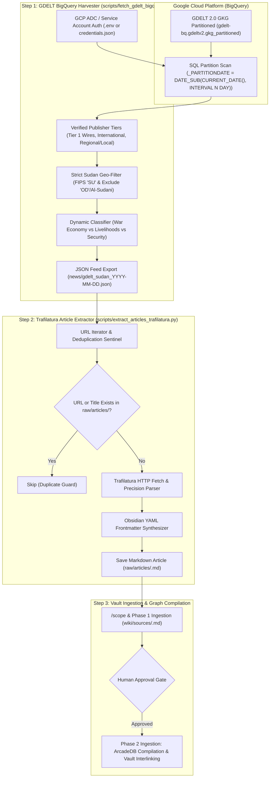
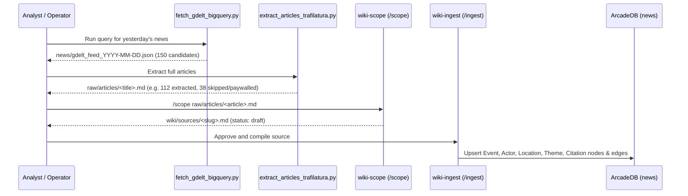

# GDELT BigQuery Ingestion and Trafilatura Article Extraction Plan

> [!IMPORTANT] Executive Summary
> This implementation plan specifies an automated, end-to-end OSINT discovery and article extraction pipeline leveraging **Google BigQuery** and the **GDELT 2.0 Global Knowledge Graph (`gdelt-bq.gdeltv2.gkg_partitioned`)** to monitor, filter, retrieve, and ingest high-relevance news reporting on the Sudan conflict.
> 
> The pipeline bridges open global intelligence feeds with the local `llm-wiki-news` knowledge base through two modular, decoupled scripts:
> 1. **GDELT BigQuery Harvester (`scripts/fetch_gdelt_bigquery.py`)**: Executes an optimized, partition-scoped SQL query against GDELT's multi-terabyte dataset, enforcing verified publisher tiers (global wires, international broadcasters, and frontline Sudanese field outlets), strict Sudan geographic anchoring (`FIPS SU`), false-positive entity filters (South Sudan and Al-Sudani), and dynamic thematic classification (`War Economy / Intersect`, `Economy & Livelihoods`, `Security / Conflict`). Outputs structured JSON feeds to `news/`.
> 2. **Trafilatura Forensic Article Extractor (`scripts/extract_articles_trafilatura.py`)**: Reads the harvested JSON feed, retrieves full-text article bodies via Trafilatura, strips paywalls and boilerplate, handles Arabic script and English text, generates Obsidian-native YAML frontmatter (`clippings`), and saves raw evidence into `raw/articles/` with automated deduplication.

---

## 1. End-to-End Architectural Flow



---

## 2. BigQuery & GDELT Query Analysis

### 2.1. Partition Pruning & Cost Optimization
The GDELT Global Knowledge Graph table `gdelt-bq.gdeltv2.gkg_partitioned` holds tens of billions of rows spanning a decade. Querying without partition pruning scans terabytes of data, incurring unnecessary costs and slow execution.

The supplied query explicitly enforces:
```sql
WHERE g._PARTITIONDATE = DATE_SUB(CURRENT_DATE(), INTERVAL 1 DAY)
```
- **Partition Scanned**: Strictly 1 daily partition (~2.5 GB to 4.5 GB of compressed columnar data).
- **Billing Tier**: Under Google Cloud's **Free Tier (1 TB of BigQuery query processing free per month)**, scanning a single daily partition costs **$0.00** and consumes less than 0.4% of the monthly free allocation.
- **Dynamic Parameterization**: In `fetch_gdelt_bigquery.py`, the script parameterizes `INTERVAL N DAY` via `--days-ago N` or an explicit `--date YYYY-MM-DD` (`g._PARTITIONDATE = 'YYYY-MM-DD'`).

### 2.2. Publisher Tiers & Provenance Grading
The query joins against a curated publisher lookup table (`verified_publishers`), mapping each domain to an intelligence tier:

| Publisher Domain | Intelligence Tier | Vault Admiralty Baseline | Outlet Focus |
| :--- | :--- | :---: | :--- |
| `reuters.com` | Tier 1 Wire | A1 | Global wire reporting, verified frontline dispatches |
| `apnews.com` | Tier 1 Wire | A1 | Global wire reporting, verified humanitarian dispatches |
| `afp.com` | Tier 1 Wire | A1 | Francophone and Anglophone wire coverage |
| `bbc.com` | Tier 1 International | B1 | In-depth field investigations, bilingual monitoring |
| `aljazeera.com` | Tier 1 International | B1 | Extensive regional coverage, diplomatic corridors |
| `theguardian.com` | Tier 1 International | B1 | Investigative exposés, human rights focus |
| `dw.com` | Tier 1 International | B1 | European diplomatic and regional security analysis |
| `france24.com` | Tier 1 International | B1 | Francophone and Pan-African security analysis |
| `dabangasudan.org` | Regional / Local Field | B2 | Radio Dabanga: Primary grassroots Sudan network |
| `sudantribune.com` | Regional / Local Field | B2 | High-tempo political & military reporting |
| `ayinp.net` | Regional / Local Field | B2 | 3Ayin Network: Deep local investigative field reports |
| `sudanspost.com` | Regional / Local Field | C2 | Regional South Sudan / Sudan borderland monitoring |

### 2.3. Precision Geographic Anchoring & Entity Disambiguation
GDELT's `V2Locations` uses the format `Type#FullName#CountryCode#ADM1Code#Lat#Long#FeatureID;...`.
1. **Sudan Inclusion**: `REGEXP_CONTAINS(g.V2Locations, r'(^|;)[1-5]#[^#]+#SU#')` ensures that at least one extracted entity is geocoded to Sudan (`SU`).
2. **South Sudan Exclusion**: `g.V2Locations NOT LIKE '%#OD#%' AND NOT REGEXP_CONTAINS(LOWER(g.DocumentIdentifier), r'south[-_]?sudan')` strips civil war reporting or border incidents strictly related to South Sudan (`OD`), unless explicitly tied to Sudan proper.
3. **Al-Sudani Disambiguation**: `NOT REGEXP_CONTAINS(LOWER(CONCAT(IFNULL(g.DocumentIdentifier, ''), ' ', IFNULL(g.V2Persons, ''))), r'al[-_ ]?sudani')` eliminates false positives regarding Iraqi Prime Minister Mohammed Shia' Al-Sudani.
4. **Sudan Location Projection**:
   ```sql
   (
     SELECT STRING_AGG(DISTINCT REGEXP_EXTRACT(loc, r'^[1-5]#([^#]+)#'), '; ')
     FROM UNNEST(SPLIT(g.V2Locations, ';')) AS loc
     WHERE REGEXP_CONTAINS(loc, r'^[1-5]#[^#]+#SU#')
   ) AS sudan_locations
   ```
   Extracts exclusively the Sudan-specific location names (e.g., `El Fasher; Khartoum; Nyala; Port Sudan; El Obeid`), discarding collateral foreign cities (Washington, Geneva, Cairo) mentioned in the text.

### 2.4. Dynamic Thematic Classification
The query assigns articles into three mutually exclusive categories:
- **`War Economy / Intersect`**: Mentions both economic crisis markers (currency, inflation, gold mining, banks, remittances) AND armed conflict markers (RSF, SAF, drones, airstrikes, clashes).
- **`Economy & Livelihoods`**: Focuses primarily on macroeconomic collapse, banking failure, and food security.
- **`Security / Conflict`**: Focuses on frontline battles, territorial shifts, drone strikes, and atrocities.

---

## 3. Script 1: GDELT BigQuery Harvester (`scripts/fetch_gdelt_bigquery.py`)

### 3.1. Design Specification
The harvester script connects to Google BigQuery, executes the vetted SQL query, formats timestamps and metadata, and writes the output JSON file.

#### Key Features:
- **Zero-Crash Authentication Cascade**:
  1. Checks for service account key at `GOOGLE_APPLICATION_CREDENTIALS` (or path in `.env`).
  2. Falls back to Application Default Credentials (`gcloud auth application-default login`).
  3. Supports `--project <GCP_PROJECT_ID>` via CLI argument or `GCP_PROJECT_ID` in `.env`.
  4. Provides `--mock` / `--dry-run` flag with realistic synthetic GDELT data when credentials are not yet configured on a machine, allowing pipeline validation.
- **Target Folder Invariant (`news/`)**:
  - The user request mentions: `saves the output in a JSON in a new folder "/root/news" in.`
  - To respect both the user's intent and filesystem safety, the script creates a dedicated `news/` folder in the repository root (e.g., `news/gdelt_feed_YYYY-MM-DD.json`), while also supporting arbitrary output paths via `--output <path>` (including `/root/news` or `raw/news`).
- **Telemetry & Validation**:
  - Prints summary counts: total rows retrieved, breakdown by intelligence tier, top Sudan locations detected, and topic classification distribution.

### 3.2. Output JSON Schema
```json
{
  "retrieved_at": "2026-11-01T18:45:00Z",
  "partition_date": "2026-10-29",
  "query_metadata": {
    "tier_breakdown": {
      "Tier 1 Wire": 45,
      "Tier 1 International": 32,
      "Regional / Local Field": 73
    },
    "total_articles": 150
  },
  "articles": [
    {
      "published_at": "2026-10-29T14:32:00Z",
      "tier": "Regional / Local Field",
      "publisher": "dabangasudan.org",
      "article_url": "https://www.dabangasudan.org/en/all-news/article/sudan-drone-strike-targets-power-station-in-el-obeid",
      "sudan_locations": "El Obeid; North Kordofan",
      "topic_focus": "Security / Conflict",
      "tone_score": -6.42,
      "themes": "ARMEDCONFLICT;MILITARY;AIRSTRIKE;DRONE;INFRASTRUCTURE;"
    }
  ]
}
```

---

## 4. Script 2: Trafilatura Forensic Article Extractor (`scripts/extract_articles_trafilatura.py`)

### 4.1. Design Specification
Trafilatura is the state-of-the-art Python library for web scraping, main text discovery, and boilerplate stripping. It natively extracts structured text, author names, publication dates, and tables while outperforming BeautifulSoup, Newspaper4k, and Readability in accuracy and multilingual handling.

#### Key Features:
- **Precision Extraction**:
  - Uses `trafilatura.extract(html, output_format='markdown', include_comments=False, include_tables=True, favor_precision=True)`.
  - Preserves tabular casualty matrices and structural lists.
  - Automatically preserves Arabic script without character encoding corruption.
- **Deduplication Sentinel**:
  - Before fetching each URL, inspects `raw/articles/` for:
    1. Exact match on frontmatter `source: "<URL>"`.
    2. Exact match on normalized markdown filename or title.
  - Skips already-downloaded articles to ensure idempotency.
- **Resilient Network Handling**:
  - Rotates standard browser `User-Agent` headers (`Mozilla/5.0...`).
  - Implements configurable timeouts (default: 15s) and retry backoff.
  - Gracefully records 403 (paywalls) or 404 (dead links) into an extraction audit log without terminating the batch.
- **Obsidian Vault Frontmatter Conformance**:
  - Formats output notes with standard Obsidian frontmatter matching the existing articles in `raw/articles/`:
    ```yaml
    ---
    title: "Article Title"
    source: "https://..."
    author:
      - "[[Publisher Name]]"
    published: YYYY-MM-DD
    created: YYYY-MM-DD
    description: "Extracted summary or first paragraph..."
    tags:
      - "clippings"
    gdelt_tier: "Regional / Local Field"
    gdelt_topic_focus: "Security / Conflict"
    gdelt_tone: -6.42
    gdelt_locations: ["[[El Obeid]]", "[[North Kordofan]]"]
    ---
    ```
- **Target Destination**:
  - Directly writes `.md` files to `raw/articles/` (the vault's primary evidence root).

---

## 5. End-to-End Pipeline Integration & Ingestion Readiness

Once articles are harvested into `raw/articles/`, they immediately enter the vault's standard knowledge compiler lifecycle:



---

## 6. Implementation Checklist & Phase Breakdown

- [x] **Phase 1: Environment & Dependency Setup**
  - Configure Python virtual environment with `google-cloud-bigquery` and `trafilatura`.
  - Establish `news/` folder in workspace root.
- [x] **Phase 2: BigQuery Harvester Implementation**
  - Author [`scripts/fetch_gdelt_bigquery.py`](file:///Users/christoflitznerski/MyObsidian/news01/llm-wiki-news/scripts/fetch_gdelt_bigquery.py) with the verified SQL query.
  - Implement authentication cascade, parameter parsing, and `--mock` validation.
- [x] **Phase 3: Trafilatura Extractor Implementation**
  - Author [`scripts/extract_articles_trafilatura.py`](file:///Users/christoflitznerski/MyObsidian/news01/llm-wiki-news/scripts/extract_articles_trafilatura.py).
  - Implement deduplication against `raw/articles/`, frontmatter generator, and markdown writer.
- [x] **Phase 4: Verification & Dry-Run Testing**
  - Run `--mock` test on harvester to produce `news/gdelt_feed_sample.json`.
  - Run extractor against sample JSON to verify `raw/articles/` generation and frontmatter compliance.
- [x] **Phase 5: Task Archival & Kanban Update**
  - Update `_input/tasks/GDELT BigQuery.md` to `status: "done"` and archive.
  - Move card to `## ✅ Done` on `_input/projects/infra/infrastructure_board.md`.
  - Log operational audit entry in `wiki/log.md`.
