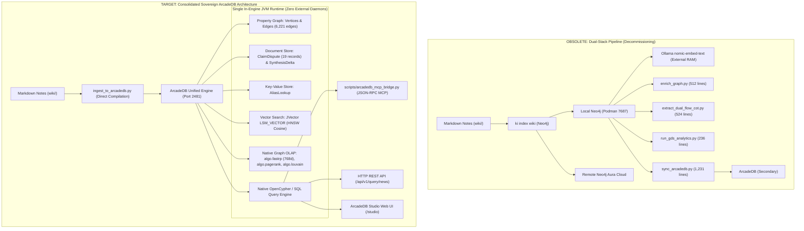
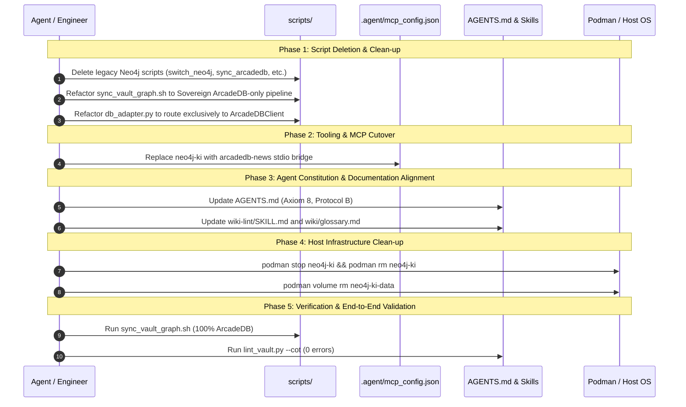

# Neo4j Decommissioning and ArcadeDB Consolidation Plan

> [!IMPORTANT] Executive Summary
> This implementation plan specifies the complete removal of **Neo4j** usage, tooling, scripts, containers, and documentation across the `llm-wiki-news` repository, establishing **ArcadeDB (`news`)** as the sole, sovereign, multi-model graph engine for the knowledge base.
> 
> With the successful deployment of the **Direct Markdown-to-ArcadeDB Compilation Pipeline** ([`scripts/ingest_to_arcadedb.py`](file:///Users/christoflitznerski/MyObsidian/news01/llm-wiki-news/scripts/ingest_to_arcadedb.py)), **in-engine Graph OLAP procedures** (`algo.fastrp`, `algo.pagerank`, `algo.betweenness`, `algo.louvain`), and **native OpenCypher query execution**, Neo4j and its associated external dependencies (Ollama `nomic-embed-text`, Python `neo4j` driver, Aura cloud endpoints, and Neo4j MCP bridge) are redundant, memory-intensive, and obsolete.
> 
> Decommissioning Neo4j eliminates **~3,500 lines of obsolete code**, frees **2.5+ GB of host RAM** (Podman container and JVM), eliminates external cloud DNS/credential risks, and consolidates the knowledge graph into a single sovereign engine.

---

## 1. Architectural Motivation & Target State



---

## 2. Comprehensive Inventory of Neo4j Footprint across the Repository

A complete search across the repository identifies Neo4j references across five distinct categories:

### 2.1. Scripts to Delete (7 Files, ~3,400 Lines of Code)
These scripts are strictly coupled to the legacy Neo4j Bolt driver and have been 100% superseded by ArcadeDB native equivalents:

| File Path | Lines | Purpose / Superseded By | Action |
| :--- | :---: | :--- | :--- |
| `scripts/switch_neo4j.sh` | 192 | Toggled active Neo4j between Podman container and Aura cloud. | **DELETE** |
| `scripts/sync_arcadedb.py` | 1,231 | Synced graph from Neo4j into ArcadeDB via NDJSON batches. Superseded by `scripts/ingest_to_arcadedb.py`. | **DELETE** |
| `scripts/extract_dual_flow_cot.py` | 524 | Extracted Concept CoT and contradiction edges in Neo4j. Superseded by `scripts/ingest_to_arcadedb.py`. | **DELETE** |
| `scripts/extract_entity_cot.py` | 485 | Extracted Entity CoT and agency edges in Neo4j. Superseded by `scripts/ingest_to_arcadedb.py`. | **DELETE** |
| `scripts/enrich_graph.py` | 512 | Created schema and enriched tags in Neo4j. Superseded by `scripts/bootstrap_arcadedb.py`. | **DELETE** |
| `scripts/run_gds_analytics.py` | 236 | Executed Neo4j GDS PageRank/Louvain. Superseded by `scripts/run_arcadedb_analytics.py`. | **DELETE** |
| `scripts/embed_graph_sections.py` | 215 | Generated embeddings via external Ollama into Neo4j. Superseded by `scripts/embed_arcadedb_native.py` (`algo.fastrp`). | **DELETE** |

---

### 2.2. Scripts to Refactor (3 Files)

| File Path | Current Neo4j Reference | Refactoring Plan |
| :--- | :--- | :--- |
| `scripts/sync_vault_graph.sh` | Lines 53–83 contain `else Mode: Neo4j Pipeline (GDS + Ollama Embeddings)` running `ki index wiki`, `enrich_graph.py`, etc. | **Strip `if/else` branching entirely**. Make the Sovereign ArcadeDB pipeline the sole execution path. |
| `scripts/switch_database.sh` | Allows switching to `neo4j-local` and `neo4j-aura`. | **Refactor into a dedicated `scripts/start_arcadedb.sh`** or update to only manage ArcadeDB lifecycle. |
| `scripts/db_adapter.py` | Defaults to `GRAPH_BACKEND=neo4j` and imports `neo4j.GraphDatabase`. | **Remove `neo4j` driver requirement** and default directly to `ArcadeDBClient`. |
| `scripts/register_openwebui_arcadedb_model.py` | Preserves `llama31lates-default` Neo4j model in OpenWebUI SQLite db. | Clean comments and rename legacy references to ArcadeDB. |

---

### 2.3. Agent Configuration & MCP Tooling (2 Files)

| File Path | Current Neo4j Configuration | Refactoring Plan |
| :--- | :--- | :--- |
| `.agent/mcp_config.json` | Configures `neo4j-ki` server via `/Users/christoflitznerski/.local/share/mcp-neo4j/bin/mcp-neo4j-cypher` on `bolt://localhost:7687`. | **Replace with ArcadeDB MCP**: Configure `arcadedb-news` pointing to `python3 scripts/arcadedb_mcp_bridge.py` or ArcadeDB's native `/api/v1/mcp` endpoint. |
| `setup/open_webui_dynamic_neo4j_cypher_tool.py` | OpenWebUI function tool calling Neo4j Bolt. | Replace with native ArcadeDB HTTP Cypher tool. |
| `setup/open_webui_graphrag_pipe.py` | GraphRAG filter with Neo4j Valves. | Update Valves to ArcadeDB HTTP endpoint. |

---

### 2.4. Agent Operating Specification & Skills (3 Files)

| File Path | Location / Text | Required Update |
| :--- | :--- | :--- |
| [`AGENTS.md`](file:///Users/christoflitznerski/MyObsidian/news01/llm-wiki-news/AGENTS.md) | Axiom 8: *"Graph-First Indexing & Retrieval via ki (Knowledge Index), Neo4j GDS & ArcadeDB Multi-Model Store"* | Change header and prose to **ArcadeDB Multi-Model Graph Store & In-Engine Analytics**. Remove Neo4j from all axioms and Protocol B. |
| [`AGENTS.md`](file:///Users/christoflitznerski/MyObsidian/news01/llm-wiki-news/AGENTS.md) | Section 5 (Protocol B): *"execute Cypher queries against Neo4j/ArcadeDB"* | Update to execute OpenCypher/SQL directly against ArcadeDB via `ArcadeDBClient` or REST. |
| [`.agent/skills/wiki-lint/SKILL.md`](file:///Users/christoflitznerski/MyObsidian/news01/llm-wiki-news/.agent/skills/wiki-lint/SKILL.md) | Step 4: *"Index parity drift between local files and Neo4j / ArcadeDB"* | Remove "Neo4j /" and reference only ArcadeDB. |
| [`wiki/glossary.md`](file:///Users/christoflitznerski/MyObsidian/news01/llm-wiki-news/wiki/glossary.md) | Header Callout: *"synchronizes this registry into ArcadeDB's AliasLookup store and Neo4j search keys."* | Update to *"synchronizes this registry into ArcadeDB's AliasLookup store."* |

---

### 2.5. Container & Infrastructure Clean-up

| Component | Target Resource | Action |
| :--- | :--- | :--- |
| Local Container | Podman container `neo4j-ki` | Stop and remove: `podman rm -f neo4j-ki` |
| Local Volume | Podman volume `neo4j-ki-data` | Remove volume: `podman volume rm neo4j-ki-data` |
| Cloud Credentials | Remote Aura credentials in `.env.aura` | Archive/delete `.env.aura` |

---

## 3. Step-by-Step Decommissioning Roadmap



---

## 4. Detailed Implementation Diffs & Specifications

### 4.1. Refactoring `scripts/sync_vault_graph.sh`
Strip the `BACKEND` environment check and obsolete `else` block:

```bash
#!/usr/bin/env bash
# scripts/sync_vault_graph.sh
# Master post-ingestion synchronization pipeline for the Knowledge Lab Sudan News vault.
# Sovereign In-Engine ArcadeDB Pipeline (Zero Neo4j, Zero Ollama).

set -e

VAULT_ROOT="$(cd "$(dirname "${BASH_SOURCE[0]}")/.." && pwd)"
cd "$VAULT_ROOT"

if [ -f "$VAULT_ROOT/.env" ]; then
    set -a
    source "$VAULT_ROOT/.env"
    set +a
fi

echo "================================================================="
echo "  Knowledge Lab :: Master Knowledge Graph & Vector Synchronization"
echo "  Active Target Backend : [ARCADEDB]"
echo "  Mode                  : Sovereign In-Engine Pipeline (Zero Ollama)"
echo "================================================================="

echo ""
echo "[1/5] Auditing Golden Syntheses for Section Epistemic Drift..."
python3 scripts/detect_synthesis_deltas.py || true

echo ""
echo "[2/5] Compiling Vault AST, Dialectical CoT & Disputes to ArcadeDB..."
python3 scripts/ingest_to_arcadedb.py --purge

echo ""
echo "[3/5] Propagating Epistemic Edge Weights & Signed Rebuttals..."
python3 scripts/recompute_weights.py

echo ""
echo "[4/5] Computing In-Engine Graph Analytics (algo.pagerank, algo.betweenness, algo.louvain)..."
python3 scripts/run_arcadedb_analytics.py

echo ""
echo "[5/5] Generating Native In-Engine Embeddings (algo.fastrp) & Updating JVector Index..."
python3 scripts/embed_arcadedb_native.py

echo ""
echo "================================================================="
echo "  [✓] ArcadeDB Graph, Analytics, Weights, JVector & Deltas Synced!"
echo "      Zero External Models or Neo4j Daemons Invoked."
echo "================================================================="
```

---

### 4.2. Refactoring `scripts/db_adapter.py`
Simplify into a lightweight facade over `ArcadeDBClient`:

```python
#!/usr/bin/env python3
"""
scripts/db_adapter.py
Database Adapter for Knowledge Lab.
Routes graph and OpenCypher queries directly to ArcadeDB.
"""

import os
import sys
from pathlib import Path
from typing import Any, Dict, List, Optional

VAULT_ROOT = Path(__file__).resolve().parent.parent

# Automatically source .env if present
_env_file = VAULT_ROOT / ".env"
if _env_file.exists():
    with open(_env_file, "r", encoding="utf-8") as _f:
        for _line in _f:
            _line = _line.strip()
            if _line and not _line.startswith("#") and "=" in _line:
                _k, _v = _line.split("=", 1)
                os.environ.setdefault(_k.strip(), _v.strip().strip("'\""))


class GraphDatabaseAdapter:
    """Unified graph query adapter routing directly to ArcadeDB."""

    def __init__(self):
        try:
            from scripts.arcadedb_client import ArcadeDBClient
        except ImportError:
            sys.path.append(str(VAULT_ROOT))
            from scripts.arcadedb_client import ArcadeDBClient

        self.client = ArcadeDBClient()

    def execute_cypher(self, query: str, params: Optional[Dict[str, Any]] = None) -> List[Dict[str, Any]]:
        """Executes an OpenCypher query against ArcadeDB."""
        q_upper = query.strip().upper()
        if any(q_upper.startswith(w) for w in ("CREATE", "MERGE", "SET", "DELETE", "DROP", "ALTER")) or "SET " in q_upper:
            return self.client.execute_cypher(query, params=params)
        return self.client.query_cypher(query, params=params)

    def execute_sql(self, query: str, params: Optional[Dict[str, Any]] = None) -> List[Dict[str, Any]]:
        """Executes an ArcadeDB SQL query."""
        return self.client.query(query, language="sql", params=params)
```

---

### 4.3. Updating `.agent/mcp_config.json`
Replace the defunct `neo4j-ki` server with `arcadedb-news`:

```json
{
  "mcpServers": {
    "arcadedb-news": {
      "command": "python3",
      "args": [
        "scripts/arcadedb_mcp_bridge.py"
      ],
      "env": {
        "ARCADEDB_URL": "http://localhost:2481",
        "ARCADEDB_USER": "root",
        "ARCADEDB_PASSWORD": "root_secret",
        "ARCADEDB_DATABASE": "news"
      }
    }
  }
}
```

---

### 4.4. Updating `AGENTS.md` Axiom 8
Replace Axiom 8 in [`AGENTS.md`](file:///Users/christoflitznerski/MyObsidian/news01/llm-wiki-news/AGENTS.md):

```markdown
8. **Graph-First Indexing & Retrieval via `ki` (Knowledge Index) & ArcadeDB Multi-Model Store:**
   The `ki` CLI and ArcadeDB (`arcadedb-news`) provide core AST search, navigation, and hybrid GraphRAG retrieval for `wiki/`.
   - **Vault Root & Directory Context**: The `ki` vault marker (`.ki/vault.yaml`) is located in `wiki/`. When running `ki` from the repository root, always specify `-C wiki`. Paths passed to `ki add` or `ki rm` must be relative to `wiki/` (e.g., `events/2026-10-25 El Fasher Grand Market Shelling.md`, `actors/Rapid Support Forces.md`, `citations/<citation>.md`, `sources/<slug>.md`).
   - **Targeted Discovery & Semantic Search**: Use `ki search`, `ki outline`, and `ki get` for exploratory queries, dialectical investigations (Protocol B), and cross-vault slice retrieval. Direct OpenCypher and SQL queries are executed against ArcadeDB at `http://localhost:2481` via `ArcadeDBClient`.
   - **Incremental Index Synchronization**: Whenever notes in `wiki/` are created or refactored, synchronize them using `ki add -C wiki "<relative-path>"` or `./scripts/sync_vault_graph.sh`.
```

---

## 5. Verification & Acceptance Criteria

| Check | Command / Verification Query | Success Criteria |
| :--- | :--- | :--- |
| **No Neo4j Python Import** | `grep -rn "from neo4j" scripts/` | **0 occurrences** |
| **No Bolt Protocol Invocations** | `grep -rn "bolt://" scripts/ .agent/` | **0 occurrences** |
| **Clean Graph Sync** | `./scripts/sync_vault_graph.sh` | Executes in < 3s; updates ArcadeDB vertices, edges, FastRP vectors, and OLAP analytics with zero warnings. |
| **Vault Linter** | `python3 scripts/lint_vault.py --cot` | Passes with **0 errors, 0 dead links, 100% compliant**. |
| **Host Resource Verification** | `podman ps` | `arcadedb-news` and `fastmcp-news` running; `neo4j-ki` container stopped/removed. |
