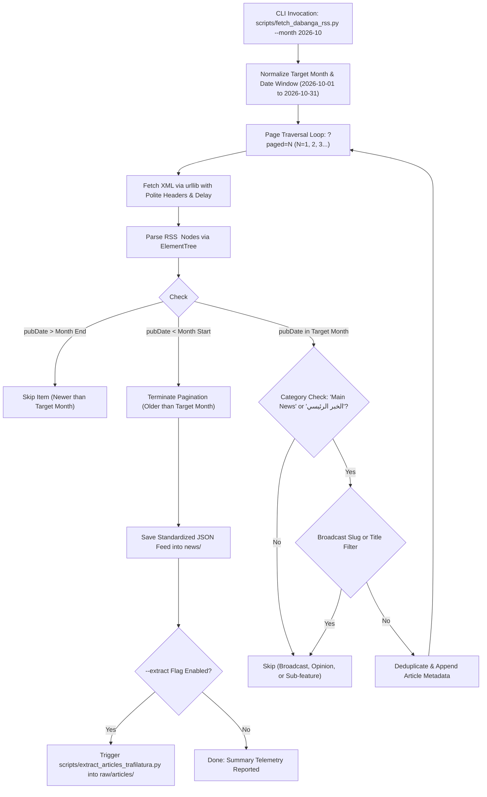

# Radio Dabanga RSS Feed Article Collector Architecture & Implementation Plan

> [!NOTE] Deliverable Specification
> **Task**: `_input/tasks/Dabanga RSS feed.md`
> **Artifact**: `scripts/fetch_dabanga_rss.py`
> **Target Feed**: `https://www.dabangasudan.org/ar/feed`
> **Primary Filter**: `<category><![CDATA[Main News]]></category>` (and Arabic equivalent `<category><![CDATA[الخبر الرئيسي]]></category>`) for a selected month.
> **Output Destination**: `news/`

---

## 1. Problem Statement & Functional Requirements

The knowledge repository requires a specialized collector targeting the official RSS syndication feed of Radio Dabanga (`https://www.dabangasudan.org/ar/feed`). Unlike broad search-and-filter HTML scrapers, RSS provides structured XML items with canonical publication timestamps (`<pubDate>`), author tags, category CDATA tags, and permalinks.

Key requirements:
1. **Feed Pagination**: Dabanga's WordPress engine exposes paginated RSS feeds via `https://www.dabangasudan.org/ar/feed/?paged=N`. The script must sequentially traverse pages from page 1 backwards in time.
2. **Date Filtering by Selected Month**: The user can specify any month (e.g. `--month 2026-10`, `--month 2026-11`, or `-m 10 -y 2026`). The collector must parse RFC 2822 timestamps (`email.utils.parsedate_to_datetime`), accept articles strictly within `YYYY-MM-01T00:00:00Z` to `YYYY-MM-{last_day}T23:59:59Z`, and safely terminate pagination when it reaches articles published prior to the target month.
3. **Category Filtering (`Main News` / `الخبر الرئيسي`)**: Radio Dabanga tags top investigative and hard-news reporting with `<category><![CDATA[الخبر الرئيسي]]></category>` (which translates directly to "Main News" in English). Broadcast audio bulletins (e.g. `نشرة الأخبار`, `السودان الآن+`, `podcast`) do not carry this category tag. The script must filter for items tagged with "Main News" or "الخبر الرئيسي" while rejecting broadcast audio/video pages.
4. **Output Storage in `news/`**: The collected articles and metadata must be serialized into a standardized feed JSON format in `news/` (e.g. `news/dabanga_rss_main_news_YYYYMM_<timestamp>.json`), fully compatible with `scripts/extract_articles_trafilatura.py` and `scripts/staging_queue.py`.
5. **Integrated Trafilatura Extraction**: An optional `--extract` flag should immediately invoke `scripts/extract_articles_trafilatura.py` to extract full text into `raw/articles/` and update the staging queue.

---

## 2. Technical Design & Architecture

---

## 3. Implementation Steps

1. **Create `scripts/fetch_dabanga_rss.py`**:
   - Implement argument parsing (`--month`, `--category`, `--lang`, `--feed-url`, `--max-pages`, `--delay`, `--extract`, `--dry-run`).
   - Implement robust XML parsing with CDATA handling and RFC 2822 date conversion.
   - Implement category matching with dual Arabic/English synonym mapping (`Main News` $\leftrightarrow$ `الخبر الرئيسي`).
   - Implement slug and title exclusion filters for broadcast radio and audio bulletins.
   - Implement standard JSON output serialization into `news/`.
2. **Test & Verify**:
   - Execute dry run and live run against October and November 2026 feeds.
   - Verify category filtering isolates news articles from broadcast audio/video pages.
   - Verify that output JSON validates against `scripts/extract_articles_trafilatura.py`.
3. **Update Documentation & Operational Queue**:
   - Update `README.md` with CLI usage instructions.
   - Update task file `_input/tasks/Dabanga RSS feed.md` to `status: "done"`, move to `_input/tasks/archived/`.
   - Update Kanban board `_input/projects/infra/infrastructure_board.md` moving card to `Done`.
