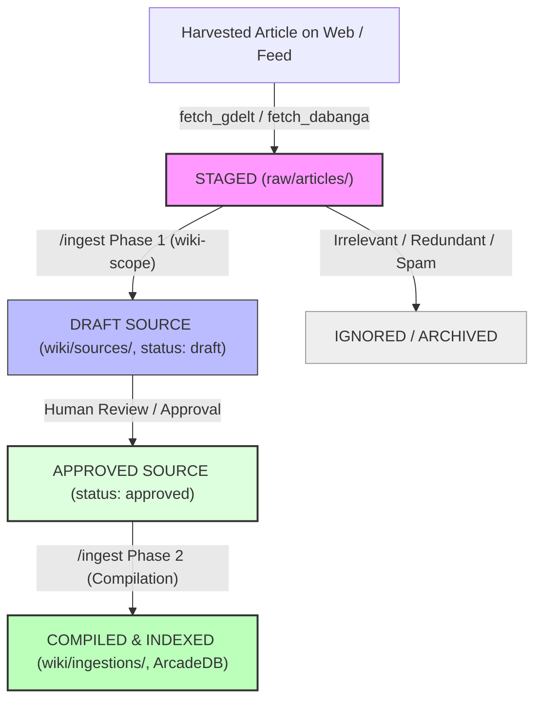

# Implementation Plan: Staging Mechanism for Harvested Articles

## 1. Executive Summary & Problem Context

With the implementation of automated harvesting pipelines ([scripts/fetch_gdelt_bigquery.py](file:///Users/christoflitznerski/MyObsidian/news01/llm-wiki-news/scripts/fetch_gdelt_bigquery.py), [scripts/fetch_dabanga_arabic.py](file:///Users/christoflitznerski/MyObsidian/news01/llm-wiki-news/scripts/fetch_dabanga_arabic.py), and [scripts/harvest_daily_news.py](file:///Users/christoflitznerski/MyObsidian/news01/llm-wiki-news/scripts/harvest_daily_news.py)), raw conflict articles are extracted and written directly into [`raw/articles/`](file:///Users/christoflitznerski/MyObsidian/news01/llm-wiki-news/raw/articles/).

As harvest volumes scale, operators and autonomous agents face an operational visibility gap:
- **Visibility**: Which harvested articles are currently staged (waiting for scoping and distillation)?
- **Progress Tracking**: Which articles are in Phase 1 review (`wiki/sources/`, `status: draft`) vs. Phase 2 compiled (`compiled: true`)?
- **Workflow Bottlenecks**: How does an agent select the "next" priority article to ingest without rescanning directories or creating duplicate source notes?
- **Architectural Boundary Invariant**: Operating Axiom 1 (`AGENTS.md`) establishes **Strict Immutability of Evidence** in `raw/`. Modifying raw article files post-creation or moving files across directories risks breaking provenance links and violating the read-only invariant.

This plan details the recommended architecture, comparative options, state machine, CLI dispatcher, and Obsidian dashboard implementation.

---

## 2. Ingestion Lifecycle State Machine

An article moves through five explicit lifecycle states:



### State Definitions

| State | Physical Location | Graph / Metadata State | Description |
| :--- | :--- | :--- | :--- |
| **1. STAGED** | `raw/articles/<title>.md` | No note in `wiki/sources/` points to this raw file. | Downloaded full-text evidence awaiting Phase 1 distillation. |
| **2. DRAFT** | `raw/articles/<title>.md` | `wiki/sources/<slug>.md` exists with `status: "draft"`, `compiled: false`. | Phase 1 scoped; scoping manifest generated; pending approval. |
| **3. APPROVED** | `raw/articles/<title>.md` | `wiki/sources/<slug>.md` exists with `status: "approved"`, `compiled: false`. | Human-in-the-loop approved; ready for graph compilation. |
| **4. COMPILED** | `raw/articles/<title>.md` | `wiki/sources/<slug>.md` has `compiled: true`; audit in `wiki/ingestions/`. | Entities created in graph, indexed in ArcadeDB and `ki`. |
| **5. IGNORED** | `raw/articles/<title>.md` | Logged in `.staging_ignore` or metadata blacklist. | Evaluated and determined out of scope, duplicated, or uninformative. |

---

## 3. Evaluation of Implementation Approaches

### Option A: Physical Directory Separation (`_staging/articles/` $\to$ `raw/articles/`)
- **Mechanism**: Harvesters save files into `_staging/articles/`. Calling `/ingest` promotes (moves) the file to `raw/articles/`.
- **Advantages**: Visual segregation in file explorers.
- **Disadvantages**:
  - Requires moving files across directories, mutating paths after external feed JSON files already reference them.
  - Adds file move errors in sandboxed runtime environments.
  - If a file is partially processed or rejected, orphaned files remain in `_staging/`.

### Option B: Frontmatter Status Mutation (`ingestion_status: staged | ingested` inside `raw/articles/`)
- **Mechanism**: Harvesters write `ingestion_status: staged` in the YAML frontmatter of raw files. Ingestion updates this field to `ingested`.
- **Advantages**: Self-contained metadata.
- **Disadvantages**:
  - **Violates Axiom 1 (Strict Immutability of `raw/`)**: Modifying raw files after initial extraction breaks forensic immutability and file hashes.

### Option C: Sovereign Dual-Layer Architecture (Zero-Mutation Computed Ledger) — **RECOMMENDED**
- **Mechanism**:
  1. `raw/articles/` remains the permanent, immutable store for all extracted articles.
  2. The Knowledge Graph itself (`wiki/sources/`) is the authoritative system of record. Every source note already links to its raw evidence via `raw_file: "raw/articles/<filename>.md"`.
  3. A fast, zero-mutation CLI tool ([scripts/staging_queue.py](file:///Users/christoflitznerski/MyObsidian/news01/llm-wiki-news/scripts/staging_queue.py)) dynamically evaluates the relationship between `raw/articles/` and `wiki/sources/`.
  4. Generates an active **Obsidian Staging Dashboard** ([_input/projects/infra/staging_dashboard.md](file:///Users/christoflitznerski/MyObsidian/news01/llm-wiki-news/_input/projects/infra/staging_dashboard.md)) and CLI queues (`--staged`, `--next`, `--summary`).

#### Why Option C is Recommended
1. **Preserves 100% Evidence Immutability**: Zero file modifications or moves inside `raw/`.
2. **Single Source of Truth**: Eliminates synchronization drift between directory folders and database records.
3. **Instant Cross-Platform Telemetry**: Provides real-time pipeline status via CLI and Obsidian visual notes.
4. **Autonomous Agent Integration**: Subagents and slash commands (`/ingest`) can query `scripts/staging_queue.py next` to automatically dequeue and process the next pending article.

---

## 4. Technical Architecture: `scripts/staging_queue.py`

### 4.1. Core Logic & State Resolution
The script scans:
1. `raw/articles/*.md`: All harvested primary evidence files.
2. `wiki/sources/*.md`: All distilled source notes, extracting frontmatter fields:
   - `raw_file`: Resolves direct path matches (accounting for relative paths, Unicode normalization, and URL decodings).
   - `url`: Fallback match against raw article frontmatter `source:`.
   - `status`: `"draft"` vs. `"approved"`.
   - `compiled`: `true` vs. `false`.
3. `wiki/ingestions/**/*.md`: Verifies compilation audit dossiers.

### 4.2. CLI Interface & Commands

```bash
# 1. Summary of queue statistics
python3 scripts/staging_queue.py status

# 2. List all staged (unprocessed) articles
python3 scripts/staging_queue.py list --staged

# 3. List articles pending review or approved for compilation
python3 scripts/staging_queue.py list --drafts
python3 scripts/staging_queue.py list --approved

# 4. Get the next priority article path to feed directly into /ingest
python3 scripts/staging_queue.py next

# 5. Generate or update Obsidian visual dashboard
python3 scripts/staging_queue.py sync --output _input/projects/infra/staging_dashboard.md
```

### 4.3. Data Model for Resolved Queue Item

```python
@dataclass
class StagedArticle:
    filename: str
    filepath: Path
    url: str
    title: str
    publisher: str
    language: str
    published_date: str
    harvested_date: str
    status: Literal["STAGED", "DRAFT", "APPROVED", "COMPILED", "IGNORED"]
    source_note: Optional[Path]
    ingestion_dossier: Optional[Path]
```

---

## 5. Visual Staging Dashboard Design

The tool will generate and maintain a living Obsidian dashboard note at `_input/projects/infra/staging_dashboard.md`:

```markdown
# 📥 News & OSINT Staging & Ingestion Dashboard

> [!NOTE]
> **Queue Telemetry**: Total Harvested: 28 | ⏳ Staged: 14 | 📝 In Review: 3 | 🚀 Approved: 1 | ✅ Compiled: 10
> **Last Synchronized**: 2026-11-02 09:15:00 UTC

## ⏳ Staged Articles (Pending Ingestion)

| Article Title | Publisher | Lang | Published | Action |
| :--- | :--- | :--- | :--- | :--- |
| `[[(حرب المسيرات) السودان يشكو اثيوبيا لمجلس الامن]]` | Radio Dabanga | `ar` | 2026-11-01 | `/ingest "raw/articles/..."` |
| `[[مقتل وإصابة 9 أشخاص في هجوم بطائرة مُسيّرة...]]` | Radio Dabanga | `ar` | 2026-11-01 | `/ingest "raw/articles/..."` |

## 📝 In Review (Phase 1 Draft Sources)

| Draft Source Note | Associated Raw Article | Status | Review Gate |
| :--- | :--- | :--- | :--- |
| `[[sources/2026-11-01-dabanga-drone-complaint]]` | `[[(حرب المسيرات)...]]` | `draft` | [Approve Note] |
```

---

## 6. Implementation Steps

1. **Step 1: Build `scripts/staging_queue.py`**:
   - Implement YAML frontmatter parsing with Unicode NFC normalization.
   - Implement state classifier (`STAGED`, `DRAFT`, `APPROVED`, `COMPILED`, `IGNORED`).
   - Implement CLI subcommands (`status`, `list`, `next`, `sync`).
2. **Step 2: Generate Initial Dashboard**:
   - Run `python3 scripts/staging_queue.py sync` to create `_input/projects/infra/staging_dashboard.md`.
3. **Step 3: Update `AGENTS.md` & Skill References**:
   - Reference `scripts/staging_queue.py` in `.agent/skills/wiki-ingest/SKILL.md` so Phase 1 ingestion instructions guide the agent on discovering staged articles.
4. **Step 4: Verify & Lint**:
   - Run `python3 scripts/lint_vault.py --cot` to guarantee vault compliance.
