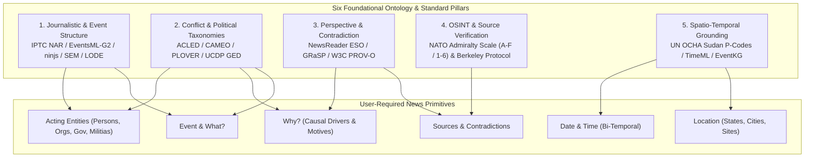
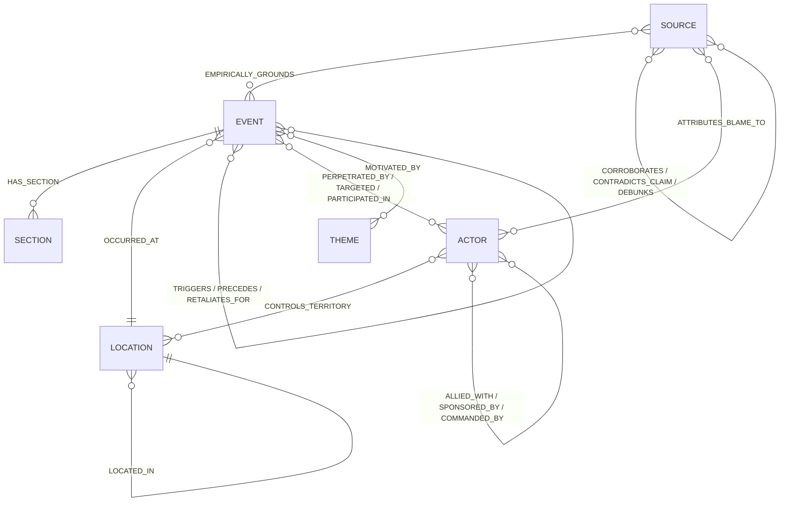

# Sudan News & OSINT LLM-Wiki: Ontology Research, Contradiction Engine & Proposed Wiki Structure

> [!IMPORTANT] Executive Mandate & Architectural Pivot
> This specification fulfills the architectural pivot defined in [[_input/tasks/archived/Concept Change to News.md]]: transforming `llm-wiki-news` from a pedagogical learning space into a **multilingual News & Open-Source Intelligence (OSINT) Knowledge Graph focused on Sudan**.
> - **Part I (Task 1)** presents deep research into international news standards, conflict event ontologies, spatio-temporal models, and perspective/contradiction frameworks that support Andrej Karpathy's **LLM-Wiki** paradigm.
> - **Part II (Task 2)** defines the complete **New Wiki Structure**—including directory topography, YAML frontmatter schemas, Dual-Flow Chain of Thought (Micro-CoT and Macro-CoT) adaptations, multilingual Arabic/English entity resolution, and the Ingest-Time Contradiction Engine.

---

## Part I: Deep Research — Standards & Ontologies for News, Relationships, Contradictions & Karpathy's LLM-Wiki

### 1. Why Karpathy's LLM-Wiki Paradigm Fits Conflict News Better Than Standard RAG

In Andrej Karpathy's **LLM-Wiki** architecture, the LLM does not merely retrieve raw text chunks at query time; instead, it acts as an **ingest-time cognitive compiler** that reads raw documents (`raw/`) and continuously builds, refactors, and interlinks a structured Markdown codebase (`wiki/`) inside Obsidian, backed by a hybrid Graph + Vector database (ArcadeDB / Neo4j).

When applied to **multilingual Sudan news collection** (news articles, videos, satellite reports, and social media artefacts in Arabic, English, French, and Sudanese vernaculars), naive vector RAG fails catastrophically for four reasons:
1. **Event Fragmentation**: Ten articles in three languages covering the same artillery strike in Omdurman remain ten separate chunks in vector space, with no consolidated state.
2. **Temporal Blindness**: Standard RAG confuses a ceasefire announced in May 2023 with a battle occurring in October 2026, or confuses the *date an article was published* with the *date an atrocity occurred* during a telecom blackout.
3. **Narrative Collapsing & Hallucination**: When a Sudanese Armed Forces (SAF) communiqué and a Rapid Support Forces (RSF) Telegram post make diametrically opposed claims about who bombed a hospital or who controls a town, naive RAG blends or arbitrarily selects one claim without surfacing the contradiction.
4. **Transliteration Drift**: Arabic vs. English vs. French spellings (*Al-Jazirah* / *Gezira* / *الجزيرة*; *Hemedti* / *Dagalo* / *حميدتي*) split entity neighborhoods across disconnected embeddings.

To unlock Karpathy's LLM-Wiki for conflict news, we must replace the learning vault's *Concept-Centric Pedagogical Schema* with a synthesized **Event-, Perspective-, and Provenance-Centric News Ontology** drawn from six international standard families.



---

### 2. Evaluation of Applicable Standards & Ontologies

#### 2.1. Journalistic & Semantic Web Event Ontologies (The 5W1H Structural Backbone)

| Standard / Ontology | Core Entities & Properties | How It Supports Relationships, Contradictions & Karpathy's LLM-Wiki |
| :--- | :--- | :--- |
| **IPTC News Architecture (NAR): NewsML-G2, EventsML-G2, ninjs 3.x & rNews** | `NewsItem` (article/media package), `Event` (`EventsML-G2`), `ConceptItem` (`Person`, `Organisation`, `GeoArea`, `Topic`), `QCodes` | **Separates Media from Event**: Raw articles/videos in `raw/` map to `wiki/sources/` (`NewsItem`), while the real-world occurrence maps to a persistent `wiki/events/` node (`EventsML-G2`). Multiple sources compile into and refactor the same canonical Event note. |
| **SEM (Simple Event Model)** *(VU Amsterdam)* | `sem:Event`, `sem:Actor`, `sem:Place`, `sem:Time`, `sem:RoleType`, `sem:View`, `sem:accordingTo` | **Role-Bounded Relationships & Multi-View Contradictions**: Actors connect to events via explicit roles (`Perpetrator`, `Target`, `Belligerent`, `Mediator`, `Responder`). Crucially, `sem:View` allows an Event node to hold multiple competing accounts attributed via `sem:accordingTo`. |
| **LODE (Linking Open Descriptions of Events)** *(W3C / CWI)* | `lode:Event`, `atTime`, `inSpace`, `atPlace`, `involvedAgent`, `illustrate` | **Journalistic 5W Mapping**: Cleanly separates consensus spatio-temporal anchoring (*What, When, Where, Who*) from interpretive or contested media framing (`illustrate`). |
| **CIDOC-CRM (ISO 21127)** | `E5_Event`, `E7_Activity`, `P9_consists_of`, `P15_was_influenced_by`, `P134_continued` | **Hierarchical Event Composition**: Enables linking atomic daily incidents (e.g., *2026-10-25 El Fasher Shelling*) into parent macro-events/campaigns (e.g., *Siege of El Fasher*) via `[:PART_OF_CAMPAIGN]`. |

#### 2.2. Conflict & Political Interaction Standards (Tailored for Sudan)

General news schemas lack domain granularity for armed conflict, paramilitary fragmentation, humanitarian blockades, and regional diplomacy. Combining **ACLED**, **PLOVER/CAMEO**, and **UCDP** provides complete coverage of both kinetic warfare and political/humanitarian developments in Sudan:

| Framework | Scope in Sudan News Vault | Standardized Taxonomy Adopted |
| :--- | :--- | :--- |
| **ACLED (Armed Conflict Location & Event Data Project)** | Kinetic warfare, violence against civilians, demonstrations, and tactical shifts across Sudan's 18 states. | **6 Event Types & 25 Sub-Event Types**: `Battles` (*Armed clash*, *Territory regained/overtaken*), `Explosions/Remote violence` (*Air/drone strike*, *Shelling/artillery*, *IED*), `Violence against civilians` (*Attack*, *Abduction*, *Sexual violence*), `Protests`, `Riots`, `Strategic developments` (*Agreement*, *Looting/property destruction*, *Non-violent transfer of territory*, *Arrests*, *Base established*).<br/>**8 Actor Categories (`Inter` 1–8)**: `State Forces` (SAF, GIS), `Rebel Groups` (SPLM-N, SLA-AW), `Political Militias` (RSF, Sudan Shield Forces, Al-Baraa Brigade), `Identity Militias` (communal/tribal militias), `Rioters`, `Protesters`, `Civilians` (ERRs, Resistance Committees, IDPs), `External/Other Forces` (foreign states, UN/AU, INGOs). |
| **PLOVER (Political Language Ontology for Verifiable Event Records) & CAMEO** | Diplomatic summits, ceasefires, sanctions, arms/gold supply flows, aid access, and official statements ("What?" & "Why?"). | Decomposes political actions into **`Action Type` (What)** + **`Mode` (How: verbal statement, threat, formal agreement, material transfer, blockade, sanction)** + **`Strategic Context` (Why: military, territorial, war-economy/gold, humanitarian, diplomatic, ethnic/communal)**. |
| **UCDP GED (Uppsala Conflict Data Program)** | Casualty & displacement uncertainty under fog of war. | Replaces single-number casualty fields with **`fatalities_low`**, **`fatalities_high`**, and **`fatalities_best`** (plus `displaced_estimate`), preventing false precision when SAF, RSF, and medical NGOs report conflicting tolls. |

#### 2.3. Perspective, Attribution & Contradiction Ontologies (Solving Conflicting Narratives)

In traditional knowledge engineering, a contradiction is treated as a database error to be overwritten. In **NewsReader** and **GRaSP (Grounded Representation and Source Perspective)** (Vossen & Fokkens), **contradiction is primary intelligence signal**.

By combining **GRaSP**, **W3C PROV-O**, and **Schema.org `ClaimReview`**, our LLM-Wiki models every contested aspect of an event across three distinct layers:
1. **The Source Layer (`wiki/sources/`)**: Preserves the provenance of the raw artifact (`raw/articles/`, `raw/videos/`, `raw/social/`), recording the outlet, author/channel, publication timestamp, original language, and structural alignment (`pro_saf`, `pro_rsf`, `independent`, `civil_society_err`, `osint_verified`, `international_org`).
2. **The Claim & Perspective Layer (Inside `wiki/events/` & Graph Edges)**: Records *who said what* about the event using GRaSP attribution attributes:
   - **Aspect Contested**: `perpetrator | casualties | target_type | territorial_control | motive_why | chronology_who_shot_first`
   - **Epistemic Modality**: `confirmed | probable | alleged | denied | debunked`
   - **Polarized Stance**: `[:CORROBORATES]`, `[:CONTRADICTS_CLAIM]`, `[:ATTRIBUTES_BLAME_TO]`, `[:DENIES_INVOLVEMENT]`, `[:DEBUNKS]`.
3. **The Canonical Event Layer (`wiki/events/`)**: Synthesizes the verified baseline (what is known with high confidence) while maintaining an explicit **Section 5: Competing Narratives, Attribution & Contradictions** with a side-by-side Claim Comparison Matrix.

#### 2.4. OSINT Verification & Epistemic Scoring: NATO Admiralty Scale + Berkeley Protocol

Following the **UN OHCHR / UC Berkeley Protocol on Digital Open Source Investigations** and methodologies used by **Sudan Witness (CIR)** and **Yale Humanitarian Research Lab (HRL)**, we upgrade the vault's single `reliability_score` into the two-dimensional **NATO Admiralty Code (`A–F` × `1–6`)**:

- **Dimension 1: `source_reliability` (`A` to `F`)** — Evaluates the *source entity/channel* (`A`: Forensic/Satellite/Direct Medical Ledger; `B`: Independent verified journalism/UN; `C`: Local citizen monitor/unverified outlet; `D`: Partisan belligerent mouthpiece; `E`: Known disinformation source; `F`: Unknown/new account).
- **Dimension 2: `info_credibility` (`1` to `6`)** — Evaluates the *specific claim/artifact* (`1`: Confirmed by independent sources/geolocation/satellite; `2`: Probably true; `3`: Possibly true / single-source; `4`: Doubtful; `5`: Improbable / contradicted by physical evidence; `6`: Cannot be judged).
- **Composite Numeric Score (`reliability_score: 0.0–1.0`)**: Automatically derived from the Admiralty matrix (e.g., `A1 = 1.00`, `B1 = 0.95`, `B2 = 0.85`, `C2 = 0.75`, `C3 = 0.60`, `D3 = 0.45`, `D5 = 0.15`) to drive Astro publishing filters and ArcadeDB/Neo4j authority weighting.

#### 2.5. Spatio-Temporal Standards for Sudan: UN OCHA P-Codes & Bi-Temporal TimeML

- **Spatial Grounding (`UN OCHA COD-AB P-Codes`)**: Every location note in `wiki/locations/` is anchored to Sudan's official administrative hierarchy:
  - `ADM0`: Sudan (`SDN`)
  - `ADM1`: 18 States / Wilayat (`SD01` Khartoum, `SD02` North Darfur, `SD03` South Darfur, `SD04` Central Darfur, `SD05` East Darfur, `SD06` West Darfur, `SD15` Al Jazirah, `SD18` West Kordofan, etc.)
  - `ADM2`: 189 Localities / Mahaliyat (e.g., `SD02001` El Fasher)
  - `ADM3` / `Site`: Cities, neighborhoods (e.g., *Shambat*, *Kalakla*, *Arkawit*), IDP camps (*Zamzam Camp*, *Kalma Camp*), military bases (*Wadi Seidna Air Base*, *Corps of Engineers*), border crossings (*Adre*, *Gallabat*), and infrastructure (*Jebel Aulia Dam*, *Khartoum Refinery*).
- **Bi-Temporal Grounding (`TimeML` + `EventKG`)**: Separates **Valid Time ($t_{\text{valid}}$)** (`event_start_date`, `event_end_date`, `time_precision: exact_time | day | week | month`) from **Report Time ($t_{\text{reported}}$)** (`published_date`) and **Compilation Time ($t_{\text{compiled}}$)** (`last_updated`).

---

### 3. Direct Mapping to User Requirements

| Required News Primitive | Applied Standard / Ontology | Target Wiki Node / Property | How Relationships & Contradictions Are Handled |
| :--- | :--- | :--- | :--- |
| **Event** | IPTC `EventsML-G2`, `SEM`, `LODE`, `CIDOC-CRM` | `wiki/events/<YYYY-MM-DD>-<slug>.md` (`type: event`, `subtype: incident \| campaign \| crisis \| diplomatic`) | Atomic incidents link to parent campaigns (`[:PART_OF_CAMPAIGN]`) and sequential events (`[:PRECEDES]`, `[:TRIGGERS]`, `[:RETALIATES_FOR]`). |
| **Date & Time** | `TimeML` (ISO 24617-1), `EventKG`, `ACLED` `time_precision` | Frontmatter `event_start_date`, `event_end_date`, `time_precision`, `reported_date` + `wiki/timelines/` | Bi-temporal properties distinguish when an attack happened vs. when it was reported after a blackout; `TEMPORAL_CAUSAL_INVERSION` flags disputes over "who broke a ceasefire first." |
| **Location** | `UN OCHA Sudan P-Codes`, `HXL`, `ACLED` `geo_precision`, `WGS84` | `wiki/locations/<Location Name>.md` (`type: location`, `pcode`, `adm_level`, `lat`, `lon`, `current_control`) | Hierarchical containment (`[:LOCATED_IN]`) from site $\to$ locality $\to$ state; tracks `[:CONTROLS_TERRITORY]` vs. `[:CONTESTS_TERRITORY]` when SAF and RSF both claim control. |
| **Acting Entities** *(Persons, Orgs, Gov, Militias)* | `ACLED` Actor Categories (`Inter` 1–8), `SEM` `RoleType`, `W3C PROV-O` | `wiki/actors/<Actor Name>.md` (`type: actor`, `subtype: state_force \| armed_group \| political_body \| civil_society \| person \| media_source`) | Tracks command hierarchy (`[:COMMANDED_BY]`), coalitions (`[:ALLIED_WITH]`), foreign backing (`[:SPONSORED_BY]`), defections (`[:DEFECTED_TO]`), and event roles (`[:PERPETRATED_BY]`, `[:TARGETED]`). |
| **What?** | `ACLED` 6 Event Types / 25 Sub-Events, `PLOVER` Action/Mode, `UCDP` Fatalities | Event Section 1 & 2 + Frontmatter `event_category`, `event_sub_type`, `fatalities_low/best/high`, `humanitarian_impact` | Standardizes kinetic actions, civilian targeting, infrastructure damage, and diplomatic actions; flags `MAGNITUDE_DISCREPANCY` and `TARGET_FRAMING_CONFLICT` across sources. |
| **Why?** | `PLOVER` Context, `Micro-CoT` Step 3 (`CAUSAL_MOTIVES`), `wiki/themes/` | Event Section 3 (`3. Causal Drivers & Strategic Motives`) + `wiki/themes/<Theme>.md` (`type: theme`) | Links tactical events to macro drivers (`[[Darfur Gold Supply Chain]]`, `[[Ethnic Targeting]]`, `[[Supply Route Interdiction]]`) via `[:MOTIVATED_BY]` and `[:DRIVES_EVENT]`, separating stated pretexts from strategic motives. |
| **Sources** | `IPTC ninjs`, `GRaSP`, `W3C PROV-O`, `NATO Admiralty Scale`, `Berkeley Protocol` | `wiki/sources/<YYYY-MM-DD>-<outlet>-<slug>.md` (`type: source`, `admiralty_rating`, `alignment`, `language`) | Preserves multilingual provenance; links sources to events via `[:EMPIRICALLY_GROUNDS]`, `[:CORROBORATES]`, and `[:CONTRADICTS_CLAIM]`. |

---

## Part II: Proposed New Wiki Structure for Sudan News (`llm-wiki-news`)

### 1. New Tripartite Directory Topography

We preserve the core Karpathy LLM-Wiki separation between **Layer 1: Immutable Raw Evidence (`raw/`)** and **Layer 2: Agent-Compiled Knowledge Graph (`wiki/`)**, while restructuring both layers around multilingual news, OSINT artifacts, and event-centric intelligence.

```mermaid
flowchart LR
    subgraph RawLayer ["Layer 1: Immutable Multilingual Evidence (raw/)"]
        R_ART["raw/articles/<br/>(News clips: AR, EN, FR)"]
        R_SOC["raw/social/<br/>(Telegram, X, Facebook posts)"]
        R_VID["raw/videos/ & raw/transcripts/<br/>(Field footage, broadcasts)"]
        R_REP["raw/reports/ & raw/satellite/<br/>(UN OCHA, ACLED, Yale HRL, NGOs)"]
        R_TSK["raw/tasks/ & raw/drafts/<br/>(Analyst briefs & SITREPs)"]
    end

    subgraph AgentCompiler ["Cognitive Compiler (Antigravity / LLM Agent)"]
        SCOPE["1. wiki-scope (Event & Entity Deduplication)"]
        INGEST["2. wiki-ingest (Cross-Lingual English Compilation)"]
        COT["3. Dual-Flow CoT & Contradiction Extractor"]
    end

    subgraph WikiLayer ["Layer 2: Compiled Sudan News Graph (wiki/)"]
        W_SRC["wiki/sources/<br/>(Source Distillations + Admiralty Score)"]
        W_EV["wiki/events/<br/>(Incidents, Battles, Campaigns, Talks)"]
        W_ACT["wiki/actors/<br/>(Persons, Armed Groups, Gov, NGOs)"]
        W_LOC["wiki/locations/<br/>(States, Localities, Cities, Camps)"]
        W_THM["wiki/themes/<br/>(Macro Drivers, War Economy, Doctrines)"]
        W_TML["wiki/timelines/<br/>(Chronological Ledgers & Frontline Arcs)"]
        W_SYN["wiki/syntheses/ & wiki/ingestions/<br/>(Archived Intelligence Briefs & Dossiers)"]
        W_CAT["System Ledgers:<br/>index.md | overview.md | glossary.md | log.md"]
    end

    RawLayer --> AgentCompiler --> WikiLayer
```



#### 1.1. Detailed Directory Specification

| Directory / File Path | Permission | Role in Sudan News LLM-Wiki | Naming Convention |
| :--- | :---: | :--- | :--- |
| **`raw/articles/`** | `READ-ONLY` | Web-clipped news articles in Arabic, English, French, etc. (Radio Dabanga, Sudan Tribune, Al Jazeera, Reuters, Mada Masr, Sudan War Monitor). | `YYYY-MM-DD-<outlet>-<slug>.md` |
| **`raw/social/`** | `READ-ONLY` | Archived social media posts, Telegram communiqués (SAF, RSF, ERRs, local monitors), and X/Twitter threads. | `YYYY-MM-DD-<channel>-<slug>.md` |
| **`raw/videos/`** | `READ-ONLY` | Raw video recordings (`.mp4`, `.mov`), field clips, and broadcast segments for multimodal verification. | `YYYY-MM-DD-<source>-<slug>.mp4` |
| **`raw/transcripts/`** | `READ-ONLY` | Timestamped transcripts (Arabic + English translation) of speeches, voice notes, and video reports. | `YYYY-MM-DD-<source>-<slug>.md` |
| **`raw/reports/`** | `READ-ONLY` | Long-form PDFs and reports from UN OCHA, IPC Famine Review, Amnesty, HRW, ACLED, Sentry. | `YYYY-MM-DD-<org>-<slug>.pdf/.md` |
| **`raw/satellite/`** | `READ-ONLY` | Remote sensing dossiers, thermal anomaly reports, and geospatial imagery analyses (e.g., Yale HRL, Sudan Witness). | `YYYY-MM-DD-<lab>-<slug>.pdf/.md` |
| **`raw/assets/`** | `READ-ONLY` | Downloaded images, maps, geolocation frames, and weapon identification photos. | `<source-slug>-fig1.png` |
| **`wiki/events/`** | `READ-WRITE` | **Primary Center of Gravity**: Atomic incidents (`subtype: incident`), multi-day military operations (`subtype: campaign`), diplomatic events (`subtype: diplomatic`), and systemic emergencies (`subtype: crisis`). | `YYYY-MM-DD <Canonical Event Title>.md` (for discrete incidents) or `<Campaign Title>.md` |
| **`wiki/actors/`** | `READ-WRITE` | **Acting Entities**: State forces, armed groups/militias, political coalitions, foreign state actors, civil society/ERRs, key individuals/commanders, and media outlets. | `<Canonical English Name>.md` (e.g., `Rapid Support Forces.md`) |
| **`wiki/locations/`** | `READ-WRITE` | **Geopolitical & Spatial Nodes**: Sudan's 18 States (`ADM1`), Localities (`ADM2`), cities, neighborhoods, military bases, border crossings, and IDP camps. | `<Canonical Place Name>.md` (e.g., `El Fasher.md`) |
| **`wiki/themes/`** | `READ-WRITE` | **Structural "Why?" & Macro-Concepts**: Enduring conflict drivers, war economy mechanics, military doctrines, ethnic dynamics, and humanitarian issues. | `<Canonical Theme Title>.md` (e.g., `Darfur Gold Supply Chain.md`) |
| **`wiki/timelines/`** | `READ-WRITE` | **Temporal Aggregators**: Monthly chronological ledgers and campaign timelines weaving discrete events into sequential progressions. | `YYYY-MM Sudan Conflict Chronicle.md` or `Timeline of <Topic>.md` |
| **`wiki/sources/`** | `READ-WRITE` | **Provenance Distillations**: One distillation note per primary file in `raw/`, containing Admiralty score, alignment, extracted claims, and bilingual quotes. | `YYYY-MM-DD-<outlet>-<slug>.md` |
| **`wiki/syntheses/`** | `READ-WRITE` | Archived analytical outputs from complex `/query` investigations (e.g., actor network maps, contradiction audits). | `<query-slug>.md` |
| **`wiki/ingestions/`** | `READ-WRITE` | Chronological ingestion audit dossiers organized by date (`wiki/ingestions/YYYY-MM-DD/<source-slug>.md`). | `YYYY-MM-DD/<source-slug>.md` |
| **`wiki/index.md`** | `READ-WRITE` | Master 1-line catalog organized by `## Events`, `## Actors`, `## Locations`, `## Themes`, `## Timelines`, `## Sources`, `## Syntheses`, `## Ingestions`. | `wiki/index.md` |
| **`wiki/overview.md`** | `READ-WRITE` | **Living Executive SITREP (Situation Report)**: High-level synthesis of active frontlines, territorial control, diplomatic tracks, humanitarian crisis metrics, and major unresolved narrative contradictions. | `wiki/overview.md` |
| **`wiki/glossary.md`** | `READ-WRITE` | **Cross-Lingual Entity & Place Disambiguation Registry**: Maps Arabic script, colloquial Sudanese nicknames, French spellings, and acronyms to canonical English titles and UN OCHA P-Codes. | `wiki/glossary.md` |
| **`wiki/log.md`** | `READ-WRITE` | Append-only operational audit log tracking every `/ingest`, `/query`, `/lint`, and contradiction resolution. | `wiki/log.md` |

> [!TIP] Backward-Compatibility Mapping with Existing Scripts
> In Neo4j and ArcadeDB (`scripts/enrich_graph.py` and `scripts/bootstrap_arcadedb.py`), every file in `wiki/` retains the master `:Document` vertex type alongside its specific domain label (`:Event`, `:Actor`, `:Location`, `:Theme`, `:Timeline`, `:Source`, `:Synthesis`, `:Ingestion`). For zero-downtime compatibility with existing tools that query `:Concept` or `:Entity`, `:Theme` and `:Event` can optionally carry secondary label `:Concept`, while `:Actor` and `:Location` carry secondary label `:Entity`.

---

### 2. Mandatory YAML Frontmatter Schemas by Node Type

To support Dataview queries in Obsidian, Astro digital garden filtering (`site/src/content.config.ts`), and typed graph indexing in ArcadeDB/Neo4j, each folder uses a standardized YAML frontmatter contract.

#### 2.1. Event Note Schema (`wiki/events/`)
```yaml
---
title: "2026-10-25 El Fasher Grand Market Shelling"
type: "event"
subtype: "incident" # Options: incident | campaign | crisis | diplomatic
event_category: "Explosions/Remote violence" # ACLED Top-Level Category
event_sub_type: "Shelling/artillery/missile attack" # ACLED / PLOVER Sub-Type
event_start_date: 2026-10-25T14:15:00Z # Valid Time (t_valid start)
event_end_date: 2026-10-25T16:00:00Z   # Valid Time (t_valid end)
time_precision: "exact_time" # Options: exact_time | day | week | month
reported_date: 2026-10-26    # First reported date (t_reported)
last_updated: 2026-10-31     # Wiki compilation date (t_compiled)
locations: ["[[El Fasher]]", "[[North Darfur]]"]
pcode: "SD02001"
geo_precision: "neighborhood_site" # Options: exact_coords | neighborhood_site | city_town | locality_adm2 | state_adm1
actors_involved:
  - actor: "[[Rapid Support Forces]]"
    role: "alleged_perpetrator" # Options: perpetrator | alleged_perpetrator | target | belligerent | mediator | responder
  - actor: "[[Sudanese Armed Forces]]"
    role: "belligerent"
  - actor: "[[El Fasher Emergency Response Room]]"
    role: "responder"
parent_campaign: "[[Siege of El Fasher]]"
fatalities_low: 18
fatalities_best: 24
fatalities_high: 35
verification_status: "corroborated_with_contradictions" # Options: confirmed | corroborated_with_contradictions | single_source | disputed | debunked
admiralty_rating: "B2"
reliability_score: 0.85
contradiction_flags: ["ATTRIBUTION_CONFLICT", "MAGNITUDE_DISCREPANCY"]
tags: [north-darfur, el-fasher, shelling, civilian-casualties, rsf, saf]
sources: ["[[sources/2026-10-26-dabanga-el-fasher-market]]", "[[sources/2026-10-26-rsf-telegram-el-fasher]]", "[[sources/2026-10-28-yale-hrl-el-fasher-thermal]]"]
aliases: ["El Fasher Market Attack Oct 25", "قصف سوق الفاشر الكبير"]
---
```

#### 2.2. Acting Entity Note Schema (`wiki/actors/`)
```yaml
---
title: "Rapid Support Forces"
type: "actor"
subtype: "armed_group" # Options: state_force | armed_group | political_body | civil_society | person | media_source
acled_actor_type: "Political Militia" # State Forces | Rebel Groups | Political Militia | Identity Militia | Civilians | External/Other
parent_organization: ""
leader: "[[Mohamed Hamdan Dagalo]]"
allies: ["[[SPLM-N (al-Hilu)]]"]
opponents: ["[[Sudanese Armed Forces]]", "[[Joint Darfur Force]]"]
areas_of_operation: ["[[North Darfur]]", "[[South Darfur]]", "[[Khartoum State]]", "[[Al Jazirah]]"]
last_updated: 2026-10-31
reliability_score: 0.95
tags: [actor, paramilitary, rsf, darfur, khartoum]
sources: ["[[sources/2026-10-26-dabanga-el-fasher-market]]"]
aliases: ["RSF", "الدعم السريع", "Quwwat ad-Da'm as-Sari'", "Janjaweed"]
---
```

#### 2.3. Location Note Schema (`wiki/locations/`)
```yaml
---
title: "El Fasher"
type: "location"
subtype: "city_town" # Options: country | state_adm1 | locality_adm2 | city_town | neighborhood_site | idp_camp | infrastructure | border_crossing
adm_level: 3
parent_location: "[[North Darfur]]"
pcode: "SD02001"
coordinates: [13.6279, 25.3493] # [lat, lon] WGS84
current_control: "Contested (SAF / Joint Darfur Force inside city; RSF besieging)" # Options: SAF | RSF | Joint Darfur Force | SPLM-N | Contested | Civilian
control_last_changed: 2024-05-10
humanitarian_ipc_phase: 5 # 1 (Minimal) to 5 (Famine/Catastrophe)
last_updated: 2026-10-31
reliability_score: 0.98
tags: [location, north-darfur, state-capital, besieged]
sources: ["[[sources/2026-10-26-dabanga-el-fasher-market]]"]
aliases: ["Al-Fashir", "الفاشر", "El-Fasher"]
---
```

#### 2.4. Source Note Schema (`wiki/sources/`)
```yaml
---
title: "Radio Dabanga: 24 Killed in Artillery Shelling on El Fasher Grand Market"
type: "source"
subtype: "news_article" # Options: news_article | social_post | video_osint | satellite_report | official_communique | ngo_report | eyewitness
source_outlet: "[[Radio Dabanga]]"
author_or_channel: "Dabanga Sudan News"
original_url: "https://www.dabangasudan.org/..."
raw_file: "raw/articles/2026-10-26-dabanga-el-fasher-market.md"
language: "ar" # ISO 639-1: ar | en | fr | de
published_date: 2026-10-26T09:30:00Z
ingested_date: 2026-10-31
alignment: "independent" # Options: independent | pro_saf | pro_rsf | state_media | civil_society_err | international_org | osint_verified
admiralty_source_reliability: "B" # A | B | C | D | E | F
admiralty_info_credibility: 2     # 1 | 2 | 3 | 4 | 5 | 6
admiralty_rating: "B2"
reliability_score: 0.85
events_covered: ["[[2026-10-25 El Fasher Grand Market Shelling]]"]
actors_mentioned: ["[[Rapid Support Forces]]", "[[Sudanese Armed Forces]]", "[[El Fasher Emergency Response Room]]"]
locations_mentioned: ["[[El Fasher]]", "[[North Darfur]]"]
tags: [source, arabic-source, radio-dabanga, north-darfur]
aliases: []
---
```

---

### 3. Redesigning Dual-Flow Chain of Thought (CoT) for News & Contradictions

A cornerstone of `llm-wiki-news` is **Axiom 9: Dual-Flow Chain of Thought (CoT)**, which structures intra-document section flows (**Micro-CoT**) and inter-document graph relationships (**Macro-CoT**). Below is the complete adaptation of Dual-Flow CoT from pedagogical theory to conflict news intelligence.

#### 3.1. Micro-CoT: Intra-Document Epistemic Arcs for News Nodes

```mermaid
flowchart TD
    subgraph EventMicroCoT ["Event Note Micro-CoT Arc (wiki/events/)"]
        E1["1. Event Anchor & 5W1H Summary<br/>(EVENT_ANCHOR)"] -->|":PROGRESSES_TO<br/>{transition_type: 'chronological_mechanics'}"| E2["2. Chronological Sequence & Tactical Mechanics<br/>(CHRONOLOGICAL_MECHANICS - 'What & How')"]
        E2 -->|":PROGRESSES_TO<br/>{transition_type: 'causal_motives'}"| E3["3. Causal Drivers & Strategic Motives<br/>(CAUSAL_MOTIVES - 'Why')"]
        E3 -->|":PROGRESSES_TO<br/>{transition_type: 'impact_assessment'}"| E4["4. Humanitarian, Territorial & Geopolitical Impact<br/>(IMPACT_ASSESSMENT)"]
        E4 -->|":PROGRESSES_TO<br/>{transition_type: 'contradiction_matrix'}"| E5["5. Competing Narratives, Attribution & Contradictions<br/>(CONTRADICTION_MATRIX)"]
        E5 -->|":PROGRESSES_TO<br/>{transition_type: 'synthesis_catalog'}"| E6["Related Primitives<br/>(SYNTHESIS_CATALOG)"]
    end
```



##### A. Canonical 6-Stage Section Arc for `wiki/events/` (`type: event`)

| Step # | Canonical Section Heading | `step_type` Label in Graph | Toulmin / Investigative Function | Outbound Macro-CoT Edges Generated |
| :---: | :--- | :--- | :--- | :--- |
| **1** | `## 1. Event Anchor & 5W1H Summary` | `EVENT_ANCHOR` | Establishes baseline identity: *What*, *When* ($t_{\text{valid}}$ vs. $t_{\text{reported}}$), *Where*, *Who*, and verification level. | `[:OCCURRED_AT]`, `[:PART_OF_CAMPAIGN]`, `[:INVOLVES_ACTOR]` |
| **2** | `## 2. Chronological Sequence & Tactical Mechanics ("What & How")` | `CHRONOLOGICAL_MECHANICS` | Reconstructs the timeline of action, weapon systems/methods used, and tactical maneuvers. | `[:PRECEDES]`, `[:PERPETRATED_BY]`, `[:TARGETED]` |
| **3** | `## 3. Causal Drivers & Strategic Motives ("Why")` | `CAUSAL_MOTIVES` | Explains *why* the event occurred: immediate triggers, retaliatory logic, supply route objectives, and stated vs. underlying motives. | `[:TRIGGERED_BY]`, `[:RETALIATES_FOR]`, `[:MOTIVATED_BY]` (to `wiki/themes/`) |
| **4** | `## 4. Humanitarian, Territorial & Geopolitical Impact` | `IMPACT_ASSESSMENT` | Documents casualty ranges (low/best/high), civilian displacement (IDPs), infrastructure destruction, and shifts in territorial control. | `[:SHIFTS_CONTROL_TO]`, `[:DISPLACES_POPULATION]`, `[:DAMAGES_INFRASTRUCTURE]` |
| **5** | `## 5. Competing Narratives, Attribution & Contradictions` | `CONTRADICTION_MATRIX` | **The GRaSP Dialectical Engine**: Contrasts conflicting claims across belligerents, local witnesses, and OSINT labs via a structured Claim Comparison Matrix. | `[:CORROBORATES]`, `[:CONTRADICTS_CLAIM]`, `[:ATTRIBUTES_BLAME_TO]`, `[:DEBUNKS]` |
| **6** | `## Related Primitives` | `SYNTHESIS_CATALOG` | Bidirectional links to Campaign, Preceding/Subsequent Events, Actors, Locations, Themes, and Sources. | `[:CITES]`, `[:LINKS_TO]` |

##### B. Canonical 6-Stage Section Arcs for `wiki/actors/`, `wiki/locations/`, and `wiki/themes/`

| Node Type | Step 1 (`ANCHOR`) | Step 2 | Step 3 | Step 4 | Step 5 | Step 6 |
| :--- | :--- | :--- | :--- | :--- | :--- | :--- |
| **Actor (`wiki/actors/`)** | `1. Identity, Classification & Leadership Anchor` | `2. Historical Lineage, Factions & Command Structure` | `3. Strategic Objectives, Ideology & Political Economy ("Why")` | `4. Operational Capabilities, Alliances & Foreign Backing` | `5. Chronological Event Footprint & Accountability Record` | `## Related Primitives` |
| **Location (`wiki/locations/`)** | `1. Geopolitical Identity & Strategic Significance` | `2. Territorial Control History & Armed Presence` | `3. Key Infrastructure, Trade Corridors & Resources` | `4. Humanitarian Status, Displacement & Civil Services` | `5. Chronological Log of Major Conflict Events` | `## Related Primitives` |
| **Theme (`wiki/themes/`)** | `1. Core Thesis & Structural Mechanism ("Why")` | `2. Historical Roots & Political Economy Anatomy` | `3. Operational Manifestations Across Frontlines` | `4. Humanitarian, Regional & Diplomatic Consequences` | `5. Empirical Debates, Uncertainties & Competing Analyses` | `## Related Primitives` |

---

#### 3.2. Macro-CoT: Inter-Document Relationship Topology in Neo4j & ArcadeDB

Replacing pedagogical edges (`[:REMEDIES_DILEMMA]`, `[:EXTENDS_THEORY]`) with news-intelligence edges enables deep multi-hop causal, spatio-temporal, and contradiction queries:

| Relationship Category | Edge Type | Domain $\to$ Range | Semantic Definition & Properties |
| :--- | :--- | :--- | :--- |
| **1. Causal & Temporal Flow** | `[:PRECEDES]` | `(:Event) -> (:Event)` | Chronological ordering between linked events along a frontline or negotiation track. |
| | `[:TRIGGERS]` | `(:Event) -> (:Event)` | Direct causal provocation or immediate precipitant (`confidence`, `warrant`). |
| | `[:RETALIATES_FOR]` | `(:Event) -> (:Event)` | Explicit or inferred retaliatory action linking two events. |
| | `[:PART_OF_CAMPAIGN]` | `(:Event) -> (:Event)` | Connects an atomic `incident` to a macro `campaign` or `crisis`. |
| | `[:MOTIVATED_BY]` | `(:Event) -> (:Theme)` | Connects an event's Section 3 (`CAUSAL_MOTIVES`) to a structural driver (`wiki/themes/`). |
| **2. Actor Agency & Roles** | `[:PERPETRATED_BY]` | `(:Event) -> (:Actor)` | Identifies the initiating actor (`attribution_status: confirmed \| alleged \| disputed`). |
| | `[:TARGETED]` | `(:Event) -> (:Actor \| :Location)` | Identifies the actor, civilian group, or infrastructure targeted by an action. |
| | `[:PARTICIPATED_IN]` | `(:Actor) -> (:Event)` | Role-qualified participation (`role: belligerent \| mediator \| signatory \| responder`). |
| | `[:COMMANDED_BY]` | `(:Actor) -> (:Actor)` | Links a military unit/faction to its commander (`start_date`, `end_date`). |
| | `[:ALLIED_WITH]` | `(:Actor) -> (:Actor)` | Active coalition or operational alignment (`status: active \| fractured`). |
| | `[:SPONSORED_BY]` | `(:Actor) -> (:Actor)` | External material, financial, or diplomatic backing (`evidence_level`). |
| | `[:DEFECTED_TO]` | `(:Actor) -> (:Actor)` | Tracks commander or faction defections (`date`, `trigger_event`). |
| **3. Spatio-Political** | `[:OCCURRED_AT]` | `(:Event) -> (:Location)` | Anchors an event to its most specific `wiki/locations/` node (`geo_precision`). |
| | `[:LOCATED_IN]` | `(:Location) -> (:Location)` | Administrative containment hierarchy (`Site -> Locality ADM2 -> State ADM1 -> Country`). |
| | `[:CONTROLS_TERRITORY]` | `(:Actor) -> (:Location)` | Current territorial control (`status: full \| partial \| contested`, `since_date`). |
| | `[:DISPLACES_POPULATION]` | `(:Event) -> (:Location)` | Tracks forced displacement from an origin location to receiving IDP camps/states (`estimated_idps`). |
| **4. Provenance & Contradiction** | `[:EMPIRICALLY_GROUNDS]` | `(:Source) -> (:Event \| :Actor)` | Primary source citation grounding a node (`admiralty_rating`). |
| | `[:CORROBORATES]` | `(:Source) -> (:Source \| :Event)` | Independent source confirming the core claims of another source or event. |
| | `[:CONTRADICTS_CLAIM]` | `(:Source) -> (:Source)` | Explicit factual conflict between two sources (`conflict_type`, `contested_field`, `summary`). |
| | `[:ATTRIBUTES_BLAME_TO]` | `(:Source) -> (:Actor)` | Tracks which actor a specific source blames for an incident (`event_slug`, `quote`). |
| | `[:DEBUNKS]` | `(:Source) -> (:Source)` | Verified OSINT/satellite/chronolocation report proving a prior claim or media artifact false. |

---

### 4. Concrete Example: How an Event Note Looks in `wiki/events/`

Below is a complete template illustrating how the agent compiles multiple contradictory Arabic and English sources into a single canonical Event note in `wiki/events/2026-10-25 El Fasher Grand Market Shelling.md`:

````markdown
---
title: "2026-10-25 El Fasher Grand Market Shelling"
type: "event"
subtype: "incident"
event_category: "Explosions/Remote violence"
event_sub_type: "Shelling/artillery/missile attack"
event_start_date: 2026-10-25T14:15:00Z
event_end_date: 2026-10-25T16:00:00Z
time_precision: "exact_time"
reported_date: 2026-10-26
last_updated: 2026-10-31
locations: ["[[El Fasher]]", "[[North Darfur]]"]
pcode: "SD02001"
geo_precision: "neighborhood_site"
parent_campaign: "[[Siege of El Fasher]]"
fatalities_low: 18
fatalities_best: 24
fatalities_high: 35
verification_status: "corroborated_with_contradictions"
admiralty_rating: "B2"
reliability_score: 0.85
contradiction_flags: ["ATTRIBUTION_CONFLICT", "MAGNITUDE_DISCREPANCY", "TARGET_FRAMING_CONFLICT"]
tags: [north-darfur, el-fasher, shelling, civilian-casualties]
sources:
  - "[[sources/2026-10-26-dabanga-el-fasher-market]]"
  - "[[sources/2026-10-26-rsf-telegram-el-fasher]]"
  - "[[sources/2026-10-26-saf-statement-el-fasher]]"
  - "[[sources/2026-10-28-yale-hrl-el-fasher-thermal]]"
aliases: ["El Fasher Market Attack Oct 25", "قصف سوق الفاشر الكبير"]
---

# 2026-10-25 El Fasher Grand Market Shelling

> [!NOTE] 5W1H Event Intelligence Anchor
> - **What**: Heavy artillery bombardment striking commercial stalls and surrounding residential blocks at the Grand Market (*Suq al-Kabir*) in [[El Fasher]].
> - **When**: 25 October 2026, ~14:15–16:00 CAT (`time_precision: exact_time`); first reported 26 October 2026 following satellite internet restoration.
> - **Where**: [[El Fasher]] (`pcode: SD02001`), [[North Darfur]] (`geo_precision: neighborhood_site`).
> - **Who**: Attributed by local monitors and [[Sudanese Armed Forces]] to [[Rapid Support Forces]] artillery units positioned east of the city; [[Rapid Support Forces]] denied targeting civilians and alleged an [[Sudanese Armed Forces]] airstrike misfire.
> - **Impact**: 24 confirmed fatalities (`low: 18`, `high: 35`), 60+ wounded transferred to [[Saudi Hospital El Fasher]], and destruction of 40+ food stalls.
> - **Verification**: **Corroborated with Contradictions (`B2`)** — Munition impact craters and directional trajectory verified via [[Yale Humanitarian Research Lab]] satellite imagery ([[sources/2026-10-28-yale-hrl-el-fasher-thermal]]).

---

## 1. Event Anchor & 5W1H Summary

On the afternoon of 25 October 2026, multiple heavy artillery rounds impacted the Grand Market (*Suq al-Kabir*) in central [[El Fasher]], the capital of [[North Darfur]], during peak civilian trading hours ([[sources/2026-10-26-dabanga-el-fasher-market]]). The incident occurred as part of the ongoing [[Siege of El Fasher]], in which [[Rapid Support Forces]] forces have encircled positions held by the [[Sudanese Armed Forces]] 6th Infantry Division and the [[Joint Darfur Force]].

## 2. Chronological Sequence & Tactical Mechanics ("What & How")

1. **Initial Clashes (11:00–13:30 CAT)**: Heavy ground clashes broke out in the eastern neighborhoods of [[El Fasher]] between [[Rapid Support Forces]] assault units and the [[Joint Darfur Force]] ([[sources/2026-10-26-dabanga-el-fasher-market]]).
2. **Market Bombardment (14:15–16:00 CAT)**: Between 8 and 12 heavy indirect-fire shells (assessed as 120mm mortar or 122mm howitzer rounds) struck the densely packed vegetable and grain section of the Grand Market ([[sources/2026-10-28-yale-hrl-el-fasher-thermal]]).
3. **Medical Evacuation (16:00–20:00 CAT)**: Volunteers from the [[El Fasher Emergency Response Room]] evacuated casualties under intermittent sniper and artillery fire to [[Saudi Hospital El Fasher]], the last partially functioning surgical facility in the city ([[sources/2026-10-26-dabanga-el-fasher-market]]).

## 3. Causal Drivers & Strategic Motives ("Why")

- **Tactical Retaliation**: Local monitors assessed the bombardment as retaliatory fire after [[Rapid Support Forces]] units were repulsed from the eastern perimeter earlier that morning by the [[Joint Darfur Force]] ([[sources/2026-10-26-dabanga-el-fasher-market]]).
- **Siege Attrition & Starvation Warfare**: Structurally, the strike aligns with the broader pattern of [[Weaponization of Starvation and Aid Blockades]], wherein commercial markets, water stations, and communal kitchens (*Takaya*) inside besieged urban pockets are degraded to force civilian depopulation and garrison surrender ([[sources/2026-10-28-yale-hrl-el-fasher-thermal]]).

## 4. Humanitarian, Territorial & Geopolitical Impact

- **Casualties**: [[El Fasher Emergency Response Room]] recorded 24 named fatalities at [[Saudi Hospital El Fasher]] (`fatalities_best: 24`), while noting that at least 18 bodies were immediately buried by families (`fatalities_low: 18`) and local activist networks claimed up to 35 dead (`fatalities_high: 35`).
- **Food Security Impact**: Thermal and optical satellite imagery confirmed burn scars across approximately 2,400 square meters of market stalls, destroying critical grain reserves amid IPC Phase 5 famine conditions in [[North Darfur]] and neighboring [[Zamzam IDP Camp]] ([[sources/2026-10-28-yale-hrl-el-fasher-thermal]]).

## 5. Competing Narratives, Attribution & Contradictions

| Contested Dimension | Local Monitors & Medical Sources ([[El Fasher Emergency Response Room]], [[Radio Dabanga]]) | [[Sudanese Armed Forces]] Narrative | [[Rapid Support Forces]] Narrative | Independent OSINT / Satellite Verification ([[Yale Humanitarian Research Lab]]) |
| :--- | :--- | :--- | :--- | :--- |
| **Source & Admiralty** | [[sources/2026-10-26-dabanga-el-fasher-market]] (`B2`) | [[sources/2026-10-26-saf-statement-el-fasher]] (`D3`) | [[sources/2026-10-26-rsf-telegram-el-fasher]] (`D5`) | [[sources/2026-10-28-yale-hrl-el-fasher-thermal]] (`A1`) |
| **Perpetrator Attribution** | Attributes shelling to [[Rapid Support Forces]] eastern artillery batteries. | Blames "terrorist [[Rapid Support Forces]] militia" for deliberate massacre. | Denies shelling the market; claims [[Sudanese Armed Forces]] warplanes dropped unguided barrel bombs that missed RSF positions. | Crater ellipticity and dispersion pattern indicate multi-round ground artillery originating from E/NE (RSF-held sector), contradicting the single airstrike claim. |
| **Target Framing** | Civilian commercial market (*Suq al-Kabir*) during market hours. | Unarmed civilian shoppers. | Claims the area housed a [[Joint Darfur Force]] ammunition staging point. | No military vehicles or fortified revetments visible in pre-strike high-resolution imagery of the market stalls. |
| **Casualty Count** | 24 confirmed hospital deaths; 60+ injured. | Claims 35+ civilian martyrs. | Does not acknowledge civilian toll from artillery. | Confirms catastrophic structural damage across 40+ stalls consistent with mass-casualty event. |

### Dialectical Synthesis of Contradictions
- **`ATTRIBUTION_CONFLICT` & `TARGET_FRAMING_CONFLICT`**: The claim in [[sources/2026-10-26-rsf-telegram-el-fasher]] that the destruction was caused by an [[Sudanese Armed Forces]] airstrike is **debunked (`D5`)** by crater geometry in [[sources/2026-10-28-yale-hrl-el-fasher-thermal]], which shows 10+ distinct indirect-fire artillery impacts rather than aerial bomb craters.
- **`MAGNITUDE_DISCREPANCY`**: The discrepancy between 24 deaths ([[El Fasher Emergency Response Room]]) and 35 deaths ([[Sudanese Armed Forces]]) reflects verified hospital admissions versus unverified field burials; `fatalities_best` is anchored to the medical ledger (`24`).

## Related Primitives

- **Parent Campaign**: [[Siege of El Fasher]]
- **Locations**: [[El Fasher]], [[North Darfur]], [[Saudi Hospital El Fasher]], [[Zamzam IDP Camp]]
- **Actors**: [[Rapid Support Forces]], [[Sudanese Armed Forces]], [[Joint Darfur Force]], [[El Fasher Emergency Response Room]]
- **Structural Themes**: [[Weaponization of Starvation and Aid Blockades]], [[Urban Siege Warfare in Sudan]]
- **Primary Sources**: [[sources/2026-10-26-dabanga-el-fasher-market]], [[sources/2026-10-26-rsf-telegram-el-fasher]], [[sources/2026-10-26-saf-statement-el-fasher]], [[sources/2026-10-28-yale-hrl-el-fasher-thermal]]
````

---

### 5. Multilingual Ingestion & Cross-Lingual Entity Resolution (`Protocol A` Upgrade)

Because `raw/` will be populated with articles, videos, and social media posts in **Arabic (Modern Standard Arabic and Sudanese dialect), English, French, and German**, **Axiom 6 (Universal English Compilation)** is upgraded with four news-specific rules:

#### 5.1. Cross-Lingual Entity, Kunya & Place Normalization in `wiki/glossary.md`
Sudanese conflict reporting frequently uses Arabic kunyas (nicknames), tribal designations, military unit numbers, and varied transliterations. `wiki/glossary.md` and ArcadeDB's `AliasLookup` collection enforce a strict many-to-one mapping:

| Canonical Wiki Node (`wiki/`) | Node Type | Permitted Aliases, Arabic Script & Transliterations (`aliases`) | UN OCHA P-Code / ACLED Code | Disambiguation Context |
| :--- | :--- | :--- | :--- | :--- |
| [[Sudanese Armed Forces]] | `actor` (`state_force`) | `SAF`, `القوات المسلحة السودانية`, `الجيش السوداني`, `Sudanese Army`, `Al-Jaysh al-Sudani` | `Inter1: 1 (State Forces)` | Official military of the Republic of the Sudan led by [[Abdel Fattah al-Burhan]]. |
| [[Rapid Support Forces]] | `actor` (`armed_group`) | `RSF`, `قوات الدعم السريع`, `الدعم السريع`, `Quwwat ad-Da'm as-Sari'`, `Janjaweed (historical)` | `Inter1: 3 (Political Militia)` | Paramilitary force led by [[Mohamed Hamdan Dagalo]]. |
| [[Mohamed Hamdan Dagalo]] | `actor` (`person`) | `Hemedti`, `Hemetti`, `حميدتي`, `محمد حمدان دقلو`, `Gen. Dagalo` | `Leader: RSF` | Commander of the [[Rapid Support Forces]]. Never create a separate note for "Hemedti." |
| [[Abdel Fattah al-Burhan]] | `actor` (`person`) | `Al-Burhan`, `البرهان`, `عبد الفتاح البرهان`, `General Burhan` | `Leader: SAF / TSC` | Commander-in-Chief of [[Sudanese Armed Forces]] and head of the [[Transitional Sovereignty Council]]. |
| [[Emergency Response Rooms]] | `actor` (`civil_society`) | `ERR`, `ERRs`, `غرف الطوارئ`, `Ghuraf al-Tawari'`, `Sudan Emergency Response Rooms` | `Inter1: 7 (Civilians)` | Grassroots mutual-aid and humanitarian responder network across Sudan; sub-chapters link to parent or specific city (e.g., [[Khartoum Emergency Response Room]]). |
| [[El Fasher]] | `location` (`city_town`) | `Al-Fashir`, `El-Fasher`, `الفاشر`, `Fasher` | `SD02001` (`ADM2/City`) | Capital of [[North Darfur]] (`SD02`). |
| [[Al Jazirah]] | `location` (`state_adm1`) | `Gezira`, `Al-Jazira`, `الجزيرة`, `ولاية الجزيرة`, `Gezira State` | `SD15` (`ADM1`) | State in central Sudan; capital is [[Wad Madani]] (`SD15001`). |

#### 5.2. Event Deduplication & Refactoring Heuristic (`wiki-scope` for News)
A major risk in news ingestion is creating duplicate Event notes when five outlets report on the same clash over a 72-hour window. During Step 2 of `/ingest` (`wiki-scope`), the agent executes a deterministic **Spatio-Temporal + Actor Overlap Check** before creating a new `wiki/events/` node:
1. Query existing `wiki/events/` nodes where:
   $$\lvert t_{\text{valid}}(\text{new}) - t_{\text{valid}}(\text{existing}) \rvert \le 48\text{ hours} \quad \land \quad \text{Location}(\text{new}) \cap \text{Location}(\text{existing}) \neq \emptyset$$
2. **If a matching Event node exists**:
   - Do **NOT** create a new Event note.
   - Create the new `wiki/sources/<slug>.md` distillation note for the incoming raw artifact.
   - **Refactor the existing `wiki/events/<date>-<slug>.md` note**: append the new source to `sources`, update casualty ranges (`fatalities_low/best/high`) if new medical/verified figures emerged, and—if the new source contradicts existing claims—add or update a row in `## 5. Competing Narratives, Attribution & Contradictions`!
3. **If no matching Event node exists**:
   - Create a new canonical `wiki/events/YYYY-MM-DD <Canonical Title>.md` note and link it to its parent campaign (`[[Siege of El Fasher]]`), location (`[[El Fasher]]`), and monthly timeline (`[[2026-10 Sudan Conflict Chronicle]]`).

#### 5.3. Bilingual Quote Preservation in `wiki/sources/`
While all compiled narrative prose in `wiki/` is authored in English (Axiom 6), when distilling non-English primary sources (especially Arabic eyewitness testimonies, official military communiqués, or hate-speech/incitement evidence under the Berkeley Protocol), `wiki/sources/` notes preserve both the **exact English translation** and the **original Arabic/vernacular quote** in blockquotes so forensic nuance is never lost during translation.

---

### 6. Database Schema Upgrades (ArcadeDB & Neo4j)

To support real-time contradiction detection, spatio-temporal queries, and Admiralty filtering, `scripts/bootstrap_arcadedb.py` and `scripts/enrich_graph.py` are extended with the following vertex, document, and edge definitions:



#### 6.1. New ArcadeDB DDL Extensions (`scripts/bootstrap_arcadedb.py`)

| Schema Element | Type | Key Properties & Indexes | Purpose |
| :--- | :--- | :--- | :--- |
| **`Event`** | `VERTEX TYPE` | `title` (UNIQUE), `subtype`, `event_category`, `event_sub_type`, `event_start_date` (INDEX), `event_end_date`, `pcode` (INDEX), `fatalities_low`, `fatalities_best`, `fatalities_high`, `verification_status`, `admiralty_rating`, `reliability_score` | Enables chronological timeline queries, fatality aggregation, and ACLED category filtering. |
| **`Actor`** | `VERTEX TYPE` | `title` (UNIQUE, FULL_TEXT), `subtype`, `acled_actor_type`, `leader`, `reliability_score` | Models persons, armed groups, state forces, political bodies, ERRs, and media outlets. |
| **`Location`** | `VERTEX TYPE` | `title` (UNIQUE, FULL_TEXT), `subtype`, `pcode` (INDEX), `adm_level`, `lat`, `lon`, `current_control`, `humanitarian_ipc_phase` | Enables geospatial rollup by Sudan State (`ADM1`) or Locality (`ADM2`) and territorial control tracking. |
| **`Theme`** | `VERTEX TYPE` | `title` (UNIQUE, FULL_TEXT), `subtype`, `reliability_score` | Captures structural "Why?" drivers (war economy, gold, drone proliferation, famine). |
| **`ClaimDispute`** | `DOCUMENT TYPE` | `event_title` (INDEX), `conflict_type` (`ATTRIBUTION_CONFLICT`, `MAGNITUDE_DISCREPANCY`, etc.), `source_a`, `claim_a`, `source_b`, `claim_b`, `resolution_status` (`unresolved`, `corroborated`, `debunked`), `verifying_source`, `timestamp` | News equivalent of `SynthesisDelta`: provides an instant ledger of all active factual contradictions across the vault. |

#### 6.2. High-Value Cypher Queries Enabled by the New Schema

1. **Find All Unresolved Contradictions on a Specific Frontline (e.g., North Darfur)**:
   ```cypher
   MATCH (loc:Location {title: "North Darfur"})<-[:LOCATED_IN*0..2]-(site:Location)<-[:OCCURRED_AT]-(ev:Event)
   MATCH (s1:Source)-[:EMPIRICALLY_GROUNDS]->(ev)<-[:EMPIRICALLY_GROUNDS]-(s2:Source)
   MATCH (s1)-[c:CONTRADICTS_CLAIM]->(s2)
   RETURN ev.event_start_date AS Date,
          ev.title AS Event,
          site.title AS Location,
          c.conflict_type AS ContradictionType,
          s1.title AS SourceA,
          s2.title AS SourceB,
          ev.verification_status AS VerificationStatus
   ORDER BY ev.event_start_date DESC;
   ```

2. **Reconstruct Causal Chain ("Why?") Behind an Event**:
   ```cypher
   MATCH path = (root:Event)-[:TRIGGERS|RETALIATES_FOR|PRECEDES*1..4]->(target:Event {title: "2026-10-25 El Fasher Grand Market Shelling"})
   OPTIONAL MATCH (target)-[:MOTIVATED_BY]->(theme:Theme)
   RETURN [n IN nodes(path) | n.title] AS CausalEventChain,
          collect(DISTINCT theme.title) AS StructuralDrivers;
   ```

3. **Audit Source Bias & Debunked Claims by Outlet/Channel**:
   ```cypher
   MATCH (outlet:Actor {subtype: "media_source"})<-[:PUBLISHED_BY]-(s:Source)
   OPTIONAL MATCH (verifier:Source)-[d:DEBUNKS]->(s)
   RETURN outlet.title AS MediaOutlet,
          count(DISTINCT s) AS TotalReports,
          count(DISTINCT d) AS DebunkedClaimsCount,
          avg(s.reliability_score) AS AvgReliabilityScore
   ORDER BY DebunkedClaimsCount DESC;
   ```

---

### 7. Implementation & Migration Roadmap for `llm-wiki-news`

When ready to activate this structure across the codebase, execute the following 5-step adaptation sequence:

| Phase | Target Files in `llm-wiki-news` | Concrete Modification |
| :---: | :--- | :--- |
| **Phase 1: Directory & Ledger Scaffolding** | `raw/{articles,social,videos,transcripts,reports,satellite}`<br/>`wiki/{events,actors,locations,themes,timelines,sources,syntheses,ingestions}`<br/>`wiki/{index.md,overview.md,glossary.md}` | Create the news subdirectories; seed `wiki/glossary.md` with baseline Sudan actors (`SAF`, `RSF`, `ERRs`) and UN OCHA `ADM1` State P-Codes (`SD01`–`SD18`); format `wiki/overview.md` as the **Sudan Conflict Living SITREP**. |
| **Phase 2: Agent Constitution & Skills** | `AGENTS.md`<br/>`.agent/skills/wiki-scope/SKILL.md`<br/>`.agent/skills/wiki-ingest/SKILL.md`<br/>`.agent/skills/wiki-lint/SKILL.md` | Update `AGENTS.md` Axiom 9 & Protocol A with the 6-stage `Event`, `Actor`, `Location`, and `Theme` Micro-CoT arcs, the NATO Admiralty rating table (`A1`–`F6`), and the 48-hour Spatio-Temporal Event Deduplication rule. |
| **Phase 3: Graph Bootstrap & CoT Extractors** | `scripts/bootstrap_arcadedb.py`<br/>`scripts/enrich_graph.py`<br/>`scripts/extract_dual_flow_cot.py`<br/>`scripts/extract_entity_cot.py` | Add `Event`, `Actor`, `Location`, `Theme`, `Timeline`, and `ClaimDispute` types and news Macro-CoT edges (`[:OCCURRED_AT]`, `[:PERPETRATED_BY]`, `[:TRIGGERS]`, `[:CONTRADICTS_CLAIM]`, `[:CORROBORATES]`, `[:CONTROLS_TERRITORY]`). |
| **Phase 4: FastMCP & Chainlit Intelligence Studio** | `services/fastmcp/cot_retriever.py`<br/>`services/frontend/app.py`<br/>`setup/safeguard_intent_anchors.md` | Update CoT-Windowed Retrieval to inject **Antecedent Trigger Event + Focal Event + Subsequent Retaliation + Contradiction Matrix** into the LLM prompt context; rebrand Chainlit UI from "Socratic Learning Studio" to **"Sudan OSINT & News Intelligence Studio"**. |
| **Phase 5: Astro Digital Garden Frontend** | `site/src/config/wiki.config.ts`<br/>`site/src/content.config.ts` | Update `includedFolders` to `['events', 'actors', 'locations', 'themes', 'timelines', 'sources', 'syntheses']` and map topic categories to `['Military & Frontlines', 'Humanitarian Crisis', 'Diplomacy & Politics', 'War Economy', 'OSINT & Verification']`. |
