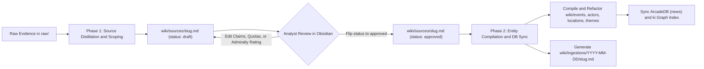

# Two-Phase Ingestion Skill Architecture Proposal

> [!IMPORTANT] Executive Summary
> This proposal specifies the architectural redesign of the Sudan News & OSINT ingestion pipeline (`wiki-ingest`) from a single-pass workflow into a **Two-Phase Human-in-the-Loop (HITL) Compilation Pipeline** governed by an explicit `status` property (`draft` $\to$ `approved`) on every source distillation note in `wiki/sources/<source-slug>.md`.
> - **Phase 1 (`wiki-ingest-phase1` / Source Distillation & Scoping)**: Verifies immutable raw evidence in `raw/`, runs 48-hour spatio-temporal event deduplication (`wiki-scope`), extracts bilingual forensic quotes, scores NATO Admiralty reliability (`A1`–`F6`), and authors `wiki/sources/<source-slug>.md` with `status: "draft"`. Execution halts before any domain entities (`wiki/events/`, `wiki/actors/`, `wiki/locations/`, `wiki/themes/`, `wiki/timelines/`) or database state in ArcadeDB (`news`) are modified.
> - **Analyst Review Gate**: The user reviews `wiki/sources/<source-slug>.md` in Obsidian, adjusts candidate nodes or Admiralty ratings if needed, and flips `status: "draft"` to `status: "approved"`.
> - **Phase 2 (`wiki-ingest-phase2` / Approved Entity Compilation & Database Sync)**: Detects or receives a source note with `status: "approved"`, compiles and refactors the target 5W1H domain notes (`events`, `actors`, `locations`, `themes`, `timelines`), generates the audit dossier in `wiki/ingestions/YYYY-MM-DD/<source-slug>.md`, updates vault ledgers ([[index]], [[overview]], [[glossary]], [[log]]), and synchronizes ArcadeDB (`http://localhost:2481`) and `ki`.

---

## 1. Rationale & Epistemic Benefits for Conflict Intelligence

In multilingual conflict monitoring across Sudan, incoming evidence in `raw/` spans high-reliability humanitarian assessments (UN OCHA, Yale HRL), independent radio (Radio Dabanga, Sudan Tribune), and partisan belligerent communiqués ([[Sudanese Armed Forces]] vs. [[Rapid Support Forces]] Telegram channels). A single-pass ingestion pipeline risks propagating errors directly into the compiled graph if:
1. **Event Deduplication Drift**: A secondary report on an existing battle is misclassified as a new Event rather than a refactor of an existing Event note within the $\lvert \Delta t_{\text{valid}} \rvert \le 48\text{h}$ window.
2. **Transliteration or P-Code Ambiguity**: An unfamiliar Arabic locality or commander kunya is mapped to a duplicate Actor or Location node.
3. **Admiralty Over-Weighting**: A single-source partisan claim (`E5` or `C3`) is treated as corroborated fact (`B2`) before the analyst inspects the extracted claims table.

By halting at `wiki/sources/<source-slug>.md` in `status: "draft"`, the source note serves as both the **forensic provenance record** and the **interactive staging manifest**.



---

## 2. Frontmatter Schema & State Machine for `wiki/sources/`

### 2.1. New Mandatory `status` Property on Source Notes
Every note in `wiki/sources/<source-slug>.md` will include the `status` property in its YAML frontmatter alongside `compiled_at` (populated after Phase 2 completes):

```yaml
---
title: "2026-10-26 Radio Dabanga: Shelling of El Fasher Grand Market"
type: "source"
subtype: "news_article" # Options: news_article | social_post | video_osint | satellite_report | official_communique | ngo_report | eyewitness
status: "draft"         # Options: draft | approved
compiled: false         # Flipped to true after Phase 2 completes entity & DB updates
compiled_at: null       # Populated with YYYY-MM-DD upon Phase 2 completion
source_outlet: "Radio Dabanga"
raw_file: "raw/articles/2026-10-26-dabanga-el-fasher-market.md"
language: "ar"
published_date: 2026-10-26
ingested_date: 2026-11-01
alignment: "independent"
admiralty_source_reliability: "B"
admiralty_info_credibility: 2
admiralty_rating: "B2"
reliability_score: 0.82
events_to_create:
  - "[[2026-10-25 El Fasher Grand Market Shelling]]"
actors_to_create: []
locations_to_create:
  - "[[El Fasher]]"
themes_to_create: []
nodes_to_refactor:
  - "[[Rapid Support Forces]]"
  - "[[Sudanese Armed Forces]]"
  - "[[North Darfur]]"
tags: [north-darfur, el-fasher, shelling, civilian-casualties]
aliases: []
---
```

### 2.2. Design Decision: Two-State (`draft` | `approved`) vs. Auxiliary `compiled` Flag
To satisfy the requirement that the source property is strictly **`draft` or `approved`** while preventing accidental re-execution when batch-processing approved sources:
- **`status: "draft" | "approved"`**: Controlled by the workflow and analyst review. Phase 1 sets `status: "draft"`. The analyst changes it to `status: "approved"` in Obsidian Properties.
- **`compiled: false | true`**: A boolean guard flag.
  - When `status: "draft"` and `compiled: false` $\to$ **Pending Analyst Review** (Phase 1 complete; blocked from Phase 2).
  - When `status: "approved"` and `compiled: false` $\to$ **Ready for Phase 2 Execution** (queued for entity compilation and database sync).
  - When `status: "approved"` and `compiled: true` $\to$ **Fully Compiled & Synced** (Phase 2 completed; included in ArcadeDB `news` and Astro frontend).

| `status` Value | `compiled` Flag | Pipeline Stage | Allowed Actions & System Visibility |
| :--- | :---: | :--- | :--- |
| **`draft`** | `false` | Phase 1 Complete (Awaiting Review) | Editable in Obsidian; **excluded** from `wiki/{events,actors,locations,themes}` compilation, **excluded** from ArcadeDB graph ingestion, and **withheld** from Astro Digital Garden. |
| **`approved`** | `false` | Approved by Analyst (Ready for Phase 2) | Eligible for Phase 2 execution (`/ingest-approve` or `/ingest <source-file>`), which compiles/refactors wiki nodes and syncs ArcadeDB. |
| **`approved`** | `true` | Phase 2 Complete (Live in Graph) | Fully compiled into `wiki/` nodes, indexed in ArcadeDB (`http://localhost:2481`), and published on the Astro Digital Garden. |

---

## 3. Detailed Phase Specifications

### 3.1. Phase 1: Source Distillation & Scoping (`status: "draft"`)

**Trigger**: `/ingest <raw-file-path>` (or explicit `/ingest-draft <raw-file-path>`) when given a file in `raw/` (or `_input/research/`).

**Execution Steps**:
1. **Path & Immutability Verification**:
   - Confirm the target file exists in `raw/` (`articles/`, `social/`, `videos/`, `transcripts/`, `reports/`, `satellite/`) or `_input/research/`.
   - Enforce read-only immutability on `raw/`.
2. **Pre-Ingestion Reconnaissance & 48-Hour Deduplication (`wiki-scope`)**:
   - Read `wiki/index.md`, `wiki/glossary.md`, and the raw source document.
   - Perform the **48-Hour Spatio-Temporal Event Deduplication Check** ($\lvert \Delta t_{\text{valid}} \rvert \le 48\text{h}$ at overlapping locations) and apply the $\ge 0.70$ significance filter.
   - Populate the candidate lists (`events_to_create`, `actors_to_create`, `locations_to_create`, `themes_to_create`, `nodes_to_refactor`).
3. **Draft Source Note Creation (`wiki/sources/<source-slug>.md`)**:
   - Author `wiki/sources/<source-slug>.md` with `status: "draft"` and `compiled: false`.
   - Include four structured sections inside the source note:
     1. `## 1. 5W1H Source Intelligence Summary & Provenance` (with `> [!NOTE] Source Provenance & Admiralty Assessment` callout).
     2. `## 2. Atomic Extracted Claims Table` (Claim `#`, 5W1H Tuple, Modality [`confirmed | probable | alleged | denied | debunked`], Target Wiki Node, Contradiction Flag).
     3. `## 3. Bilingual Direct Citations & Forensic Evidence` (English translation + original Arabic/foreign script blockquote).
     4. `## 4. Scoped Ingestion Plan (Review Before Approval)` (explicitly listing the proposed New Events, New Actors, New Locations, New Themes/Timelines, and Refactors/Contradictions to be executed in Phase 2).
4. **Operational Log & Halt**:
   - Append to `wiki/log.md`:
     `## [YYYY-MM-DD] ingest-draft | <source-slug> | Created draft source note in wiki/sources/<source-slug>.md (Admiralty: <rating>); awaiting analyst approval (status: draft -> approved).`
   - Present a summary to the user linking `[<source-slug>.md](file:///.../wiki/sources/<source-slug>.md)` and instructing them to review the note and change `status: "draft"` to `status: "approved"` when ready for Phase 2.

---

### 3.2. Phase 2: Approved Compilation & Database Synchronization (`status: "approved"`)

**Trigger**:
- **Single-Source Mode**: `/ingest wiki/sources/<source-slug>.md` (or `"continue ingestion for <source-slug>"`).
- **Batch Queue Mode**: `/ingest --approved` (scans `wiki/sources/*.md` for all notes where `status: "approved"` and `compiled: false`).

**Execution Steps**:
1. **Approval Gate Verification**:
   - Read `wiki/sources/<source-slug>.md`.
   - Verify `status == "approved"`. If `status == "draft"`, abort and notify the user: *"Source `[[sources/<source-slug>]]` is still in `status: draft`. Please review and update `status: approved` in frontmatter before running Phase 2."*
   - Read any analyst modifications made during review (updated `admiralty_rating`, edited claims in Section 2, or modified node quotas in frontmatter / Section 4).
2. **Multi-Node 5W1H Compilation & GRaSP Contradiction Refactoring**:
   - Compile all approved new notes in `wiki/events/`, `wiki/actors/`, `wiki/locations/`, `wiki/themes/`, and `wiki/timelines/` following the mandatory 6-stage Micro-CoT section arcs.
   - Refactor all approved existing nodes in `nodes_to_refactor`, appending competing claims to `## 5. Competing Narratives, Attribution & Contradictions` and updating `contradiction_flags`.
3. **Source State Finalization & Ingestion Dossier Creation**:
   - Update `wiki/sources/<source-slug>.md` frontmatter: set `compiled: true` and `compiled_at: YYYY-MM-DD`.
   - Author the permanent audit dossier in `wiki/ingestions/YYYY-MM-DD/<source-slug>.md` (`type: "ingestion"`).
4. **Catalog & Ledger Synchronization**:
   - Update `wiki/index.md`, `wiki/glossary.md` (new Arabic/English aliases & UN OCHA P-Codes), and `wiki/overview.md` (Living SITREP).
5. **Database & Graph Index Synchronization**:
   - Run `./scripts/sync_vault_graph.sh` (or `python3 scripts/ingest_to_arcadedb.py` + `ki add -C wiki`) to push all newly created/updated vertices, `ClaimDispute` records, `AliasLookup` entries, and Macro-CoT edges into **ArcadeDB (`http://localhost:2481`, database `news`)** and Neo4j/`ki`.
   - Append to `wiki/log.md`:
     `## [YYYY-MM-DD] ingest-approved | <source-slug> | Compiled approved source into N notes (E events, A actors, L locations, T themes, K refactors); generated dossier in wiki/ingestions/YYYY-MM-DD/; synced ArcadeDB & ki graph.`

---

## 4. Required Codebase & Tooling Modifications

> [!NOTE] Implementation Impact Matrix
> Implementing the two-phase ingestion split requires targeted updates across **6 files** in the repository.

| Target File | Component Role | Required Modification |
| :--- | :--- | :--- |
| **[AGENTS.md](file:///Users/christoflitznerski/MyObsidian/news01/llm-wiki-news/AGENTS.md)** | System Constitution | Update Section 3.2 (Source Frontmatter Schema) to include `status: "draft" \| "approved"` and `compiled: false \| true`. Update Section 4 (`Protocol A: Ingestion`) into **Phase A.1 (Draft Source Distillation)** and **Phase A.2 (Approved Graph Compilation & DB Sync)**. |
| **[.agent/skills/wiki-ingest/SKILL.md](file:///Users/christoflitznerski/MyObsidian/news01/llm-wiki-news/.agent/skills/wiki-ingest/SKILL.md)** | Ingestion Skill | Split the Execution Sequence into **Phase 1: Source Distillation (`status: draft`)** (Steps 1–4, halting after creating `wiki/sources/<source-slug>.md`) and **Phase 2: Approved Compilation & Database Sync (`status: approved`)** (Steps 5–7, gated on `status: "approved"`). |
| **[.agent/skills/wiki-scope/SKILL.md](file:///Users/christoflitznerski/MyObsidian/news01/llm-wiki-news/.agent/skills/wiki-scope/SKILL.md)** | Pre-Scoping Skill | Update Step 4 so the **Scoped Ingestion Manifest** is embedded directly into Section 4 (`## 4. Scoped Ingestion Plan`) and YAML frontmatter (`events_to_create`, `actors_to_create`, `locations_to_create`, `themes_to_create`, `nodes_to_refactor`) of the draft source note. |
| **[scripts/lint_vault.py](file:///Users/christoflitznerski/MyObsidian/news01/llm-wiki-news/scripts/lint_vault.py)** | Vault Linter | 1. Validate that every `wiki/sources/*.md` note has `status` in `{"draft", "approved"}`.<br>2. Exempt `status: "draft"` source notes from `ORPHAN_NOTE` and `DEAD_LINK` errors (since their target `events_to_create` / `actors_to_create` notes are not yet compiled until Phase 2!).<br>3. Report a dedicated informational summary of pending `status: "draft"` and uncompiled `status: "approved"` sources. |
| **[scripts/ingest_to_arcadedb.py](file:///Users/christoflitznerski/MyObsidian/news01/llm-wiki-news/scripts/ingest_to_arcadedb.py)** | ArcadeDB Compiler | Skip `wiki/sources/*.md` files where `status == "draft"` during ArcadeDB graph ingestion so unreviewed draft sources are never prematurely indexed into `http://localhost:2481`. Add `Source.status` property (`draft` \| `approved`) to ArcadeDB. |
| **[site/src/config/wiki.config.ts](file:///Users/christoflitznerski/MyObsidian/news01/llm-wiki-news/site/src/config/wiki.config.ts)** | Astro Digital Garden | Update `isNotePublished()` so any note with `frontmatter.status === 'draft'` is automatically withheld from public rendering on the Astro site until flipped to `status: "approved"`. |

---

## 5. Critical Edge Case Handled: Linter & Dead-Link Immunity for `status: "draft"` Sources

A subtle architectural interaction occurs during **Phase 1**:
- When `wiki/sources/<source-slug>.md` is saved in `status: "draft"`, its **Atomic Extracted Claims Table** (Section 2) and **Scoped Ingestion Plan** (Section 4) will contain `[[wikilinks]]` to proposed new Events, Actors, and Locations (e.g., `[[2026-10-25 El Fasher Grand Market Shelling]]`) that **do not exist yet** because Phase 2 has not run.
- Furthermore, `wiki/index.md` does not link to the draft source yet, which would normally trigger an `ORPHAN_NOTE` warning in `scripts/lint_vault.py`.

**Solution in [scripts/lint_vault.py](file:///Users/christoflitznerski/MyObsidian/news01/llm-wiki-news/scripts/lint_vault.py)**:
- When scanning a note in `wiki/sources/` with `status: "draft"` (or `status: "approved"` with `compiled: false`):
  1. Do **not** flag outbound wikilinks to planned nodes as `DEAD_LINK`.
  2. Do **not** flag the uncompiled source note as `ORPHAN_NOTE`.
  3. Instead, display a clean **"Pending Ingestion Queue"** section in the `/lint` output listing all `draft` sources awaiting review and all `approved` sources ready for Phase 2 compilation.

---

## 6. Proposed User Experience & Command Flows

### Flow A: Ingesting a New Raw File (Phase 1)
1. User invokes: `ingest raw/articles/2026-10-26-dabanga-el-fasher.md`
2. Agent runs **Phase 1**, creates `wiki/sources/2026-10-26-dabanga-el-fasher.md` with `status: "draft"`, and outputs:
   > **Phase 1 Complete (`status: draft`)**: Created source distillation `[[sources/2026-10-26-dabanga-el-fasher]]` (`Admiralty: B2`).
   > - **Proposed New Nodes**: 1 Event, 0 Actors, 1 Location
   > - **Proposed Refactors**: 3 Existing Nodes
   >
   > Review the source note in Obsidian, adjust any claims or target nodes if needed, change `status: "draft"` to `status: "approved"`, and reply **"proceed with Phase 2"** (or run `/ingest wiki/sources/2026-10-26-dabanga-el-fasher.md`).

### Flow B: Approving & Compiling into Wiki + Database (Phase 2)
1. User changes `status: "draft"` $\to$ `status: "approved"` in `wiki/sources/2026-10-26-dabanga-el-fasher.md` (or tells the agent *"approve and run Phase 2"*).
2. Agent verifies `status: "approved"`, creates/updates the `wiki/{events,actors,locations,themes,timelines}/` notes, generates `wiki/ingestions/YYYY-MM-DD/2026-10-26-dabanga-el-fasher.md`, flips `compiled: true`, updates `wiki/index.md`, `wiki/overview.md`, and `wiki/glossary.md`, and runs `./scripts/sync_vault_graph.sh` to update ArcadeDB (`http://localhost:2481`).

---

## Related Primitives

- **Core Governance & Skills**: [[overview|Sudan Conflict Living SITREP]], [[glossary|Sudan Cross-Lingual Glossary & P-Code Registry]]
- **Originating Task**: [[_input/tasks/archived/Split ingestion skill.md|Split Ingestion Skill Task Specification]]
