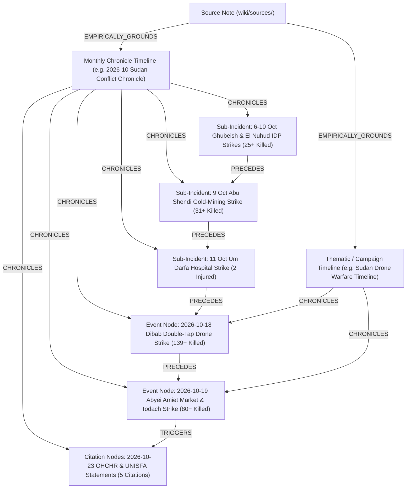

# Wiki Timelines Architecture & Ingestion Integration Plan (`wiki/timelines/`)

> [!IMPORTANT] Executive Summary: Why `wiki/timelines/` Was Empty & How to Turn It Into the Vault's Temporal Spine
> During our first full ingestion ([[sources/2026-10-23-un-news-sudan-drone-strikes-306-killed]]), `wiki/events/`, `wiki/actors/`, `wiki/locations/`, `wiki/themes/`, and `wiki/citations/` were populated with 22 rich nodes, while `wiki/timelines/` remained empty.
>
> **Root Cause Diagnosis**:
> 1. **Missing Frontmatter Array in `source` Schema**: Phase 1 draft source notes (`wiki/sources/<source-slug>.md`) had explicit target arrays for `events_to_create`, `actors_to_create`, `locations_to_create`, `themes_to_create`, and `citations_to_create`, **but no `timelines_to_create` (or `timelines_to_update`) field**.
> 2. **No Automatic Monthly/Campaign Chronicle Routing in `wiki-scope`**: While `wiki-scope` grouped "Themes & Timelines ($T$)" conceptually, it lacked a deterministic rule requiring every dated `Event` (`event_start_date: YYYY-MM-DD`) to be anchored into a **Monthly Conflict Chronicle** (`[[YYYY-MM Sudan Conflict Chronicle]]`) and/or a **Campaign/Thematic Timeline**.
> 3. **No Micro-CoT Arc or Graph Edge Extraction for `Timeline` Notes**: Unlike `Event`, `Actor`, `Location`, `Theme`, and `Citation`, `Timeline` lacked a canonical Micro-CoT section structure in `AGENTS.md` / `scripts/lint_vault.py` and lacked dedicated temporal sequencing edges (`[:CHRONICLES]`, `[:PRECEDES]`) in `scripts/ingest_to_arcadedb.py`.

---

## 1. Strategic Role of `wiki/timelines/` in Conflict & OSINT Intelligence

In conflict monitoring systems (ACLED, UN OCHA, ICG CrisisWatch, Institute for the Study of War, Bellingcat), atomic **Event Notes (`wiki/events/`)** answer *"What happened in this discrete incident or bounded campaign?"*, whereas **Timeline Notes (`wiki/timelines/`)** provide the **Longitudinal, Bitemporal & Causal Spine** across events, citations, theatres, and months:



### Five Core Intelligence Capabilities Unlocked by `wiki/timelines/`

| Capability | Why `wiki/events/` Alone Is Insufficient | How `wiki/timelines/` Solves It |
| :--- | :--- | :--- |
| **1. Sub-Threshold Incident Preservation** | In [[sources/2026-10-23-un-news-sudan-drone-strikes-306-killed]], the 6–10 Oct Ghubeish/El Nuhud strikes (`25+` killed), 9 Oct Abu Shendi strike (`31+` killed), and 11 Oct Um Darfa hospital strike (`2` injured) were folded into [[2026-10 Sudan Drone Warfare Escalation]] rather than given standalone event files. | A **Monthly Chronicle (`[[2026-10 Sudan Conflict Chronicle]]`)** gives every dated sub-incident its own chronological row with exact $t_{\text{valid}}$, $t_{\text{reported}}$, P-Code, actor attribution, and casualty count so no dated strike is buried in prose. |
| **2. Bitemporal Lag Tracking ($\Delta t = t_{\text{reported}} - t_{\text{valid}}$)** | In conflict zones with telecom blackouts, atrocities are often reported days or weeks later (e.g., `2026-10-06` strikes reported on `2026-10-23`, a **17-day reporting lag**). | Timelines maintain a side-by-side **Valid Date ($t_{\text{valid}}$) vs. Report Date ($t_{\text{reported}}$)** ledger, surfacing verification delays and information blackouts. |
| **3. Cross-Theatre Escalation & Tempo Analysis** | Individual event notes focus on a single locality (`SD18`, `SD17`, `SD18001`). | Timelines reveal **multi-theatre operational tempo**—such as how back-to-back strikes hit [[West Kordofan]] on `2026-10-18` ([[2026-10-18 Dibab Double-Tap Drone Strike]]) and neighboring [[Abyei]] less than 24 hours later on `2026-10-19` ([[2026-10-19 Abyei Amiet Market and Todach Drone Strike]]). |
| **4. Action–Reaction & Speech-Act Sequencing** | Citations in `wiki/citations/` are stored as individual statements. | Timelines interleave **kinetic events** (`wiki/events/`) with **diplomatic/forensic speech acts** (`wiki/citations/`) on a single time axis—showing how kinetic escalation on `18–19 Oct` triggered [[Volker Türk]]'s condemnation ([[2026-10-23 Volker Türk Condemnation of Sudan Drone Escalation and Arms Influx]]) and the UN Security Council war crimes warning on `23 Oct`. |
| **5. Automated `[:PRECEDES]` Edge Materialization in ArcadeDB** | Manually authoring `[:PRECEDES]` edges between dozens of events is error-prone. | `scripts/ingest_to_arcadedb.py` can parse the chronological ledger table in each `Timeline` note to automatically materialize `(:Timeline)-[:CHRONICLES]->(:Event | :Citation)` and sequential `(:Event)-[:PRECEDES]->(:Event)` edges in ArcadeDB (`news`). |

---

## 2. Taxonomy of Timeline Subtypes (`wiki/timelines/`)

Every note in `wiki/timelines/` (`type: "timeline"`) must declare one of four canonical `subtype` values:

| `subtype` | Naming Convention | Triggering Rule in `wiki-scope` / `wiki-ingest` | Example from Current Vault |
| :--- | :--- | :--- | :--- |
| **`monthly_chronicle`** | `YYYY-MM Sudan Conflict Chronicle` | **Mandatory Auto-Upsert**: Whenever an ingested source contains events in calendar month `YYYY-MM`, create (if missing) or refactor (if existing) `[[YYYY-MM Sudan Conflict Chronicle]]`. | `[[2026-10 Sudan Conflict Chronicle]]` |
| **`campaign_timeline`** | `<Theatre/Operation> Campaign Timeline` | Created when $\ge 2$ linked incidents or a `subtype: campaign` event span a distinct geographic corridor or siege. | `[[2026 Kordofan and Abyei Corridor Escalation Timeline]]` |
| **`thematic_timeline`** | `<Theme/Doctrine> Timeline` | Created when a longitudinal `Theme` (e.g., [[Drone Proliferation and Double-Tap Strike Doctrine in Sudan]]) exhibits a dated sequence of doctrinal milestones across multiple locations. | `[[Sudan Drone Warfare and Double-Tap Strike Timeline]]` |
| **`diplomatic_timeline`** | `<Process/Body> Diplomatic and Accountability Timeline` | Created when tracking ceasefire talks (Jeddah, Geneva, Manama), UN Security Council resolutions, and [[OHCHR]] investigations over time. | `[[UN Security Council and OHCHR Sudan Accountability Timeline]]` |

---

## 3. Mandatory Frontmatter & 5-Stage Micro-CoT Schema for `wiki/timelines/`

### 3.1. YAML Frontmatter Schema (`wiki/timelines/<Title>.md`)

```yaml
---
title: "2026-10 Sudan Conflict Chronicle"
type: "timeline"
subtype: "monthly_chronicle" # Options: monthly_chronicle | campaign_timeline | thematic_timeline | diplomatic_timeline
start_date: 2026-10-01
end_date: 2026-10-31
time_horizon: "month" # Options: week | month | quarter | year | multi_year
theatres_covered:
  - "[[West Kordofan]]"
  - "[[Blue Nile State]]"
  - "[[Abyei]]"
events_chronicled:
  - "[[2026-10 Sudan Drone Warfare Escalation]]"
  - "[[2026-10-18 Dibab Double-Tap Drone Strike]]"
  - "[[2026-10-19 Abyei Amiet Market and Todach Drone Strike]]"
citations_chronicled:
  - "[[2026-10-23 Volker Türk Condemnation of Sudan Drone Escalation and Arms Influx]]"
  - "[[2026-10-23 Seif Magango Statement on Evisceration of Civilian Infrastructure in Sudan]]"
  - "[[2026-10-23 Muhammad Farooq First-Responder Account of Amiet Market Fire]]"
  - "[[2026-10-23 Adebowale Ajabge Report on UNISFA Emergency Response and Todach Evacuations]]"
  - "[[2026-10-23 Angelina Musa Diaw Survivor Testimony on Amiet Market Destruction]]"
actors_involved:
  - "[[Sudanese Armed Forces]]"
  - "[[Rapid Support Forces]]"
  - "[[OHCHR]]"
  - "[[UNISFA]]"
themes_linked:
  - "[[Drone Proliferation and Double-Tap Strike Doctrine in Sudan]]"
cumulative_fatalities_low: 306
cumulative_fatalities_best: 306
cumulative_fatalities_high: 350
admiralty_rating: "A2"
reliability_score: 0.90
tags:
  - sudan
  - timeline
  - monthly-chronicle
  - 2026-10
  - drone-warfare
last_updated: 2026-11-01
sources:
  - "[[sources/2026-10-23-un-news-sudan-drone-strikes-306-killed]]"
aliases:
  - "October 2026 Sudan Conflict Timeline"
  - "October 2026 Sudan Chronicle"
---
```

### 3.2. Canonical 5-Stage Timeline Micro-CoT Arc (Axiom 9 Extension)

Every note in `wiki/timelines/` must follow a 5-stage reasoning progression verified by `scripts/lint_vault.py --cot` and indexed by `scripts/ingest_to_arcadedb.py`:

1. **`## 1. Temporal Scope, Theatre Coverage & Strategic Periodization` (`TIMELINE_ANCHOR`)**:
   - Lead Callout (`> [!IMPORTANT] Temporal Chronicle Anchor`) summarizing the start/end window (`start_date` to `end_date`), covered states/P-Codes, cumulative casualties, dominant operational pattern, and primary belligerents.
2. **`## 2. Chronological Event & Citation Ledger (Bitemporal Sequence)` (`CHRONOLOGICAL_LEDGER`)**:
   - Native Mermaid timeline/sequence flowchart (`flowchart TD` or `sequenceDiagram`) + master GFM Bitemporal Table ordered strictly by $t_{\text{valid}}$ (`Valid Date ($t_valid$)`, `Report Date ($t_reported$) & Lag`, `Location & P-Code`, `Actors & Role`, `Event / Incident / Speech Act`, `Casualties & Impact`, `Linked Wiki Node & Rating`).
3. **`## 3. Causal Escalation Chains, Turning Points & Tempo Analysis` (`CAUSAL_ESCALATION`)**:
   - Analytical breakdown of operational tempo (e.g., strike frequency, geographical shifts between [[Blue Nile State]], [[West Kordofan]], and [[Abyei]]), action–reaction triggers, and doctrinal inflections ([[Drone Proliferation and Double-Tap Strike Doctrine in Sudan]]).
4. **`## 4. Cumulative Humanitarian, Territorial & Attribution Telemetry` (`CUMULATIVE_TELEMETRY`)**:
   - Quantitative aggregation table comparing fatalities by theatre, perpetrator attribution breakdown (`confirmed` vs. `alleged` vs. `unspecified`), infrastructure destroyed (hospitals, IDP camps, markets), and active `contradiction_flags`.
5. **`## Related Primitives` (`SYNTHESIS_CATALOG`)**:
   - Bidirectional links to all chronicled Events, Citations, Actors, Locations, Themes, and Originating Sources.

---

## 4. Concrete Demonstration: How Our First Ingestion Populates `wiki/timelines/`

For our already-ingested source [[sources/2026-10-23-un-news-sudan-drone-strikes-306-killed]], applying this architecture immediately yields **`[[2026-10 Sudan Conflict Chronicle]]`** (`subtype: "monthly_chronicle"`), transforming the 6 dated sub-incidents and 5 UN citations into a unified bitemporal ledger:

| Valid Date ($t_{\text{valid}}$) | Report Date ($t_{\text{reported}}$) & Lag | Location & P-Code | Actors & Attribution | Incident / Speech Act Summary | Verified Toll | Canonical Node |
| :--- | :--- | :--- | :--- | :--- | :--- | :--- |
| `2026-10-06` to `2026-10-10` | `2026-10-23` (+13–17d lag) | Ghubeish & El Nuhud, [[West Kordofan]] (`SD18`) | Alleged [[Sudanese Armed Forces]] $\to$ IDP Shelters | Drone strikes hit displaced persons' shelters across two towns. | **25+ killed** (incl. women & children) | [[2026-10 Sudan Drone Warfare Escalation]] |
| `2026-10-09` | `2026-10-23` (+14d lag) | Abu Shendi, [[Blue Nile State]] (`SD17`) | Alleged [[Rapid Support Forces]] $\to$ IDP gold miners | Drone strike hit displaced people mining gold near an IDP site. | **31+ killed** (mostly women & children) | [[2026-10 Sudan Drone Warfare Escalation]] |
| `2026-10-11` | `2026-10-23` (+12d lag) | Um Darfa, [[Blue Nile State]] (`SD17`) | [[Rapid Support Forces]] $\to$ Um Darfa Hospital | Drone strike hit medical facility, forcing hospital closure. | **2 health workers seriously injured** | [[2026-10 Sudan Drone Warfare Escalation]] |
| `2026-10-18` | `2026-10-23` (+5d lag) | Dibab, [[West Kordofan]] (`SD18`) | Unspecified UAV operator in [[Rapid Support Forces]]-held town | Repeat "double-tap" drone strike on a civilian transport truck. | **139+ killed** | [[2026-10-18 Dibab Double-Tap Drone Strike]] |
| `2026-10-19` | `2026-10-23` (+4d lag) | Amiet Market & Todach, [[Abyei]] (`SD18001`) | Unspecified UAV operator; [[UNISFA]] first responders | Drone strike burned Amiet Market ([[2026-10-23 Muhammad Farooq First-Responder Account of Amiet Market Fire]], [[2026-10-23 Angelina Musa Diaw Survivor Testimony on Amiet Market Destruction]]); [[UNISFA]] evacuated wounded to Todach ([[2026-10-23 Adebowale Ajabge Report on UNISFA Emergency Response and Todach Evacuations]]). | **80+ killed**, **27+ injured** | [[2026-10-19 Abyei Amiet Market and Todach Drone Strike]] |
| `2026-10-23` | `2026-10-23` (0d lag) | Geneva / New York / [[Abyei]] | [[Volker Türk]], [[Seif Magango]] ([[OHCHR]]), UN Security Council | [[OHCHR]] verified `306+` 3-week drone deaths, condemned infrastructure evisceration, and demanded halt to arms influx; UNSC warned [[Abyei]] strike may constitute a war crime. | Diplomatic & forensic intervention | [[2026-10-23 Volker Türk Condemnation of Sudan Drone Escalation and Arms Influx]], [[2026-10-23 Seif Magango Statement on Evisceration of Civilian Infrastructure in Sudan]] |

---

## 5. Step-by-Step Implementation Plan Across the Repository

To make `wiki/timelines/` a first-class, automatically maintained part of every future `/ingest` operation—and backfill our first ingestion—we should execute the following 5 updates:

1. **Update `AGENTS.md` (Axiom 9 & Section 3.2/4)**:
   - Add the **5-Stage Timeline Micro-CoT Arc** (`1. Temporal Scope, Theatre Coverage & Strategic Periodization`, `2. Chronological Event & Citation Ledger`, `3. Causal Escalation Chains, Turning Points & Tempo Analysis`, `4. Cumulative Humanitarian, Territorial & Attribution Telemetry`, `## Related Primitives`).
   - Add `timelines_to_create` to the mandatory `source` frontmatter schema (and instruct `wiki-scope` to place existing monthly chronicles into `nodes_to_refactor` whenever new events fall into an already-created `YYYY-MM` chronicle).
   - Add `[:CHRONICLES]` to the Macro-CoT relational handshakes.
2. **Update `.agent/skills/wiki-scope/SKILL.md` & `.agent/skills/wiki-ingest/SKILL.md`**:
   - **Mandatory Monthly Chronicle Rule**: Every Phase 1 scoping pass (`wiki-scope`) must check the `YYYY-MM` window of extracted events and either add `[[YYYY-MM Sudan Conflict Chronicle]]` to `timelines_to_create` (if it does not yet exist in `wiki/timelines/`) or add it to `nodes_to_refactor` (if it already exists).
   - Scope a `campaign_timeline` or `thematic_timeline` whenever a source documents $\ge 3$ sequential strikes or a multi-week campaign.
3. **Update `scripts/bootstrap_arcadedb.py` & `scripts/ingest_to_arcadedb.py`**:
   - Add `Timeline` properties (`start_date`, `end_date`, `time_horizon`, `cumulative_fatalities_best`, `admiralty_rating`, `reliability_score`) and `CREATE EDGE TYPE CHRONICLES IF NOT EXISTS` in `scripts/bootstrap_arcadedb.py`.
   - In `scripts/ingest_to_arcadedb.py`, parse `events_chronicled` and `citations_chronicled` from `wiki/timelines/*.md` to create `(:Timeline)-[:CHRONICLES]->(:Event | :Citation)` edges and sequential `(:Event)-[:PRECEDES]->(:Event)` edges.
4. **Update `scripts/lint_vault.py`**:
   - Add `timelines/` to the `--cot` Dual-Flow CoT stage verifier so every Timeline note is checked for its 5 canonical headings.
5. **Backfill `wiki/timelines/` for `2026-10-23-un-news-sudan-drone-strikes-306-killed`**:
   - Compile `wiki/timelines/2026-10 Sudan Conflict Chronicle.md` (`subtype: "monthly_chronicle"`) and `wiki/timelines/Sudan Drone Warfare and Double-Tap Strike Timeline.md` (`subtype: "thematic_timeline"`), register them in `wiki/index.md` and `wiki/sources/2026-10-23-un-news-sudan-drone-strikes-306-killed.md`, and sync them to ArcadeDB (`news`).
