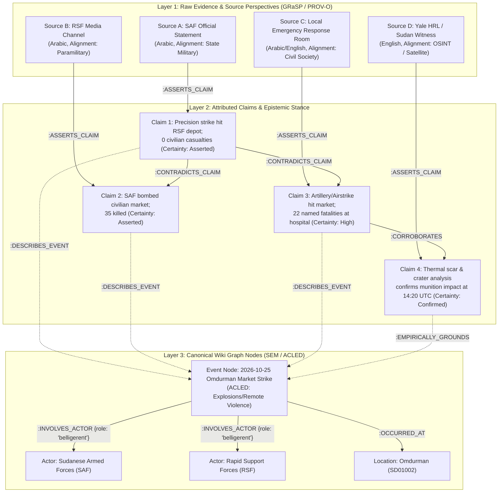

# News, Conflict & Provenance Ontologies for an Event-Centric Karpathy LLM-Wiki

- **Research Subject**: Deep-dive into News Standards, Conflict Event Ontologies, OSINT Verification Frameworks, and Contradiction Modeling for [[Sudan Conflict Knowledge Graph]]
- **Target File**: `raw/research/news-ontologies-and-conflict-intelligence-standards.md`
- **Date**: 2026-10-31
- **Keywords**: IPTC News Architecture, ninjs, EventsML-G2, Simple Event Model (SEM), LODE, NewsReader, GRaSP, ACLED, CAMEO, PLOVER, EventKG, TimeML, W3C PROV-O, UN OCHA P-Codes, Berkeley Protocol, NATO Admiralty Scale, Karpathy LLM Wiki, Sudan Conflict

---

## 1. Executive Summary

Transforming a personal knowledge repository based on Andrej Karpathy's **LLM-Wiki** paradigm from an academic/pedagogical learning space into a **multilingual news and open-source intelligence (OSINT) collection engine focused on Sudan** requires a foundational shift in knowledge representation.

In a learning wiki, knowledge is **concept-centric** and largely **atemporal**: theories, mental models, and software architectures evolve slowly and converge toward consensus. In contrast, conflict news and OSINT collection (spanning Arabic, English, French, and local Sudanese vernaculars across news agencies, Telegram channels, satellite imagery reports, and social media videos) is **event-centric, bi-temporal, spatio-political, and inherently adversarial**. During active conflict—such as the war in Sudan involving the Sudanese Armed Forces (SAF), Rapid Support Forces (RSF), allied militias, civilian Emergency Response Rooms (ERRs), and regional powers—incoming reports suffer from the "fog of war," telecommunications blackouts, deliberate disinformation, and conflicting casualty or attribution claims.

Traditional Retrieval-Augmented Generation (RAG) fails in this environment because chunk-based vector similarity collapses contradictory articles from different dates or partisan outlets into hallucinated composites. Conversely, Karpathy's **Ingest-Time Compilation** model—augmented with **Dual-Flow Chain of Thought (CoT)** and backed by a multi-model graph/vector database (ArcadeDB / Neo4j)—is uniquely suited to solve this problem, provided its underlying schema synthesizes five complementary families of international standards:

1. **Journalistic & Media Exchange Ontologies** (**IPTC NAR / EventsML-G2 / ninjs**, **LODE**, **SEM**) to decouple raw media items (`raw/`) from persistent, canonical Event, Actor, and Location nodes (`wiki/`).
2. **Conflict & Geopolitical Event Taxonomies** (**ACLED**, **CAMEO / PLOVER**, **UCDP GED**) to standardize kinetic actions, strategic developments, actor classifications, interaction dyads, and casualty uncertainty ranges.
3. **Perspective, Attribution & Contradiction Frameworks** (**NewsReader ESO**, **GAF / GRaSP**, **W3C PROV-O**, **ClaimReview**) to prevent conflicting claims from overwriting each other by modeling *who asserts what, with what certainty, and based on what evidence*.
4. **OSINT & Intelligence Verification Protocols** (**NATO Admiralty Scale A–F / 1–6**, **Berkeley Protocol**) to decouple **Source Reliability** (outlet track record and alignment) from **Information Credibility** (corroboration of a specific claim).
5. **Spatio-Temporal & Humanitarian Standards** (**UN OCHA Sudan P-Codes**, **HXL**, **TimeML**, **EventKG Bi-Temporal Modeling**) to resolve Arabic-English transliteration drift across Sudanese states/localities and distinguish physical event time ($t_{\text{valid}}$) from publication time ($t_{\text{reported}}$).

---

## 2. Theoretical & Conceptual Frameworks: The Five Ontology Pillars

### 2.1. Journalistic & Semantic Web Event Ontologies (5W1H Grounding)

Standard knowledge graphs store static entity-to-entity triples (`Subject -> Predicate -> Object`). News requires **n-ary event reification**, where an **Event** is a first-class citizen connecting *Who* (Actors + Roles), *What* (Action/Type), *When* (Time interval), *Where* (Location), *Why* (Causal drivers/Motives), and *According to Whom* (Sources).

| Standard / Ontology | Steward / Origin | Core Primitives | Architectural Value for LLM-Wiki News |
| :--- | :--- | :--- | :--- |
| **IPTC News Architecture (NAR): NewsML-G2, EventsML-G2 & ninjs 3.x** | International Press Telecommunications Council (IPTC) | `NewsItem`, `Event` (`EventsML-G2`), `ConceptItem` (Person, Org, GeoArea), `QCodes` (Media Topics) | Strictly separates transient *news packages* (`wiki/sources/`) from persistent *domain events* (`wiki/events/`), allowing 20 articles in 4 languages to compile into 1 canonical event node. |
| **SEM (Simple Event Model)** | Vrije Universiteit Amsterdam (van Hage et al.) | `sem:Event`, `sem:Actor`, `sem:Place`, `sem:Time`, `sem:RoleType`, `sem:View`, `sem:Authority` | Introduces **Role-Bounded Participation** (an actor is not merely linked to an event, but holds a role: *Perpetrator*, *Target*, *Mediator*) and **`sem:View`** to hold multiple competing accounts of the same event. |
| **LODE (Linking Open Descriptions of Events)** | Shaw, Troncy, Hardman (CWI / W3C) | `lode:Event`, `atTime`, `inSpace`, `atPlace`, `involvedAgent`, `illustrate` | Maps the journalistic **5Ws** directly to CIDOC-CRM and Dublin Core, separating factual spatio-temporal anchoring from interpretive commentary (`illustrate`). |
| **CIDOC-CRM (ISO 21127)** | ICOM / ISO Cultural & Historical Heritage Standard | `E5_Event`, `E7_Activity`, `E39_Actor`, `E52_Time-Span`, `E53_Place` | Provides formal causal and mereological event hierarchies (`P9_consists_of` linking a macro military campaign to discrete daily clashes). |

### 2.2. Conflict, Political & Humanitarian Coding Taxonomies (Sudan Domain Grounding)

While SEM and LODE define abstract event containers, they do not specify domain vocabularies for armed conflict, diplomacy, or humanitarian crises. Three empirical conflict frameworks provide rigorous, battle-tested taxonomies:

1. **ACLED (Armed Conflict Location & Event Data Project)**:
   - **Unit of Observation**: Atomic daily event defined by `(Date, Location, Event Type, Sub-Event Type, Actor 1, Assoc Actor 1, Actor 2, Assoc Actor 2, Fatalities)`.
   - **6 Canonical Event Types & 25 Sub-Event Types**:
     - `Battles`: *Armed clash*, *Government regains territory*, *Non-state actor overtakes territory*.
     - `Explosions / Remote violence`: *Air/drone strike*, *Shelling/artillery/missile attack*, *Remote explosive/landmine/IED*, *Suicide bomb*, *Chemical weapon*.
     - `Violence against civilians`: *Attack*, *Abduction/forced disappearance*, *Sexual violence*.
     - `Protests`: *Peaceful protest*, *Protest with intervention*, *Excessive force against protesters*.
     - `Riots`: *Violent demonstration*, *Mob violence*.
     - `Strategic developments`: *Agreement*, *Arrests*, *Change to group/activity*, *Disrupted weapons use*, *Headquarters or base established*, *Looting/property destruction*, *Non-violent transfer of territory*.
   - **8 Actor Categories (`Inter` Codes)**:
     1. `State Forces` (e.g., Sudanese Armed Forces [SAF], General Intelligence Service [GIS], Police)
     2. `Rebel Groups` (e.g., SPLM-N al-Hilu, SLA-Abdul Wahid, JEM factions)
     3. `Political Militias` (e.g., Rapid Support Forces [RSF], Sudan Shield Forces, Al-Baraa Ibn Malik Brigade)
     4. `Identity Militias` (e.g., communal/tribal militias in Darfur, Kordofan, Blue Nile)
     5. `Rioters`
     6. `Protesters`
     7. `Civilians` (including grassroots Emergency Response Rooms [ERRs], Resistance Committees, IDP communities)
     8. `External / Other Forces` (foreign states, mercenaries, UN/AU/IGAD missions, international NGOs)
   - **Precision Scalars**: `time_precision` (1–3) and `geo_precision` (1–3) explicitly encode uncertainty when exact dates or village coordinates are obscured by war conditions.

2. **PLOVER (Political Language Ontology for Verifiable Event Records) & CAMEO**:
   - Developed as the modern ontology successor to CAMEO (used in GDELT and ICEWS), **PLOVER** structures non-kinetic political, diplomatic, and economic interactions (such as ceasefires, arms transfers, sanctions, aid blockades, and peace summits in Jeddah, Manama, Cairo, or Geneva).
   - Decomposes political actions into **`Event Type` (What)** + **`Mode` (How: verbal statement, threat, agreement, material aid, sanction)** + **`Context` (Why: military, economic, diplomatic, humanitarian, legal)**.

3. **UCDP GED (Uppsala Conflict Data Program) Uncertainty Intervals**:
   - Instead of forcing a single point estimate for casualties when sources conflict, UCDP records `deaths_low`, `deaths_high`, and `deaths_best`. Adopting this triplet in YAML frontmatter prevents false precision during breaking news compilation.

### 2.3. Perspective, Attribution & Contradiction Ontologies (The GRaSP & NewsReader Model)

The most critical requirement for a conflict news LLM-Wiki is **detecting, preserving, and reasoning over contradictions**. Piek Vossen, Antske Fokkens, and colleagues developed the **Grounded Annotation Framework (GAF)** and **GRaSP (Grounded Representation and Source Perspective)** within the EU **NewsReader** project specifically to solve this problem in multilingual Event Knowledge Graphs.

Key architectural mechanisms of **GRaSP + W3C PROV-O**:
- **Decoupling Event Identity from Perspective Values**: Two sources can agree that an *Event* occurred at a specific *Location* and *Date* (allowing them to merge into a single `wiki/events/` note) while sharply disagreeing on **Perpetrator Attribution**, **Casualty Counts**, **Target Legitimacy (military vs. civilian)**, or **Causal Motive ("Why")**.
- **Explicit Attribution Metadata**: Every contested statement is bound to `(Source Document, Quoted Authority, Factuality/Modality, Polarity, Timestamp)`.
- **Contradiction Taxonomy for News**:
  1. `ATTRIBUTION_CONFLICT`: Disagreement over *who* perpetrated or initiated the action (mutual blame between SAF and RSF).
  2. `MAGNITUDE_DISCREPANCY`: Divergent casualty, displacement, or force-size figures beyond normal reporting lag.
  3. `TARGET_FRAMING_CONFLICT`: One party claims a target was a "military command center / fuel depot" while witnesses/OSINT identify a "hospital / bakery / IDP shelter."
  4. `TEMPORAL_CAUSAL_INVERSION`: Disagreement over sequence ("who broke the ceasefire first" or "whether an attack was preemptive vs. retaliatory").
  5. `CONTROL_DISPUTE`: Competing claims of territorial control over a strategic town, bridge, or military base (e.g., Babanusa, El Fasher, Sennar).
  6. `MEDIA_FABRICATION_DEBUNK`: Recycled old footage, AI-generated imagery, or misattributed geolocation exposed by OSINT verification.

---

## 3. Empirical Findings & Real-World Observations in Sudan Conflict Monitoring

Real-world OSINT and conflict monitoring organizations operating on Sudan—including **ACLED's Sudan Conflict Monitor**, **Sudan Witness (Centre for Information Resilience)**, **Yale Humanitarian Research Lab (HRL)**, **Sudan War Monitor**, **Radio Dabanga**, **Sudan Tribune**, and local **Emergency Response Rooms (ERRs)**—have established four empirical best practices that directly inform the LLM-Wiki design:

### 3.1. Two-Dimensional Epistemic Scoring: The NATO Admiralty Scale (A–F / 1–6)
In active conflict zones, a highly partisan source (e.g., an RSF field fighter filming a TikTok/Telegram video in Al Jazirah, or an official SAF communiqué) has low institutional neutrality (`Source Reliability = C` or `D`), yet a specific geolocated video showing recognizable landmarks in Wad Madani may be `Information Credibility = 1 (Confirmed by independent geospatial verification)`. Conversely, a reputable international outlet (`Source Reliability = B`) might repeat an unverified rumor during a communications blackout (`Information Credibility = 3` or `4`).

| Source Reliability (`A`–`F`) | Definition in Sudan News Vault | Information Credibility (`1`–`6`) | Definition in Sudan News Vault |
| :--- | :--- | :--- | :--- |
| **`A` — Completely Reliable** | Primary physical/forensic evidence: satellite imagery (Yale HRL, Planet/Maxar), verified geolocated OSINT (Sudan Witness), direct medical ledgers (MSF, WHO). | **`1` — Confirmed** | Independently corroborated by $\ge 2$ unaffiliated sources or verified via satellite/geolocation. |
| **`B` — Usually Reliable** | Established independent Sudan/international journalism with editorial verification (Radio Dabanga, Sudan Tribune, Reuters, Mada Masr, UN OCHA). | **`2` — Probably True** | Consistent with known operational patterns and reported by reliable local monitors (e.g., ERRs) without contradiction. |
| **`C` — Fairly Reliable** | Local citizen journalists, Resistance Committees, or regional outlets with occasional verification gaps. | **`3` — Possibly True** | Plausible given frontline context, but currently single-source or uncorroborated. |
| **`D` — Not Usually Reliable** | Official belligerent channels (SAF Armed Forces page, RSF official accounts) or partisan state-aligned media with documented propaganda bias. | **`4` — Doubtful** | Plausible on surface but lacks evidence and aligns suspiciously with partisan information operations. |
| **`E` — Unreliable** | Known disinformation networks, automated bot accounts, or fabricators. | **`5` — Improbable / Debunked** | Contradicted by physical/satellite evidence, chronolocation, or verified ground reports. |
| **`F` — Cannot Be Judged** | New, anonymous, or first-time social media source with no prior track record. | **`6` — Cannot Be Judged** | Insufficient information available to evaluate truth (e.g., total telecom blackout). |

To maintain seamless backward compatibility with the LLM-Wiki codebase (`site/src/config/wiki.config.ts` and ArcadeDB/Neo4j numeric filters), the Admiralty code (`A1`–`F6`) deterministically maps to a composite `reliability_score` float ($0.00 - 1.00$), while preserving both dimensions in YAML frontmatter.

### 3.2. Geopolitical & Administrative Standardization via UN OCHA Sudan P-Codes
Sudan comprises **18 States (`ADM1` / Wilayah)** and **189 Localities (`ADM2` / Mahaliya)**. Because raw news arrives in Arabic, English, and French, the same city appears under numerous spellings:
- *Al-Fashir / El Fasher / الفاشر* (North Darfur, `SD02`)
- *Al-Jazirah / Gezira / Wad Madani / ود مدني / الجزيرة* (`SD15`)
- *Al-Khartum / Khartoum / الخرطوم*, *Omdurman / أم درمان*, *Bahri / Khartoum North / بحري* (`SD01`)
- *Babanusa / بابنوسة* (West Kordofan, `SD18`)

Binding every `wiki/locations/` node to its **UN OCHA P-Code** (`pcode: "SD02001"`), WGS84 coordinates (`lat`, `lon`), administrative level (`adm_level`), and canonical English name—while indexing all Arabic spellings and transliterations in `wiki/glossary.md` and ArcadeDB's `AliasLookup` store—prevents graph fragmentation across languages.

### 3.3. Bi-Temporal Tracking Under Communication Blackouts
In Sudan, internet and cellular blackouts (and reliance on Starlink terminals) mean violent events in Darfur, Kordofan, or Sennar frequently experience a **3-to-14 day reporting lag** between occurrence and media publication. Furthermore, video artefacts are often re-uploaded weeks later as "breaking news." Therefore, every Event and Source note must track three distinct timestamps:
1. **`event_start_date` / `event_end_date` ($t_{\text{valid}}$)**: When the event occurred in reality (ISO-8601 + `time_precision`).
2. **`reported_date` ($t_{\text{reported}}$)**: When the source artifact was published/broadcast.
3. **`last_updated` ($t_{\text{compiled}}$)**: When the LLM-Wiki agent compiled or refactored the node.

---

## 4. Institutional, Policy, or Market Dynamics: Why Karpathy's LLM-Wiki Excels at News Intelligence

Andrej Karpathy's **LLM-Wiki** pattern posits that instead of querying a raw pile of documents at runtime (classic RAG), an autonomous LLM agent acts as a **cognitive compiler** that maintains a structured, interlinked Markdown codebase (`wiki/`) inside Obsidian.

When applied to Sudan conflict news, this architecture outperforms both traditional media monitoring dashboards and flat vector databases across four dimensions:
1. **Entity & Event Deduplication at Ingest-Time**: Five articles in Arabic and English about an artillery strike in Omdurman do not create five disconnected chunks; they compile into a single `[[2026-10-25 Omdurman Market Shelling]]` event note that synthesizes all five sources and highlights where their casualty counts or blame attributions diverge.
2. **Living Territorial & Actor Profiles**: Every time an event is ingested, the agent refactors the corresponding `wiki/locations/` node (updating `current_control` or humanitarian status) and `wiki/actors/` node (updating command changes, alliances, or operational footprint).
3. **Graph-Native Causal & Contradiction Traversal**: Using Dual-Flow CoT in Neo4j and ArcadeDB, analysts can ask: *"Trace the causal chain of events that led to the siege of El Fasher and show all claims where SAF and RSF narratives contradict ground humanitarian reports."*
4. **Human-in-the-Loop OSINT Verification in Obsidian**: Analysts can inspect the Markdown graph visually in Obsidian, click bidirectional `[[wikilinks]]`, view Mermaid causal timelines, and audit every claim back to its immutable source artifact in `raw/`.

---

## 5. Connections to Vault Architecture (`llm-wiki-news`)

Transitioning `llm-wiki-news` from the learning boilerplate to the Sudan News & OSINT specification maps directly onto existing system primitives:
- **Obsidian Vault (`wiki/`)**: Evolves from `{concepts, entities, sources, syntheses, ingestions}` to `{events, actors, locations, themes, timelines, sources, syntheses, ingestions}` (or maps cleanly via `type` and `subtype` labels).
- **Dual-Flow CoT (`scripts/extract_dual_flow_cot.py` & `scripts/extract_entity_cot.py`)**:
  - **Micro-CoT** shifts from deductive pedagogical steps (`DEFINITIONAL_ANCHOR -> MECHANISTIC_DEEPEN -> PRESCRIPTIVE_SOLUTION`) to investigative journalistic steps (`EVENT_ANCHOR -> CHRONOLOGICAL_MECHANICS -> CAUSAL_MOTIVES -> IMPACT_ASSESSMENT -> CONTRADICTION_MATRIX -> SYNTHESIS_CATALOG`).
  - **Macro-CoT** shifts from theoretical handshakes (`[:REMEDIES_DILEMMA]`, `[:EXTENDS_THEORY]`) to causal, spatio-temporal, agency, and epistemic verification edges (`[:TRIGGERS]`, `[:PART_OF_CAMPAIGN]`, `[:OCCURRED_AT]`, `[:PERPETRATED_BY]`, `[:TARGETED]`, `[:CORROBORATES]`, `[:CONTRADICTS_CLAIM]`, `[:CONTROLS_TERRITORY]`).
- **ArcadeDB & Neo4j Multi-Model Engine**: `SynthesisDelta` is joined by `ContradictionRecord` / `ClaimDispute` tracking unresolved factual disputes across sources, while `AliasLookup` handles cross-lingual Arabic/English/French entity resolution.

---

## 6. Primary References & Literature Grounding

1. **Van Hage, W. R., Malaisé, V., Segers, R., Hollink, L., & Schreiber, G. (2011).** *Design and use of the Simple Event Model (SEM).* Web Semantics: Science, Services and Agents on the World Wide Web, 9(2), 128–136. https://doi.org/10.1016/j.websem.2011.03.003
2. **Shaw, R., Troncy, R., & Hardman, L. (2009).** *LODE: Linking Open Descriptions of Events.* In The Semantic Web (ASWC 2009), Lecture Notes in Computer Science, vol 5926. Springer.
3. **Vossen, P., Agerri, R., Aldabe, I., Cybulska, A., van Erp, M., Fokkens, A., et al. (2016).** *NewsReader: Using knowledge resources in a cross-lingual reading machine to generate more knowledge from massive streams of news.* Knowledge-Based Systems, 110, 60–85.
4. **Fokkens, A., Vossen, P., Rospocher, M., Hoekstra, R., & van Hage, W. R. (2017).** *GRaSP: Grounded Representation and Source Perspective.* Proceedings of the Workshop on Events and Stories in the News (ACL).
5. **International Press Telecommunications Council (IPTC). (2024).** *IPTC News Architecture (NAR), NewsML-G2, EventsML-G2, and ninjs (News in JSON) 3.x Specifications.* https://iptc.org/standards/
6. **Raleigh, C., Linke, A., Hegre, H., & Karlsen, J. (2010 / 2024).** *Armed Conflict Location & Event Data Project (ACLED) Codebook and Sudan Conflict Methodology.* https://acleddata.com/
7. **Halterman, A., Bagozzi, B. E., Beger, A., Schrodt, P. A., & Simpson, E. (2023).** *PLOVER and POLECAT: A New Political Event Ontology and Dataset.* International Studies Association (ISA) / Parus Analytics.
8. **Gottschalk, S., & Demidova, E. (2018).** *EventKG: A Multilingual Event-Centric Temporal Knowledge Graph.* In The Semantic Web (ESWC 2018), LNCS vol 10843.
9. **Pustejovsky, J., Castano, J., Ingria, R., Sauri, R., Gaizauskas, R., Setzer, A., & Katz, G. (2003).** *TimeML: Robust Specification of Event and Temporal Expressions in Text.* ISO 24617-1 (ISO-TimeML).
10. **Lebo, T., Sahoo, S., & McGuinness, D. (2013).** *PROV-O: The PROV Ontology.* W3C Recommendation. https://www.w3.org/TR/prov-o/
11. **United Nations OHCHR & UC Berkeley Human Rights Center. (2022).** *Berkeley Protocol on Digital Open Source Investigations: A Practical Guide on the Effective Use of Digital Open Source Information in Investigating Violations of International Criminal, Human Rights and Humanitarian Law.* https://www.ohchr.org/
12. **UN OCHA / Humanitarian Data Exchange (HDX). (2024).** *Sudan Subnational Administrative Boundaries (COD-AB) and Place Codes (P-Codes).* https://data.humdata.org/group/sdn
13. **Centre for Information Resilience (CIR). (2024–2026).** *Sudan Witness Methodology: Open-Source Verification of Conflict Incidents in Sudan.* https://www.info-res.org/sudan-witness/
14. **Yale School of Public Health — Humanitarian Research Lab (HRL). (2023–2026).** *Sudan Conflict Observatory Reports & Remote Sensing Methodology.* https://ysph.yale.edu/humanitarian-research-lab/
