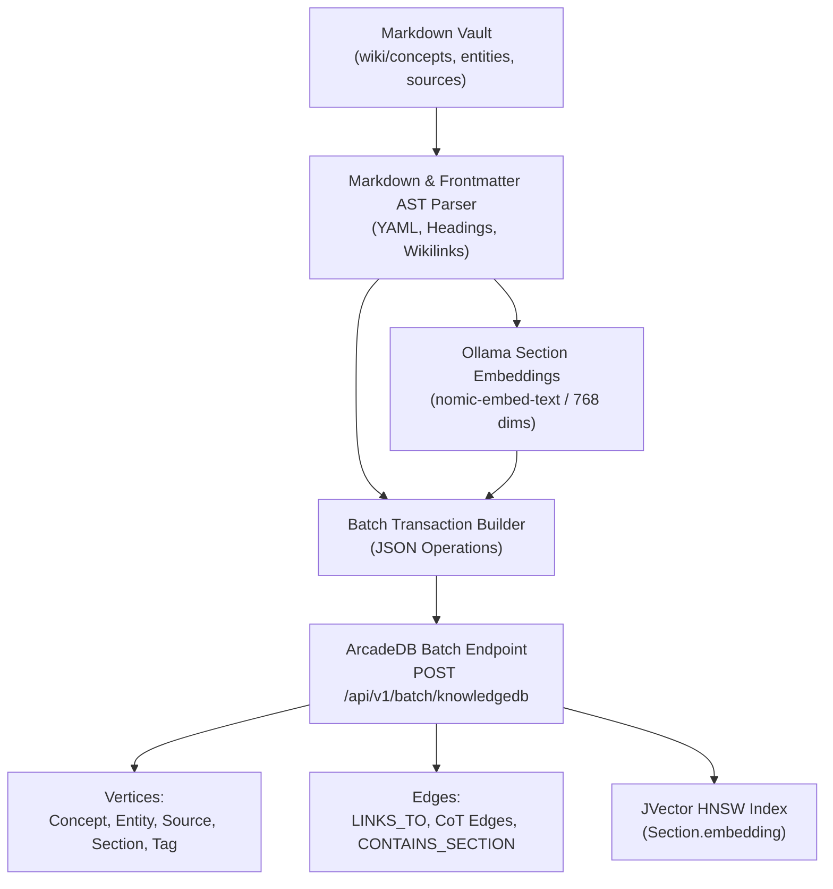

# ArcadeDB Sync Ingestion Pilot & Benchmarking Plan

This document establishes the architecture, data pipeline, and benchmarking methodology for **`scripts/sync_arcadedb.py`**—a dedicated synchronization and evaluation harness designed to pilot **ArcadeDB** against **Neo4j** in [[Knowledge Lab]].

---

## 1. Executive Summary & Goals

The objective of the ArcadeDB pilot is to test a sovereign, multi-model graph engine that unifies:
1. **Graph Traversal** (OpenCypher / Gremlin) for Micro/Macro Chain of Thought (CoT).
2. **Native Vector Search** (JVector HNSW 768-dim embeddings) for sub-second semantic section retrieval.
3. **Key-Value & Document Storage** (JSON documents and high-speed key lookups) for alias resolution and frontmatter metadata.
4. **Native MCP Server** (`/api/v1/mcp`) running directly on HTTP port 2480 without intermediary adapters.

This pilot plan outlines the design of `scripts/sync_arcadedb.py` to ingest the Markdown vault, populate schema and indexes, embed sections, and benchmark query latencies against the active Neo4j GDS instance.

---

## 2. Ingestion Pipeline Architecture

The ingestion pipeline translates Obsidian vault markdown files (`wiki/`) into ArcadeDB types via high-density HTTP batch operations.



### 2.1 Schema Mapping

| Markdown Source Component | ArcadeDB Model Element | Type / Index |
| :--- | :--- | :--- |
| `wiki/concepts/*.md` | Vertex Type | `Concept` (extends `Vertex`) |
| `wiki/entities/*.md` | Vertex Type | `Entity` (subtype: researcher, org, software) |
| `wiki/sources/*.md` | Vertex Type | `Source` (extends `Vertex`) |
| Section Headings (`#`, `##`, `###`) | Vertex Type | `Section` (title, content, embedding) |
| Frontmatter `tags` | Vertex Type | `Tag` (unique name) |
| In-text `[[wikilinks]]` | Edge Type | `LINKS_TO` |
| Document Sections | Edge Type | `CONTAINS_SECTION` |
| CoT Conceptual Handshakes | Edge Types | `PROGRESSES_TO`, `REMEDIES_DILEMMA`, `EXTENDS_THEORY`, `PRECIPITATES` |
| Entity Agency Handshakes | Edge Types | `ORIGINATES_THEORY`, `OPERATIONALIZES`, `AFFILIATED_WITH`, `CHAMPIONS_SOLUTION` |
| Section Vectors (768 dims) | Vector Index | `Section[embedding] LSM_VECTOR` (metric: `COSINE`) |
| Alias Registry (`wiki/glossary.md`) | Document Type / Key-Value | `AliasLookup` (alias $\to$ target canonical title) |

---

## 3. High-Density HTTP Batch Payload Design

ArcadeDB's `/api/v1/batch/{database}` endpoint allows executing hundreds of DDL commands, vertex insertions, and edge creations in a single atomic HTTP roundtrip.

### Example Batch Request

```json
{
  "operations": [
    {
      "type": "create vertex",
      "type_name": "Concept",
      "properties": {
        "title": "Agile Pedagogical Sprint",
        "reliability_score": 1.0,
        "last_updated": "2026-09-29",
        "tags": ["pedagogy", "framework"]
      }
    },
    {
      "type": "create vertex",
      "type_name": "Section",
      "properties": {
        "title": "1. Core Thesis / Definition",
        "content": "An Agile Pedagogical Sprint is a time-boxed educational cycle...",
        "embedding": [0.0124, -0.0531, 0.0892, "... 768 floats ..."]
      }
    },
    {
      "type": "create edge",
      "type_name": "CONTAINS_SECTION",
      "from": "@Concept:title = 'Agile Pedagogical Sprint'",
      "to": "@Section:title = '1. Core Thesis / Definition'"
    }
  ]
}
```

---

## 4. Benchmark Suite: ArcadeDB vs. Neo4j

To provide an objective evaluation, `scripts/sync_arcadedb.py --benchmark` will execute 4 standard test suites against both databases:

### Benchmark Test Matrix

| Benchmark Test | Operation Description | Neo4j Cypher Implementation | ArcadeDB Implementation |
| :--- | :--- | :--- | :--- |
| **B1: Key / Alias Lookup** | Point lookup of a node by alias or title | `MATCH (c:Concept {title: $t}) RETURN c` | `SELECT FROM Concept WHERE title = :t` (or KV lookup in `AliasLookup`) |
| **B2: Multi-Hop Traversal** | 3-hop traversal through CoT handshakes (`Concept` $\to$ `remedies` $\to$ `Problem` $\to$ `originates` $\to$ `Researcher`) | `MATCH p=(c:Concept)-[:REMEDIES_DILEMMA]->(d)-[:ORIGINATES_THEORY]-(r:Entity) RETURN p` | `MATCH (c:Concept)-[:REMEDIES_DILEMMA]->(d)-[:ORIGINATES_THEORY]-(r:Entity) RETURN c, d, r` |
| **B3: Vector KNN Retrieval** | Find top-5 most similar sections to a 768-dim query embedding | `CALL db.index.vector.queryNodes('section_vector_idx', 5, $emb) YIELD node, score RETURN node.title, score` | `SELECT title, vectorNeighbors('Section[embedding]', :emb, 5) AS score FROM Section LIMIT 5` |
| **B4: Hybrid GraphRAG Retrieval** | Vector KNN search + 2-hop graph neighborhood expansion | Cypher query chaining `db.index.vector.queryNodes` with `MATCH (node)-[:LINKS_TO*1..2]-(neighbor)` | SQL/Cypher query combining `vectorNeighbors` with graph expansion in a single pipeline |

### Recorded Telemetry Metrics
1. **P50, P95, P99 Query Latency** (milliseconds over 100 consecutive iterations).
2. **Container Memory Footprint** (`docker/podman stats` resident memory: target $\le 1.0$ GB vs Neo4j $\approx 2.5$ GB).
3. **Database Disk Size** (Data on disk for 250+ notes and embeddings).
4. **Bulk Ingestion Throughput** (nodes & edges inserted per second).

---

## 5. Implementation Roadmap for `scripts/sync_arcadedb.py`

### Step 1: Schema Bootstrapper (`init_arcadedb_schema()`)
- Execute DDL commands to ensure `Vertex` types (`Concept`, `Entity`, `Source`, `Section`, `Tag`) exist.
- Ensure `Edge` types exist.
- Build JVector index on `Section[embedding]`.

### Step 2: Vault Scanner & AST Extractor
- Walk `wiki/concepts/`, `wiki/entities/`, `wiki/sources/`.
- Parse YAML frontmatter using standard Python YAML parsing.
- Split markdown into sections based on `#`, `##`, `###` headings.
- Extract wikilinks `[[...]]`.

### Step 3: Concurrent Ollama Embedder
- Batch section contents and generate embeddings using local Ollama (`http://localhost:11434/api/embeddings`, model: `nomic-embed-text`).
- Support caching / hash checking to avoid re-embedding unchanged sections.

### Step 4: Batch Ingest Dispatcher
- Group node and edge creation operations into chunks of 500 items.
- Dispatch payloads to `POST /api/v1/batch/knowledgedb` using `httpx`.

### Step 5: Benchmark Runner (`run_benchmark()`)
- Run B1–B4 concurrently against Neo4j (via `neo4j` driver) and ArcadeDB (via `httpx`).
- Print an ASCII comparison table with latency and memory statistics.

---

## 6. Success & Promotion Criteria

ArcadeDB will be deemed ready for promotion to primary graph runtime if:
1. **Vector Latency**: JVector HNSW search $\le 25\text{ ms}$ (matching or beating Neo4j).
2. **Memory Efficiency**: Podman container memory stays under $1.2\text{ GB}$ (vs $2.5\text{ GB}+$ for Neo4j JVM + GDS).
3. **MCP Stability**: Open WebUI can query ArcadeDB MCP directly without connection drops.
4. **Data Parity**: 100% of nodes, CoT edges, and section texts match between Neo4j and ArcadeDB.
