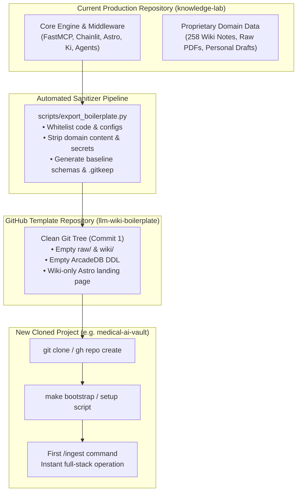
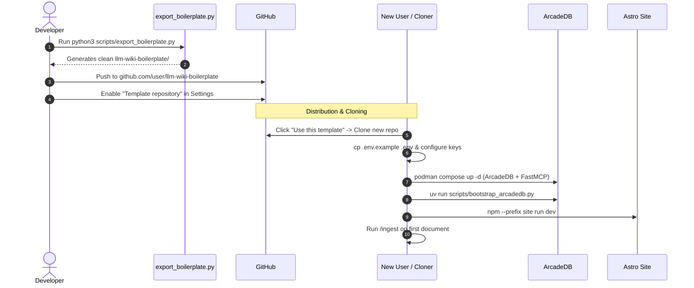
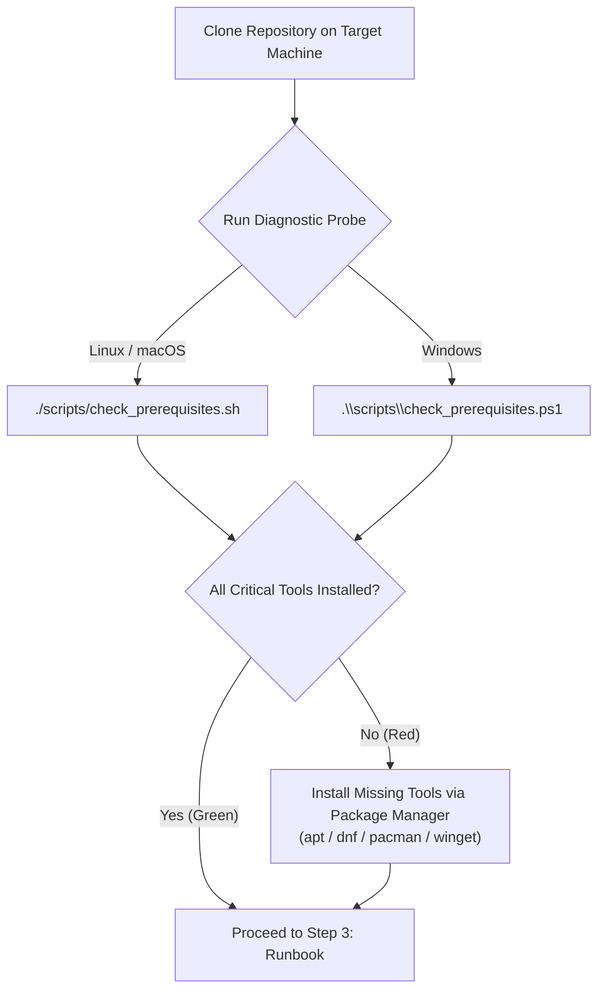

# Boilerplate Architecture & Clean System Template: Evaluation & Implementation Guide

> [!NOTE] Executive Strategic Mandate
> This specification defines the complete evaluation, technical architecture, and actionable step-by-step procedure for converting the **[[Knowledge Lab]]** repository into a clean, reusable **GitHub Template Boilerplate**. It allows any user to clone a pristine system, run a one-command bootstrap, and immediately begin ingesting knowledge into an empty, fully functional **LLM-Wiki + ArcadeDB + FastMCP + Chainlit + Astro** stack.

---

## 1. Executive Summary & Evaluation of Boilerplate Options

The current repository represents a fully developed personal LLM-Wiki ecosystem:
- **`raw/`**: Primary literature, drafts, and task management.
- **`wiki/`**: 258 compiled atomic concepts, entities, sources, and syntheses.
- **`services/fastmcp/`**: Middleware handling semantic routing, guardrails, and Dual-Flow CoT retrieval.
- **`services/frontend/`**: Chainlit-based Socratic Learning Studio on port 8080.
- **`setup/`**: Orchestration manifests for ArcadeDB, FastMCP, and Chainlit.
- **`site/`**: Astro 5 frontend with Pagefind search, dynamic wikilink resolution, and interactive Mermaid diagram modals.

To reuse this sophisticated architecture for new subject domains, enterprise teams, or personal vaults without carrying over domain-specific notes or proprietary history, we need a clean boilerplate.



---

### Comparative Evaluation of Distribution Strategies

| Criteria | Option 1: GitHub Template Repository | Option 2: Orphan Git Branch (`boilerplate`) | Option 3: Automated Sanitizer Script (`export_boilerplate.py`) |
| :--- | :--- | :--- | :--- |
| **Description** | A standalone GitHub repository flagged as `[x] Template repository`. | An unconnected branch inside the same repo (`git checkout --orphan`). | A Python/Bash script that deterministically outputs a clean folder or push target. |
| **Git History Privacy** | **100% Isolated** (Starts at commit 1; zero history leakage). | **Moderate** (Branch is clean, but cloning whole repo downloads all packfiles). | **100% Isolated** (Produces a fresh git tree). |
| **Cloning Friction** | **Zero Friction** (1-click green "Use this template" button on GitHub). | **Medium** (Requires `git clone --single-branch -b boilerplate`). | **Low** (Generates the files for Option 1). |
| **Maintenance Burden** | Requires pushing updates when core engine evolves. | Single repo to manage, but risks accidental merge conflicts. | **Lowest** (Rerun script whenever core architecture updates). |
| **Recommendation** | **Target Destination (Recommended)** | Not Recommended for multi-user distribution | **Source Generator (Recommended)** |

> [!TIP] The Recommended Dual-Engine Strategy
> Use **Option 3 (Sanitizer Script)** as the generator, and publish its output as **Option 1 (GitHub Template Repository)**. This ensures that updates made to the production engine can be cleanly exported to the public template repository with a single command, without manual copy-pasting.

---

## 2. Component-by-Component Clean-State Architecture

### 2.1. Root Files & Agent Specifications

The root directory contains the operating specifications that govern the autonomous agent:

| File | Production State | Boilerplate Clean State | Customization Action |
| :--- | :--- | :--- | :--- |
| **`AGENTS.md`** | Configured for `Knowledge Lab` with specific pedagogical guidelines. | Parameterized template with placeholder `{{PROJECT_NAME}}`, retaining all 10 core axioms, CoT invariants, and `/ingest`, `/query`, `/lint` protocols. | Replace `{{PROJECT_NAME}}` with user project name. |
| **`.gitignore`** | Ignores `.venv`, `scratch/`, `.env.*`. | Comprehensive ignore list covering Python, Node, Astro dist, ArcadeDB volumes, and secrets. | None (ready out of the box). |
| **`.agent/` & `.agents/`** | Agent skills: `wiki-ingest`, `wiki-scope`, `wiki-format`, `wiki-lint`, `wiki-task`, `ki-knowledge-base`; rules: `arcadedb.md`. | **Preserved 100%**. These provide the autonomous intelligence and must remain intact. | None. |
| **`pyproject.toml`** | Project root Python dependencies (uv, fastmcp, neo4j, etc.). | Preserved with standardized dependencies for scripts and graph tooling. | Run `uv sync` or `pip install -e .`. |
| **`scripts/`** | Contains sync, graph analytics, and CoT extractors. | Preserved; includes `bootstrap_arcadedb.py` for Day-0 schema initialization. | None. |

---

### 2.2. Wiki Directory Topography (`raw/` and `wiki/`)

Per the task mandate, all domain-specific notes and operational trackers are pruned, while empty structural directories are preserved with `.gitkeep`.

#### `raw/` Topography
- **Preserved (Empty with `.gitkeep`)**:
  - `raw/articles/.gitkeep`
  - `raw/papers/.gitkeep`
  - `raw/books/.gitkeep`
  - `raw/research/.gitkeep`
  - `raw/transcripts/.gitkeep`
  - `raw/assets/.gitkeep`
  - `raw/tasks/.gitkeep`
  - `raw/tasks/archived/.gitkeep`
  - `raw/drafts/.gitkeep`
- **Permanently Removed in Boilerplate**:
  - ❌ `raw/publishing/` (Editorial pipeline)
  - ❌ `raw/publishing/ideas/`
  - ❌ `raw/projects/` (Kanban boards and sprint specs)
  - ❌ `scratch/` (Temporary agent scratch files)

#### `wiki/` Topography
- **Preserved Folders (Empty with `.gitkeep`)**:
  - `wiki/concepts/.gitkeep`
  - `wiki/entities/.gitkeep`
  - `wiki/sources/.gitkeep`
  - `wiki/syntheses/.gitkeep`
  - `wiki/ingestions/.gitkeep`
- **Pristine Baseline Files**:
  1. **`wiki/index.md`**: Master catalog scaffold with empty section headers:
     ```markdown
     # Knowledge Base Master Catalog

     ## Concepts
     *No concepts ingested yet. Run `/ingest <file-path>` to compile your first concept.*

     ## Entities
     *No entities registered yet.*

     ## Sources
     *No primary sources distilled yet.*

     ## Syntheses
     *No dialectical syntheses archived yet.*

     ## Ingestions
     *No ingestion dossiers logged yet.*
     ```
  2. **`wiki/overview.md`**: Domain overview scaffolding prompting the user for their domain thesis.
  3. **`wiki/glossary.md`**: Taxonomy, canonical naming rules, and acronym disambiguation table.
  4. **`wiki/log.md`**: Clean append-only audit log initialized with:
     ```markdown
     # Knowledge Base Operational Log

     ## [YYYY-MM-DD] init | vault | Initialized clean knowledge base from boilerplate repository.
     ```
  5. **`wiki/.ki/vault.yaml`**: Standard knowledge index marker file.

---

### 2.3. ArcadeDB Clean Configuration

In the boilerplate, ArcadeDB starts with an empty database volume. To ensure the first ingestion and FastMCP queries do not fail due to missing vertex or edge types, an automated bootstrap script runs the initial DDL.

#### Baseline Docker/Podman Compose (`setup/compose.arcadedb.yaml`)
```yaml
services:
  arcadedb:
    image: arcadedata/arcadedb:latest
    container_name: arcadedb-ki
    restart: unless-stopped
    ports:
      - "2480:2480" # REST API, Studio Web UI, and MCP
      - "2424:2424" # Binary Protocol
    environment:
      - JAVA_TOOL_OPTIONS=-Xms512m -Xmx1536m
      - ARCADEDB_SETTINGS=-Darcadedb.server.rootPassword=${ARCADEDB_PASSWORD:-root_secret} -Darcadedb.server.defaultDatabases=${ARCADEDB_DATABASE:-knowledgedb} -Darcadedb.mcp.enabled=true
    volumes:
      - arcadedb-data:/home/arcadedb/databases
      - arcadedb-config:/home/arcadedb/config
    networks:
      - wiki-net
    healthcheck:
      test: ["CMD-SHELL", "wget -q --spider http://localhost:2480/api/v1/ready || exit 1"]
      interval: 10s
      timeout: 5s
      retries: 5

volumes:
  arcadedb-data:
    name: arcadedb-data
  arcadedb-config:
    name: arcadedb-config

networks:
  wiki-net:
    name: wiki-net
```

#### Automated Schema Bootstrap (`setup/bootstrap_arcadedb.py`)
This script connects to the fresh ArcadeDB instance and executes the complete DDL schema:
1. **Vertex Types**:
   - `Concept`, `Entity`, `Source`, `Section`, `Tag`.
2. **Edge Types**:
   - Micro-CoT Intra-Document: `PROGRESSES_TO`.
   - Macro-CoT Inter-Document: `REMEDIES_DILEMMA`, `EXTENDS_THEORY`, `PRECIPITATES`, `EMPIRICALLY_GROUNDS`.
   - Entity Agency: `ORIGINATES_THEORY`, `CHAMPIONS_SOLUTION`, `CRITIQUES_PARADIGM`, `OPERATIONALIZES`, `AFFILIATED_WITH`, `INTELLECTUAL_LINEAGE`.
   - Structural: `HAS_SECTION`, `TAGGED_WITH`, `CITES`.
3. **Multi-Model Document Collections & Key-Value Stores**:
   - **`AliasLookup` (Document Type - Key-Value)**: Sub-millisecond lookup bucket for normalized aliases and acronyms mapping directly to canonical entity/concept titles.
     - *Initial State*: Empty upon initial clone; automatically populated by `scripts/enrich_graph.py` from `wiki/glossary.md` as notes are ingested.
     - *Schema*: `alias STRING (UNIQUE INDEX)`, `canonical_title STRING`, `type STRING`.
   - **`IntentAnchor` (Document Type - Safeguards & Fast-Paths)**: Powers in-engine semantic routing, prompt injection blocking, and instantaneous conversational fast-paths without invoking LLMs.
     - *Initial State*: **Pre-seeded with baseline content**! `scripts/bootstrap_arcadedb.py` automatically parses `setup/safeguard_intent_anchors.md` and populates adversarial guardrails (`prompt_injection`, `system_prompt_leak`, `jailbreak_dan`, `harmful_content`) and conversational fast-paths (`chitchat_greeting`, `chitchat_gratitude`, `chitchat_farewell`, `meta_capabilities`).
     - *Schema*: `intent STRING`, `category STRING`, `action STRING`, `utterance STRING (FULL_TEXT INDEX)`, `embedding LIST OF FLOAT (LSM_VECTOR INDEX)`, `response_template STRING`.
   - **`SynthesisDelta` (Document Type - Epistemic Drift Store)**: Decoupled changelog recording section-level hash modifications and flagging stale syntheses (`[:SYNTHESIZES]`).
     - *Initial State*: Empty upon initial clone; populated dynamically by `scripts/detect_synthesis_deltas.py` whenever underlying concept sections evolve.
     - *Schema*: `synthesis_slug STRING (INDEX)`, `section_uri STRING`, `change_type STRING`, `diff_snippet STRING`, `timestamp STRING`, `resolved BOOLEAN`.
4. **Indexes & Search Vectors**:
   - Unique constraints on `Concept(title)`, `Entity(title)`, `Source(slug)`, `Tag(name)`, `AliasLookup(alias)`.
   - Native HNSW JVector index on `Section(vector)` (768 dimensions, Cosine metric).
   - Full-Text Lucene indexes on `Concept(title)`, `Entity(title)`, and `IntentAnchor(utterance)`.
5. **Legacy Component Retirement**:
   - ⚠️ **`TextToQueryDemo` Deprecation**: The legacy `TextToQueryDemo` collection (previously used for DAIL-SQL few-shot retrieval) is **no longer used** in modern ArcadeDB v3 / FastMCP Consolidated V3 retrieval. It is intentionally omitted from the clean boilerplate schema.

---

### 2.4. FastMCP Clean Configuration

`services/fastmcp/` requires zero code modifications, only sanitized environment configuration:
- **`services/fastmcp/.env.example`**:
  ```env
  ARCADEDB_URL=http://localhost:2480
  ARCADEDB_DATABASE=knowledgedb
  ARCADEDB_USER=root
  ARCADEDB_PASSWORD=root_secret
  DEFAULT_DIALECT=auto
  LOG_LEVEL=INFO
  ENABLE_LANGFUSE=false
  ```
- **Empty Graph Resilience**: FastMCP’s retriever queries (`ConsolidatedV3Retriever`, `DAILSQLRetriever`) gracefully handle empty result sets (`[]`) and return structured empty contexts rather than raising 500 errors.

---

### 2.5. Chainlit Clean Configuration

`services/frontend/` provides the chat presentation layer:
- **`services/frontend/.env.example`**:
  ```env
  FASTMCP_URL=http://fastmcp-middleware:8000
  CHAINLIT_HOST=0.0.0.0
  CHAINLIT_PORT=8080
  OPENROUTER_API_KEY=
  LLM_MODEL=openrouter/free
  ENABLE_LANGFUSE=false
  ```
- **Remove Hardcoded Secrets**: Ensure `DEFAULT_OPENROUTER_KEY` in `app.py` falls back to empty string `""` if not set in the environment.
- **Pristine Chat Welcome**: Update `services/frontend/chainlit.md` to introduce the clean boilerplate:
  > *"Welcome to your sovereign Socratic Knowledge Studio. Ingest documents into `raw/` to populate your knowledge graph and begin dialectical sparring."*

---

### 2.6. Astro Site Clean Configuration (`site/`)

Per the user requirements:
> *"Using only /wiki and related pages (categories, tags, etc.) with a simple boilerplate landing page"*

#### What is Kept in `site/`:
- **Core Engine & Components**:
  - `site/astro.config.mjs` (Expressive Code, Tailwind CSS 4, sitemap, remark plugins).
  - `site/src/plugins/remark-obsidian-wikilinks.mjs` (Resolves Obsidian wikilinks and callouts).
  - `site/src/components/ui/MermaidRenderer.astro` (Interactive SVG diagrams, Light/Dark canvas toggle, zoom/pan hand-tool).
  - `site/src/components/ui/WikiCard.astro` & `TagBadge.astro`.
  - `site/src/layouts/WikiNoteLayout.astro` (Backlinks, metadata bar, breadcrumbs, TOC).
- **Core Routes**:
  - `/` (`site/src/pages/index.astro`): Redesigned as a clean, modern Knowledge Base & Socratic Studio landing page.
  - `/wiki` (`site/src/pages/wiki/index.astro`): Full catalog with type filters and search.
  - `/wiki/[...slug]` (`site/src/pages/wiki/[...slug].astro`): Dynamic note rendering.
  - `/tags` & `/tags/[tag]` (`site/src/pages/tags/`): Statically generated tag indexes.
  - `/categories` & `/categories/[category]` (`site/src/pages/categories/`): Topic category hubs.
  - `/assistant` (`site/src/pages/assistant.astro`): Full-viewport Chainlit embedding with offline fallback.
  - `/404.astro`: Accessible error page.

#### What is Decoupled / Pruned:
- **`site/src/content/blog/`**: Pruned or replaced with a single sample `welcome.mdx`.
- **`site/src/pages/blog/`**: Redirected to `/wiki` in `astro.config.mjs`:
  ```javascript
  redirects: {
    '/blog': '/wiki',
    '/blog/[...slug]': '/wiki/[...slug]',
    '/essays': '/wiki',
  }
  ```
- **`site/src/config/site.ts`**: Navigation bar updated to focus strictly on the Knowledge Base:
  ```typescript
  export const navItems = [
    { title: 'Home', href: '/' },
    { title: 'Knowledge Graph', href: '/wiki' },
    { title: 'Categories', href: '/categories' },
    { title: 'Tags', href: '/tags' },
    { title: 'Learning Studio', href: '/assistant' },
  ];
  ```

---

## 3. The Automated Boilerplate Sanitizer Script

To automate boilerplate creation directly from this active codebase, create `scripts/export_boilerplate.py`. This script copies all architectural assets, creates empty directory scaffolds, sanitizes configuration files, and outputs a ready-to-publish directory.

```python
#!/usr/bin/env python3
"""
scripts/export_boilerplate.py
Automated sanitizer that exports a pristine, clean-slate GitHub template repository
from the active knowledge-lab codebase.
"""

import os
import shutil
import re
from pathlib import Path

SOURCE_ROOT = Path(__file__).resolve().parent.parent
OUTPUT_DIR = SOURCE_ROOT.parent / "llm-wiki-boilerplate"

# 1. Directories to replicate with empty .gitkeep files
EMPTY_DIRECTORIES = [
    "raw/articles",
    "raw/papers",
    "raw/books",
    "raw/research",
    "raw/transcripts",
    "raw/tasks",
    "raw/tasks/archived",
    "raw/drafts",
    "raw/assets",
    "wiki/concepts",
    "wiki/entities",
    "wiki/sources",
    "wiki/syntheses",
    "wiki/ingestions",
    "wiki/.ki",
]

# 2. Files and directories to copy verbatim
COPY_WHITELIST = [
    ".agent",
    ".agents",
    "services/fastmcp",
    "services/frontend",
    "setup",
    "site",
    "scripts",
    "pyproject.toml",
    ".gitignore",
]

# 3. Path patterns to strictly ignore during copy
EXCLUDE_PATTERNS = [
    "__pycache__",
    ".venv",
    "node_modules",
    ".astro",
    "dist",
    "data-store.json",
    ".chainlit/.files",
    ".chainlit/translations",
    "*.pyc",
    ".DS_Store",
    ".env",
    ".env.arcadedb",
    ".env.aura",
    ".env.local",
    "*.pem",
    "*.key",
]

def should_exclude(path: Path) -> bool:
    for pattern in EXCLUDE_PATTERNS:
        if path.match(pattern) or pattern in str(path):
            return True
    return False

def clean_copy_tree(src: Path, dst: Path):
    if should_exclude(src):
        return
    if src.is_dir():
        dst.mkdir(parents=True, exist_ok=True)
        for item in src.iterdir():
            clean_copy_tree(item, dst / item.name)
    else:
        shutil.copy2(src, dst)

def create_scaffold():
    print(f"🚀 Generating clean boilerplate into: {OUTPUT_DIR}")
    if OUTPUT_DIR.exists():
        shutil.rmtree(OUTPUT_DIR)
    OUTPUT_DIR.mkdir(parents=True)

    # 1. Copy whitelisted code & configs
    for item in COPY_WHITELIST:
        src = SOURCE_ROOT / item
        if src.exists():
            print(f"  • Copying {item}...")
            clean_copy_tree(src, OUTPUT_DIR / item)

    # 2. Replicate empty directory trees with .gitkeep
    for rel_path in EMPTY_DIRECTORIES:
        target_dir = OUTPUT_DIR / rel_path
        target_dir.mkdir(parents=True, exist_ok=True)
        (target_dir / ".gitkeep").touch()
    print("  • Replicated empty raw/ and wiki/ structures.")

    # 3. Author pristine baseline wiki files
    (OUTPUT_DIR / "wiki/index.md").write_text(
        "# Knowledge Base Master Catalog\n\n"
        "## Concepts\n*No concepts ingested yet. Run `/ingest <file-path>` to compile your first concept.*\n\n"
        "## Entities\n*No entities registered yet.*\n\n"
        "## Sources\n*No primary sources distilled yet.*\n\n"
        "## Syntheses\n*No dialectical syntheses archived yet.*\n\n"
        "## Ingestions\n*No ingestion dossiers logged yet.*\n"
    )

    (OUTPUT_DIR / "wiki/overview.md").write_text(
        "# Domain Knowledge Overview\n\n"
        "> [!NOTE] Living Domain Synthesis\n"
        "> Author your high-level domain synthesis, foundational pillars, and theoretical positions here.\n"
    )

    (OUTPUT_DIR / "wiki/glossary.md").write_text(
        "# Knowledge Base Glossary & Disambiguation Registry\n\n"
        "## Canonical Naming Rules\n\n"
        "| Term | Canonical Entity / Concept | Aliases & Acronyms | Context / Disambiguation |\n"
        "| :--- | :--- | :--- | :--- |\n"
    )

    (OUTPUT_DIR / "wiki/log.md").write_text(
        "# Knowledge Base Operational Log\n\n"
        "All operations follow the format:\n"
        "`## [YYYY-MM-DD] Operation | Target | Brief summary of edits`\n\n"
        "---\n\n"
        "## [2026-10-06] init | vault | Initialized clean knowledge base from boilerplate.\n"
    )

    (OUTPUT_DIR / "wiki/.ki/vault.yaml").write_text("profile: default\n")

    # 4. Clean site/src/content/blog/ (Replace with 1 welcome note)
    blog_dir = OUTPUT_DIR / "site/src/content/blog"
    if blog_dir.exists():
        shutil.rmtree(blog_dir)
    blog_dir.mkdir(parents=True, exist_ok=True)
    (blog_dir / "welcome.mdx").write_text(
        "---\n"
        "title: \"Welcome to Your Sovereign Knowledge Base\"\n"
        "description: \"Your local-first, agentic knowledge engine is ready for ingestion.\"\n"
        "pubDate: 2026-10-06\n"
        "category: \"Architecture\"\n"
        "tags: [\"knowledge-graph\", \"socratic-ai\"]\n"
        "---\n\n"
        "# Welcome to Your Knowledge Base\n\n"
        "This platform combines an Obsidian-native knowledge graph with ArcadeDB and Socratic AI.\n"
    )

    # 5. Sanitize AGENTS.md (Neutralize project names)
    agents_src = (SOURCE_ROOT / "AGENTS.md").read_text()
    agents_clean = agents_src.replace("Knowledge Lab", "Knowledge Lab").replace("knowledge", "knowledge")
    (OUTPUT_DIR / "AGENTS.md").write_text(agents_clean)

    # 6. Sanitize README.md
    (OUTPUT_DIR / "README.md").write_text(
        "# Sovereign LLM-Wiki Boilerplate\n\n"
        "A local-first, autonomous knowledge compiler and Socratic learning studio powered by:\n"
        "- **Obsidian IDE**: Agent-managed markdown knowledge graph.\n"
        "- **ArcadeDB**: Multi-model graph and vector storage.\n"
        "- **FastMCP**: Semantic routing and Dual-Flow Chain-of-Thought middleware.\n"
        "- **Chainlit**: Socratic Learning Studio with live streaming.\n"
        "- **Astro 5**: High-speed digital garden with Pagefind and interactive Mermaid diagrams.\n\n"
        "See `setup/boilerplate_architecture_and_clean_clone_guide.md` for initialization instructions.\n"
    )

    print("✅ Boilerplate export completed successfully!")

if __name__ == "__main__":
    create_scaffold()
```

---

## 4. Step-by-Step Implementation Guide



---

### Step 1: Export & Push the Boilerplate to GitHub

1. **Run the Sanitizer Script**:
   ```bash
   python3 scripts/export_boilerplate.py
   ```
2. **Initialize Git in the Export Directory**:
   ```bash
   cd ../llm-wiki-boilerplate
   git init
   git add .
   git commit -m "feat(genesis): initial boilerplate template release"
   ```
3. **Publish to GitHub**:
   ```bash
   gh repo create llm-wiki-boilerplate --public --source=. --remote=origin --push
   ```
4. **Enable GitHub Template Feature**:
   - Go to your repository on GitHub: `https://github.com/<your-username>/llm-wiki-boilerplate`.
   - Navigate to **Settings** $\to$ **General**.
   - Check the box: `[x] Template repository`.

---

### Step 2: Cross-Platform System Prerequisite Diagnostic & Setup (Linux & Windows)

Before running the stack on a newly cloned workstation, verify that the prerequisite host tools are installed.



#### Prerequisite Software Matrix

| Tool | Role in LLM-Wiki Stack | Criticality | Linux (Debian / Ubuntu / Fedora) | Windows 11 (Native & WSL2) |
| :--- | :--- | :--- | :--- | :--- |
| **Obsidian** | Desktop Markdown IDE & Graph Canvas | Optional (Recommended) | Flatpak / Snap / AppImage | `winget install Obsidian.Obsidian` |
| **Antigravity CLI (`agy`)** | Autonomous AI pair programmer & compiler | **Critical** | Native Linux CLI / npm global | `npm install -g @google/antigravity-cli` (or inside WSL2) |
| **Container Engine** | Runs ArcadeDB & Chainlit containers | **Critical** | Podman (`podman compose`) or Docker | Docker Desktop (WSL2 backend) or Podman Desktop |
| **Python 3.11+** | Backend scripts & FastMCP runtime | **Critical** | `python3` from package manager | `winget install Python.Python.3.12` |
| **Astral `uv`** | High-speed Python package manager & runner | **Critical** | `curl -LsSf https://astral.sh/uv/install.sh \| sh` | `winget install astral-sh.uv` or PowerShell script |
| **Node.js (v20+) & npm** | Builds Astro 5 digital garden & Pagefind | **Critical** | NodeSource repo (`nodejs`) or `nvm` | `winget install OpenJS.NodeJS.LTS` |
| **Git & GitHub CLI (`gh`)**| Version control & template generation | **Critical** | `sudo apt install git gh` | `winget install Git.Git GitHub.cli` |
| **Ollama** | Optional local embeddings (`nomic-embed-text`)| Optional | `curl -fsSL https://ollama.com/install.sh \| sh` | `winget install Ollama.Ollama` |

---

#### Automated Diagnostic Check

Run the built-in diagnostic probe in your terminal to automatically audit your host environment:

- **On Linux / macOS**:
  ```bash
  chmod +x scripts/check_prerequisites.sh
  ./scripts/check_prerequisites.sh
  ```
- **On Windows (PowerShell)**:
  ```powershell
  powershell -ExecutionPolicy Bypass -File .\scripts\check_prerequisites.ps1
  ```

---

#### Platform-Specific Installation Instructions

##### A. Linux Setup (Ubuntu / Debian / Fedora / Arch)

1. **Install Core Utilities & Git**:
   ```bash
   # Ubuntu / Debian
   sudo apt update && sudo apt install -y git curl wget build-essential jq

   # Fedora
   sudo dnf install -y git curl wget jq

   # Arch Linux
   sudo pacman -Syu --needed git curl wget jq base-devel
   ```

2. **Install Google Antigravity CLI (`agy`)**:
   ```bash
   # Via official installer:
   curl -fsSL https://antigravity.google/install.sh | bash

   # OR via npm:
   npm install -g @google/antigravity-cli
   ```

3. **Install Container Engine (Podman or Docker)**:
   *Podman is strongly recommended on Linux for rootless, daemonless security*:
   ```bash
   # Ubuntu 22.04+ / Debian 12+
   sudo apt install -y podman podman-compose

   # Fedora
   sudo dnf install -y podman podman-compose
   ```

4. **Install Python 3.11+ and Astral `uv`**:
   ```bash
   # Install uv (installs and manages Python automatically)
   curl -LsSf https://astral.sh/uv/install.sh | sh
   source ~/.bashrc  # or ~/.zshrc
   ```

5. **Install Node.js 20 LTS**:
   ```bash
   curl -fsSL https://deb.nodesource.com/setup_20.x | sudo -E bash -
   sudo apt install -y nodejs
   ```

6. **Install Obsidian IDE**:
   ```bash
   # Flatpak (Recommended for sandboxed security)
   flatpak install flathub md.obsidian.Obsidian

   # Snap
   sudo snap install obsidian --classic
   ```

---

##### B. Windows 11 Setup (PowerShell & WSL2)

> [!TIP] The Windows WSL2 Recommendation
> On Windows, running the repository inside **WSL2 (Windows Subsystem for Linux - Ubuntu)** is strongly recommended. WSL2 natively supports POSIX shell scripts (`scripts/sync_vault_graph.sh`), eliminates path separator mismatches (`\` vs `/`), and integrates seamlessly with Docker Desktop and VS Code / Antigravity CLI, while Obsidian on Windows can open the vault directly via `\\wsl$\Ubuntu\path\to\vault`.

If running natively on Windows via PowerShell:

1. **One-Command Installation via WinGet (Run in Administrator PowerShell)**:
   ```powershell
   winget install --id Obsidian.Obsidian -e
   winget install --id Git.Git -e
   winget install --id GitHub.cli -e
   winget install --id OpenJS.NodeJS.LTS -e
   winget install --id Python.Python.3.12 -e
   winget install --id astral-sh.uv -e
   winget install --id Docker.DockerDesktop -e
   ```

2. **Install Google Antigravity CLI**:
   ```powershell
   npm install -g @google/antigravity-cli
   ```

3. **Configure Docker Desktop**:
   - Launch Docker Desktop.
   - Go to **Settings > General** and ensure **"Use the WSL 2 based engine"** is checked.
   - Go to **Settings > Resources > WSL Integration** and enable integration for your default distro.

4. **Restart PowerShell**:
   Close and reopen your terminal to ensure all new environment variables and binaries are refreshed in your `PATH`.

---

### Step 3: Customization After Cloning (The 10-Minute Setup Runbook)

When you or another developer clones the repository into a new folder:

#### 1. Clone from Template
```bash
# Using GitHub CLI:
gh repo create my-ai-lab --template <your-username>/llm-wiki-boilerplate --clone
cd my-ai-lab

# OR using standard git clone:
git clone https://github.com/<your-username>/llm-wiki-boilerplate.git my-ai-lab
cd my-ai-lab
```

#### 2. Set Up Environment Variables
Copy the template environment files:
```bash
cp setup/.env.example .env
cp services/fastmcp/.env.example services/fastmcp/.env
cp services/frontend/.env.example services/frontend/.env
```
Edit `.env` to supply:
- `OPENROUTER_API_KEY`: Your OpenRouter or local LLM key.
- `ARCADEDB_PASSWORD`: Set a secure root password (default: `root_secret`).

#### 3. Install Dependencies
```bash
# Install Python dependencies
uv sync

# Install Astro frontend dependencies
npm --prefix site install
```

#### 4. Spin Up ArcadeDB & FastMCP Services
```bash
podman compose -f setup/compose.arcadedb.yaml up -d
# (or docker compose -f setup/compose.arcadedb.yaml up -d)
```
Verify ArcadeDB readiness:
```bash
curl -i http://localhost:2480/api/v1/ready
# Expected: HTTP 204 No Content
```

#### 5. Bootstrap ArcadeDB Schemas, Document Stores & Seed Safeguards
Run the automated bootstrap script to initialize vertices, edges, document collections (`AliasLookup`, `IntentAnchor`, `SynthesisDelta`), vector indexes, and seed baseline safeguard rules:
```bash
uv run scripts/bootstrap_arcadedb.py
```
This automatically configures the database, initializes all types and constraints, seeds active `IntentAnchor` records (enabling immediate prompt injection blocking and conversational fast-paths without LLM overhead), and omits retired legacy tables (`TextToQueryDemo`). Verify schema and document creation in your browser by opening `http://localhost:2480` (ArcadeDB Studio) and logging in with user `root` and your password.

#### 6. Customize Branding & Navigation
Update project metadata in two files:
1. **`site/src/config/site.ts`**:
   - Set `name`: `"My Knowledge Lab"`
   - Set `title`: `"My Domain Title"`
   - Set `description`: `"Personal sovereign knowledge graph."`
2. **`AGENTS.md`**:
   - Replace generic titles with your specific research mandate and domain rules.

#### 7. Launch Frontend & Learning Studio
In separate terminal windows (or via background daemons):
```bash
# Terminal 1: Launch Astro Digital Garden (Port 4321)
npm --prefix site run dev

# Terminal 2: Launch Chainlit Learning Studio (Port 8080)
podman compose -f setup/compose.chainlit.yaml up -d
```

#### 8. Verify Day-1 Ingestion
Add your first primary source document (PDF, article, or transcript) into `raw/articles/` and run the ingestion command:
```bash
/ingest raw/articles/my-first-paper.pdf
```
The autonomous agent will:
1. Generate the scoped manifest in `wiki/ingestions/`.
2. Create atomic concept and entity notes in `wiki/concepts/` and `wiki/entities/`.
3. Synchronize vertices and CoT progressions into ArcadeDB.
4. Update `wiki/index.md` and `wiki/log.md`.
5. The note will immediately appear live on the Astro site at `http://localhost:4321/wiki` with full search indexing and clickable wikilinks!

---

## 5. Verification Checklist

| Verification Gate | Command / Action | Expected Result |
| :--- | :--- | :--- |
| **Clean Repo Scan** | `git status` in cloned repo | Clean tree; no leftover personal notes in `raw/` or `wiki/`. |
| **ArcadeDB Readiness** | `curl -f http://localhost:2480/api/v1/ready` | HTTP 204 No Content. |
| **Schema Bootstrap** | `uv run scripts/bootstrap_arcadedb.py` | 6 Vertex types, 11 Edge types, and LSM_VECTOR index created. |
| **FastMCP Health** | `curl -f http://localhost:8000/health` | `{"status": "ok", "arcadedb": "connected"}`. |
| **Chainlit UI** | Visit `http://localhost:8080` | Clean welcome screen with interactive chat input. |
| **Astro Site Build** | `npm --prefix site run build` | Compiles cleanly with zero 404 errors; Pagefind indexes `/wiki`. |
| **Assistant Iframe** | Visit `http://localhost:4321/assistant` | Chainlit loads inside the full-viewport iframe without CSP errors. |

---

## 6. Maintenance & Future Syncing

When new features are built into the primary repository (such as upgraded diagram viewers, new FastMCP tools, or improved remark plugins), updating the template repository is as simple as re-running the generator script:

```bash
# 1. In production repo: run export script
python3 scripts/export_boilerplate.py

# 2. In template repo: commit and push changes
cd ../llm-wiki-boilerplate
git add .
git commit -m "chore(sync): update core engine from upstream knowledge-lab"
git push origin main
```
This ensures that the public boilerplate template stays synchronized with the cutting edge of your private research engine while maintaining strict data isolation.
