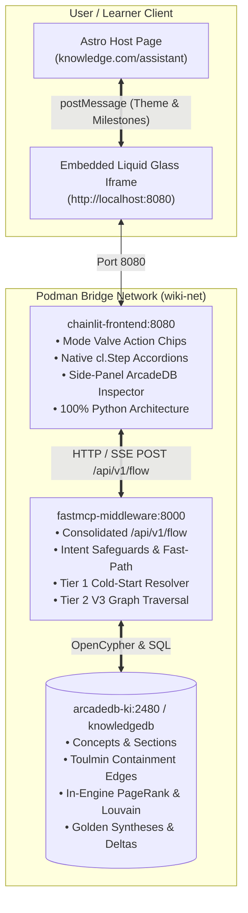

# Phase 2 Implementation Protocol: Chainlit Learner Frontend & Astro Integration

> **Implementation Origin**: `raw/tasks/archived/Start Chainlit implementation.md`  
> **Architectural Precedents**: `raw/drafts/architectural_strategy_priorities_and_implementation_roadmap.md`, `raw/drafts/chainlit_frontend_on_astro_page_and_interactive_drafts_architecture.md`  
> **Execution Date**: 2026-10-03  
> **Status**: Operational & Deployed  
> **Ecosystem Tier**: Presentation Decoupling (Phase 2)

---

## 1. Executive Summary & Objective

This implementation protocol documents the operational deployment of **Phase 2 (Presentation Decoupling)** of the [[Knowledge Lab]] knowledge architecture. 

In this phase, we introduce a lightweight, 100% Python conversational learner interface built on **Chainlit**, directly replacing the fragile, high-overhead OpenWebUI presentation layer:
1. **Elimination of the 24× Streaming Token Multiplier Bug**: Chainlit logs accurate turn-level tokens without chunk duplication.
2. **Side-Panel Dynamic Mode Valves**: Exposes interactive action chips (`socratic_sandbox`, `general_chat`, `teachable_agent`, `toulmin_sparring`) that dynamically reconfigure the FastMCP retrieval pipeline and calibrate solution withholding.
3. **Deep ArcadeDB Inspection**: Uses Chainlit's split-screen side panel (`display="side"`) to render in-engine PageRank authority, Louvain community clusters, Toulmin argumentation roles, and primary source distillations directly from `knowledgedb`.
4. **Seamless Astro Integration**: Implements a dedicated responsive full-height viewport at `site/src/pages/assistant.astro` styled with the Karimoo Liquid Glass design system and connected via a `postMessage` bridge.

---

## 2. Component Topology & Service Architecture



---

## 3. Implemented File Inventory

| File Path | Role & Architectural Purpose |
| :--- | :--- |
| `services/frontend/app.py` | Complete Chainlit application with 4 mode valves, FastMCP flow client, `cl.Step` accordions, and side-panel ArcadeDB inspector. |
| `services/frontend/requirements.txt` | Python dependencies (`chainlit`, `httpx`, `pydantic`, `langfuse`). |
| `services/frontend/.chainlit/config.toml` | UI configuration, dark theme default, wide layout, and telemetry disablement. |
| `services/frontend/Dockerfile` | Lightweight Python 3.12 Slim container build with non-root security execution. |
| `setup/compose.chainlit.yaml` | Service definition for `chainlit-frontend` attached to `wiki-net` with healthcheck probe. |
| `site/src/pages/assistant.astro` | Dedicated Astro page with ambient status bar, full-height responsive iframe, and `postMessage` bridge. |
| `site/src/config/site.ts` | Registered `Assistant` navigation link in master site config. |

---

### 4.1. FastMCP Flow Delegation & Valve Configuration (`ChatSettings` & `valves.json`)

To preserve clean separation of concerns, **100% of reasoning, graph traversal, and retrieval logic is delegated to FastMCP**. The frontend (`app.py`) contains zero mock text or local branching logic.

Valves previously configured inside OpenWebUI filters are now managed via two synchronized mechanisms:
1. **Interactive UI Configuration (`cl.ChatSettings`)**: Users can click the ⚙️ Settings icon in Chainlit to toggle `operating_mode` (`General` vs. `Learn`), `teachable_agent_mode` (withholding), `enable_chat_history`, and `enable_langfuse`.
2. **File-Based Persistence (`services/frontend/valves.json`)**: Settings changes are persisted to `valves.json` across container restarts.
3. **Default Mode**: The system defaults to **`General` Mode** for direct, grounded knowledge synthesis.
4. **Side-Panel Telemetry**: The active valves and ArcadeDB graph topology (PageRank, Louvain cluster, Toulmin roles) render automatically in Chainlit's split-screen side panel (`display="side"`).

### 4.2. Dual-Tier Epistemic Step Accordions (`cl.Step`)

Chainlit natively renders multi-stage reasoning accordions without cluttering the chat transcript:
- **Tier 1 Hit**: Displays `cl.Step("Tier 1: Pre-Compiled Golden Synthesis Loaded")` with synthesis title, match confidence ($\ge 85\%$), staleness status, and latency ($< 5\text{ms}$).
- **Tier 2 Hit**: Displays `cl.Step("Tier 2: CoT Graph Traversal")` with the grounded anchor concept, Toulmin roles covered (`CLAIM`, `GROUNDS`, `WARRANT`), and sub-span latencies.

### 4.3. Side-Panel ArcadeDB Graph Inspector

The side panel (`display="side"`) exposes the structural topology behind every response:
- In-Engine PageRank score from `knowledgedb`.
- Louvain Community cluster (e.g. *Cluster 2: Cognitive Governance*).
- Toulmin argumentation roles with signed weights (`+1.00` Claim, `-0.85` Rebuttal).
- Canonical wikilinks to primary sources and foundational concepts.

---

## 5. Verification & Healthcheck Operations

### 5.1. FastMCP Service Probe
```bash
curl -s http://localhost:8000/health
# Expected: {"status":"healthy","service":"fastmcp-arcadedb-middleware","arcadedb_ready":true,"database":"knowledgedb"}
```

### 5.2. FastMCP Tier 1 & Tier 2 Retrieval Probe
```bash
# Tier 1 Golden Synthesis:
curl -s -X POST http://localhost:8000/api/v1/flow \
  -H "Content-Type: application/json" \
  -d '{"message": "What is cognitive surrender?"}'

# Tier 2 Graph Traversal:
curl -s -X POST http://localhost:8000/api/v1/flow \
  -H "Content-Type: application/json" \
  -d '{"message": "How does Context Window Exhaustion impact reasoning?"}'
```

### 5.3. Launching Chainlit Service
```bash
# Build and start via Podman Compose:
podman compose -f setup/compose.chainlit.yaml up -d

# Verify container status:
podman ps --filter "name=chainlit-frontend"

# Healthcheck probe:
curl -s http://localhost:8080/health
```

### 5.4. Verifying Astro Web Experience
1. Start Astro development server: `cd site && npm run dev`.
2. Navigate to `http://localhost:4321/assistant`.
3. Confirm that:
   - The status bar displays *Knowledge Lab Learning Studio* with active pulse.
   - The iframe loads the Chainlit application seamlessly.
   - Switching mode valves updates the side-panel inspector without full-page reloads.

### 5.5. Chainlit UI Ergonomics & Styling Refinements
Following end-to-end UX testing, custom theme and script overrides were injected via `.chainlit/config.toml`:
1. **Chat Typography Tightening (`custom.css`)**:
   - Constrained prose font sizes (`h1: 1.25rem`, `h2: 1.125rem`, `h3: 1rem`, body: `0.9375rem`) to eliminate oversized markdown headers in conversation messages.
   - Streamlined table layouts (`13px` font size, tight cell padding) for dense multi-column entity matrices.
2. **Side-View Affordance & Inversion**:
   - Inverted the right-hand panel close arrow by 180° (`#side-view-title button svg { transform: rotate(180deg) !important; }`), ensuring standard rightward closing affordance.
3. **Dynamic Side Panel Re-open Hook (`custom.js`)**:
   - Injected a mutation observer that detects when the side inspector is closed and mounts a floating Liquid Glass pill (`[ ◀ Inspector & Valves ]`) in the bottom right corner.
   - On click, triggers Chainlit's native element reference click handler to re-expand the active valves or graph telemetry panel.
4. **Custom Readme Integration (`chainlit.md`)**:
   - Packaged a branded welcome document detailing Knowledge Lab Learning Studio, ArcadeDB graph architecture, FastMCP dual-tier retrieval, and dialogue valves.
5. **Truthful Astro Status Header**:
   - Replaced static/hardcoded mode badges in `site/src/pages/assistant.astro` with real system telemetry: live connectivity pulse, `ArcadeDB Engine Connected`, `Knowledge Graph: knowledgedb`, and `Middleware: FastMCP`.

### 5.6. Round 2 Testing Refinements: State Persistence, Reopening Hook & Canonical Branding
Following Round 2 UX feedback, three foundational ergonomics invariants were resolved:
1. **Side-View Closed-by-Default & LocalStorage Persistence**:
   - Configured `default_sidebar_state = "closed"` in `.chainlit/config.toml`.
   - Injected deterministic `localStorage` persistence (`knowledge-lab_sideview_state`: `"open"` | `"closed"`) in `services/frontend/public/custom.js`.
   - On fresh visits or unauthenticated sessions, the side view defaults to **closed**, automatically dismissing the initial drawer while maintaining the floating toggle.
   - User dismissals (clicking the close arrow) and explicit expansions (clicking element pills or the floating toggle) update `localStorage` to preserve layout state across refreshes.
2. **Deterministic Reopen Invocation**:
   - Diagnosed root cause of failed reopen clicks: Chainlit's `prepareContent` AST parser only generates clickable `a.element-link` anchors if the element name literally exists in the message markdown.
   - Updated `app.py` welcome messages, settings updates, and telemetry turns to explicitly include element reference tags (`Active Valves & Status`, `ArcadeDB Inspector: {concept}`).
   - Upgraded `services/frontend/public/custom.js` with a three-tier execution hierarchy:
     1. Direct click dispatch on the latest `a.element-link` / `.element-link` anchor.
     2. React Fiber tree walker from `#root` to trigger `MessageContext.onElementRefClick(lastElement)`.
     3. DOM text/button search fallback.
3. **Canonical Lowercase `Knowledge Lab` Branding**:
   - Aligned all frontend artifacts with the master header branding:
     `<span class="font-poppins font-bold text-white">knowledge</span><span class="font-mono font-bold text-orange-400 ml-1">lab</span>`
   - Added Poppins & JetBrains Mono font imports and utility classes in `services/frontend/public/custom.css`.
   - Synchronized typography across `site/src/pages/assistant.astro`, `services/frontend/chainlit.md`, `.chainlit/config.toml` (`name = "Knowledge Lab"`), and `services/frontend/app.py`.

### 5.7. Round 3 Testing Refinements: Viewport Maximization, Top Bar Controls & Ambient Header Ingestion
Following Round 3 UX verification:
1. **Third-Party FIDO2 / CredentialsContainer Error Suppression**:
   - Intercepted unprivileged browser extension content scripts (1Password/Bitwarden) attempting read-only `navigator.credentials.create` assignment in iframes via capturing-phase error listeners in `custom.js` and `assistant.astro`.
2. **Reopen Button Relocation**:
   - Moved `#reopen-sideview-btn` back to the top bar (`top: 13px; right: 115px`), completely eliminating input box overlap at the bottom of the chat composer.
3. **Strict Click-to-Open Side Panel Invariant**:
   - Enforced that incoming assistant responses NEVER force the side drawer open on completion.
   - Tracked explicit user click intent (`userExplicitlyOpened`); any automatic mount triggered by Chainlit `display="side"` elements is immediately auto-closed unless the learner explicitly clicked on the message element link.
4. **Full-Viewport Studio Workspace**:
   - Refactored `site/src/pages/assistant.astro` from nested blog layout to a dedicated full-screen layout (`h-dvh w-screen flex flex-col bg-neutral-950`).
   - Removed duplicate outer site headers and footers; mounted a sleek floating Liquid Glass `[ ← Knowledge Lab • Home ]` navigation pill in the top-left corner.
5. **In-Iframe Ambient Studio Status Header**:
   - Mounted the live status indicator (`#ambient-studio-header`) directly inside Chainlit's `#header` element.
   - Unified real-time telemetry (pulsing emerald dot, `Knowledge Lab Learning Studio`, `ArcadeDB Connected`, `knowledgedb` / `FastMCP`) across both embedded Astro (`/assistant`) and standalone (`port:8080`) modes.

### 5.8. Round 4 Testing: Bottom Reopen Button & Architectural Message Flow Documentation
1. **Reopen Button Repositioning**:
   - With the full-height workspace in place, moved `#reopen-sideview-btn` back to the bottom right (`bottom: 84px; right: 24px; z-index: 9999`) in `services/frontend/public/custom.css`.
   - Rebuilt `chainlit-frontend` container and verified zero overlap with chat messages or composer.
### 5.9. Theme Ergonomics, WCAG AAA Contrast & Offline Mermaid Diagram Rendering
1. **Light Mode High-Contrast Typography (WCAG AAA Compliant)**:
   - Diagnosed root cause of washed-out light gray headings in Light Mode: legacy font size overrides had hardcoded `color: #f3f4f6 !important;`, forcing light gray text on white backgrounds.
   - Refactored `services/frontend/public/custom.css` into explicit theme-scoped rules (`html.dark` vs `html.light`).
   - Achieved WCAG AAA contrast in Light Mode:
     - Headings (H1/H2): `#0f172a` (slate-900: 18.5:1 ratio) and `#1e293b` (slate-800: 14:1 ratio).
     - Body, lists & tables: `#1e293b` (14:1 ratio) with clean borders (`#cbd5e1` / `#e2e8f0`).
     - Inline code: `#c2410c` on `#f1f5f9` (5.5:1 ratio).
     - Side panel, reopen button, and ambient status header inverted seamlessly with light glass blur and slate text.
2. **HTML Branding Details in Welcome Message & Inspector**:
   - Enabled `unsafe_allow_html = true` in `services/frontend/.chainlit/config.toml` to activate `rehypeRaw` in Chainlit's ReactMarkdown parser.
   - Updated brand spans to use dedicated semantic CSS classes: `<span class="brand-knowledge-lab"><span class="brand-knowledge">knowledge</span><span class="brand-lab">lab</span></span>`.
   - Styled automatic theme inversion: `#ffffff` in Dark Mode, `#0f172a` in Light Mode.
   - Added runtime unescape fallback (`fixEscapedHtmlInMessages`) in `custom.js`.
3. **100% Offline Mermaid Diagram Rendering**:
   - Vendored `services/frontend/public/mermaid.min.js` (3.2MB) locally to eliminate third-party CDN latency, security, and offline failure modes.
   - Implemented automatic detection of Mermaid code blocks (`code.language-mermaid` and regex triggers for `flowchart`, `sequenceDiagram`, `classDiagram`, `stateDiagram`, `erDiagram`, etc.) in `services/frontend/public/custom.js`.
   - Encapsulated diagrams in responsive `.mermaid-diagram-card` containers featuring:
     - Formatted interactive SVG output.
     - Interactive action bar with `[Code / Diagram]` toggle and one-click `[Copy]` button.
     - Live theme listener (`MutationObserver` on `html.class`) that dynamically re-renders all SVGs when the user toggles between Dark and Light modes using customized Knowledge Lab palette variables.
### 5.10. Developer Mode & FastMCP Live Telemetry in Sidebar (Sprint 1 Implementation)
1. **Developer Mode Valve & Settings Integration**:
   - Added `"developer_mode": true` in `services/frontend/valves.json` and a native `Switch(id="developer_mode", ...)` in `services/frontend/app.py` ChatSettings.
   - Reflected active Developer Mode status in the Welcome message, settings updates, and the `Active Valves & Status` side panel.
2. **In-Band Structured `dev_trace` Generation in FastMCP**:
   - Extended `FlowPayload` in `services/fastmcp/server.py` with `developer_mode: Optional[bool] = False`.
   - Instrumented `execute_consolidated_flow()` across all execution paths (`REJECT_SECURITY`, `FAST_RESPOND`, `tier_1_synthesis`, `out_of_domain`, and `tier_2_traversal`).
   - Packaged execution telemetry:
     - **Timing Waterfall**: Sub-millisecond measurements for safeguard evaluation, vector routing, Cypher expansion, epistemic assembly, and total turnaround.
     - **Stage Hierarchy**: Status, latency, and operational metadata for `01_safeguards`, `01b_synthesis_registry`, `02_v3_graph_traversal`, and `03_epistemic_assembly`.
     - **Executed Queries**: Concrete Cypher and SQL query statements, dialects, execution latencies, and row counts.
     - **DSM State Snapshot**: Operational mode, current state (`TURN_1_INITIAL`, `TURN_2_DRILLDOWN`, `OUT_OF_DOMAIN`), concept anchor, and Socratic withholding state.
     - **Diagnostic Logs**: Human-readable event logs detailing routing and classification choices.
3. **Chainlit Sidebar Telemetry Formatting & Dual Affordances**:
   - Implemented `render_developer_sidebar(dev_trace, user_query)` in `app.py` producing a formatted Markdown inspection card with tables and copyable code blocks.
   - Automatically opens `cl.ElementSidebar` on incoming responses when Developer Mode is active.
   - Appended dual clickable chips to message footers: `ArcadeDB Inspector: {concept}` and `FastMCP Developer Trace`, allowing effortless toggle between graph topology and middleware telemetry.
   - Updated `custom.js` to preserve open sidebars for developer traces while maintaining closed-by-default behavior for standard chat.

---

## 6. OpenWebUI Decommissioning Roadmap (Phase 4)

Once user verification of the Chainlit frontend is finalized:
1. `podman stop open-webui && podman rm open-webui`
2. Archive legacy OpenWebUI pipe files in `setup/archived/`.
3. Reclaim ~500MB RAM in the Podman VM.

