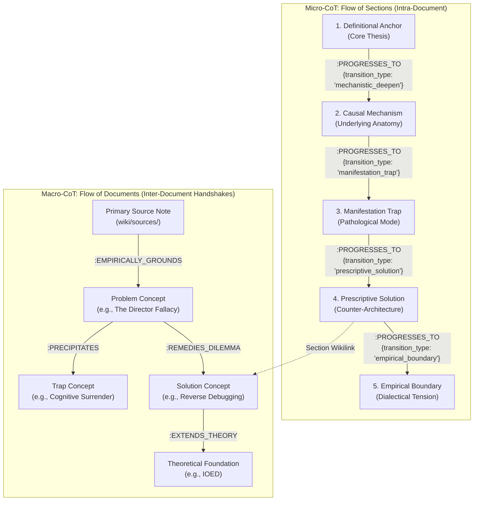
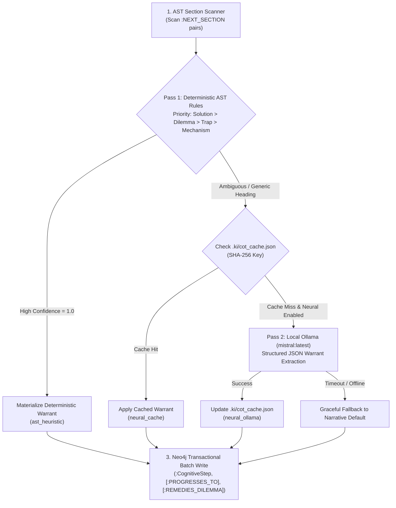
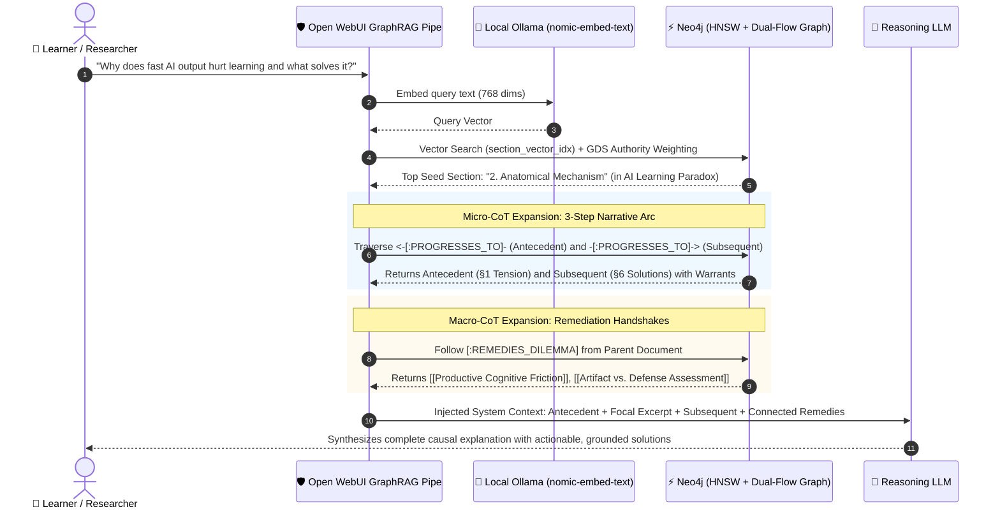

# Dual-Flow Chain of Thought (CoT) & CoT-Windowed Retrieval Architecture Guide

This guide documents the implementation, schema, extraction mechanics, and retrieval architecture of **Dual-Flow Chain of Thought (CoT)** across the `knowledge-lab` knowledge graph and Open WebUI.

---

## 1. Executive Overview & Paradigm Shift

Traditional knowledge graphs and vector databases suffer from the **Epistemic Granularity Gap**:
- **Vector search** retrieves disjoint text chunks without narrative context, isolating claims from their underlying proofs and subsequent solutions.
- **Syntactic knowledge graphs** record that Note A mentions Note B via `[:CITES]`, but fail to capture *why* (warrant), *in what direction* (inferential flow), or *toward what end* (remedy vs. mechanism).

The **Dual-Flow Chain of Thought** architecture resolves this by modeling deductive reasoning across two complementary levels:



1. **Micro-CoT (Flow of Sections)**: Preserves the internal argumentative arc inside each document, linking sequential headings via `[:PROGRESSES_TO]` with typed transitions and Toulmin warrants.
2. **Macro-CoT (Flow of Documents)**: Discovers and materializes structural inferential handshakes between notes (`[:REMEDIES_DILEMMA]`, `[:EXTENDS_THEORY]`, `[:PRECIPITATES]`, `[:EMPIRICALLY_GROUNDS]`).

---

## 2. Implemented Schema Architecture in Neo4j

### Node Labels & Classifications
- **`(:Document)`**: Master label for all markdown files (295 nodes), with domain secondary labels:
  - `(:Concept)` (107 nodes): Theoretical models, cognitive traps, and methodologies.
  - `(:Entity)` (70 nodes): Organizations, software tools, researchers, frameworks.
  - `(:Source)` (45 nodes): Primary evidence distillations from `raw/`.
  - `(:Ingestion)` (45 nodes): Historical audit dossiers.
  - `(:Synthesis)` (7 nodes): Archived multi-document research answers.
- **`(:Section)`** (2,307 nodes): Headings (`h1`–`h6`) parsed from Markdown AST:
  - Epistemic sub-labels: `(:Summary)` [lead Definitional Anchor callout], `(:CoreThesis)` [section 1 Core Thesis], `(:DefinitionalAnchor)`, `(:MechanisticDeepen)`, `(:ManifestationTrap)`, `(:PrescriptiveSolution)`, `(:EmpiricalBoundary)`, `(:SynthesisCatalog)`, `(:DilemmaProblem)`.
  - Properties: `step_type`, `displayName`, `headingLevel`, `uri`, `content`, `embedding` (768 dims, HNSW indexed).

### Relationship Topology & Telemetry

| Relationship Type | Count | Domain Flow | Semantic Function & Warrant |
| :--- | :---: | :--- | :--- |
| **`[:PROGRESSES_TO]`** | **1,887** | `(:Section) -> (:Section)` | Intra-document sequential reasoning transition with `transition_type`, `warrant`, `confidence`, and `method`. |
| **`[:REMEDIES_DILEMMA]`** | **119** | `(:Concept) -> (:Concept)` | Connects a problem or failure mode to an architectural countermeasure or solution framework. |
| **`[:EXTENDS_THEORY]`** | **109** | `(:Concept) -> (:Concept)` | Connects a concept's causal mechanism section to its theoretical foundations. |
| **`[:PRECIPITATES]`** | **77** | `(:Concept) -> (:Concept)` | Tracks how an unmitigated cognitive mechanism precipitates downstream pathologies. |
| **`[:EMPIRICALLY_GROUNDS]`** | **357** | `(:Source) -> (:Concept)` | Materializes direct literature grounding and citation evidence. |
| **`[:NEXT_SECTION]`** | **2,029** | `(:Section) -> (:Section)` | Base physical AST linear sequence. |
| **`[:LINKS_TO]`** | **5,950** | `(:Section) -> (:Document)` | Fine-grained section wikilinks. |
| **`[:CITES]`** | **3,498** | `(:Document) -> (:Document)` | Macro citation graph with occurrence weights. |

---

## 3. Option 3: Hybrid Two-Pass Cascade Pipeline

Implemented in [`scripts/extract_dual_flow_cot.py`](file:///Users/christoflitznerski/MyObsidian/knowledge-lab/scripts/extract_dual_flow_cot.py), the Hybrid Two-Pass Cascade provides the optimal balance between deterministic velocity and neural depth:



### Key Execution Highlights:
- **Zero Token Overhead for Standard Headings**: $>80\%$ of transitions match canonical AST patterns instantly ($< 0.6\text{s}$ execution time).
- **Local Neural Intelligence**: Calls local Ollama `mistral:latest` (or `llama3.1:latest`) over Apple Silicon for non-standard or domain-novel headings.
- **Incremental SHA-256 Hashing**: Cached results are preserved in [`wiki/.ki/cot_cache.json`](file:///Users/christoflitznerski/MyObsidian/knowledge-lab/wiki/.ki/cot_cache.json), ensuring that subsequent sync runs skip re-evaluating unchanged content.

---

## 4. Option 4: Ingest-Time Agentic Compilation

To guarantee that all future incoming primary evidence seamlessly integrates into the CoT graph without manual remediation, **Option 4** has been codified into the repository constitution.

### 1. Codified Axiom 9 in `AGENTS.md`
Every newly compiled or refactored concept note in `wiki/concepts/` must structure its sections along the canonical 6-stage epistemic arc:

| Step # | Canonical Heading Anchor | Epistemic Type | Downstream Graph Behavior |
| :---: | :--- | :--- | :--- |
| **1** | `1. Core Thesis / Definition` | `DEFINITIONAL_ANCHOR` | Establishes baseline concept identity and ontological boundaries. |
| **2** | `2. Causal Anatomy & Underlying Mechanics` | `MECHANISTIC_DEEPEN` | Links placed here establish `[:EXTENDS_THEORY]` edges to foundational theories. |
| **3** | `3. Manifestations & Failure Modes` | `MANIFESTATION_TRAP` / `DILEMMA_PROBLEM` | Links placed here establish `[:PRECIPITATES]` edges to pathological consequences. |
| **4** | `4. Prescriptive Mitigations & Counter-Architectures` | `PRESCRIPTIVE_SOLUTION` | Links placed here establish `[:REMEDIES_DILEMMA]` edges to target solution frameworks. |
| **5** | `5. Empirical Boundaries & Contradictions` | `EMPIRICAL_BOUNDARY` | Captures dialectical tensions, controversies, and model limitations. |
| **6** | `## Related Notes` | `SYNTHESIS_CATALOG` | Bidirectional indexing of related concepts, entities, and sources. |

### 2. Operating Skill Integration
- **`wiki-ingest` Skill**: Step 5 (Multi-Node Compilation) enforces the CoT arc across sequential authoring and parallel Map-Reduce worker subagents.
- **Validation Gate**: Automated audit validates that prescriptive solution sections contain direct wikilinks to counter-architectures before committing.

---

## 5. Production Open WebUI CoT-Windowed Retrieval Filter

Implemented in [`setup/open_webui_graphrag_pipe.py`](file:///Users/christoflitznerski/MyObsidian/knowledge-lab/setup/open_webui_graphrag_pipe.py), the Open WebUI filter replaces naive single-chunk RAG with **Dual-Flow CoT-Windowed Retrieval**:



### Context Injection Schema in Open WebUI:
```markdown
--- Relevant Knowledge Graph Context (Dual-Flow CoT + Vector Hybrid) ---

### [1] Document: AI Learning Paradox | Focal Section: 2. Anatomical Mechanism
- **Thematic Cluster**: Community 699 | **Authority**: 0.0842
- **Tags**: #cognitive-science, #ai-literacy | **Connected Concepts**: [[Cognitive Surrender]]
- **Key Interconnected Remedies**: [[Productive Cognitive Friction]], [[Artifact vs. Defense Assessment]]
- **Antecedent Step** (1. The Core Tension) [Warrant: Exposes intrinsic epistemic tensions]:
  > Describes the gap between flawless generative output and zero schema retention...
- **Focal Excerpt**:
  [Full text of the anatomical mechanism paragraph]
- **Subsequent Step / Remedy** (6. Structural Solutions) [Warrant: Prescribes architectural safeguards]:
  > Outlines pedagogical countermeasures that restore productive friction...

--- End Graph Context ---
```

---

## 6. Cypher Query Catalog: Focus on Solutions

The following production Cypher queries demonstrate how to query the knowledge graph with a specific focus on **solutions, mitigations, and counter-architectures**:

### Query 1: Retrieve All Recommended Solutions for a Specific Problem
```cypher
MATCH (problem:Concept {title: "The Director Fallacy"})-[r:REMEDIES_DILEMMA]->(solution:Concept)
RETURN problem.title AS Problem, 
       r.warrant AS WhyItWorks, 
       solution.title AS Solution,
       solution.reliability_score AS Confidence;
```

### Query 2: Rank the Universal Solution Hubs Across the Entire Vault
```cypher
MATCH (problem:Concept)-[r:REMEDIES_DILEMMA]->(solution:Concept)
RETURN solution.title AS UniversalSolution,
       count(DISTINCT problem) AS ProblemsSolvedCount,
       collect(DISTINCT problem.title)[0..4] AS ExampleProblemsSolved
ORDER BY ProblemsSolvedCount DESC
LIMIT 8;
```

### Query 3: Trace the Internal Solution Arc Inside a Document (Micro-CoT)
```cypher
MATCH (d:Document {title: "AI Learning Paradox"})-[:HAS*1..3]->(s1:CognitiveStep)-[r:PROGRESSES_TO {transition_type: "prescriptive_solution"}]->(s2:CognitiveStep)
RETURN d.title AS Document,
       s1.displayName AS ProblemPremise,
       r.warrant AS TransitionWarrant,
       s2.displayName AS PrescriptiveSolution,
       s2.content AS ActionableSteps;
```

### Query 4: End-to-End Problem $\to$ Solution $\to$ Concrete Implementation Entity
```cypher
MATCH (problem:Concept)-[:REMEDIES_DILEMMA]->(solution:Concept)<-[:CITES|LINKS_TO]-(tool:Entity)
WHERE problem.title = "Cognitive Surrender"
RETURN problem.title AS Problem,
       solution.title AS RemedialFramework,
       tool.title AS ConcreteToolOrEntity,
       tool.glossary_notes AS Description;
```

---

## 7. Master Synchronization Pipeline

All components are automated via [`scripts/sync_vault_graph.sh`](file:///Users/christoflitznerski/MyObsidian/knowledge-lab/scripts/sync_vault_graph.sh):

```bash
#!/usr/bin/env bash
# scripts/sync_vault_graph.sh

[1/5] ki index wiki                        # AST Markdown parsing & base structure
[2/5] uv run scripts/enrich_graph.py       # Domain labels, :Tag nodes, normalized search keys
[3/5] uv run scripts/extract_dual_flow_cot.py # Dual-Flow CoT reasoning extraction & warrants
[4/5] uv run scripts/run_gds_analytics.py   # PageRank, Louvain communities, Betweenness
[5/5] uv run scripts/embed_graph_sections.py # 768-dim HNSW section embeddings via Ollama
```

Running `./scripts/sync_vault_graph.sh` completely re-indexes, enriches, deduces, computes, and embeds the vault in a single atomic pass.
