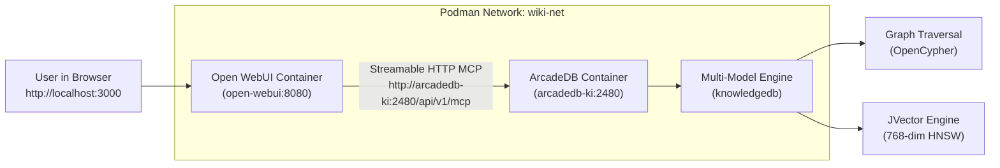

# Open WebUI & ArcadeDB Native MCP Server Setup Guide

This guide provides the complete, step-by-step instructions for connecting **Open WebUI** directly to **ArcadeDB's built-in Model Context Protocol (MCP) server** for [[Knowledge Lab]].

---

## 1. Architectural Topology

Unlike traditional databases that require an external Node.js or Python middleware container to speak MCP, **ArcadeDB embeds a native MCP server** directly within its HTTP core on port `2480`.

Both containers run on the isolated Podman bridge network `wiki-net`:



Because both containers are attached to `wiki-net`, Open WebUI routes traffic directly to `http://arcadedb-ki:2480/api/v1/mcp` via internal container DNS without exiting to the host OS.

---

## 2. Step-by-Step Open WebUI Configuration

### Step 1: Verify ArcadeDB MCP Availability
Before configuring Open WebUI, verify that ArcadeDB's MCP endpoint is active:

```bash
# Probing from host
curl -i -X POST http://localhost:2480/api/v1/mcp \
  -H "Content-Type: application/json" \
  -d '{"jsonrpc": "2.0", "method": "initialize", "params": {"protocolVersion": "2024-11-05", "capabilities": {}, "clientInfo": {"name": "test", "version": "1.0"}}, "id": 1}'
```

### Step 2: Open Admin Settings in Open WebUI
1. Navigate to Open WebUI in your browser:
   ```
   http://localhost:3000
   ```
2. Log in with your admin credentials.
3. Click your profile avatar in the bottom-left corner and select **Admin Panel**.
4. In the top navigation bar, click **Settings**, then select **External Tools** (or **Integrations / MCP Connections**).

### Step 3: Register the ArcadeDB MCP Server
1. Click **+ Add Connection** (or **Add MCP Server**).
2. Configure the connection parameters:
   - **Server Name**: `ArcadeDB KarimooLab`
   - **Connection Type**: `Streamable HTTP` / `SSE`
   - **Server URL**:
     ```
     http://arcadedb-ki:2480/api/v1/mcp
     ```
     *(Note: If testing Open WebUI running directly on the host rather than inside Podman, use `http://localhost:2480/api/v1/mcp`).*
   - **Authentication**: `Basic Auth` or `Custom Header`:
     - **Header Key**: `Authorization`
     - **Header Value**: `Basic cm9vdDprYXJpbW9vbGFiX3NlY3JldA==` *(Base64 of `root:root_secret`)*
3. Click **Save** (or **Test & Connect**).
4. Open WebUI will send an MCP `initialize` request and discover the registered tools:
   - `arcadedb_cypher_query`: Execute graph queries across concepts and entities.
   - `arcadedb_vector_search`: Perform semantic similarity lookup over sections.
   - `arcadedb_get_schema`: Retrieve current vertex/edge types and indexes.

---

## 3. Enabling ArcadeDB Tools in Chat Models

Once the MCP server is registered, you can attach its capabilities to any model or workspace:

### Method A: Per-Chat Tool Activation
1. In the chat interface (`http://localhost:3000/`), look at the input box controls.
2. Click the **Tools** icon (wrench/hammer).
3. Toggle on **ArcadeDB KarimooLab**.
4. The LLM (e.g. `llama3.1`, `qwen2.5`, or `claude-3-5-sonnet`) can now autonomously query the graph when answering questions.

### Method B: System Prompt / Model Preset Binding
To create a dedicated "KarimooLab Graph Researcher" model:
1. Go to **Workspace > Models**.
2. Click **+ Create Model**.
3. Name: `KarimooLab Graph Assistant`.
4. Base Model: Select your preferred LLM.
5. In **Tools**, check **ArcadeDB KarimooLab**.
6. In **System Prompt**, instruct the model on tool utilization:
   ```markdown
   You are the sovereign intelligence agent for Knowledge Lab.
   You have direct access to the ArcadeDB knowledge graph via MCP tools.
   Whenever the user asks about conceptual frameworks, researchers, or architectures:
   1. Use `arcadedb_vector_search` to find relevant sections.
   2. Use `arcadedb_cypher_query` to traverse Chain of Thought (CoT) handshakes.
   3. Always cite sources and concepts using Obsidian wikilinks [[Concept Name]].
   ```

---

## 4. MCP vs. Ambient Python Filter: The Hybrid Strategy

Open WebUI supports two complementary integration paradigms. They should be deployed together:

```
┌─────────────────────────────────────────────────────────────────────────┐
│                           Open WebUI Chat Session                       │
├───────────────────────────────────┬─────────────────────────────────────┤
│   Ambient Python Filter           │   Native ArcadeDB MCP Tool Calling  │
│   (Synchronous Middleware)        │   (Asynchronous Agentic Tool)       │
├───────────────────────────────────┼─────────────────────────────────────┤
│ • Fires on EVERY user message     │ • LLM decides WHEN to invoke tool   │
│ • Sub-second vector KNN search    │ • Multi-step exploratory reasoning  │
│ • Injects top-5 section context   │ • Interactive Cypher queries        │
│ • Zero LLM prompt-choice overhead │ • Deep schema inspection            │
└───────────────────────────────────┴─────────────────────────────────────┘
```

1. **Python Filter (`inlet` hook)**: Silently embeds the user query, retrieves top semantic sections from ArcadeDB via `/api/v1/query`, and prepends them to the prompt context.
2. **MCP Tool Calling**: Empowers the LLM to perform on-demand, multi-hop Cypher queries if the initial context requires further exploration.

---

## 5. Troubleshooting & Telemetry

### Issue 1: Connection Refused (`ERR_CONNECTION_REFUSED`)
- **Cause**: Open WebUI is attempting to reach `localhost:2480`, which resolves to the Open WebUI container itself, not the ArcadeDB container.
- **Fix**: Ensure the URL is `http://arcadedb-ki:2480/api/v1/mcp` and both containers are on `wiki-net`:
  ```bash
  podman network inspect wiki-net
  ```

### Issue 2: Unauthorized (HTTP 401)
- **Cause**: Missing or incorrect Basic Auth header.
- **Fix**: Verify header value `Basic cm9vdDprYXJpbW9vbGFiX3NlY3JldA==`.

### Issue 3: MCP Disabled in ArcadeDB
- **Cause**: ArcadeDB container started without `-Darcadedb.mcp.enabled=true`.
- **Fix**: Check container logs:
  ```bash
  podman logs arcadedb-ki | grep -i mcp
  ```
  Ensure `ARCADEDB_SETTINGS` contains `-Darcadedb.mcp.enabled=true`.
