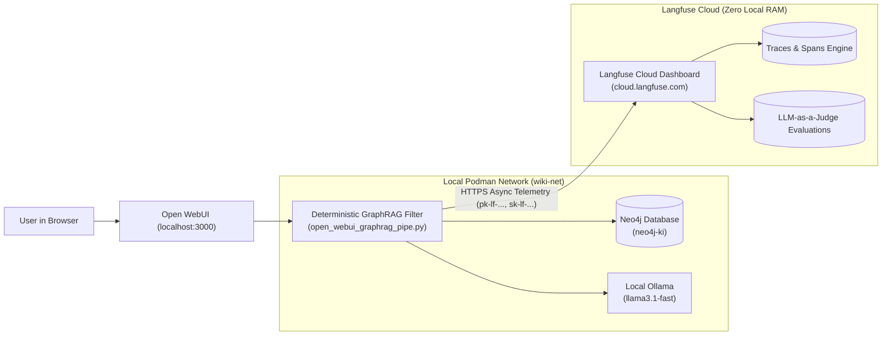
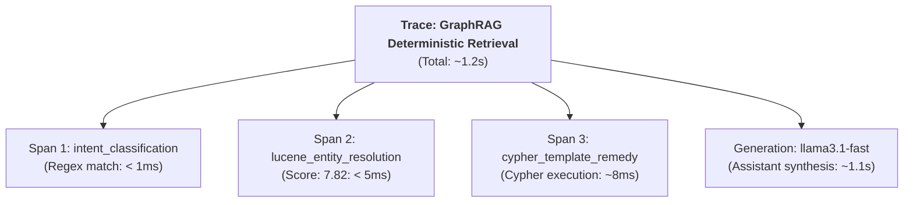

# Langfuse Cloud & Open WebUI Integration Guide

---

## 1. Overview

This guide details how to connect your **Langfuse Cloud** account ([cloud.langfuse.com](https://cloud.langfuse.com)) with **Open WebUI** to achieve full sub-millisecond observability over the **Deterministic GraphRAG & Dual-Flow CoT** pipeline.

By connecting Langfuse Cloud, your local macOS setup (M3 24GB Unified RAM) maintains **0 MB RAM overhead** and **zero Docker container maintenance** for ClickHouse, PostgreSQL, and Redis, while logging rich nested trace flamegraphs directly to Langfuse.



---

## 2. Step 1: Obtain Credentials from Langfuse Cloud

1. Log into your account at [cloud.langfuse.com](https://cloud.langfuse.com) (or [us.cloud.langfuse.com](https://us.cloud.langfuse.com) if registered in the US region).
2. Create or select your project (e.g., `knowledge-lab`).
3. In the left navigation menu, click **Settings > API Keys**.
4. Click **+ Create new API keys**.
5. Copy the three values:
   - **Public Key**: `pk-lf-...`
   - **Secret Key**: `sk-lf-...`
   - **Host URL**: `https://cloud.langfuse.com` (EU default) or `https://us.cloud.langfuse.com` (US).

---

## 3. Step 2: Configure Open WebUI

You have two integration options available in your repository:

### Option A: Deep GraphRAG Instrumentation (Recommended)
This option instruments the inner workings of your knowledge graph directly (Lucene score, Cypher query latency, vector fallback, and generation).

1. Open your browser and go to Open WebUI at `http://localhost:3000`.
2. Navigate to **Admin Panel > Functions**.
3. Select or create the function **Deterministic Neo4j GraphRAG & Dual-Flow CoT Filter**.
4. Paste the updated code from [`setup/open_webui_graphrag_pipe.py`](file:///Users/christoflitznerski/MyObsidian/knowledge-lab/setup/open_webui_graphrag_pipe.py).
5. Click **Save**.
6. Click the **Valves (Gear Icon)** next to the function:
   - Set `ENABLE_LANGFUSE`: **True** (toggle on).
   - Set `LANGFUSE_PUBLIC_KEY`: Paste your `pk-lf-...` key.
   - Set `LANGFUSE_SECRET_KEY`: Paste your `sk-lf-...` key.
   - Set `LANGFUSE_HOST`: `https://cloud.langfuse.com` (or your US endpoint).
7. Click **Save Valves**.

---

### Option B: Standalone General Chat Filter
If you also want general conversation logging for other models or standard chats without GraphRAG:

1. Navigate to **Admin Panel > Functions**.
2. Click **+ Add Function**.
3. Paste the contents of [`setup/open_webui_langfuse_filter.py`](file:///Users/christoflitznerski/MyObsidian/knowledge-lab/setup/open_webui_langfuse_filter.py).
4. Save and configure its **Valves** with your API keys.
5. Set the function to **Global** or attach it to specific models.

---

## 4. Step 3: Verification & Flamegraph Inspection

1. In Open WebUI, open a new chat using `llama3.1-fast` (or your preferred model).
2. Enter a test query that triggers deterministic GraphRAG:
   ```text
   What solutions or counter-architectures mitigate Cognitive Surrender?
   ```
3. Open your browser to [cloud.langfuse.com](https://cloud.langfuse.com) and go to **Tracing > Traces**.
4. Click on the newly recorded trace (`GraphRAG Deterministic Retrieval`).
5. Verify the nested sub-spans:
   - `intent_classification`: Displays `output: {"intent": "REMEDY", "target_step_type": "PRESCRIPTIVE_SOLUTION"}`.
   - `lucene_entity_resolution`: Displays `output: {"matched_entity": "Cognitive Surrender", "score": 7.82}`.
   - `cypher_template_remedy`: Displays `remedies: ["Productive Cognitive Friction", "Socratic AI Architecture", ...]`.
   - `assistant_generation`: Displays model completion duration, tokens, and synthesized answer.



---

## 5. Step 4: Multi-Turn Context Bloat Monitoring

To verify that the **Stateful Context Replacement** implemented in `open_webui_graphrag_pipe.py` prevents prompt bloat:

1. Continue the test conversation in Open WebUI:
   - **Turn 1**: *"What causes Cognitive Surrender?"*
   - **Turn 2**: *"What specific remedies solve this?"*
   - **Turn 3**: *"Are there any failure modes in that remedy?"*
2. In Langfuse Cloud, inspect the **Generations** table:
   - Confirm that `prompt_tokens` remains stable (~600–750 tokens) rather than compounding (500 -> 1,200 -> 2,100+ tokens).
   - This empirically confirms that previous turns' graph context blocks are safely stripped before fresh context is injected.

---

## 6. Step 5: Setting Up Dual-Flow CoT Evaluation (LLM-as-a-Judge)

In Langfuse Cloud, you can automatically grade responses against the 6-stage epistemic arc:

1. Navigate to **Scores / Evals > Templates**.
2. Click **+ New Score Template**:
   - **Name**: `cot_adherence_score`
   - **Data Type**: Numeric (1 to 5) or Categorical.
3. In **Automated Evaluations**, add an LLM evaluator prompt:
   ```markdown
   Evaluate whether the assistant response explicitly grounds its deductive reasoning in the Dual-Flow CoT epistemic arc:
   1. Definitional Anchor: Defines the core thesis clearly.
   2. Causal Anatomy: Explains the underlying mechanisms.
   3. Failure Traps: Identifies pathologies or dilemmas.
   4. Prescriptive Solutions: Outlines concrete counter-architectures.
   5. Dialectical Boundaries: Cites limitations and failure conditions.
   
   Rate the response from 1 (unstructured summary) to 5 (full 6-stage deductive compliance).
   ```
4. Target Metric: Maintain an average score $\ge 4.0$ across all vault sparring sessions.
