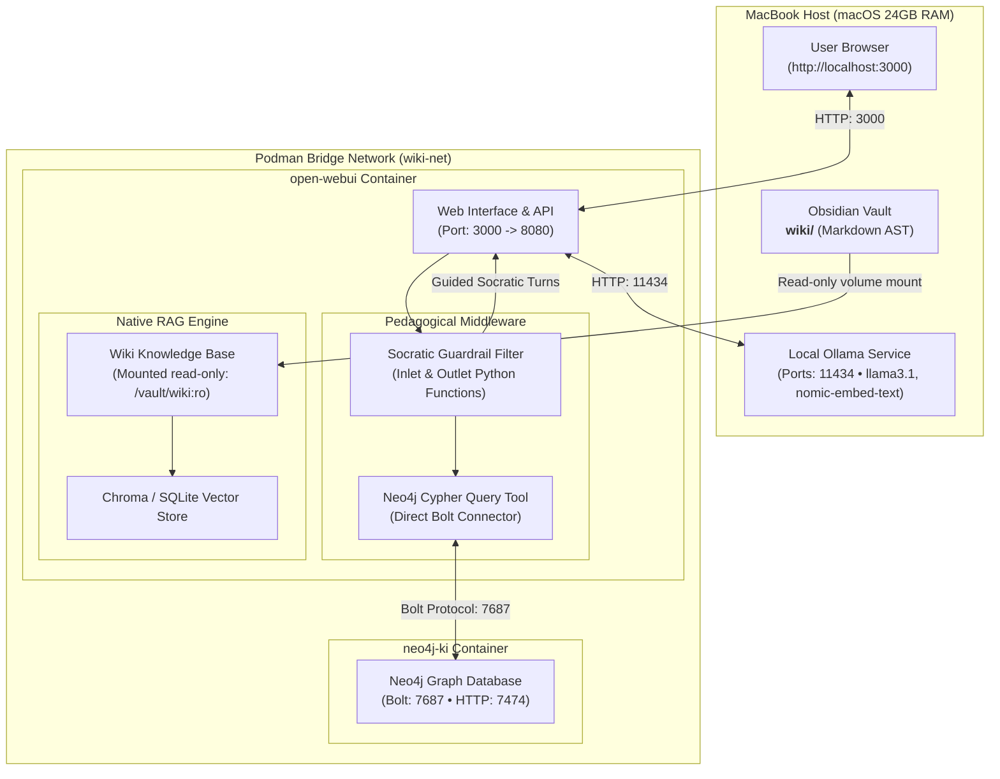

# Open WebUI Socratic Wiki Chat: Complete Setup & Implementation Guide

---

## 1. Overview & Architecture

This guide details the complete configuration and deployment of **Open WebUI** on macOS as a **pedagogically governed, Socratic conversational companion** over your local Obsidian wiki (`wiki/`).

The setup runs in **Podman** on your MacBook, interconnects directly with your running **Neo4j** container (`neo4j-ki`), interfaces with local **Ollama** (`llama3.1`, `mistral`, `nomic-embed-text`) or **OpenRouter**, and deterministically enforces single-question dialectical sparring to prevent cognitive offloading and the [[AI Learning Paradox]].



---

## 2. Infrastructure Specifications & Topology

- **Container Runtime**: Podman (rootless mode).
- **Virtual Machine Allocation**: `podman-machine-default` with **6,144 MB (6 GB) RAM** and 4 vCPUs.
- **Shared Network**: `wiki-net` (bridge driver with internal DNS resolution enabled).
- **Open WebUI URL**: `http://localhost:3000` (mapped to container port `8080`).
- **Volume Mounts**:
  - `open-webui-data` $\rightarrow$ `/app/backend/data` (persistent database, user accounts, embeddings).
  - `/Users/christoflitznerski/MyObsidian/knowledge-lab/wiki` $\rightarrow$ `/vault/wiki:ro` (read-only Obsidian wiki).
- **Neo4j Endpoint**: `bolt://neo4j-ki:7687` (internal container DNS) or `bolt://localhost:7687` (host).
- **Ollama Endpoint**: `http://host.containers.internal:11434`.

---

## 3. Terminal & Container Setup Commands

### 3.1 Prerequisite: Start Local Ollama
Ensure Ollama is listening on all interfaces (`0.0.0.0`) so Podman can communicate with it:
```bash
OLLAMA_HOST=0.0.0.0:11434 OLLAMA_ORIGINS="*" ollama serve
```

### 3.2 Network & Container Launch
If ever recreating or inspecting the container stack:

```bash
# 1. Ensure shared network exists
podman network create wiki-net

# 2. Launch Open WebUI (Zero-Ollama, Native ArcadeDB Embeddings)
podman run -d \
  --name open-webui \
  --network wiki-net \
  -p 3000:8080 \
  -v open-webui-data:/app/backend/data \
  -v /Users/christoflitznerski/MyObsidian/knowledge-lab/wiki:/vault/wiki:ro \
  -e ENABLE_OLLAMA_API=False \
  -e RAG_EMBEDDING_ENGINE="" \
  -e WEBUI_SECRET_KEY="knowledge-lab-secret-key" \
  ghcr.io/open-webui/open-webui:main
```

---

## 4. Web UI Configuration Walkthrough

### Step 4.1: Initial Account Registration
1. In your browser, open: **`http://localhost:3000`**.
2. Fill out the initial signup form (Name, Email, Password).
3. The first registered account is assigned permanent **Admin** privileges. (All user databases remain completely local in the `open-webui-data` volume).

---

### Step 4.2: LLM Connection Verification
1. Click your user profile in the bottom-left corner $\rightarrow$ **Admin Settings** $\rightarrow$ **Connections**.
2. **Ollama Decommissioned**:
   - Ollama API is disabled (`ENABLE_OLLAMA_API=False`). All vector embeddings are performed 100% natively in ArcadeDB via `algo.fastrp` and JVector `LSM_VECTOR`.
3. **OpenRouter / OpenAI API**:
   - Under the **OpenAI API** section:
     - **URL**: `https://openrouter.ai/api/v1`
     - **API Key**: `sk-or-v1-...`
   - Click **Verify / Refresh**. All OpenRouter models (Claude 3.5 Sonnet, GPT-4o, DeepSeek, etc.) will become selectable.

---

### Step 4.3: Mount the Obsidian Knowledge Base (v0.11.4 Directory Tree)
Open WebUI v0.11.4 introduces native nested directory trees (`dirs/create` and `sync/diff`):
1. In the left navigation bar, click **Workspace** $\rightarrow$ **Knowledge**.
2. Click **+** (New Knowledge Base):
   - **Name**: `Obsidian Wiki`
   - **Description**: `Local personal knowledge graph concepts and sources`
3. Click the Knowledge Base to open its file explorer:
   - **Option A (Drag & Drop Folder)**: Drag your `wiki/` folder (or specific subfolders: `wiki/concepts/`, `wiki/entities/`, `wiki/sources/`) directly into the browser window.
   - **Option B (Upload Directory)**: Click the **Upload** icon $\rightarrow$ **Upload Directory** $\rightarrow$ select `/Users/christoflitznerski/MyObsidian/knowledge-lab/wiki`.
4. Open WebUI v0.11.4 will parse the Markdown AST, preserve your subfolder hierarchy, and vectorize the notes using the local `nomic-embed-text` embedding engine.

---

### Step 4.4: Install the Middleware Filters (v0.11.4 Inlets & Outlets)

In Open WebUI, filters act as middleware:
- **Inlet Filters** intercept the user query before the LLM, executing vector/graph search and injecting context.
- **Outlet Filters** intercept the generated response, enforcing formatting, brevity, or single-question ceilings.

#### Filter A: Unified Neo4j GraphRAG & Dual-Flow CoT Filter (Inlet)
This filter runs hybrid vector search over `section_vector_idx`, performs **CoT-Windowing** (expanding seed matches to Antecedent + Focal + Subsequent steps), and retrieves connected solution frameworks (`[:REMEDIES_DILEMMA]`).

1. Navigate to **Workspace** $\rightarrow$ **Functions** $\rightarrow$ click **+ (Create Function)**.
2. Configure settings:
   - **Type**: `Filter`
   - **Name**: `Unified Neo4j GraphRAG & CoT Filter`
   - **ID**: `neo4j_graphrag_cot_filter`
3. Paste the code from [`setup/open_webui_graphrag_pipe.py`](file:///Users/christoflitznerski/MyObsidian/knowledge-lab/setup/open_webui_graphrag_pipe.py).
4. Click **Save** and toggle the filter to **Active**.
5. Click the **Valves (gear icon)** to configure parameters:
   - `ENABLE_COT_WINDOWING`: `True`
   - `INCLUDE_REMEDIES`: `True`
   - `MAX_REMEDIES_COUNT`: `3`
   - `EXCERPT_CHAR_LIMIT`: `800`

#### Filter B: Socratic Friction Guardrail (Outlet)
1. In **Workspace** $\rightarrow$ **Functions** $\rightarrow$ click **+ (Create Function)**:
   - **Type**: `Filter`
   - **Name**: `Socratic Friction Guardrail`
   - **ID**: `socratic_guardrail`
2. Paste the following Python code:

```python
"""
title: Socratic Friction Guardrail Filter
author: Knowledge Lab
version: 1.0.0
description: Deterministically enforces single-turn inquiry and word ceilings on LLM responses to maintain productive cognitive friction.
"""

from pydantic import BaseModel, Field

class Filter:
    class Valves(BaseModel):
        max_words: int = Field(default=65, description="Strict word count ceiling for assistant turns.")
        enforce_question: bool = Field(default=True, description="Ensure assistant output terminates in a question.")

    def __init__(self):
        self.valves = self.Valves()

    def outlet(self, body: dict, __user__: dict = None) -> dict:
        messages = body.get("messages", [])
        if not messages:
            return body

        last_msg = messages[-1]
        if last_msg.get("role") != "assistant":
            return body

        content = last_msg.get("content", "").strip()

        # Rule 1: Truncate verbosity exceeding max_words
        words = content.split()
        if len(words) > self.valves.max_words:
            truncated = " ".join(words[:self.valves.max_words])
            last_period = max(truncated.rfind("."), truncated.rfind("?"), truncated.rfind("!"))
            if last_period > 0:
                content = truncated[:last_period + 1]
            else:
                content = truncated + "..."
            content += "\n\n*(Trimmed for Socratic brevity)*"

        # Rule 2: Guarantee single-question focus
        if self.valves.enforce_question and "?" not in content:
            content += "\n\nWhat is your initial thought on this?"

        last_msg["content"] = content
        return body
```
3. Click **Save** and toggle the filter to **Active**.

---

### Step 4.5: Install the Dynamic Neo4j Cypher & CoT Tool (Dual-Mode Text2Cypher v2.5.0)

This tool dynamically translates natural language inquiries into executable Cypher queries across **Dual-Flow Chain of Thought relationships** (`[:REMEDIES_DILEMMA]`, `[:EXTENDS_THEORY]`, `[:PRECIPITATES]`, `[:PROGRESSES_TO]`), GDS PageRank authority, and taxonomy aliases.

1. Navigate to **Workspace** $\rightarrow$ **Tools** $\rightarrow$ click **+ (Create Tool)**.
2. Configure settings:
   - **Name**: `Dynamic Neo4j Cypher & GDS Generator`
   - **ID**: `dynamic_neo4j_cypher_tool`
3. Paste the code from [`setup/open_webui_dynamic_neo4j_cypher_tool.py`](file:///Users/christoflitznerski/MyObsidian/knowledge-lab/setup/open_webui_dynamic_neo4j_cypher_tool.py).
4. Click **Save**. Open WebUI will automatically install `neo4j` and `requests`.
5. Click the **Valves (gear icon)** to verify:
   - `neo4j_uri`: `bolt://neo4j-ki:7687`
   - `ollama_url`: `http://host.containers.internal:11434/api/generate`
   - `llm_model`: `llama3.1:latest` (or `mistral:latest`)

---

### Step 4.6: Assemble the Socratic Wiki Model Preset (Dialectical Mode)

1. Navigate to **Workspace** $\rightarrow$ **Models** $\rightarrow$ click **+ (New Model)**.
2. Configure attributes:
   - **Model Name**: `Socratic Wiki Companion`
   - **Base Model**: Select `llama3.1:latest` (or `anthropic/claude-3.5-sonnet` via OpenRouter).
   - **System Prompt**:
     ```text
     You are the Socratic Learning Companion for the user's personal knowledge base.
     Your purpose is NOT to deliver answers directly, but to guide the user to discover solutions, diagnose cognitive failure modes, and build durable internal mental schemas through dialectical inquiry.

     You are equipped with a Dual-Flow Chain of Thought knowledge graph that injects:
     - Antecedent Premise (the foundational assumptions)
     - Focal Mechanism (the underlying cognitive engine)
     - Subsequent Consequence / Trap (how people fail or misuse it)
     - Interconnected Remedies (architectural safeguards and counter-frameworks)

     CORE OPERATIONAL RULES:
     1. DEDUCTIVE SCAFFOLDING VIA COT: Do not jump straight to the solution. Guide the user along the reasoning arc:
        - First: Prompt them to explain the underlying causal mechanism in their own words.
        - Second: Ask where the unmitigated mechanism fails (the cognitive trap).
        - Third: Challenge them to design an architectural safeguard to prevent that failure before revealing the target framework.
     2. NO DIRECT ANSWER DUMPING: Never reveal the target framework by name until the user articulates its core principle.
     3. GRAPH ANCHORING: Ground questions in the wiki's concepts (e.g., "In your notes on The Director Fallacy, how does outsourcing execution create synthetic fluency?").
     4. SINGLE-QUESTION PACING: Exactly ONE focused question per turn. Never ask multi-part questions or lists.
     5. BREVITY CEILING: Keep responses strictly under 60 words.
     ```
   - **Tools**: Enable `Dynamic Neo4j Cypher & GDS Generator`.
   - **Filters**: Enable `Unified Neo4j GraphRAG & CoT Filter` and `Socratic Friction Guardrail`.
3. Click **Save**.

---

### Step 4.7: Assemble the Knowledge Graph Architect Model Preset (Analytical Mode)

For writing drafts, curriculum design, research syntheses, or publishing pipelines, deploy an analytical companion configured to unroll full causal chains and visual Mermaid DAGs:

1. In **Workspace** $\rightarrow$ **Models** $\rightarrow$ click **+ (New Model)**.
2. Configure attributes:
   - **Model Name**: `Knowledge Graph Architect`
   - **Base Model**: Select `llama3.1:latest` (or `anthropic/claude-3.5-sonnet` via OpenRouter).
   - **System Prompt**:
     ```text
     You are the Chief Knowledge Architect for Knowledge Lab.
     Your goal is to synthesize rigorous, evidence-grounded technical analysis by querying the local Neo4j Dual-Flow Chain of Thought graph.

     TOOL EXECUTION PROTOCOL:
     - You have access to the tool `generate_and_run_cypher`.
     - Whenever a user asks to analyze a dilemma, problem, failure mode, or concept, DO NOT invent solutions or simulate queries in text. You MUST FIRST call `generate_and_run_cypher` to query the knowledge graph.
     - You can query `generate_and_run_cypher` using plain English (e.g. `generate_and_run_cypher(question="What are the prescriptive solutions and remedies for Cognitive Surrender?")`) OR direct Cypher (e.g. `generate_and_run_cypher(question="MATCH (problem:Concept {title: 'Cognitive Surrender'})-[r:REMEDIES_DILEMMA]->(solution:Concept) RETURN solution.title, r.warrant")`).
     - Once you receive the table of results from `generate_and_run_cypher`, cite the returned concepts, warrants, and metrics in your response.

     OUTPUT ARCHITECTURE:
     1. Executive Thesis: Ground the core tension or mechanism clearly.
     2. Mermaid Reasoning DAG: Author an Obsidian-native Mermaid flowchart (`flowchart TD` or `flowchart LR`) tracing the deductive CoT arc:
        Premise -> Causal Mechanism ([:EXTENDS_THEORY]) -> Dilemma / Trap ([:PRECIPITATES]) -> Prescriptive Solution ([:REMEDIES_DILEMMA]).
     3. Prescriptive Solutions Matrix: Use a GitHub-Flavored Markdown table with columns: `| Problem / Dilemma | Recommended Solution | Architectural Warrant (Why It Works) | Confidence |`.
     4. Canonical Wikilinks: Every concept or entity must be cited directly as standard Obsidian wikilinks (e.g. [[Cognitive Surrender]], [[Productive Cognitive Friction]]). Never wrap wikilinks in code backticks.
     5. No Raw ASCII Box Art: Always use native Markdown tables and Mermaid diagrams.
     ```
   - **Tools**: Enable `Dynamic Neo4j Cypher & GDS Generator`.
   - **Filters**: Enable `Unified Neo4j GraphRAG & CoT Filter` (leave `Socratic Friction Guardrail` disabled so it can output comprehensive syntheses).
3. Click **Save**.

---

## 5. Verification & Dialectical Sparring Test

1. Start a new chat session at `http://localhost:3000`.
2. Select **Socratic Wiki Companion** from the model dropdown.
3. Submit a test question:
   > *"Can you explain the AI Learning Paradox to me?"*

### Expected Behavioral Outcome:
- **No Answer Dumping**: The assistant does NOT produce a multi-paragraph summary.
- **Graph Inspection**: In the background, it accesses Neo4j connections and RAG context chunks.
- **Concise Turn**: The output terminates in $\le 65$ words.
- **Diagnostic Inquiry**:
  > *"When an AI tool solves a complex task for you with zero cognitive friction, how does your brain's internal mental model differ from when you struggled through the problem yourself?"*

---

## 6. Automated Host Synchronization via `oikb` CLI

While Open WebUI runs in a Podman container, your Markdown notes and publishing pipelines reside natively on macOS. To synchronize files automatically without manual browser uploads, use the official **`oikb` (Open WebUI Knowledge Base CLI)** tool on your Mac host.

### 6.1 Architectural Principle: Host vs. Container
`oikb` **must run directly on your macOS host**, not inside the Podman container:
* It monitors local Obsidian vault files using native macOS filesystem events (`FSEvents`).
* Container VM boundaries prevent live host file changes from reliably notifying internal watchers.
* On the host, `oikb` reads your notes, computes SHA-256 diffs, and sends lightweight sync calls to Open WebUI over HTTP (`http://localhost:3000/api/v1/...`).

### 6.2 Installation & Host Authentication
`oikb` is installed via `uv` at `~/.local/bin/oikb`:

```bash
# 1. Install tool via uv
uv tool install oikb

# 2. Persist Open WebUI URL and admin API key
oikb config set url http://localhost:3000
oikb config set token sk-422b2326d2974693886fe2565e217329
```

### 6.3 Repository Sync Configuration (`.oikb.yaml`)
A ready-to-use configuration file is maintained in the repository root:

```yaml
sources:
  - name: publishing
    source: ./raw/publishing
    kb-id: "4a51e569-95eb-46fa-84c3-ab196c92724c"
    interval: "15m"
  - name: wiki
    source: ./wiki
    target-path: "wiki"
    kb-id: "14f80155-2a74-404c-ae48-102907b86f79"
    interval: "30m"
```

> [!IMPORTANT] Target Path Invariant (`target-path: "wiki"`)
> When `Obsidian Wiki` was originally mounted into Open WebUI via the browser directory picker, Open WebUI registered the root folder as `wiki` and nested subdirectories under `wiki/concepts/`, `wiki/entities/`, etc. Setting `target-path: "wiki"` instructs `oikb` to prepend `wiki` to local paths, ensuring a 100% path match against `webui.db` without duplicate folders or mass re-indexing.

### 6.4 Daily Usage Workflows

| Mode | Command | Behavioral Outcome |
| :--- | :--- | :--- |
| **Wiki Post-Ingest Sync** | `oikb sync --name wiki` | Incrementally syncs newly compiled notes from `wiki/` to Open WebUI in `< 1s`. |
| **Full Incremental Sync** | `oikb sync` | Compares all configured sources (`publishing` + `wiki`) against Open WebUI and uploads diffs. |
| **Real-Time Watcher** | `oikb watch` | Stays active in a terminal tab; watches vault folders and syncs immediately on save. |
| **Scheduled Daemon** | `oikb daemon` | Runs as a background service and performs incremental syncs according to intervals. |
| **Status Check** | `oikb status --kb-id <id>` | Displays Knowledge Base title, registered file count, and last update timestamp. |
| **Preview Diff** | `oikb diff` | Previews files to be added, modified, or deleted without executing any changes. |

---

## 7. Daily Operations Cheat Sheet

| Action | Command / Procedure |
| :--- | :--- |
| **Start Ollama** | `OLLAMA_HOST=0.0.0.0:11434 OLLAMA_ORIGINS="*" ollama serve` |
| **Check Container Status** | `podman ps` |
| **Stop Open WebUI** | `podman stop open-webui` |
| **Start Open WebUI** | `podman start open-webui` |
| **Restart Open WebUI** | `podman restart open-webui` |
| **View Container Logs** | `podman logs -f open-webui` |
| **Post-Ingest Wiki Sync** | `oikb sync --name wiki` (from repository root) |
| **Sync All Knowledge** | `oikb sync` (from repository root) |
| **Live Knowledge Watcher** | `oikb watch` (auto-syncs on file save) |
| **Update Notes in Neo4j** | Run `ki add -C wiki "<relative-path>"` from repo root |

---

## 8. Troubleshooting & Maintenance

### 8.1 Chrome Infinite Reload / Flicker on `localhost:3000`
If Chrome flickers or loops infinitely when visiting `http://localhost:3000` while Safari works normally, Chrome is holding stale cookies, localStorage, or an old Service Worker from a previous web app on port 3000.

**Fixes**:
1. **Immediate Bypass**: Navigate to **`http://127.0.0.1:3000`** in Chrome. Chrome isolates storage origins between `localhost` and `127.0.0.1`.
2. **Clear Site Data**:
   - Open Developer Tools in Chrome (`Cmd + Option + I`).
   - Click the **Application** tab $\rightarrow$ select **Storage** in the left sidebar.
   - Click **Clear site data** and hard-refresh (`Cmd + Shift + R`).

### 8.2 Tool Not Triggering in Chat Turns (Missing `toolIds`)
If Neo4j queries do not appear in the Neo4j query logs during chat, verify that the tool is assigned to the model:
1. In Open WebUI, attaching a **Knowledge Base** (vector RAG) does not automatically enable **Tools** (function calling).
2. Navigate to **Workspace** $\rightarrow$ **Models** $\rightarrow$ edit your model preset $\rightarrow$ scroll to **Tools** $\rightarrow$ ensure **Knowledge Graph Explorer (Neo4j)** is checked and saved.

### 8.3 Runaway Embedding Tasks on Video Binaries (Emergency Stop)
Open WebUI vector ingestion is designed exclusively for text and markdown documents. If a directory containing video binaries (`.mp4`, `.mov`, `.m4v`) is linked:
* The loader treats raw binary frames as text characters, generating tens of thousands of corrupted chunks (e.g. 80,000+ batches) and pinning the CPU at 100%.
* **Emergency Termination**: PyTorch embedding loops cannot be canceled from the frontend. Terminate the loop immediately with:
  ```bash
  podman restart open-webui
  ```
* **Best Practice**: Keep raw video files in `raw/videos/`, transcribe them using Whisper into text notes in `raw/transcripts/`, and index only the transcripts.

### 8.4 Vector Store Compaction & Database Vacuum
If large files were accidentally ingested, purge orphaned Chroma collections and shrink SQLite:

```bash
podman exec open-webui python -c "
import sqlite3, os
conn = sqlite3.connect('/app/backend/data/webui.db', isolation_level=None)
conn.execute('PRAGMA wal_checkpoint(TRUNCATE)')
conn.execute('VACUUM')
conn.close()

c_conn = sqlite3.connect('/app/backend/data/vector_db/chroma.sqlite3', isolation_level=None)
c_conn.execute('VACUUM')
c_conn.close()
"
```

### 8.5 Missing API Key Option in User Settings
If the "API Keys" section is missing from **Settings** $\rightarrow$ **Account**:
1. Open WebUI disables API key generation by default via `auth.enable_api_keys=false` and `user.permissions.features.api_keys=false`.
2. Enable both settings in the container configuration:
   ```bash
   podman exec open-webui python -c "
   import sqlite3, json
   conn = sqlite3.connect('/app/backend/data/webui.db')
   c = conn.cursor()
   c.execute('UPDATE config SET value=\"true\" WHERE key=\"auth.enable_api_keys\"')
   row = c.execute('SELECT value FROM config WHERE key=\"user.permissions\"').fetchone()
   if row:
       perms = json.loads(row[0])
       perms['features']['api_keys'] = True
       c.execute('UPDATE config SET value=? WHERE key=\"user.permissions\"', (json.dumps(perms),))
   conn.commit()
   conn.close()
   "
   ```
3. Refresh the web page (`Cmd + R`) to reveal the creation interface.


