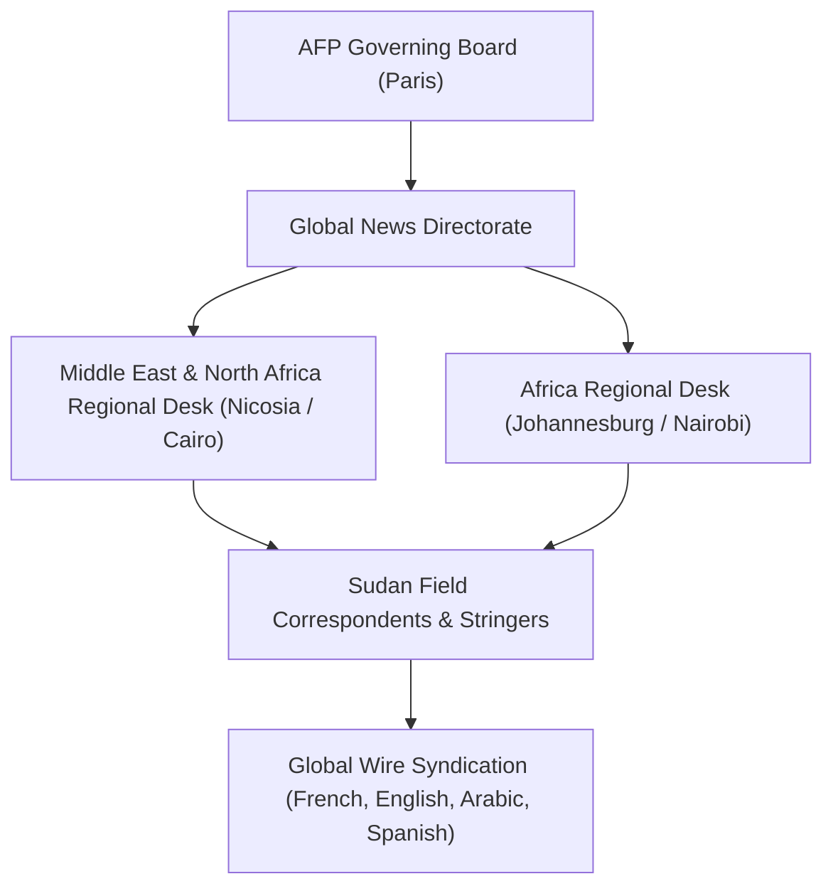

# Agence France-Presse

## 1. Identity, Classification & Leadership Anchor

> [!NOTE] Identity, Classification & Leadership Anchor
> **Agence France-Presse (AFP)** is an international news agency headquartered in Paris, France, and one of the world's three leading global wire services alongside Reuters and the Associated Press. Led by CEO Fabrice Fries and Global News Director Phil Chetwynd, AFP operates a vast multilingual network of correspondents providing verified, rapid, and non-partisan news dispatches, wire photography, and video coverage on the war in Sudan.

## 2. Historical Lineage, Factions & Command Structure

Traced back to 1835 as the world's oldest news agency, AFP was established in its modern form by a 1957 statute guaranteeing complete editorial independence from state or political influence. Throughout the modern history of Sudan—from the second civil war and the 2003 Darfur conflict to the 2018–2019 revolution and the 2023 war—AFP has maintained on-the-ground stringers and regional editors chronicling military operations, humanitarian displacement, and political transitions.

## 3. Strategic Objectives, Ideology & Political Economy ("Why")

AFP's operational mandate centers on rapid, impartial, and verified wire journalism:
- **Real-Time Factual Reporting**: Delivering unembellished, factual wire alerts on military strikes, high-casualty bombings, and political communiqués.
- **Strict Verification Standards**: Requiring dual-source corroboration before publishing civilian casualty tolls and explicitly attributing contradictory military claims to their respective sources.
- **Multilingual Dissemination**: Translating breaking developments into six languages, ensuring that Sudanese news reaches international media clients, diplomacy, and human rights bodies simultaneously.

## 4. Operational Capabilities, Alliances & Foreign Backing

- **Global Syndication**: AFP's wire reports are syndicated across thousands of international news outlets, including [[Arab News]], Le Monde, BBC, and Middle Eastern publications.
- **Field Safety & Remote Reporting**: Operates through verified local stringers, eyewitness networks, and UN agency briefings to verify frontline dynamics despite severe threats to journalists and pervasive telecommunications blackouts.

## 5. Chronological Event Footprint & Accountability Record

| Date | Wire Reporting Milestone | Event Corroboration |
| :--- | :--- | :--- |
| **2023-04** | Initial breaking alerts on clashes at General Command and Khartoum Airport | First verified international wire accounts |
| **2024-05** | Detailed field dispatches on RSF encirclement of El Fasher | Documented shelling of South Hospital |
| **2026-10-31** | Dispatched wire alert on UN Secretary-General's condemnation of Nyala market drone attack | Provided base wire text syndicated by regional press |

## ## Related Primitives
- **Sources**: [[sources/2026-10-31-arab-news-un-chief-appalled-drone-strikes-nyala-market]]
- **Themes**: [[Drone Proliferation and Double-Tap Strike Doctrine in Sudan]]
- **Events**: [[2026-10-27 Nyala Tanqonj Market Drone Strike]]
- **Actors**: [[Arab News]], [[Stéphane Dujarric]], [[António Guterres]], [[Sudanese Armed Forces]], [[Rapid Support Forces]]
- **Locations**: [[Nyala]]
