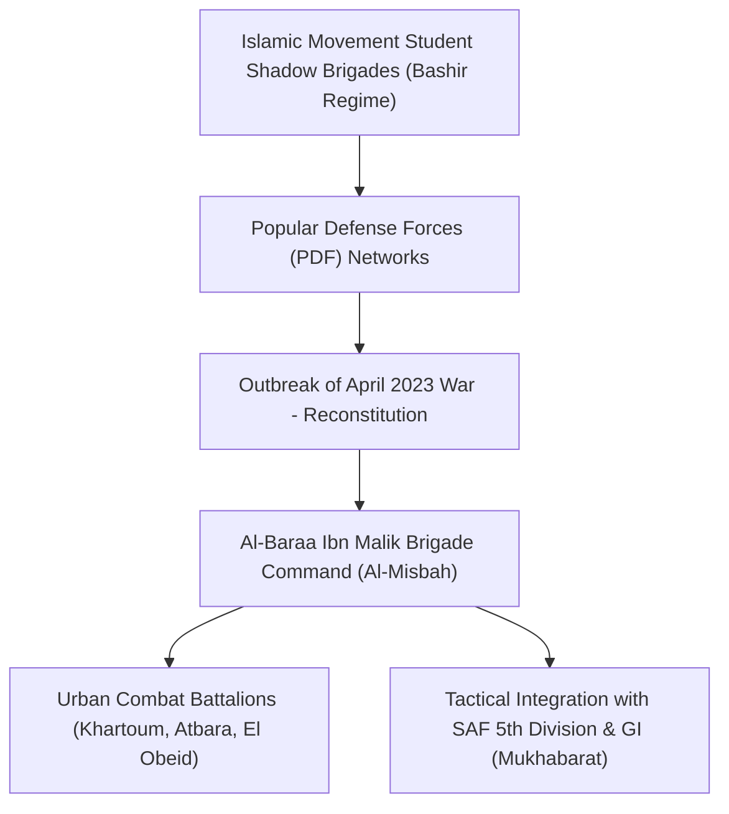

# Al-Baraa Ibn Malik Brigade

## 1. Identity, Classification & Leadership Anchor

> [!NOTE] Armed Group & Islamist Auxiliary Anchor
> The **Al-Baraa Ibn Malik Brigade** (كتيبة البراء بن مالك) is an elite Sudanese Islamist paramilitary formation operating as a dedicated auxiliary combat wing fighting alongside the [[Sudanese Armed Forces]] (SAF) against the [[Rapid Support Forces]] (RSF). Commanded by **Al-Misbah Abu Zaid Talha**, the brigade draws ideological and organizational lineage from the student brigades of the former National Congress Party (NCP) and the Popular Defense Forces (PDF) that sustained the Omar al-Bashir regime. In [[El Obeid]], its members are quartered in residential properties, an urban co-location pattern identified by the UN Fact-Finding Mission as drawing lethal drone fire onto civilian neighborhoods.

## 2. Historical Lineage, Factions & Command Structure

Mobilizing immediately following the outbreak of fighting in Khartoum in April 2023, the brigade spearheaded fierce defensive engagements around the SAF Armored Corps (al-Shajara) and the General Command. With seasoned fighters skilled in small-unit urban warfare, drone reconnaissance, and ideological indoctrination, Al-Baraa rapidly expanded into a premier fighting formation, deploying units to River Nile, Sennar, and North Kordofan.

## 3. Strategic Objectives, Ideology & Political Economy ("Why")

The brigade operates under explicit religious-nationalist and political doctrines:
- **Total Defeat of the RSF**: Framing the conflict as an existential defense of the Sudanese state and Islamic identity against foreign-backed "mercenary invasion."
- **Rehabilitation of Islamic Movement Influence**: Reasserting the institutional power of the Sudanese Islamic Movement within the military-security apparatus.
- **Vocal Rejection of Peace Concessions**: Opposing Track-1 peace negotiations that equate state-aligned armed groups with the RSF or demand civilian-led security sector reform.

## 4. Operational Capabilities, Alliances & Foreign Backing

- **Combat Lethality**: Possesses dedicated sniper teams, anti-tank guided missile (ATGM) crews, and specialized commercial drone deployment units.
- **Deep SAF Integration**: Operates under operational clearance and heavy weapon support from SAF regional commands, including the 5th Infantry Division in El Obeid.
- **High-Profile Target for RSF Strikes**: Its command presence in residential quarters in [[El Obeid]] (such as Al-Muwazzafeen) has made civilian properties magnets for RSF suicide drone strikes, as documented in UN report `A/HRC/65/CRP.1`.

## 5. Chronological Event Footprint & Accountability Record

- **2023-04-16**: Deploys urban combat units to reinforce besieged SAF garrisons in central Khartoum.
- **2024-04-02**: An iftar gathering hosted by the Al-Baraa Brigade in [[Atbara]] is struck by a suicide drone, killing 12 people and demonstrating its high-priority target status for the RSF.
- **2026-06-11**: Members quartered in residential properties in Al-Muwazzafeen, [[El Obeid]], are targeted by RSF drone strikes that kill at least 3 neighboring civilians.
- **2026-10-28**: UN Fact-Finding Mission formally documents the brigade's active mobilization and military co-location inside civilian residential neighborhoods in El Obeid (`A/HRC/65/CRP.1`, Paras 12, 18).

## Related Primitives

- **Sources**: [[sources/2026-10-28-un-hrc-crp1-el-obeid-civilian-devastation]]
- **Actors**: [[Sudanese Armed Forces]], [[Rapid Support Forces]], [[Transitional Sovereignty Council]]
- **Locations**: [[El Obeid]], [[North Kordofan]], [[Atbara]], [[Khartoum State]]
- **Themes**: [[State Surveillance and Civic Space Contraction in Sudan]], [[Drone Proliferation and Double-Tap Strike Doctrine in Sudan]]
- **Timelines**: [[2026-10 Sudan Conflict Chronicle]], [[Sudan Drone Warfare and Double-Tap Strike Timeline]]
