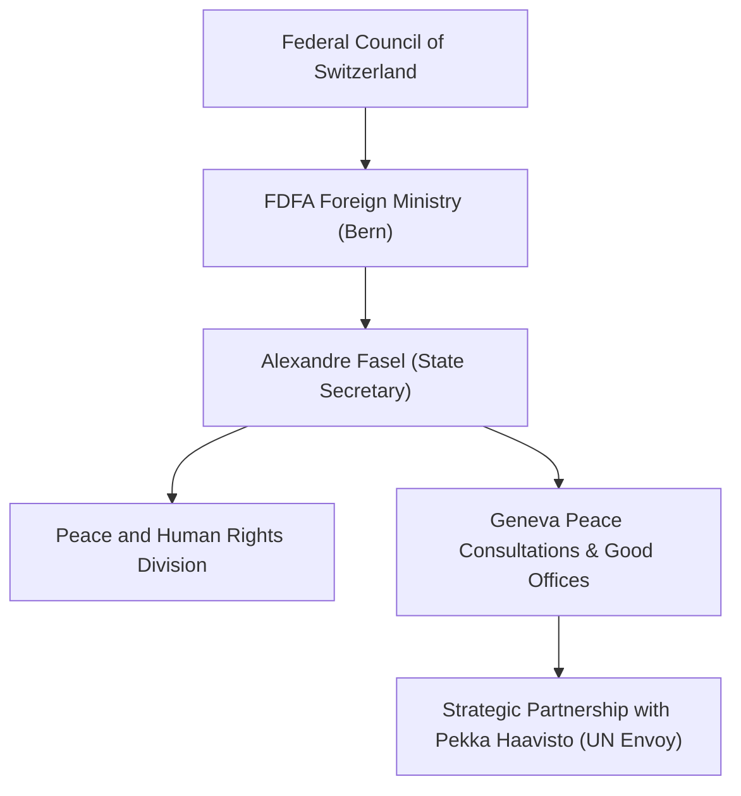

# Alexandre Fasel

## 1. Identity, Classification & Leadership Anchor

> [!NOTE] Identity, Classification & Leadership Anchor
> **Alexandre Fasel** is a veteran Swiss career diplomat serving as the State Secretary of the [[Federal Department of Foreign Affairs (Switzerland)]] (FDFA) since September 2023. As the senior-most civil servant in Swiss foreign policy, Fasel oversees Switzerland's global diplomatic missions and its traditional Good Offices mandates. In the context of the Sudan conflict, Fasel serves as the high-level Swiss host and diplomatic partner alongside the UN, convening multilateral peace consultations in [[Geneva]].

## 2. Historical Lineage, Factions & Command Structure

Fasel has had an extensive diplomatic career, previously serving as the Permanent Representative of Switzerland to the United Nations Office at Geneva (2013–2016), Ambassador to the United Kingdom (2017–2021), and Special Representative for Science Diplomacy in Geneva. His deep institutional familiarity with the Geneva multilateral ecosystem enables him to leverage Swiss neutrality effectively to convene disparate international stakeholders.

## 3. Strategic Objectives, Ideology & Political Economy ("Why")

Fasel’s diplomatic leadership regarding Sudan focuses on:
- **Protecting Civilians from Asymmetric Aerial Warfare**: Publicly condemning the influx of armed drones and loitering munitions, emphasizing that technology proliferation in Sudan disproportionately slaughters innocent non-combatants.
- **Multilateral Alignment**: Bridging differences between Western donor states, the African Union, IGAD, and Gulf regional actors to prevent fragmented diplomatic posturing.
- **Humanitarian Access Facilitation**: Utilizing Geneva talks to secure tangible commitments on aid convoy deconfliction and infrastructure protection.

## 4. Operational Capabilities, Alliances & Foreign Backing

- **Host-State Authority**: Coordinates with Swiss federal agencies to provide secure, confidential diplomatic facilities, expert technical support, and mediation logistics.
- **Strategic Bilateral Dialogue**: Engages high-level envoys from the United States, Saudi Arabia, the European Union, Egypt, and the UAE to align international pressure on Sudanese belligerents.

## 5. Chronological Event Footprint & Accountability Record

| Date | Diplomatic Action / Event | Substantive Outcome |
| :--- | :--- | :--- |
| **2024-08** | Facilitation of ALPS Talks in Switzerland | Advanced humanitarian access commitments via the Adré corridor |
| **2026-10-21** | Chaired high-level opening of Geneva Consultative Meeting on Peace Initiatives | Issued landmark address warning that the escalating drone war in Sudan is "killing mostly civilians" |

## ## Related Primitives
- **Sources**: [[sources/2026-10-21-un-news-geneva-peace-efforts-drone-war]]
- **Themes**: [[Multilateral Mediation and Peace Coordination Mechanisms in Sudan]], [[Drone Proliferation and Double-Tap Strike Doctrine in Sudan]]
- **Events**: [[2026-10-21 Geneva Consultative Meeting on Peace Initiatives in Sudan]]
- **Actors**: [[Federal Department of Foreign Affairs (Switzerland)]], [[Pekka Haavisto]], [[United Nations]], [[Sudanese Armed Forces]], [[Rapid Support Forces]]
- **Locations**: [[Geneva]]
