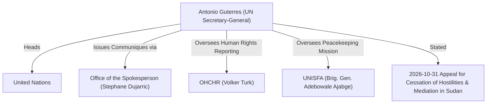

# António Guterres

## 1. Identity, Classification & Leadership Anchor

> [!NOTE] Person Actor & Executive Leadership Anchor
> - **Canonical Person**: [[António Guterres]]
> - **Subtype**: `person`
> - **Institutional Role (`role_title`)**: Secretary-General of the United Nations
> - **Affiliated Organization (`affiliated_organization`)**: [[United Nations]]
> - **Executive Communications Channel**: [[Office of the Spokesperson for the Secretary-General]] (delivered via Spokesperson [[Stéphane Dujarric]])
> - **Epistemic Reliability**: **`A1`** (`reliability_score: 0.95`)

**António Guterres** is the ninth Secretary-General of the [[United Nations]] ([[sources/2026-10-31-unsg-spokesperson-escalating-drone-attacks-sudan]]). On **31 October 2026**, via a formal statement delivered by Spokesperson [[Stéphane Dujarric]], [[António Guterres]] strongly condemned the escalating unmanned aerial vehicle (drone) attacks across Sudan and [[Abyei]] by the [[Sudanese Armed Forces]] and [[Rapid Support Forces]] as violations of international humanitarian law (IHL), expressed outrage over strikes on civilians and health facilities, and issued an urgent appeal for an immediate cessation of hostilities and good-faith mediation ([[2026-10-31 António Guterres Appeal for Immediate Cessation of Hostilities and Good-Faith Mediation in Sudan]], [[2026-10-31 Stéphane Dujarric UNSG Statement Condemning Escalating Drone Attacks in Sudan and Abyei]]).

---

## 2. Historical Lineage, Factions & Command Structure

As chief administrative officer of the [[United Nations]], [[António Guterres]] oversees the Secretariat, peacekeeping deployments such as [[UNISFA]] in [[Abyei]], and human rights monitoring through [[OHCHR]] under High Commissioner [[Volker Türk]] ([[sources/2026-10-31-unsg-spokesperson-escalating-drone-attacks-sudan]], [[sources/2026-10-23-un-news-sudan-drone-strikes-306-killed]]).

---

## 3. Strategic Objectives, Ideology & Political Economy ("Why")

[[António Guterres]]'s strategic posture toward the Sudan war rests on three pillars:
1. **Upholding International Humanitarian Law (IHL)**: Denouncing the use of armed drones against civilians, women, children, and critical infrastructure—including health facilities—across Sudan and [[Abyei]] as direct violations of IHL ([[2026-10-31 Stéphane Dujarric UNSG Statement Condemning Escalating Drone Attacks in Sudan and Abyei]], [[Drone Proliferation and Double-Tap Strike Doctrine in Sudan]]).
2. **Immediate Cessation of Hostilities**: Demanding that the [[Sudanese Armed Forces]] and [[Rapid Support Forces]] agree without delay to a cessation of hostilities as an essential first step toward ending the conflict ([[2026-10-31 António Guterres Appeal for Immediate Cessation of Hostilities and Good-Faith Mediation in Sudan]]).
3. **Good-Faith Political Mediation**: Mobilizing [[United Nations]] support for a sustainable political resolution that reflects the aspirations of the Sudanese people ([[2026-10-31 António Guterres Appeal for Immediate Cessation of Hostilities and Good-Faith Mediation in Sudan]]).

---

## 4. Operational Capabilities, Alliances & Foreign Backing

Through the [[United Nations]] Secretariat, [[António Guterres]] coordinates international diplomatic pressure alongside the UN Security Council, [[OHCHR]], and [[UNISFA]], drawing on verified field telemetry (`306+` drone fatalities documented in three weeks of October 2026) to press belligerents and external arms suppliers to halt escalatory operations ([[sources/2026-10-23-un-news-sudan-drone-strikes-306-killed]], [[sources/2026-10-31-unsg-spokesperson-escalating-drone-attacks-sudan]]).

---

## 5. Chronological Event Footprint & Accountability Record

| Date ($t_{\text{valid}}$) | Standalone Citation / Event Node | Speech Act | Core Diplomatic & Legal Position | Source |
| :--- | :--- | :--- | :--- | :--- |
| `2026-10-31` | [[2026-10-31 António Guterres Appeal for Immediate Cessation of Hostilities and Good-Faith Mediation in Sudan]] | `ceasefire_call` (`official_statement`) | Called on conflict parties to spare civilians and critical infrastructure, agree without delay to a cessation of hostilities, and engage in good-faith mediation. | [[sources/2026-10-31-unsg-spokesperson-escalating-drone-attacks-sudan]] |
| `2026-10-31` | [[2026-10-31 Stéphane Dujarric UNSG Statement Condemning Escalating Drone Attacks in Sudan and Abyei]] | Attributable Principal (`war_crimes_warning`) | Strongly condemned escalating drone attacks across Sudan and [[Abyei]] killing hundreds of civilians as violations of IHL. | [[sources/2026-10-31-unsg-spokesperson-escalating-drone-attacks-sudan]] |

---

## Related Primitives

- **Affiliated Organization & Spokesperson**:
  - [[United Nations]] | [[Office of the Spokesperson for the Secretary-General]] | [[Stéphane Dujarric]]
- **UN Officials & Missions**:
  - [[Volker Türk]] | [[Seif Magango]] | [[OHCHR]] | [[UNISFA]] | [[Adebowale Ajabge]] | [[Muhammad Farooq]]
- **Standalone Citations**:
  - [[2026-10-31 António Guterres Appeal for Immediate Cessation of Hostilities and Good-Faith Mediation in Sudan]]
  - [[2026-10-31 Stéphane Dujarric UNSG Statement Condemning Escalating Drone Attacks in Sudan and Abyei]]
- **Events, Locations & Themes Referenced**:
  - [[2026-10 Sudan Drone Warfare Escalation]] | [[2026-10-19 Abyei Amiet Market and Todach Drone Strike]]
  - [[Abyei]] | [[West Kordofan]] | [[Blue Nile State]]
  - [[Drone Proliferation and Double-Tap Strike Doctrine in Sudan]]
- **Timelines & Sources**:
  - [[2026-10 Sudan Conflict Chronicle]] | [[Sudan Drone Warfare and Double-Tap Strike Timeline]]
  - [[sources/2026-10-31-unsg-spokesperson-escalating-drone-attacks-sudan]]
