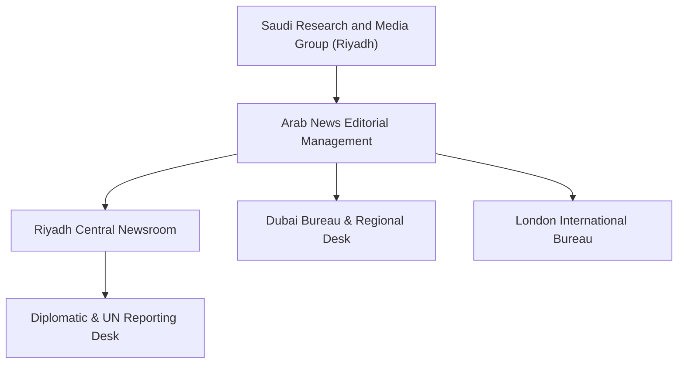

# Arab News

## 1. Identity, Classification & Leadership Anchor

> [!NOTE] Identity, Classification & Leadership Anchor
> **Arab News** is an English-language daily newspaper published in Saudi Arabia and operating internationally, owned by the Saudi Research and Media Group (SRMG). Edited by Faisal J. Abbas, it serves as a leading English-language regional voice representing Gulf political perspectives, multilateral diplomatic developments, and Middle Eastern geopolitical analysis.

## 2. Historical Lineage, Factions & Command Structure

Founded in 1975 in Jeddah as Saudi Arabia's first English-language daily, Arab News has evolved into a multi-platform international news outlet with digital bureaus in London, Dubai, and Paris. Its editorial coverage aligns with the foreign policy priorities of the Kingdom of Saudi Arabia, emphasizing regional stability, counter-extremism, and support for established sovereign state institutions.

## 3. Strategic Objectives, Ideology & Political Economy ("Why")

In the context of the Sudan conflict, Arab News maintains an editorial framing characterized by:
- **Support for Sovereign State Institutions**: Framing the conflict through the lens of preserving Sudanese state integrity and the [[Sudanese Armed Forces]] as the constitutional military entity, while scrutinizing paramilitary disruption.
- **Promotion of Saudi Diplomatic Initiatives**: Providing prominent coverage to the Jeddah Peace Talks co-mediated by Saudi Arabia and the United States.
- **Humanitarian Telemetry**: Highlighting United Nations communiqués, civilian casualty figures, and emergency food delivery operations funded by King Salman Humanitarian Aid and Relief Centre (KSrelief).

## 4. Operational Capabilities, Alliances & Foreign Backing

- **Diplomatic Access**: Enjoys deep institutional access to regional foreign ministries, Arab League delegations, and UN press briefings in New York and Geneva.
- **Wire Syndication**: Leverages major international wire feeds (AFP, Reuters, AP) alongside localized regional reporting to provide rapid international syndication of breaking news.

## 5. Chronological Event Footprint & Accountability Record

| Date | Coverage Milestone | Reporting Focus |
| :--- | :--- | :--- |
| **2023-05** | Launch of the US-Saudi Jeddah Talks | Detailed Track-1 negotiations on humanitarian ceasefires |
| **2024-08** | Coverage of ALPS Geneva Consultations | Reported Saudi diplomatic coordination with international partners |
| **2026-10-31** | Dispatched report on UNSG condemnation of Nyala market drone strikes | Amplified UN warning of 102+ civilian casualties in South Darfur |

## ## Related Primitives
- **Sources**: [[sources/2026-10-31-arab-news-un-chief-appalled-drone-strikes-nyala-market]]
- **Themes**: [[Drone Proliferation and Double-Tap Strike Doctrine in Sudan]], [[Multilateral Mediation and Peace Coordination Mechanisms in Sudan]]
- **Events**: [[2026-10-27 Nyala Tanqonj Market Drone Strike]]
- **Actors**: [[Stéphane Dujarric]], [[António Guterres]], [[Sudanese Armed Forces]], [[Rapid Support Forces]]
- **Locations**: [[Nyala]], [[South Darfur.md|South Darfur]]
