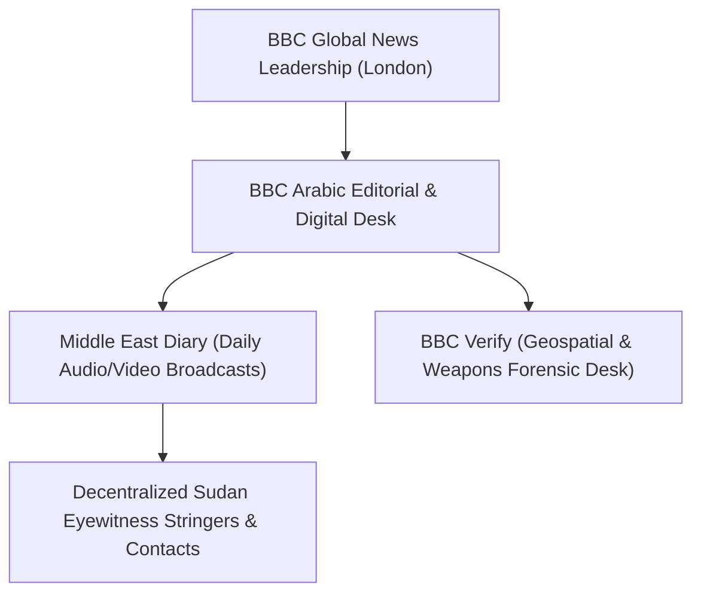

# BBC News

## 1. Identity, Classification & Leadership Anchor

> [!NOTE] Identity, Classification & Leadership Anchor
> **BBC News** (specifically [[BBC News]] Arabic / *بي بي سي عربي*) is an international public service broadcaster providing multilingual news and investigative journalism. In conflict reporting on Sudan, BBC Arabic maintains specialized programming such as *Middle East Diary* (`يوميات الشرق الأوسط`), deploying localized stringers and verified eyewitness networks to document frontline strikes, casualties, and infrastructure destruction across both SAF- and RSF-controlled territories.

## 2. Historical Lineage, Factions & Command Structure

Founded as the BBC Empire Service in 1932, BBC Arabic was established in 1938 as the BBC's first foreign-language radio service. Throughout the Sudan conflict post-April 2023, BBC Arabic has operated as one of the premier international outlets conducting direct audio interviews with survivors in besieged cities, including Nyala, El Fasher, and Khartoum.

## 3. Strategic Objectives, Ideology & Political Economy ("Why")

- **Public-Interest Verification**: Providing impartial, multi-sourced verification that balances conflicting military claims through rigorous eyewitness interviews and human rights triangulation.
- **Forensic Tactical Accountability**: Documenting civilian protection failures, including double-tap drone attacks, mass casualties in markets, and hospital degradation under international humanitarian law.
- **Direct Eyewitness Amplification**: Preserving vernacular testimonies from ordinary citizens living under territorial control of belligerent forces.

## 4. Operational Capabilities, Alliances & Foreign Backing

- **Direct Communication Channels**: Maintains secure, encrypted messaging channels with local residents across Darfur, Kordofan, and Khartoum, allowing testimony collection even amid severe telecommunications blackouts.
- **Open-Source Triangulation**: Leverages BBC Verify methodologies to cross-reference satellite imagery, social media footage, and hospital manifests.

## 5. Chronological Event Footprint & Accountability Record

| Date | Key Reporting Contribution | Context |
| :--- | :--- | :--- |
| **2026-10-28** | Published comprehensive investigation into the Nyala market double-tap drone strike | Captured first-person testimonies of the 10-minute double-tap interval and 70-person mass grave |

## Related Primitives

- **Source Notes**: [[sources/2026-10-28-bbc-arabic-nyala-market-strike-conflicting-casualty-tolls]]
- **Covered Incidents**: [[2026-10-27 Nyala Tanqonj Market Drone Strike]]
- **Quoted Entities**: [[Emergency Lawyers]], [[Hamdan Suleiman]]
