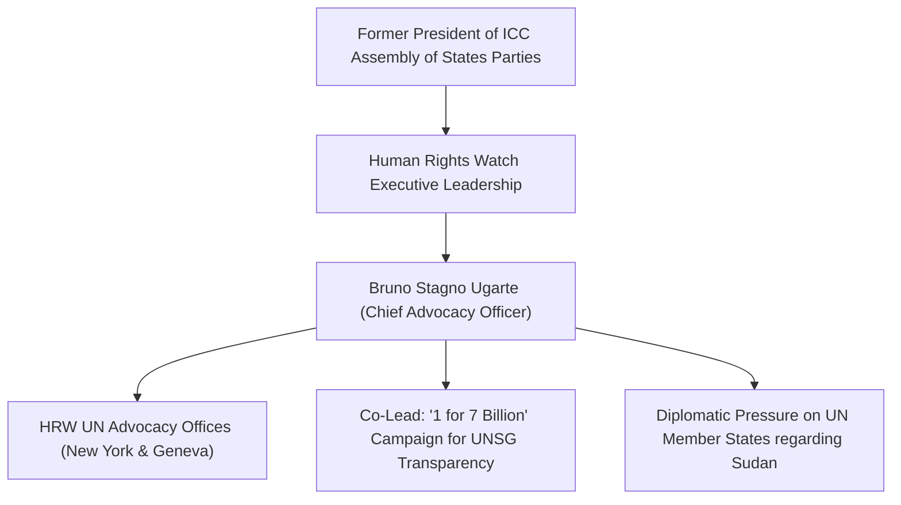

# Bruno Stagno Ugarte

## 1. Identity, Classification & Leadership Anchor

> [!NOTE] Identity, Classification & Leadership Anchor
> **Bruno Stagno Ugarte** is a Costa Rican diplomat and international advocacy leader serving as the Chief Advocacy Officer at [[Human Rights Watch]] (HRW). A former Minister of Foreign Affairs of Costa Rica (2006–2010), Permanent Representative to the [[United Nations]] (2002–2006), and President of the Assembly of States Parties of the [[International Criminal Court]] (2005–2008), Stagno directs HRW's global advocacy operations across the UN Security Council, General Assembly, and Human Rights Council.

## 2. Historical Lineage, Factions & Command Structure

During his tenure as Costa Rica's Foreign Minister and UN Ambassador, Stagno was a foremost international architect of disarmament initiatives, co-authoring the Arms Trade Treaty (ATT) framework and championing peaceful multilateral settlement of disputes. At HRW, he combines high-level diplomatic statecraft with rigorous human rights advocacy to challenge geopolitical cynicism within the UN system.

## 3. Strategic Objectives, Ideology & Political Economy ("Why")

Stagno’s strategic priorities regarding the war in Sudan include:
- **Preserving UN Secretary-General Integrity**: Championing strict criteria for the selection of the next UN Secretary-General, insisting that any candidate whose government violates UN arms embargoes or finances atrocity perpetrators is morally and politically disqualified.
- **Enforcing the Rome Statute & ICC Mandate**: Mobilizing UN member states to execute ICC arrest warrants and provide diplomatic and budgetary backing to ICC investigations into Darfur.
- **Arms Embargo Universalization**: Demanding that the UN Security Council expand the Darfur arms embargo to cover all of Sudan and include punitive secondary sanctions against third-party enablers.

## 4. Operational Capabilities, Alliances & Foreign Backing

- **Diplomatic Networks**: Possesses unparalleled access to UN ambassadors, foreign ministers, and the UN Secretariat, enabling him to navigate behind-the-scenes negotiations in New York and Geneva.
- **Civil Society Leadership**: Acts as a key steering figure in international coalitions including the "1 for 7 Billion" campaign, working alongside Sudanese and global atrocity prevention organizations.

## 5. Chronological Event Footprint & Accountability Record

| Date | High-Level Diplomatic Engagement | Context |
| :--- | :--- | :--- |
| **2005–2008** | Presided over the ICC Assembly of States Parties during Darfur referrals | Advanced international justice framework for Sudan |
| **2026-10-28** | Speaker at Global Civil Society Briefing on UAE UN Candidacy | Warned that electing a candidate from a state fueling atrocities in Sudan would severely damage UN legitimacy |

## ## Related Primitives
- **Sources**: [[sources/2026-10-30-the-guardian-sudanese-diaspora-uae-un-nominee-nusseibeh]]
- **Themes**: [[Multilateral Capture and Accountability Politics in Sudan]], [[UAE Foreign Backing and Logistics Network for the Rapid Support Forces]]
- **Events**: [[2026-10-28 Global Civil Society Briefing Opposing Lana Nusseibeh Candidacy for UN Secretary-General]]
- **Actors**: [[Human Rights Watch]], [[Kenneth Roth]], [[Lana Nusseibeh]], [[Carlos Mureithi]], [[United Arab Emirates]]
- **Locations**: [[Geneva]]
