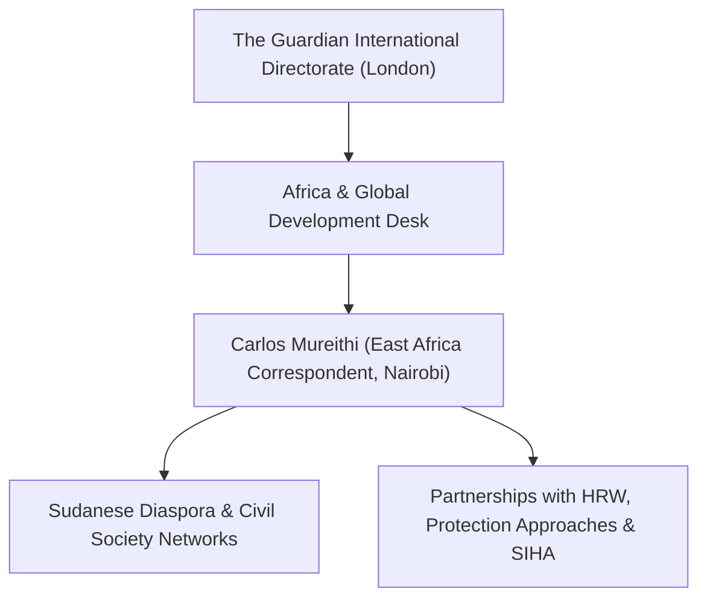

# Carlos Mureithi

## 1. Identity, Classification & Leadership Anchor

> [!NOTE] Identity, Classification & Leadership Anchor
> **Carlos Mureithi** is an award-winning Kenyan investigative journalist and international affairs correspondent for [[The Guardian]], based in Nairobi. Covering East Africa and the Horn of Africa, Mureithi specializes in political accountability, human rights violations, and regional geopolitics, with investigative reporting on external state complicity, diaspora mobilization, and proxy warfare surrounding the Sudan conflict.

## 2. Historical Lineage, Factions & Command Structure

Before joining The Guardian, Mureithi worked as an East Africa correspondent for the Christian Science Monitor, Quartz Africa, and the Daily Nation in Kenya. He holds a master's degree from the Craig Newmark Graduate School of Journalism at the City University of New York (CUNY) and has received international recognition for investigative coverage of conflict and governance across East Africa.

## 3. Strategic Objectives, Ideology & Political Economy ("Why")

Mureithi’s reporting on Sudan focuses on:
- **Exposing External War Backing**: Investigating how foreign powers—primarily the [[United Arab Emirates]]—fuel the conflict through logistics corridors, arms flows, and financial support to the [[Rapid Support Forces]].
- **Documenting Civil Society Resistance**: Elevating the collective agency of Sudanese diaspora coalitions, grassroots activists, and mutual aid groups challenging international impunity.
- **Scrutinizing Multilateral Governance**: Investigating conflicts of interest within international organizations, particularly diplomatic campaigns for top UN leadership positions.

## 4. Operational Capabilities, Alliances & Foreign Backing

- **Source Cultivation**: Maintains extensive contacts among Sudanese diaspora groups across the United Kingdom, United States, Kenya, and Uganda.
- **Rigorous Cross-Verification**: Cross-references civil society statements, diplomatic demarches, and official government responses to ensure accurate, balanced, and verified investigations.

## 5. Chronological Event Footprint & Accountability Record

| Date | Investigative Dispatch | Key Subject / Impact |
| :--- | :--- | :--- |
| **2024-05** | Regional reporting on Horn of Africa displacement | Documented cross-border refugee crises in Uganda and Kenya |
| **2026-10-30** | Exclusive investigation for The Guardian | Revealed global civil society and diaspora mobilization opposing UAE diplomat Lana Nusseibeh's UN Secretary-General candidacy |

## ## Related Primitives
- **Sources**: [[sources/2026-10-30-the-guardian-sudanese-diaspora-uae-un-nominee-nusseibeh]]
- **Themes**: [[Multilateral Capture and Accountability Politics in Sudan]], [[UAE Foreign Backing and Logistics Network for the Rapid Support Forces]]
- **Events**: [[2026-10-28 Global Civil Society Briefing Opposing Lana Nusseibeh Candidacy for UN Secretary-General]]
- **Actors**: [[The Guardian]], [[Lana Nusseibeh]], [[Hala al-Karib]], [[Kenneth Roth]], [[United Arab Emirates]]
- **Locations**: [[Geneva]]
