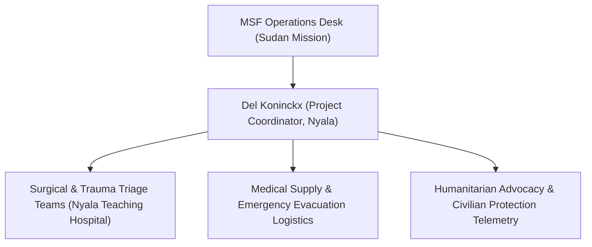

# Del Koninckx

## 1. Identity, Classification & Leadership Anchor

> [!NOTE] Identity, Classification & Leadership Anchor
> **Del Koninckx** is an international humanitarian professional serving as the Project Coordinator for [[Médecins Sans Frontières]] (MSF) in [[Nyala]] (`SD03001`), South Darfur. In this capacity, Koninckx oversees MSF's emergency surgical, trauma, and inpatient projects at Nyala Teaching Hospital, coordinating response teams amidst heavy urban bombardments and escalating drone warfare.

## 2. Historical Lineage, Factions & Command Structure

Leading operations in one of the most volatile urban sectors in Darfur, Koninckx manages emergency admissions during major mass-casualty events, frequently coordinating with local civilian health workers and volunteer cart-drivers transporting trauma victims.

## 3. Strategic Objectives, Ideology & Political Economy ("Why")

- **Civilian Protection Advocacy**: Publicly demanding an immediate cessation of strikes targeting civilian gatherings, markets, and residential areas.
- **Humanitarian Impartiality**: Ensuring transparent, verified reporting on the civilian nature of mass casualties treated in MSF-supported wards.
- **Sustaining Emergency Care**: Fighting severe medical logistics blockades to keep operating rooms functional in South Darfur.

## 4. Operational Capabilities, Alliances & Foreign Backing

- **Direct Mortuary & Triage Oversight**: Directly validates casualty counts and triage registries at Nyala Teaching Hospital.

## 5. Chronological Event Footprint & Accountability Record

| Date | Key Action / Statement | Context |
| :--- | :--- | :--- |
| **2026-10-28** | Supervised triage of 150+ wounded and reception of 36 dead at Nyala Teaching Hospital | Denounced drone attacks on food markets and described severe blast and burn trauma |

## Related Primitives

- **Affiliated Organization**: [[Médecins Sans Frontières]]
- **Location Node**: [[Nyala]], [[South Darfur]]
- **Referenced Event**: [[2026-10-27 Nyala Tanqonj Market Drone Strike]]
- **Citation**: [[2026-10-28 Del Koninckx MSF Statement on Nyala Market Drone Casualties]]
