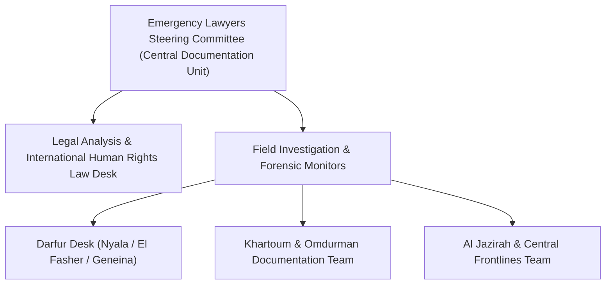

# Emergency Lawyers

## 1. Identity, Classification & Leadership Anchor

> [!NOTE] Identity, Classification & Leadership Anchor
> **Emergency Lawyers** (`محامو الطوارئ`) is an independent Sudanese grassroots legal network composed of human rights defenders and pro bono attorneys. Originating during the December 2018 Sudanese Revolution to defend detained peaceful protestors, the network transformed following the April 2023 conflict into one of Sudan's primary forensic monitoring bodies, documenting war crimes, arbitrary detentions, and indiscriminate artillery and drone attacks on civilian infrastructure.

## 2. Historical Lineage, Factions & Command Structure

Emergency Lawyers operates on a decentralized, pro bono model. Following the military takeover and subsequent civil war, its members have faced severe harassment, detentions, and extrajudicial targeting by military intelligence and paramilitary forces alike, yet remain primary sources for the UN Human Rights Council and the ICC.

## 3. Strategic Objectives, Ideology & Political Economy ("Why")

- **Forensic Documentation of War Crimes**: Rigorously documenting attacks against civilian targets, including marketplaces, hospitals, and residential areas, in accordance with the Rome Statute and the Geneva Conventions.
- **Bi-Belligerent Legal Accountability**: Exposing violations committed by both the [[Sudanese Armed Forces]] (SAF) and the [[Rapid Support Forces]] (RSF).
- **Civilian Advocacy**: Demanding independent investigations, end to impunity, and immediate humanitarian access.

## 4. Operational Capabilities, Alliances & Foreign Backing

- **On-the-Ground Verification**: Directly verifies casualty rolls, identifying victims by name, age, and circumstance, often cross-referencing mortuary admissions and burial sites.
- **Collaborative Human Rights Network**: Closely allied with local [[Emergency Response Rooms]] and medical syndicates.

## 5. Chronological Event Footprint & Accountability Record

| Date | Key Legal Action / Report | Context |
| :--- | :--- | :--- |
| **2026-10-26** | Documented 102 civilian deaths and 113 injuries from the Nyala Tanqonj Market drone strike | Issued detailed casualty roster and condemned violations of distinction and proportionality under IHL |

## Related Primitives

- **Source Notes**: [[sources/2026-10-28-bbc-arabic-nyala-market-strike-conflicting-casualty-tolls]]
- **Documented Events**: [[2026-10-27 Nyala Tanqonj Market Drone Strike]]
- **Citations**: [[2026-10-28 Emergency Lawyers Condemnation of Nyala Market Drone Strike]]
