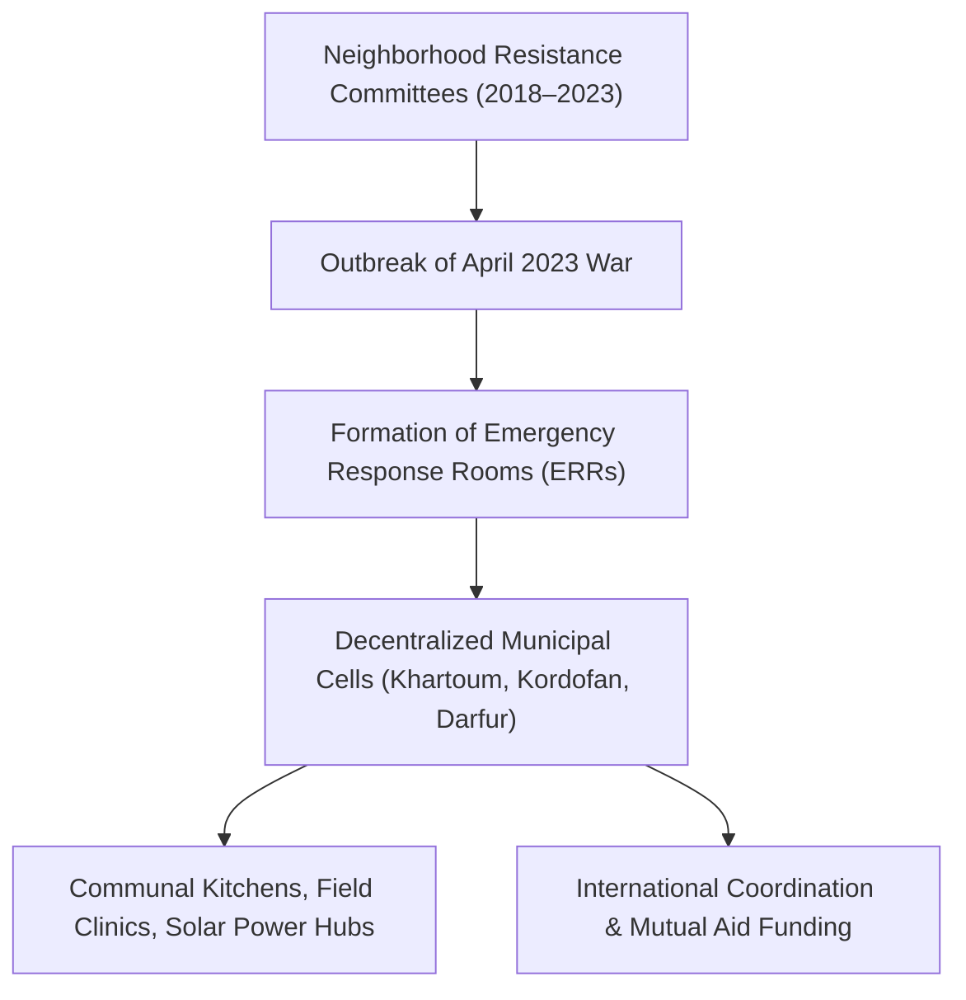

# Emergency Response Rooms

## 1. Identity, Classification & Leadership Anchor

> [!NOTE] Civil Society & Grassroots Mutual Aid Anchor
> The **Emergency Response Rooms** (ERRs) are a decentralized network of grassroots humanitarian mutual-aid initiatives formed by Sudanese youth, medical workers, and local activists in the immediate aftermath of the April 2023 war outbreak. Emerging organically from neighborhood-based [[Sudanese Resistance Committees]], ERRs operate communal kitchens (*takaya*), volunteer health clinics, clean water distribution points, and evacuation coordination across active war theatres where international aid agencies are physically absent.

## 2. Historical Lineage, Factions & Command Structure

Unlike traditional non-governmental organizations, ERRs are non-hierarchical, community-rooted cells that rely on consensus decision-making. Their members are local neighborhood residents who remain in active combat zones. In recognition of their courage and life-saving frontline response, the ERRs have received widespread international acclaim and nomination for the Nobel Peace Prize.

## 3. Strategic Objectives, Ideology & Political Economy ("Why")

The ERRs are anchored in principles of civilian solidarity, non-violent mutual aid, and self-determination:
- **Civilian Survival Under Siege**: Preventing mass starvation in encircled enclaves such as [[El Obeid]], [[El Fasher]], and urban Khartoum through communal kitchens.
- **Protection of Frontline Responders**: Maintaining operational neutrality and resisting coercion or co-optation by warring military intelligence and militia commanders.
- **Documentation and Public Health**: Monitoring epidemic outbreaks (such as cholera and dengue fever) and tracking humanitarian deprivations caused by armed blockades.

## 4. Operational Capabilities, Alliances & Foreign Backing

- **Grassroots Logistics**: Mobilizing local resources, solar panels, and bicycle couriers to smuggle medical supplies, chlorine tablets, and grain past military checkpoints.
- **Diaspora and Digital Remittances**: Funded substantially through digital transfers (*Bankak* / *Fawry*) supported by the global Sudanese diaspora and humanitarian pass-through grants.
- **Severe Systematic Repression**: Targeted by both belligerents; SAF military intelligence and RSF intelligence units have systematically arrested, tortured, and assassinated ERR volunteers on fabricated espionage accusations.

## 5. Chronological Event Footprint & Accountability Record

- **2023-04-16**: First Emergency Response Rooms emerge in Khartoum neighborhoods to coordinate medical rescues and food delivery during initial urban battles.
- **2024-03-01**: ERRs expand nationwide to meet famine conditions across Gezira, Kordofan, and Darfur.
- **2024-10-01**: Formal nomination of Sudanese Emergency Response Rooms for the Nobel Peace Prize highlighting grassroots resilience.
- **2026-10-28**: UN Fact-Finding Mission report explicitly details pervasive military intelligence harassment, phone confiscation, and arbitrary detention of ERR volunteers in [[El Obeid]].

## Related Primitives

- **Events**:
  - [[2026-10 El Obeid Siege and Drone Warfare Escalation]]
- **Actors**:
  - [[Sudanese Resistance Committees]]
  - [[SIHA Network]]
  - [[Independent International Fact-Finding Mission for the Sudan]]
- **Themes**:
  - [[State Surveillance and Civic Space Contraction in Sudan]]
  - [[International Accountability and Fact-Finding Mechanisms in Sudan]]
