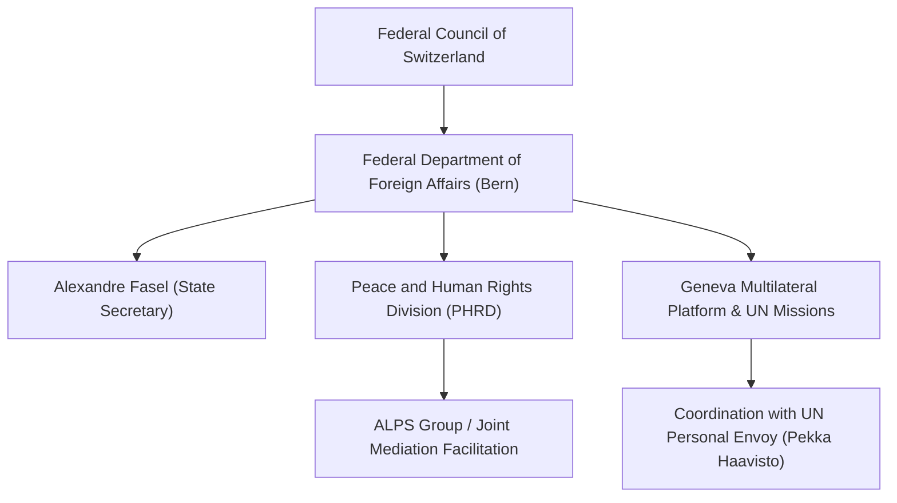

# Federal Department of Foreign Affairs (Switzerland)

## 1. Identity, Classification & Leadership Anchor

> [!NOTE] Identity, Classification & Leadership Anchor
> The **Federal Department of Foreign Affairs (FDFA)** (French: *Département fédéral des affaires étrangères*, DFAE) is the foreign ministry of the Swiss Confederation. Operating under Federal Councillor Ignazio Cassis and State Secretary **[[Alexandre Fasel]]**, the FDFA leverages Switzerland's traditional policy of neutrality and "Good Offices" to host, fund, and facilitate multilateral conflict mediation, humanitarian access coordination, and Track-1.5/Track-2 peace initiatives regarding the Sudan conflict in [[Geneva]].

## 2. Historical Lineage, Factions & Command Structure

Switzerland has historically served as a neutral convenor for Sudanese peace negotiations, notably hosting the 2002 Nuba Mountains Ceasefire Agreement (Burgenstock Agreement). Following the 2023 conflict outbreak, the FDFA revitalized its Swiss Good Offices mandate, co-hosting international consultations and working closely with the US-led ALPS initiative (Aligned for Lifesaving and Peace in Sudan) alongside Saudi Arabia, the African Union, and the United Nations.

## 3. Strategic Objectives, Ideology & Political Economy ("Why")

The FDFA's institutional priorities in the Sudan conflict comprise:
- **Facilitation of Neutral Diplomatic Space**: Providing confidential and secure diplomatic infrastructure in Geneva for belligerent delegations, regional envoys, and civilian coalitions.
- **Humanitarian Access Harmonization**: Negotiating humanitarian corridors (such as the Adré border crossing from Chad and Dabbah road from Port Sudan) to facilitate emergency life-saving aid.
- **Ceasefire and De-escalation**: Supporting the UN Secretary-General’s Personal Envoy in structuring a phased, nationwide cessation of hostilities and a ban on weaponized drone warfare.

## 4. Operational Capabilities, Alliances & Foreign Backing

- **Diplomatic Neutrality**: Maintains formal communication channels with both the SAF-led Transitional Sovereignty Council in Port Sudan and RSF leadership, while maintaining strong institutional ties with the UN Secretariat and EU counterparts.
- **Convening Power**: Financed and hosted the landmark October 2026 Consultative Meeting on Peace Initiatives in Sudan, bringing together UN Personal Envoy [[Pekka Haavisto]], the African Union, IGAD, the Arab League, and donor states.

## 5. Chronological Event Footprint & Accountability Record

| Date | Diplomatic Initiative | Key Participants |
| :--- | :--- | :--- |
| **2024-08** | ALPS Group humanitarian mediation talks held in Geneva | US, Switzerland, Saudi Arabia, UAE, Egypt, UN, RSF |
| **2026-10-21** | Co-convened the Geneva Consultative Meeting on Peace Initiatives | [[Alexandre Fasel]], [[Pekka Haavisto]], AU, IGAD, Arab League |
| **2026-10-21** | State Secretary Fasel issued public statement highlighting drone warfare civilian tolls | UN and International Press Corps |

## ## Related Primitives
- **Sources**: [[sources/2026-10-21-un-news-geneva-peace-efforts-drone-war]]
- **Themes**: [[Multilateral Mediation and Peace Coordination Mechanisms in Sudan]], [[Drone Proliferation and Double-Tap Strike Doctrine in Sudan]]
- **Events**: [[2026-10-21 Geneva Consultative Meeting on Peace Initiatives in Sudan]]
- **Actors**: [[Alexandre Fasel]], [[Pekka Haavisto]], [[United Nations]], [[Sudanese Armed Forces]], [[Rapid Support Forces]]
- **Locations**: [[Geneva]]
