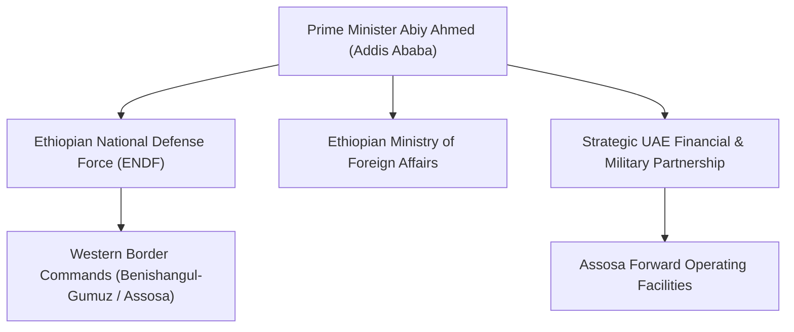

# Government of Ethiopia

## 1. Identity, Classification & Leadership Anchor

> [!NOTE] Identity, Classification & Leadership Anchor
> The **Government of Ethiopia** is the federal executive authority of the Federal Democratic Republic of Ethiopia, led by Prime Minister Abiy Ahmed. Situated along Sudan's eastern and southeastern frontier, Ethiopia plays a pivotal and contested regional role in the conflict, balancing diplomatic relationships, complex security entanglements in the Horn of Africa, and deep financial and military dependencies on the [[United Arab Emirates]].

## 2. Historical Lineage, Factions & Command Structure

Ethiopia's relations with Sudan have historically swung between close cooperation and border friction over the fertile al-Fashaga border agricultural triangle and the construction of the Grand Ethiopian Renaissance Dam (GERD) on the Blue Nile. Under Abiy Ahmed, Addis Ababa developed profound financial, infrastructure, and defense ties with Abu Dhabi, which financed major urban, agricultural, and security initiatives within Ethiopia.

## 3. Strategic Objectives, Ideology & Political Economy ("Why")

Ethiopian policy toward the Sudan war is shaped by interlocking strategic calculations:
- **Red Sea Access Ambitions**: Securing maritime access and port leases across the Red Sea and Gulf of Aden (exemplified by the January 2024 Somaliland Memorandum of Understanding).
- **GERD Security & Hydropolitics**: Ensuring stability on its western flank to protect the GERD reservoir and dam infrastructure from cross-border sabotage.
- **Transactional UAE Alliance**: Securing foreign currency injections, central bank deposits, and drone hardware from Abu Dhabi in exchange for granting transit, airspace, or staging privileges for Emirati regional operations.

## 4. Operational Capabilities, Alliances & Foreign Backing

- **Geographic Proximity**: Ethiopia's Benishangul-Gumuz region, anchored by the regional capital [[Assosa]], lies directly adjacent to Sudan's Blue Nile State and within long-range drone flight paths to [[Haiya]] and the Red Sea corridor.
- **Accusations of Proxy Facility Hosting**: While officially asserting regional neutrality and calling for IGAD-led peace talks, the de facto Sudanese government in Port Sudan has formally accused Ethiopia of allowing UAE proxies to establish drone staging and launching infrastructure near the border.

## 5. Chronological Event Footprint & Accountability Record

| Date | Incident / Development | Regional Arena |
| :--- | :--- | :--- |
| **2023-07** | IGAD Quartet mediation summit held in Addis Ababa; boycotted by SAF | Addis Ababa |
| **2024-01** | RSF Commander Mohamed Hamdan Dagalo received with red-carpet honors | Addis Ababa |
| **2026-10-31** | Sudan MFA undersecretary Muawiya Osman publicly alleges Ethiopian staging of Haiya drone strike | [[Assosa]], [[Haiya]] |

## ## Related Primitives
- **Sources**: [[sources/2026-10-31-dabanga-haiya-oil-electricity-drone-attack]]
- **Themes**: [[Regional Proxy Warfare and Transnational Drone Supply Networks in Sudan]], [[Energy Infrastructure Targeting in the Sudan War.md|Energy Infrastructure Targeting in the Sudan War]]
- **Events**: [[2026-10-31 Haiya Oil Pumping and Power Station Drone Strike]]
- **Actors**: [[United Arab Emirates]], [[Ministry of Foreign Affairs (Sudan)]], [[Muawiya Osman]], [[Rapid Support Forces]], [[Sudanese Armed Forces]]
- **Locations**: [[Assosa]], [[Haiya]], [[Red Sea State.md|Red Sea State]]
