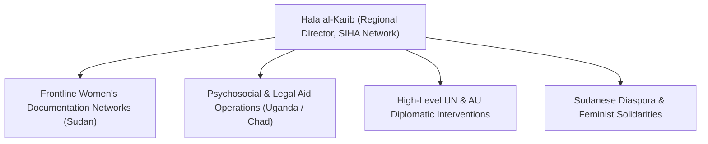

# Hala al-Karib

## 1. Identity, Classification & Leadership Anchor

> [!NOTE] Identity, Classification & Leadership Anchor
> **Hala al-Karib** is a renowned Sudanese feminist activist, human rights defender, and researcher serving as the Regional Director of the Strategic Initiative for Women in the Horn of Africa ([[SIHA Network]]). Based between Kampala, Uganda, and the wider Horn of Africa, al-Karib is one of the world's leading authorities and advocates on conflict-related sexual violence (CRSV), grassroots humanitarian mutual aid, and women's political participation in Sudan.

## 2. Historical Lineage, Factions & Command Structure

With over two decades of grassroots organizing and human rights leadership across Sudan, South Sudan, Ethiopia, Somalia, and Uganda, al-Karib has been an outspoken champion of women's liberation from military authoritarianism and fundamentalist oppression. Following the 2023 war outbreak, she spearheaded SIHA's emergency operations, establishing safe corridors and trauma care for survivors of sexual violence while briefing the UN Security Council and the International Criminal Court.

## 3. Strategic Objectives, Ideology & Political Economy ("Why")

Al-Karib’s advocacy philosophy and strategic commitments center on:
- **Exposing Conflict-Related Sexual Violence as a Weapon of War**: Refusing to allow sexual violence and genocidal mass rape to be treated as peripheral collateral damage, instead demonstrating how both SAF and RSF utilize gendered violence to terrorize civilian populations.
- **Dismantling External Impunity**: Holding regional governments—particularly the [[United Arab Emirates]]—accountable for financing and arming militias accused of mass rape and ethnic cleansing.
- **Centering Grassroots Sudanese Agency**: Demanding that international peace initiatives directly incorporate Sudanese frontline women, Emergency Response Rooms, and local civil society rather than cutting backroom deals with warlords.

## 4. Operational Capabilities, Alliances & Foreign Backing

- **Direct Ground Intelligence**: Receives real-time, encrypted reporting from hundreds of local women monitors and mutual aid collectives embedded across Darfur, Khartoum, and Kordofan.
- **International Platform**: Widely published in international policy journals and media (including The Guardian, Foreign Policy, and Al Jazeera), regularly delivering keynote addresses to European parliaments and UN bodies.

## 5. Chronological Event Footprint & Accountability Record

| Date | Leadership / Advocacy Milestone | Focus Area |
| :--- | :--- | :--- |
| **2023-11** | Address to UN Security Council Arria-Formula Meeting | Presented forensic testimonies of sexual violence in Darfur and Khartoum |
| **2024-06** | Published policy briefs on the collapse of maternal healthcare in Sudan | Addressed humanitarian disaster facing displaced women and girls |
| **2026-10-28** | Speaker at Global Civil Society Briefing on UAE UN Candidacy | Denounced UAE support for RSF and condemned the denial of genocidal acts in El Fasher |

## ## Related Primitives
- **Sources**: [[sources/2026-10-30-the-guardian-sudanese-diaspora-uae-un-nominee-nusseibeh]]
- **Themes**: [[Ethnic Cleansing and Genocidal Patterns in Darfur]], [[Multilateral Capture and Accountability Politics in Sudan]], [[UAE Foreign Backing and Logistics Network for the Rapid Support Forces]]
- **Events**: [[2026-10-28 Global Civil Society Briefing Opposing Lana Nusseibeh Candidacy for UN Secretary-General]]
- **Actors**: [[SIHA Network]], [[Human Rights Watch]], [[Kenneth Roth]], [[Lana Nusseibeh]], [[Carlos Mureithi]]
- **Locations**: [[El Fasher]], [[Geneva]]
