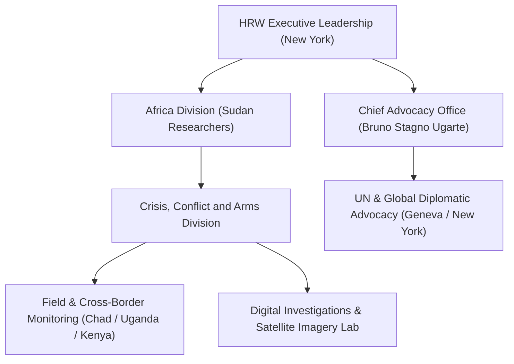

# Human Rights Watch

## 1. Identity, Classification & Leadership Anchor

> [!NOTE] Identity, Classification & Leadership Anchor
> **Human Rights Watch (HRW)** is an international non-governmental organization headquartered in New York City that conducts research and advocacy on human rights. Led by Executive Director Tirana Hassan alongside Chief Advocacy Officer **[[Bruno Stagno Ugarte]]** and long-time former leader **[[Kenneth Roth]]**, HRW plays an essential role in investigating, documenting, and legally qualifying war crimes, crimes against humanity, and ethnic cleansing in the Sudan conflict.

## 2. Historical Lineage, Factions & Command Structure

Founded in 1978 as Helsinki Watch, HRW has maintained an exhaustive documentary record of conflict atrocities in Sudan for over three decades. HRW played a decisive role in documenting the 2003–2005 Darfur genocide and advocating for the UN Security Council referral to the [[International Criminal Court]] (Resolution 1593). In the current conflict, HRW has mobilized its Crisis, Conflict, and Arms Division alongside open-source geospatial analysts to investigate mass killings, sexual violence, and foreign weapon flows.

## 3. Strategic Objectives, Ideology & Political Economy ("Why")

HRW's advocacy and research doctrine in Sudan centers on:
- **Comprehensive Arms Embargo Enforcement**: Urging the UN Security Council to expand the Darfur-specific arms embargo nationwide to halt weapons flows to both SAF and RSF.
- **Foreign State Complicity Documentation**: Rigorously documenting the supply of weapons, drones, and armored vehicles by foreign states—particularly the [[United Arab Emirates]]—to the RSF.
- **Multilateral Integrity & Accountability**: Challenging the normalization or elevation of complicit state officials to international multilateral leadership roles.

## 4. Operational Capabilities, Alliances & Foreign Backing

- **Forensic Verification**: Combines extensive in-person survivor interviews with commercial satellite imagery analysis, ballistic fragment verification, and geolocation of perpetrator-uploaded video footage.
- **Advocacy Infrastructure**: Maintains permanent advocacy offices in New York, Washington, London, Brussels, and Geneva, directly engaging UN Security Council diplomats, EU foreign ministers, and international prosecutors.

## 5. Chronological Event Footprint & Accountability Record

| Date | Investigative Report / Action | Substantive Finding |
| :--- | :--- | :--- |
| **2023-11** | Report on Mass Killings in Ardamata, West Darfur | Documented RSF execution of over 1,000 Massalit civilians |
| **2024-05** | Report: "The Massalit Will Not Live Here Anymore" | Formally classified RSF ethnic cleansing in El Geneina as crimes against humanity and genocide |
| **2026-10-28** | Public advocacy campaign regarding UAE UN leadership nomination | Former Executive Director Kenneth Roth and Chief Advocacy Officer Bruno Stagno Ugarte condemned UAE impunity |

## ## Related Primitives
- **Sources**: [[sources/2026-10-30-the-guardian-sudanese-diaspora-uae-un-nominee-nusseibeh]]
- **Themes**: [[Ethnic Cleansing and Genocidal Patterns in Darfur]], [[UAE Foreign Backing and Logistics Network for the Rapid Support Forces]], [[Multilateral Capture and Accountability Politics in Sudan]]
- **Events**: [[2026-10-28 Global Civil Society Briefing Opposing Lana Nusseibeh Candidacy for UN Secretary-General]]
- **Actors**: [[Kenneth Roth]], [[Bruno Stagno Ugarte]], [[SIHA Network]], [[United Arab Emirates]], [[Rapid Support Forces]], [[Sudanese Armed Forces]]
- **Locations**: [[Geneva]]
