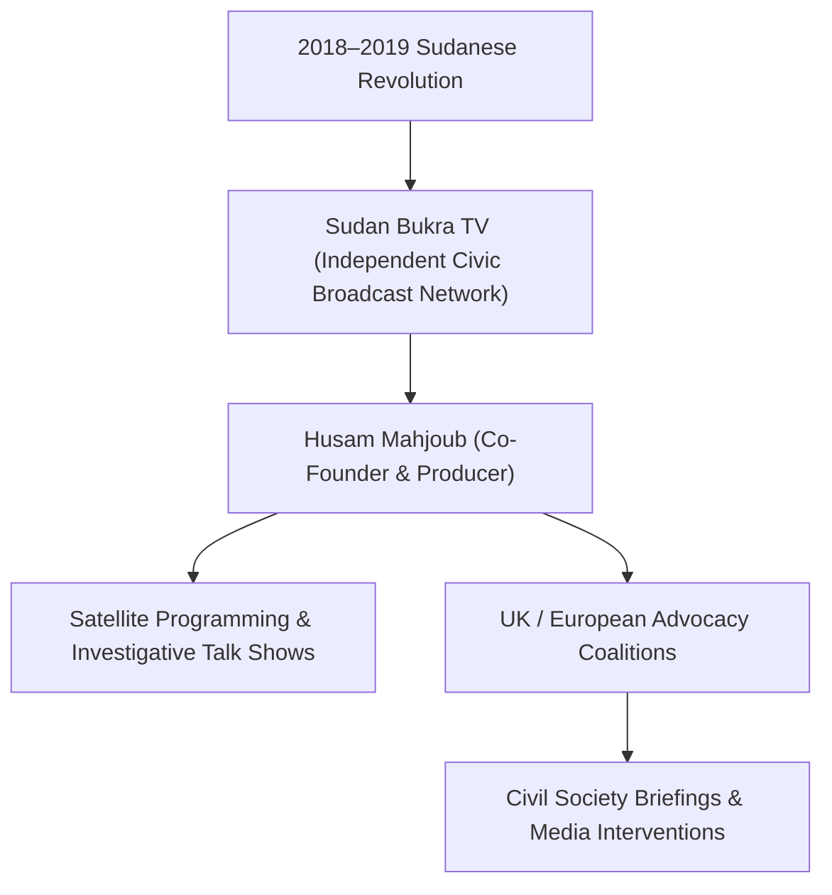

# Husam Mahjoub

## 1. Identity, Classification & Leadership Anchor

> [!NOTE] Identity, Classification & Leadership Anchor
> **Husam Mahjoub** is a Sudanese diaspora media leader, political analyst, and co-founder of **Sudan Bukra TV** (*Sudan of Tomorrow*), an independent satellite and digital broadcaster established to support the pro-democracy revolution and civil society in Sudan. Operating from the United Kingdom, Mahjoub is an influential civic advocate and commentator analyzing external proxy interference, war economy networks, and transitional governance.

## 2. Historical Lineage, Factions & Command Structure

Mahjoub and fellow diaspora media practitioners founded Sudan Bukra TV during the height of the anti-Bashir protests in 2019 to provide uncensored broadcasting for the civilian resistance committees. Following the October 2021 military coup and the catastrophic war in April 2023, Sudan Bukra TV became a vital independent media node, transmitting frontline reports, political debate, and cultural resilience programming to audiences across Sudan and the diaspora.

## 3. Strategic Objectives, Ideology & Political Economy ("Why")

Mahjoub’s public advocacy and editorial perspective focus on:
- **Civilian Democratic Governance**: Reaffirming that lasting peace in Sudan cannot be achieved by entrenching a military duopoly between SAF generals and RSF warlords.
- **Countering External Hegemonic Projects**: Exposing regional financial networks and arms flows, specifically criticizing the [[United Arab Emirates]] for underwriting military devastation while presenting a facade of diplomatic benevolence.
- **Media Democratization**: Maintaining media spaces free from partisan state or militia financing to preserve historical memory and document human rights violations.

## 4. Operational Capabilities, Alliances & Foreign Backing

- **Broadcast Reach**: Broadcasts via satellite into millions of Sudanese homes, providing essential information to communities deprived of reliable local internet access.
- **Coalition Building**: Partners actively with Sudanese community organizations in the UK, European human rights platforms, and investigative journalists to spotlight the war's neglected dynamics.

## 5. Chronological Event Footprint & Accountability Record

| Date | Media / Advocacy Contribution | Focus |
| :--- | :--- | :--- |
| **2023-05** | Special wartime programming launch on Sudan Bukra | Grassroots mutual aid and survivor stories |
| **2026-10-28** | Speaker and organizer at Global Civil Society Briefing | Denounced UAE diplomatic whitewashing and campaigned against the Lana Nusseibeh UNSG candidacy |

## ## Related Primitives
- **Sources**: [[sources/2026-10-30-the-guardian-sudanese-diaspora-uae-un-nominee-nusseibeh]]
- **Themes**: [[Multilateral Capture and Accountability Politics in Sudan]], [[UAE Foreign Backing and Logistics Network for the Rapid Support Forces]]
- **Events**: [[2026-10-28 Global Civil Society Briefing Opposing Lana Nusseibeh Candidacy for UN Secretary-General]]
- **Actors**: [[Ibrahim Alduma]], [[Lana Nusseibeh]], [[Carlos Mureithi]], [[United Arab Emirates]]
- **Locations**: [[Geneva]]
