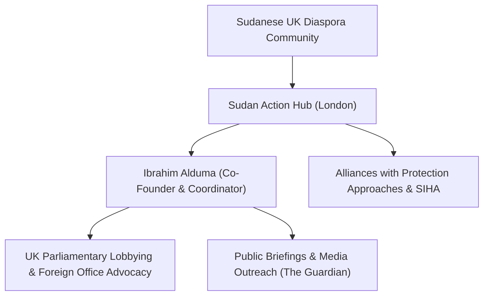

# Ibrahim Alduma

## 1. Identity, Classification & Leadership Anchor

> [!NOTE] Identity, Classification & Leadership Anchor
> **Ibrahim Alduma** is a Sudanese diaspora activist, community organizer, and co-founder of the **Sudan Action Hub**, an advocacy coalition based in the United Kingdom dedicated to mobilizing public awareness, parliamentary lobbying, and humanitarian solidarity for Sudan. Alduma serves as a prominent coordinator organizing public demonstrations, open letters, and diplomatic briefings holding external actors accountable for fueling the Sudanese conflict.

## 2. Historical Lineage, Factions & Command Structure

Following the outbreak of war in April 2023, Alduma joined other UK-based Sudanese professionals and activists to establish the Sudan Action Hub. The group was founded to bridge the information gap in Western capitals regarding the scale of the atrocities and to counteract the geopolitical indifference of Western governments toward the catastrophe in Sudan.

## 3. Strategic Objectives, Ideology & Political Economy ("Why")

Alduma’s civic advocacy focuses on:
- **Exposing Gulf State Complicity**: Pressuring Western governments—particularly the UK Foreign, Commonwealth & Development Office (FCDO)—to cease diplomatic deference to the [[United Arab Emirates]] regarding its arms transfers to the [[Rapid Support Forces]].
- **Protecting Multilateral Integrity**: Demanding that candidates for high UN office, such as [[Lana Nusseibeh]], be scrutinized based on their state's compliance with international law and UN arms embargoes.
- **Amplifying Grassroots Civilian Priorities**: Supporting mutual aid networks and Emergency Response Rooms inside Sudan with international fundraising and policy visibility.

## 4. Operational Capabilities, Alliances & Foreign Backing

- **Diaspora Mobilization**: Coordinates protests outside Downing Street, the UAE Embassy in London, and the Houses of Parliament, uniting diverse Sudanese political and community factions.
- **Civil Society Alliances**: Works in close concert with British atrocity-prevention organizations such as Protection Approaches and Sudanese media collectives like Sudan Bukra TV.

## 5. Chronological Event Footprint & Accountability Record

| Date | Advocacy Milestone | Objective |
| :--- | :--- | :--- |
| **2024-04** | London Global Day of Action for Sudan | Organized mass rallies marking one year of conflict |
| **2026-10-28** | Key Organizer of Global Civil Society Briefing | Mobilized international opposition to UAE UN Secretary-General candidacy |

## ## Related Primitives
- **Sources**: [[sources/2026-10-30-the-guardian-sudanese-diaspora-uae-un-nominee-nusseibeh]]
- **Themes**: [[Multilateral Capture and Accountability Politics in Sudan]], [[UAE Foreign Backing and Logistics Network for the Rapid Support Forces]]
- **Events**: [[2026-10-28 Global Civil Society Briefing Opposing Lana Nusseibeh Candidacy for UN Secretary-General]]
- **Actors**: [[Husam Mahjoub]], [[Kate Ferguson]], [[Lana Nusseibeh]], [[Carlos Mureithi]], [[United Arab Emirates]]
- **Locations**: [[Geneva]]
