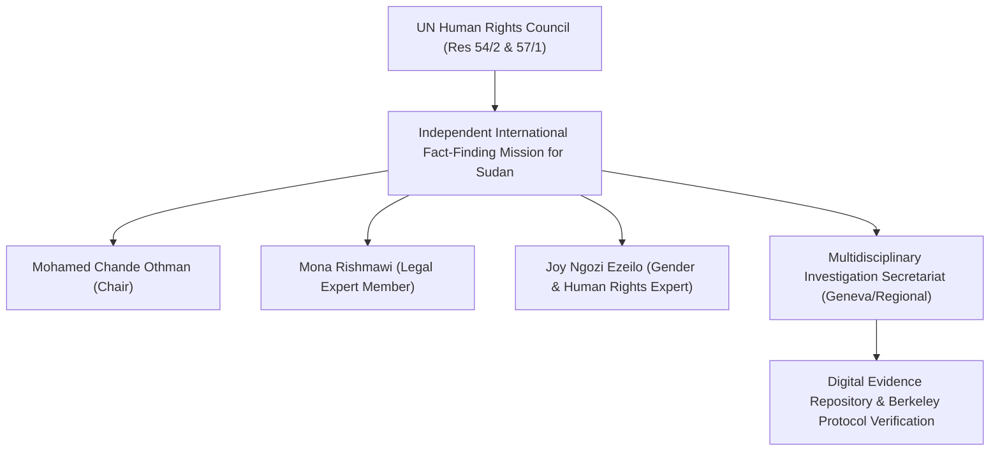

# Independent International Fact-Finding Mission for the Sudan

## 1. Identity, Classification & Leadership Anchor

> [!NOTE] Identity, Classification & Leadership Anchor
> The **Independent International Fact-Finding Mission for the Sudan (FFM Sudan)** is an independent international investigative body established by the [[UN Human Rights Council]] pursuant to resolution 54/2 in October 2023. Tasked with investigating all alleged human rights violations, abuses, and related crimes in the context of the armed conflict in Sudan that erupted on 15 April 2023, the Mission operates under the leadership of Chair **[[Mohamed Chande Othman]]** (former Chief Justice of Tanzania) alongside expert members **[[Mona Rishmawi]]** (Palestine) and **[[Joy Ngozi Ezeilo]]** (Nigeria).

## 2. Historical Lineage, Factions & Command Structure

The FFM was created in response to systemic atrocities committed during the 2023–2026 conflict between the [[Sudanese Armed Forces]] (SAF) and the [[Rapid Support Forces]] (RSF). In October 2024, the UN Human Rights Council adopted resolution 57/1, extending the Mission's mandate for an additional year to maintain investigative continuity. The Mission comprises criminal investigators, forensic digital experts, legal analysts, and gender-based violence specialists adhering to the Berkeley Protocol for open-source and field-based evidentiary documentation.

## 3. Strategic Objectives, Ideology & Political Economy ("Why")

The FFM's strategic mandate is threefold:
1. **Fact-Finding & Legal Classification**: Establish the factual reality of incidents, determining whether acts constitute war crimes, crimes against humanity, or genocide.
2. **Perpetrator Identification & Individual Criminal Liability**: Identify responsible individuals, military commanders, and foreign entities supplying weaponry or logistical assistance.
3. **Evidence Preservation for Prosecutorial Mechanisms**: Secure witness statements, satellite analysis, and chain-of-custody documentation for the [[International Criminal Court]] (ICC) and prospective independent tribunals.

Financed through the UN regular budget, the Mission maintains strict structural independence from both Sudanese belligerents and external regional powers, shielding its investigative findings from geopolitical leverage.

## 4. Operational Capabilities, Alliances & Foreign Backing

Denied in-country entry visas by the de facto military-led government in [[Port Sudan]], the FFM conducts remote, cross-border, and digital investigations across Chad, Kenya, Uganda, and Switzerland:
- **Investigative Methodology**: Conducts extensive in-person interviews with refugees, displaced survivors, eyewitnesses, medical personnel, and defectors, supplemented by commercial satellite imagery, intercepted radio/drone telemetry, and verified open-source video material.
- **Institutional Partnerships**: Closely collaborates with the Office of the UN High Commissioner for Human Rights (OHCHR), the UN Security Council Panel of Experts on the Sudan, and international human rights organizations including [[Human Rights Watch]].

## 5. Chronological Event Footprint & Accountability Record

| Period / Date | Investigative Milestone / Finding | Primary Target / Implicated Actor |
| :--- | :--- | :--- |
| **2024-09** | First Comprehensive Report to UN HRC; documented war crimes and crimes against humanity by both SAF and RSF; recommended arms embargo expansion. | [[Sudanese Armed Forces]], [[Rapid Support Forces]] |
| **2026-02-19** | Formal finding that RSF operations in [[El Fasher]] bear hallmarks of genocide against non-Arab Fur and Zaghawa groups. | [[Rapid Support Forces]], Janjaweed allied militias |
| **2026-10-28** | Presentation to UNGA Third Committee documenting weaponized drone proliferation, siege starvation, and arbitrary detention in [[El Obeid]]. | [[Sudanese Armed Forces]], [[Rapid Support Forces]], Foreign drone suppliers |

## ## Related Primitives
- **Sources**: [[sources/2026-10-28-ohchr-ffm-el-obeid-drone-warfare-repression]], [[sources/2026-10-28-ohchr-independent-international-fact-finding-mission-sudan-portal]], [[sources/2026-02-19-un-news-el-fasher-hallmarks-of-genocide]]
- **Themes**: [[International Accountability and Fact-Finding Mechanisms in Sudan]], [[Ethnic Cleansing and Genocidal Patterns in Darfur]], [[Drone Proliferation and Double-Tap Strike Doctrine in Sudan]]
- **Events**: [[2025-10 El Fasher Siege and RSF Takeover Atrocities]], [[2026-10 El Obeid Siege and Drone Warfare Escalation]]
- **Actors**: [[Mohamed Chande Othman]], [[Mona Rishmawi]], [[Joy Ngozi Ezeilo]], [[UN Human Rights Council]], [[Sudanese Armed Forces]], [[Rapid Support Forces]]
- **Locations**: [[Geneva]], [[El Fasher]], [[El Obeid]]
