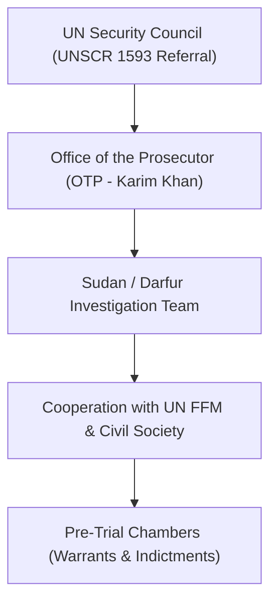

# International Criminal Court

## 1. Identity, Classification & Leadership Anchor

> [!NOTE] Political Body & International Justice Anchor
> The **International Criminal Court** (ICC), headquartered in The Hague, Netherlands, is the permanent international tribunal established under the Rome Statute to prosecute individuals for genocide, crimes against humanity, war crimes, and the crime of aggression. In Sudan, the ICC exercises jurisdiction pursuant to United Nations Security Council Resolution 1593 (2005), which referred the situation in Darfur to the Court. Led by Prosecutor Karim Ahmad Khan KC, the ICC serves as the premier judicial body investigating recurring atrocity crimes across [[North Darfur]] and [[South Darfur]] committed by both the [[Sudanese Armed Forces]] (SAF) and the [[Rapid Support Forces]] (RSF).

## 2. Historical Lineage, Factions & Command Structure

The ICC’s mandate in Sudan originated during the 2003–2005 Darfur genocide, resulting in historic arrest warrants against former president Omar al-Bashir, Ahmad Harun, and Abdel Rahim Hussein for war crimes and genocide, as well as the landmark trial of Janjaweed commander Ali Kushayb (Muhammad Ali Abd-Al-Rahman). Following the outbreak of the April 2023 war and the renewed ethnic cleansing campaigns in West and North Darfur, Prosecutor Khan announced in July 2023 that the ICC mandate encompasses current atrocities across Darfur, establishing active evidence collection pipelines.

## 3. Strategic Objectives, Ideology & Political Economy ("Why")

The ICC operates under the mandate of universal accountability, combating entrenched cultures of impunity:
- **Individual Criminal Responsibility**: Breaking cycles of recurrent violence in Sudan by prosecuting senior military commanders and proxy militia leaders responsible for targeted massacres.
- **Deterrence Across Expanding Frontlines**: Signaling to commanders in [[El Fasher]] and [[Nyala]] that ethnically targeted executions, sexual violence, and sieges will incur international prosecution.
- **Judicial Preservation of Evidence**: Standardizing digital and forensic evidence collected under the Berkeley Protocol to satisfy strict admissibility standards in criminal trials.

## 4. Operational Capabilities, Alliances & Foreign Backing

While the ICC possesses robust legal and forensic capabilities, it lacks an independent enforcement force:
- **Investigative Synergy**: The Court maintains formal and informal information-sharing relationships with the [[Independent International Fact-Finding Mission for the Sudan]] (FFM) and the [[UN Human Rights Council]] (UNHRC).
- **Civil Society Coalitions**: Local Sudanese human rights monitors, diaspora jurists, and survivor networks channel first-hand testimonies, forensic imagery, and perpetrator records directly to OTP investigators.
- **Enforcement Challenges**: Both the SAF-dominated [[Transitional Sovereignty Council]] and the RSF leadership have evaded arrest warrants and obstructed physical investigator access to frontline territories.

## 5. Chronological Event Footprint & Accountability Record

- **2005-03-31**: UNSC adopts Resolution 1593 referring the situation in Darfur to the ICC.
- **2023-07-13**: ICC Prosecutor Karim Khan formally informs the UN Security Council that his office has launched investigations into renewed atrocities committed in Darfur since April 2023.
- **2024-06-11**: Prosecutor Khan issues an urgent public warning regarding imminent mass atrocities and siege dynamics in [[El Fasher]].
- **2026-10-28**: Findings released by the UN Fact-Finding Mission formally recommend transferring new evidence of RSF war crimes and crimes against humanity to the ICC for prosecution.

## Related Primitives

- **Events**:
  - [[2025-10 El Fasher Siege and RSF Takeover Atrocities]]
- **Actors**:
  - [[Independent International Fact-Finding Mission for the Sudan]]
  - [[UN Human Rights Council]]
  - [[Rapid Support Forces]]
  - [[Sudanese Armed Forces]]
- **Themes**:
  - [[International Accountability and Fact-Finding Mechanisms in Sudan]]
  - [[Ethnic Cleansing and Genocidal Patterns in Darfur]]
- **Timelines**:
  - [[Sudan Accountability and International Justice Timeline]]
