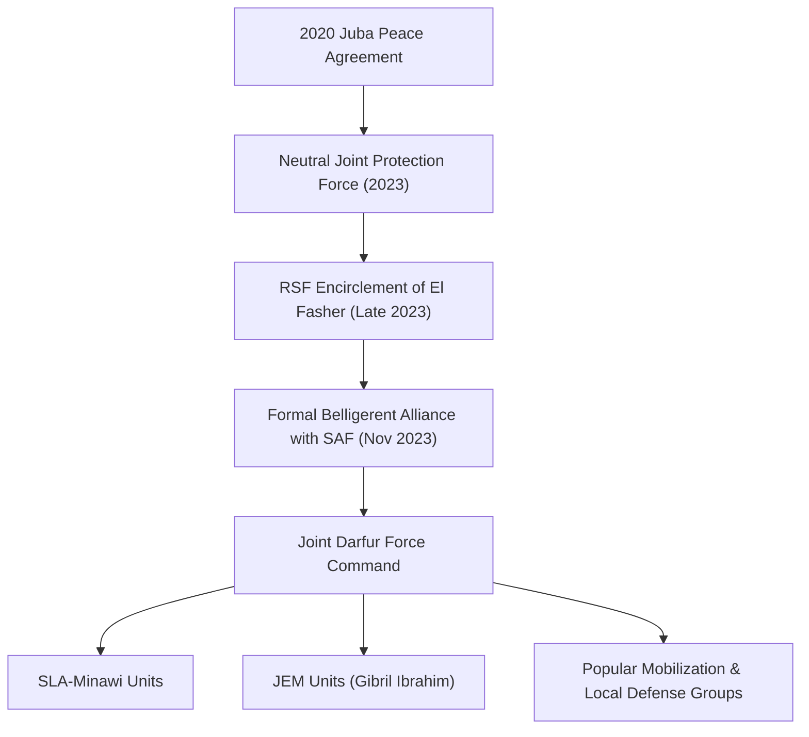

# Joint Darfur Force

## 1. Identity, Classification & Leadership Anchor

> [!NOTE] Armed Group & Darfur Resistance Coalition Anchor
> The **Joint Darfur Force** (officially the *Joint Force of Armed Struggle Movements*) is a military coalition established by major signatory movements of the 2020 Juba Peace Agreement—principally the Sudan Liberation Movement faction led by Minni Minawi (SLA-Minawi) and the Justice and Equality Movement led by Gibril Ibrahim (JEM). While initially constituted as a neutral protection unit for civilian convoys and commercial traffic in Darfur, the coalition officially abandoned neutrality in November 2023, aligning fully with the [[Sudanese Armed Forces]] (SAF) to defend [[El Fasher]] against surrounding [[Rapid Support Forces]] (RSF) encirclement.

## 2. Historical Lineage, Factions & Command Structure

Formed following the April 2023 outbreak of hostilities, the Joint Force initially sought to insulate North Darfur from the catastrophic ethnic massacres witnessed in West Darfur. However, as the RSF overran SAF garrisons in Nyala, El Geneina, Zalingei, and Ed Daein, North Darfur became the final bastion of non-RSF control in Darfur. Confronted with systematic siege operations, the Joint Force unified its command structure with the SAF 6th Infantry Division in El Fasher.

## 3. Strategic Objectives, Ideology & Political Economy ("Why")

The strategic doctrine of the Joint Darfur Force is anchored in regional survival, territorial integrity, and the preservation of non-Arab community defense:
- **Territorial Defense of El Fasher**: Preventing the total collapse of North Darfur into RSF administrative control, which would consolidate a de facto partition of Sudan.
- **Protection of IDP Communities**: Guarding vulnerable displaced civilian populations in [[Zamzam IDP Camp]] and Abu Shouk camp from targeted ethnically motivated massacres.
- **National Political Leverage**: Retaining military leverage within the SAF-aligned state structure to guarantee post-war political representation under the Juba Peace framework.

## 4. Operational Capabilities, Alliances & Foreign Backing

- **Combat Footprint**: The Joint Force possesses seasoned guerrilla infantry, technical-mounted light cavalry, and specialized urban combat units familiar with Darfurian topography.
- **SAF Military Integration**: Operates in close tactical coordination with SAF aerial support, artillery, and logistical air-drops inside besieged pockets.
- **Logistical Constraints**: Severe supply shortages, ammunition exhaustion, and weapon deficits resulting from the total siege imposed by RSF forces around El Fasher.

## 5. Chronological Event Footprint & Accountability Record

- **2023-04-27**: Established as a neutral escort force to secure commercial corridors and aid deliveries across Darfur.
- **2023-11-16**: Leaders Minni Minawi and Gibril Ibrahim officially declare an end to neutrality, pledging military resistance against RSF advances.
- **2024-05-10**: Mobilizes alongside SAF 6th Infantry Division to repel the multi-pronged RSF assault on the northern and eastern perimeters of El Fasher.
- **2025-10-15**: Participates in fierce defensive urban operations during the catastrophic siege of El Fasher, suffering severe attrition alongside civilian casualties.

## Related Primitives

- **Events**:
  - [[2025-10 El Fasher Siege and RSF Takeover Atrocities]]
- **Actors**:
  - [[Sudanese Armed Forces]]
  - [[Rapid Support Forces]]
- **Locations**:
  - [[El Fasher]]
  - [[North Darfur]]
  - [[Zamzam IDP Camp]]
- **Themes**:
  - [[Ethnic Cleansing and Genocidal Patterns in Darfur]]
- **Timelines**:
  - [[El Fasher Siege and Genocide Investigation Timeline]]
