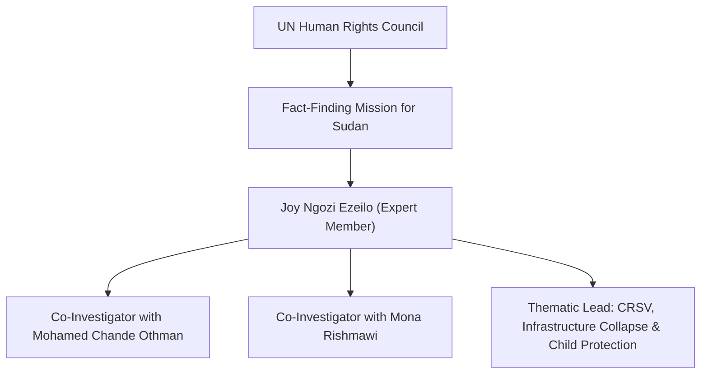

# Joy Ngozi Ezeilo

## 1. Identity, Classification & Leadership Anchor

> [!NOTE] Identity, Classification & Leadership Anchor
> **Joy Ngozi Ezeilo** is a distinguished Nigerian professor of law, Senior Advocate of Nigeria (SAN), and former UN Special Rapporteur on Trafficking in Persons, especially women and children (2008–2014). Serving as an expert member of the [[Independent International Fact-Finding Mission for the Sudan]] (FFM) since December 2023, Professor Ezeilo leads the Mission's investigative work on conflict-related sexual violence (CRSV), human trafficking, sexual slavery, and the systemic destruction of civilian infrastructure.

## 2. Historical Lineage, Factions & Command Structure

Ezeilo is a professor of public law at the University of Nigeria and founder of the Women’s Aid Collective (WACOL). A renowned international jurist, she was conferred the Nigerian national honour of Officer of the Order of the Niger (OON) and has served on numerous high-level international advisory boards on gender justice and international humanitarian law.

## 3. Strategic Objectives, Ideology & Political Economy ("Why")

Within the FFM, Professor Ezeilo focuses on the disproportionate gendered and civilian impacts of the Sudan war:
- **Conflict-Related Sexual Violence (CRSV)**: Documenting ethnically driven rape, gang rape, sexual slavery, and forced marriage perpetrated as systematic weapons of war by the [[Rapid Support Forces]] and allied militias.
- **Critical Civilian Infrastructure Protection**: Investigating the intentional destruction of hospitals, water networks, and electrical grids, framing attacks on dual-use infrastructure as collective punishment and war crimes.
- **Child Protection and Vulnerable Groups**: Highlighting the acute vulnerability of displaced children, lactating mothers, and elderly persons trapped under siege in urban centers such as [[El Obeid]] and [[El Fasher]].

## 4. Operational Capabilities, Alliances & Foreign Backing

- **Trauma-Informed Investigation**: Directs trauma-informed forensic interviews with female refugees, medical professionals, and local gender monitors.
- **Inter-Agency Coordination**: Coordinates closely with UN Women, the UN Special Representative of the Secretary-General on Sexual Violence in Conflict, and local feminist networks like the [[SIHA Network]].

## 5. Chronological Event Footprint & Accountability Record

| Date | Investigative Milestone | Key Statement / Finding |
| :--- | :--- | :--- |
| **2026-02-19** | UN Press Briefing on Darfur | Warned that violence against non-Arab civilians in El Fasher reflects genocidal intent |
| **2026-10-28** | UNGA Third Committee Briefing | Denounced the systematic flattening of critical civilian infrastructure and health facilities across Sudan |

## ## Related Primitives
- **Sources**: [[sources/2026-10-28-ohchr-ffm-el-obeid-drone-warfare-repression]], [[sources/2026-02-19-un-news-el-fasher-hallmarks-of-genocide]]
- **Themes**: [[International Accountability and Fact-Finding Mechanisms in Sudan]], [[Ethnic Cleansing and Genocidal Patterns in Darfur]], [[Energy Infrastructure Targeting in the Sudan War.md|Energy Infrastructure Targeting in the Sudan War]]
- **Events**: [[2025-10 El Fasher Siege and RSF Takeover Atrocities]], [[2026-10 El Obeid Siege and Drone Warfare Escalation]]
- **Actors**: [[Independent International Fact-Finding Mission for the Sudan]], [[Mohamed Chande Othman]], [[Mona Rishmawi]], [[SIHA Network]]
- **Locations**: [[Geneva]], [[El Fasher]], [[El Obeid]]
