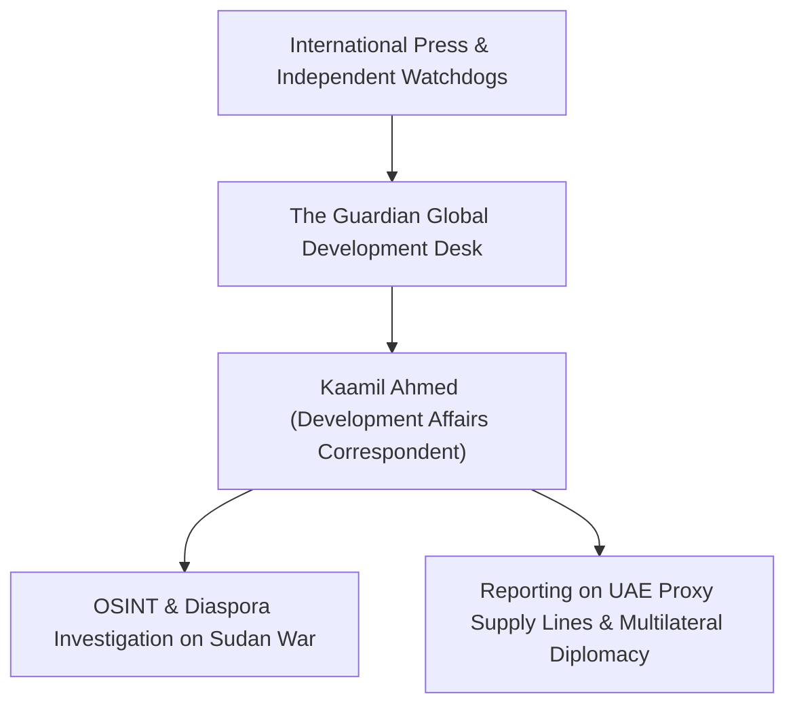

# Kaamil Ahmed

## 1. Identity, Classification & Leadership Anchor

> [!NOTE] Person Actor & Investigative Journalist Anchor
> **Kaamil Ahmed** is an international investigative journalist and development affairs correspondent for *[[The Guardian]]*, specializing in humanitarian crises, displacement, global human rights accountability, and foreign policy. Ahmed authored major investigative coverage regarding the global mobilization of Sudanese diaspora groups and international jurists opposing the prospective United Nations Secretary-General candidacy of UAE diplomat [[Lana Nusseibeh]].

## 2. Historical Lineage, Factions & Command Structure

Prior to joining *The Guardian*, Ahmed worked across the Middle East and South Asia covering forced displacement, conflict dynamics, and authoritarian governance. His investigative reporting adheres to strict editorial standards, balancing testimony from victim communities, legal analysis from international scholars, and formal diplomatic rebuttals.

## 3. Strategic Objectives, Ideology & Political Economy ("Why")

Ahmed’s journalistic mandate is grounded in public-interest investigative scrutiny and human rights reporting:
- **Exposing Conflict Complicity**: Investigating how foreign geopolitical financing and weapons flows sustain civilian suffering in forgotten conflicts like Sudan.
- **Scrutinizing Global Governance**: Shedding critical light on backdoor diplomatic lobbying and institutional capture in high-level multilateral appointments.
- **Amplifying Survivor Perspectives**: Bringing the voices of Sudanese human rights advocates and diaspora organizers into mainstream global media discourse.

## 4. Operational Capabilities, Alliances & Foreign Backing

- **Investigative Reach**: Access to premier international civil society networks, UN agency insiders, and grassroots monitoring bodies.
- **Verification Standards**: Implementation of rigorous editorial fact-checking and right-of-reply protocols with governmental authorities, including UAE diplomatic representatives.
- **Media Independence**: Backed by the editorial independence and investigative resources of *The Guardian* newsroom.

## 5. Chronological Event Footprint & Accountability Record

- **2026-10-30**: Authors *The Guardian* feature report "Sudanese diaspora and rights groups push back against UAE bid for top UN role", detailing cross-border civil society resistance to Lana Nusseibeh's potential UN SG candidacy.

## Related Primitives

- **Events**:
  - [[2026-10-28 Global Civil Society Briefing Opposing Lana Nusseibeh Candidacy for UN Secretary-General]]
- **Actors**:
  - [[The Guardian]]
  - [[Lana Nusseibeh]]
  - [[Kenneth Roth]]
  - [[Bruno Stagno Ugarte]]
  - [[United Arab Emirates]]
- **Themes**:
  - [[Multilateral Capture and Accountability Politics in Sudan]]
  - [[UAE Foreign Backing and Logistics Network for the Rapid Support Forces]]
