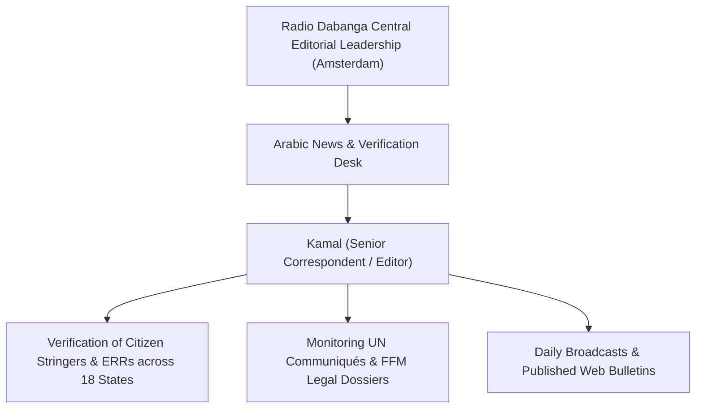

# Kamal

## 1. Identity, Classification & Leadership Anchor

> [!NOTE] Identity, Classification & Leadership Anchor
> **Kamal** is a veteran Sudanese broadcast journalist, field editor, and senior news correspondent at [[Radio Dabanga]], the prominent independent broadcaster headquartered in Amsterdam. Working across Radio Dabanga's Arabic newsdesk, Kamal authors critical investigative dispatches, tracks breaking field telemetry, and covers high-level United Nations diplomatic statements and international legal warnings concerning the war in Sudan.

## 2. Historical Lineage, Factions & Command Structure

Kamal has spent years reporting on Sudanese socio-political transformations, armed conflict, and community resistance. Following the outbreak of large-scale hostilities between the [[Sudanese Armed Forces]] (SAF) and the [[Rapid Support Forces]] (RSF) in April 2023, Kamal became a lead producer coordinating field reports from citizen reporters cut off by communications outages in Darfur, Kordofan, and the Red Sea State.

## 3. Strategic Objectives, Ideology & Political Economy ("Why")

Kamal’s journalistic work embodies Radio Dabanga's core mission:
- **Vernacular Translation of International Law**: Translating complex international multilateral statements, UN Security Council resolutions, and Fact-Finding Mission legal conclusions into accessible Arabic news bulletins for Sudanese communities.
- **Verification of Critical Infrastructure Strikes**: Investigating military attacks on non-combatant utility networks, power stations, and crude oil transit hubs to establish independent operational timelines.
- **Civic Accountability**: Resisting partisan military propaganda by independently verifying casualty claims and attributing accountability transparently.

## 4. Operational Capabilities, Alliances & Foreign Backing

- **Grassroots Verification Network**: Regularly interfaces with local doctors, municipal engineers, and mutual aid volunteers across Sudan to verify ground reports before publication.
- **Multilingual Synthesis**: Synthesizes English UN press briefings and Arabic field communiqués into rapid, accurate news bulletins syndicated via shortwave radio, satellite TV, and digital platforms.

## 5. Chronological Event Footprint & Accountability Record

| Date | Key Reporting Contribution | Context |
| :--- | :--- | :--- |
| **2026-10-31** | Broken detailed report on Haiya oil pumping and power station drone attack | First comprehensive Sudanese media account detailing damage to Station 4 and the local power grid |
| **2026-11-01** | Published Arabic analysis of UNSG Guterres drone condemnation and FFM warnings | Elevated warnings of war crimes and El Obeid siege conditions across Sudan |

## ## Related Primitives
- **Sources**: [[sources/2026-10-31-dabanga-haiya-oil-electricity-drone-attack]], [[sources/2026-11-01-dabanga-unsg-guterres-condemns-escalating-drone-attacks]]
- **Themes**: [[Energy Infrastructure Targeting in the Sudan War.md|Energy Infrastructure Targeting in the Sudan War]], [[Drone Proliferation and Double-Tap Strike Doctrine in Sudan]]
- **Events**: [[2026-10-31 Haiya Oil Pumping and Power Station Drone Strike]], [[2026-10-27 Nyala Tanqonj Market Drone Strike]]
- **Actors**: [[Radio Dabanga]], [[Stéphane Dujarric]], [[Independent International Fact-Finding Mission for the Sudan]], [[Sudanese Armed Forces]], [[Rapid Support Forces]]
- **Locations**: [[Haiya]], [[El Obeid]], [[Nyala]]
