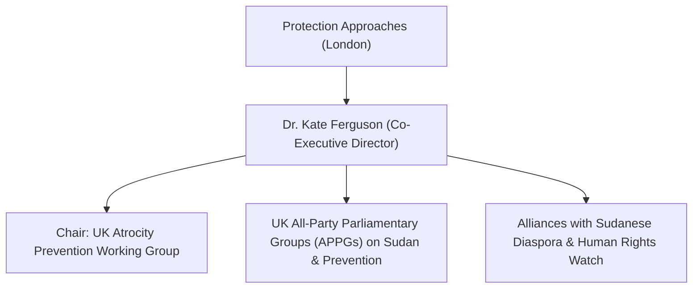

# Kate Ferguson

## 1. Identity, Classification & Leadership Anchor

> [!NOTE] Identity, Classification & Leadership Anchor
> **Dr. Kate Ferguson** is a British conflict analyst, policy expert, and co-founder and Co-Executive Director of **Protection Approaches**, a leading UK charity dedicated to ending identity-based violence and mass atrocities globally. Serving as the Chair of the UK Atrocity Prevention Working Group, Ferguson advises the UK Parliament, foreign ministries, and international bodies on systemic mechanisms to prevent genocide, war crimes, and state-sponsored proxy violence in conflicts such as Sudan.

## 2. Historical Lineage, Factions & Command Structure

Holding a PhD in ethnic violence and modern history from the University of East Anglia, Ferguson has written extensively on the architectures of state complicity, militia mobilization, and early warning systems in mass atrocity environments. Under her leadership, Protection Approaches has positioned itself as an essential policy bridge between vulnerable communities on the ground, diaspora advocates, and high-level policymaking bodies in Whitehall and Brussels.

## 3. Strategic Objectives, Ideology & Political Economy ("Why")

Ferguson’s strategic work on the Sudan crisis focuses on:
- **Exposing Structural Complicity**: Denouncing the UK and Western governments' historical reluctance to challenge Gulf allies—specifically the [[United Arab Emirates]]—over their military and financial assistance to the [[Rapid Support Forces]].
- **Atrocity Prevention Mainstreaming**: Demanding that conflict diplomacy prioritize immediate physical protection of civilians and identity-targeted groups over superficial political stabilization deals.
- **Upholding Multilateral Norms**: Insisting that multilateral leadership posts within the [[United Nations]] remain closed to states actively fueling identity-based atrocities and arms proliferation.

## 4. Operational Capabilities, Alliances & Foreign Backing

- **Parliamentary & Policy Influence**: Routinely submits expert evidence and testifies before UK Parliamentary Select Committees on Foreign Affairs and International Development.
- **Coalition Building**: Coordinates closely with Sudanese diaspora collectives such as the Sudan Action Hub, women's rights networks like [[SIHA Network]], and international watchdogs.

## 5. Chronological Event Footprint & Accountability Record

| Date | Policy / Advocacy Milestone | Focus Area |
| :--- | :--- | :--- |
| **2023-09** | Parliamentary Briefing on Mass Atrocities in Darfur | Urged UK government to apply targeted sanctions against RSF front companies |
| **2024-06** | Published analysis on Western diplomatic blind spots in Sudan | Criticized Western deference to UAE financial interests |
| **2026-10-28** | Speaker at Global Civil Society Briefing | Warned that electing UAE candidate Lana Nusseibeh as UN Secretary-General would reward impunity for the slaughter of Sudanese civilians |

## ## Related Primitives
- **Sources**: [[sources/2026-10-30-the-guardian-sudanese-diaspora-uae-un-nominee-nusseibeh]]
- **Themes**: [[Multilateral Capture and Accountability Politics in Sudan]], [[UAE Foreign Backing and Logistics Network for the Rapid Support Forces]], [[Ethnic Cleansing and Genocidal Patterns in Darfur]]
- **Events**: [[2026-10-28 Global Civil Society Briefing Opposing Lana Nusseibeh Candidacy for UN Secretary-General]]
- **Actors**: [[Ibrahim Alduma]], [[Hala al-Karib]], [[Kenneth Roth]], [[Bruno Stagno Ugarte]], [[Lana Nusseibeh]], [[Carlos Mureithi]]
- **Locations**: [[Geneva]]
