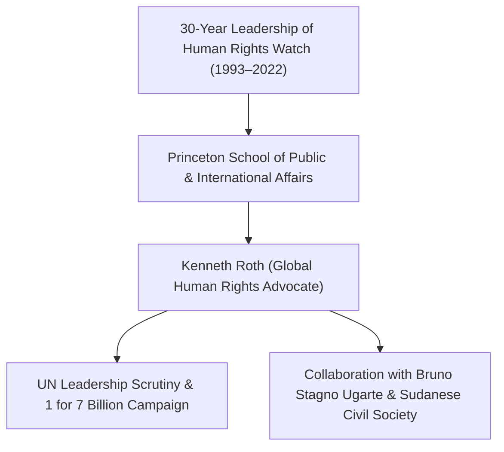

# Kenneth Roth

## 1. Identity, Classification & Leadership Anchor

> [!NOTE] Identity, Classification & Leadership Anchor
> **Kenneth Roth** is an American attorney, human rights leader, and visiting professor at the Princeton School of Public and International Affairs, who served for nearly three decades as the Executive Director of [[Human Rights Watch]] (1993–2022). One of the most influential global voices on international humanitarian law and atrocity prevention, Roth continues to lead high-profile global advocacy campaigns addressing accountability, foreign state complicity, and multilateral integrity in the Sudan war.

## 2. Historical Lineage, Factions & Command Structure

Before his transformative leadership of Human Rights Watch, Roth worked as a federal prosecutor in the US Attorney's Office for the Southern District of New York and participated in the Iran-Contra investigation. Under his direction, HRW grew from a small regional watchdog into a global powerhouse documenting war crimes across conflicts in Rwanda, the Balkans, and Darfur. Following his transition from HRW in 2022, Roth assumed academic appointments while remaining a formidable global commentator on international justice.

## 3. Strategic Objectives, Ideology & Political Economy ("Why")

Roth’s international advocacy focuses on preserving the integrity of multilateral institutions and ending great-power impunity:
- **Challenging Hypocrisy in Global Governance**: Vocally opposing the candidacy of representatives from abusive governments—such as the [[United Arab Emirates]]—for top multilateral posts like UN Secretary-General.
- **Enforcing the Rule of Law for Proxy Sponsors**: Demanding that foreign states financing or arming belligerents accused of war crimes face direct legal and diplomatic consequences.
- **Universal Jurisdiction & ICC Support**: Advocating for the arrest and prosecution of military and paramilitary leaders responsible for atrocities in Sudan.

## 4. Operational Capabilities, Alliances & Foreign Backing

- **Global Media Profile**: Possesses vast reach across international mainstream media (The New York Times, The Guardian, BBC, Foreign Affairs) and social platforms, commanding immense influence over diplomatic circles.
- **Multilateral Coalitions**: Collaborates closely with the "1 for 7 Billion" campaign advocating for a transparent, merit-based selection process for the UN Secretary-General.

## 5. Chronological Event Footprint & Accountability Record

| Date | Advocacy Milestone | Subject |
| :--- | :--- | :--- |
| **2004-04** | Authored early investigative warnings on Darfur genocide | First prominent international calls for ICC referral |
| **2026-10-28** | Keynote speaker at Global Civil Society Briefing | Issued scathing indictment of UAE UN candidacy: "The UAE wants the prestige of leading the UN while actively undermining its core mission by arming the RSF in Sudan" |

## ## Related Primitives
- **Sources**: [[sources/2026-10-30-the-guardian-sudanese-diaspora-uae-un-nominee-nusseibeh]]
- **Themes**: [[Multilateral Capture and Accountability Politics in Sudan]], [[UAE Foreign Backing and Logistics Network for the Rapid Support Forces]]
- **Events**: [[2026-10-28 Global Civil Society Briefing Opposing Lana Nusseibeh Candidacy for UN Secretary-General]]
- **Actors**: [[Human Rights Watch]], [[Bruno Stagno Ugarte]], [[Lana Nusseibeh]], [[Hala al-Karib]], [[Carlos Mureithi]]
- **Locations**: [[Geneva]]
