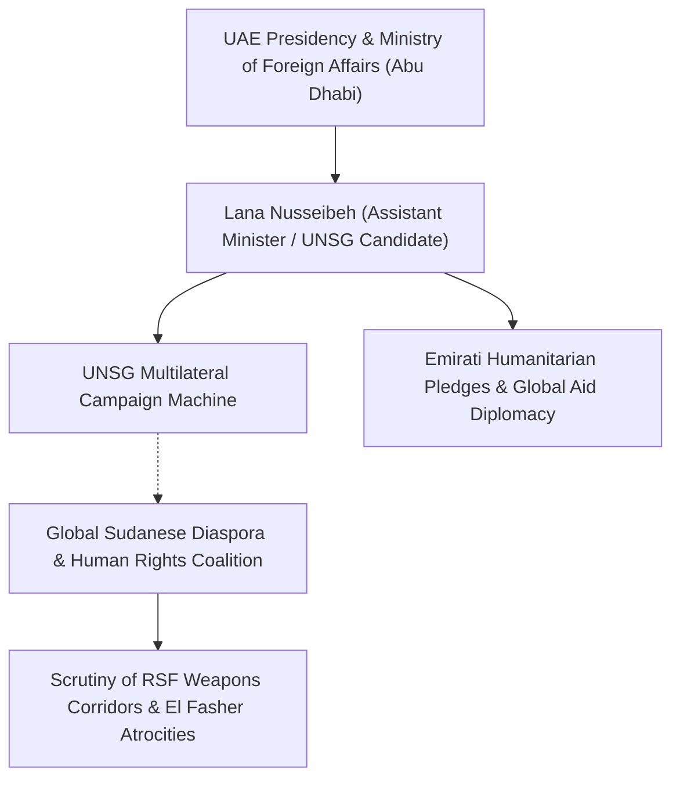

# Lana Nusseibeh

## 1. Identity, Classification & Leadership Anchor

> [!NOTE] Identity, Classification & Leadership Anchor
> **Lana Nusseibeh** (Ambassador Lana Zaki Nusseibeh) is a prominent Emirati diplomat serving as Assistant Minister of Foreign Affairs for Political Affairs and Envoy of the Foreign Minister of the [[United Arab Emirates]]. Previously serving as the UAE's Permanent Representative to the [[United Nations]] in New York (2013–2024)—including during the UAE's term on the UN Security Council (2022–2023)—Nusseibeh is the UAE's high-profile candidate for the position of United Nations Secretary-General for the 2027–2031 term, making her candidacy the center of intense international controversy regarding the UAE's arming of the [[Rapid Support Forces]] (RSF).

## 2. Historical Lineage, Factions & Command Structure

Born into an influential Palestinian family and educated at Queens' College, Cambridge, and SOAS University of London, Nusseibeh served as the first female Permanent Representative of the UAE to the United Nations. During her tenure in New York, she established a reputation as a polished multilateral negotiator, championing resolutions on women, peace, and security, climate change, and counter-terrorism.

## 3. Strategic Objectives, Ideology & Political Economy ("Why")

Nusseibeh’s diplomatic persona and campaign platform center on:
- **Projecting Emirati Soft Power & Moderation**: Branding the UAE as a forward-looking, technologically advanced, and humanitarian multilateral leader capable of bridging Global North and Global South divides.
- **Deflecting Direct Complicity Allegations**: Consistently denying that the UAE supplies weapons, drones, or logistics to the RSF, framing Emirati engagement exclusively as humanitarian relief (e.g., funding field hospitals in Chad) and peace facilitation.
- **Multilateral Realpolitik**: Leveraging the UAE’s substantial foreign aid, climate diplomacy, and investment pledges to secure diplomatic endorsements from developing states across Africa, Latin America, and Asia.

## 4. Operational Capabilities, Alliances & Foreign Backing

- **Diplomatic Apparatus**: Backed by the full resources of the UAE Ministry of Foreign Affairs, sovereign wealth networks, and top-tier international lobbying and public relations firms in Washington, London, and New York.
- **Counter-Mobilization**: Faces unprecedented opposition from Sudanese and international civil society, who argue that electing a representative of a government arming genocidal militias would irreparably shatter the moral authority of the United Nations.

## 5. Chronological Event Footprint & Accountability Record

| Date | Diplomatic Milestone / Public Stance | Controversy / Event Context |
| :--- | :--- | :--- |
| **2013–2014** | Ambassadorship to UN in New York | Routine dismissal by her mission of UN investigator [[Dino Mahtani]]'s evidence of 160+ illegal Somali charcoal shipments funding al-Shabaab entering UAE desert warehouses |
| **2022** | Diplomatic tenure as UN Permanent Representative | Retaliatory detention and expulsion of former UN investigator [[Dino Mahtani]] by UAE authorities connected to renewed Somali sanctions inquiries |
| **2023-06** | Presided over UN Security Council during UAE presidency | Navigated scrutiny over early RSF atrocities in Darfur |
| **2024-04** | Formal launch of international campaign for UN Secretary-General | Outlined platform prioritizing multilateral reform and global consensus |
| **2026-10-28** | Subject of global civil society briefing opposing her UN candidacy | Sudanese diaspora, HRW, and [[Centre for International Policy]] presented evidence of UAE arms transfers to RSF; deflected questions on past RSF denials at UN press conference |

## Related Primitives

- **Sources**: [[sources/2026-10-30-the-guardian-sudanese-diaspora-uae-un-nominee-nusseibeh]], [[sources/2026-10-28-middle-east-eye-uae-dark-politics-nusseibeh-un]]
- **Themes**: [[Multilateral Capture and Accountability Politics in Sudan]], [[UAE Foreign Backing and Logistics Network for the Rapid Support Forces]]
- **Events**: [[2026-10-28 Global Civil Society Briefing Opposing Lana Nusseibeh Candidacy for UN Secretary-General]]
- **Actors**: [[United Arab Emirates]], [[Human Rights Watch]], [[SIHA Network]], [[Kenneth Roth]], [[Hala al-Karib]], [[Carlos Mureithi]], [[Dino Mahtani]], [[Centre for International Policy]], [[Middle East Eye]]
- **Locations**: [[Geneva]]
