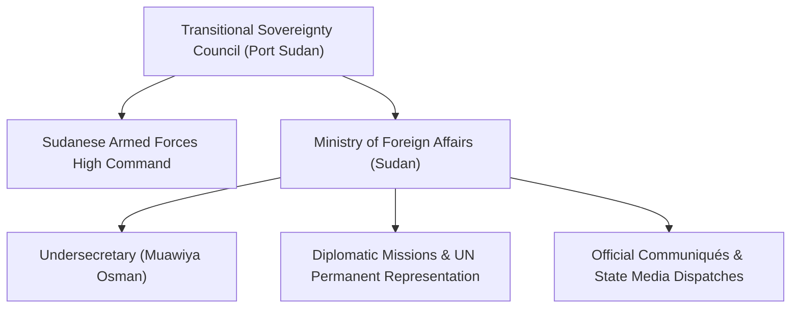

# Ministry of Foreign Affairs (Sudan)

## 1. Identity, Classification & Leadership Anchor

> [!NOTE] Identity, Classification & Leadership Anchor
> The **Ministry of Foreign Affairs (Sudan)** is the executive diplomatic organ of the Republic of the Sudan, operating from the administrative de facto wartime capital of [[Port Sudan]] under the authority of the Transitional Sovereignty Council chaired by General Abdel Fattah al-Burhan. Representing the diplomatic apparatus of the [[Sudanese Armed Forces]] (SAF), its operational diplomatic posture is directed by the Minister and senior diplomatic civil servants, notably Undersecretary **[[Muawiya Osman]]**.

## 2. Historical Lineage, Factions & Command Structure

Following the outbreak of armed conflict on 15 April 2023 and the subsequent destruction of ministerial headquarters in Khartoum, the Ministry relocated its central apparatus to Port Sudan, Red Sea State. The ministry is institutionally dominated by career diplomats aligned with the traditional state apparatus, military intelligence, and conservative nationalist factions backing the SAF against the paramilitary [[Rapid Support Forces]] (RSF).

## 3. Strategic Objectives, Ideology & Political Economy ("Why")

The Ministry's strategic objectives center on safeguarding state sovereignty and waging external diplomatic warfare:
- **International Legitimacy Defense**: Asserting that the Port Sudan authorities represent the sole legitimate sovereign government of Sudan, categorizing the RSF as an outlaw "terrorist militia."
- **Proxy War Attribution**: Publicly exposing, lodging diplomatic complaints against, and seeking UN sanctions against regional sponsors of the RSF, notably the [[United Arab Emirates]] and the [[Government of Ethiopia]].
- **Conditioning Mediation**: Rejecting mediation frameworks (such as IGAD or US-led Geneva talks) that treat the SAF and RSF as co-equal sovereign belligerents or compromise the SAF's institutional supremacy.

## 4. Operational Capabilities, Alliances & Foreign Backing

- **Diplomatic Levers**: Utilizes its seat at the [[United Nations]], the African Union (despite AU suspension), and the Arab League to block adverse resolutions, contest external fact-finding mandates, and file formal complaints with the UN Security Council.
- **Bilateral Alliances**: Cultivates strategic bilateral military and financial ties with Egypt, Saudi Arabia, Turkey, Iran, and Russia to balance RSF proxy supply corridors.

## 5. Chronological Event Footprint & Accountability Record

| Date | Diplomatic Action / Statement | Counterpart / Implicated Actor |
| :--- | :--- | :--- |
| **2023-12** | Expulsion of UAE diplomats from Port Sudan | [[United Arab Emirates]] |
| **2024-03** | Formal complaint lodged at UNSC regarding UAE weapons supplies | [[United Arab Emirates]], UN Security Council |
| **2024-10** | Rejection of FFM Sudan report at UN Human Rights Council | [[Independent International Fact-Finding Mission for the Sudan]] |
| **2026-10-31** | Statement attributing Haiya drone attack to Ethiopian-based UAE proxies | [[Government of Ethiopia]], [[United Arab Emirates]], [[Muawiya Osman]] |

## ## Related Primitives
- **Sources**: [[sources/2026-10-31-dabanga-haiya-oil-electricity-drone-attack]]
- **Events**: [[2026-10-31 Haiya Oil Pumping and Power Station Drone Strike]]
- **Themes**: [[Energy Infrastructure Targeting in the Sudan War.md|Energy Infrastructure Targeting in the Sudan War]], [[Regional Proxy Warfare and Transnational Drone Supply Networks in Sudan]]
- **Actors**: [[Muawiya Osman]], [[Sudanese Armed Forces]], [[United Arab Emirates]], [[Government of Ethiopia]]
- **Locations**: [[Port Sudan]], [[Red Sea State.md|Red Sea State]], [[Haiya]]
