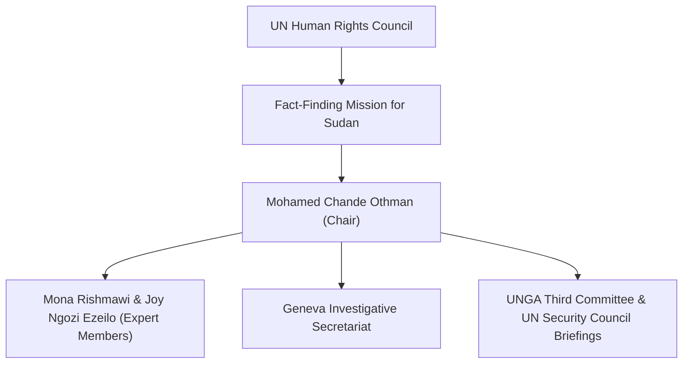

# Mohamed Chande Othman

## 1. Identity, Classification & Leadership Anchor

> [!NOTE] Identity, Classification & Leadership Anchor
> **Mohamed Chande Othman** is a distinguished Tanzanian jurist and former Chief Justice of Tanzania (2010–2017) serving as the Chair of the [[Independent International Fact-Finding Mission for the Sudan]] (FFM), appointed by the President of the [[UN Human Rights Council]] in December 2023. With decades of international criminal justice experience at the UN International Criminal Tribunal for Rwanda (ICTR) and East Timor, Justice Othman directs international fact-finding efforts into war crimes, crimes against humanity, and genocide in Sudan.

## 2. Historical Lineage, Factions & Command Structure

Prior to his appointment to the Sudan FFM, Justice Othman served as Chief of Prosecutions at the ICTR, UN Senior Legal Adviser in East Timor, UN Special Rapporteur on Human Rights in the Sudan (2005), and Independent Eminent Person leading the UN investigation into the death of former Secretary-General Dag Hammarskjöld. His leadership provides the FFM with judicial rigor, meticulous evidentiary standards, and deep familiarity with Sudanese legal structures.

## 3. Strategic Objectives, Ideology & Political Economy ("Why")

Justice Othman's institutional doctrine is grounded in strict international criminal jurisprudence and ending impunity for conflict atrocities:
- **Judicial Impartiality & Independence**: Applying uniform legal thresholds to both the [[Sudanese Armed Forces]] (SAF) and the [[Rapid Support Forces]] (RSF) without political favoritism.
- **Prosecutorial Handover**: Ensuring that evidentiary documentation adheres strictly to the Berkeley Protocol, allowing immediate evidentiary admissibility in future trials before the [[International Criminal Court]] or specialized universal jurisdiction tribunals.
- **Deterring Third-Party Complicity**: Repeatedly warning regional powers that providing weapons, loitering munitions, and financial lifelines to belligerents constitutes complicity in international crimes.

## 4. Operational Capabilities, Alliances & Foreign Backing

- **Judicial Authority**: Operates with the diplomatic authority of the UN Human Rights Council mandate, delivering formal addresses directly to the UN General Assembly Third Committee and international media corps.
- **Multilateral Alliances**: Works in coordination with UN High Commissioner for Human Rights Volker Türk, ICC Chief Prosecutor Karim Khan, and regional human rights commissions.

## 5. Chronological Event Footprint & Accountability Record

| Date | Judicial Finding / Public Address | Forum / Impact |
| :--- | :--- | :--- |
| **2024-09** | Presentation of FFM's Inception Report | Formally called for a comprehensive arms embargo and independent peacekeeping force for Sudan |
| **2026-02-19** | Landmark El Fasher Investigation Briefing | Warned that RSF operations in North Darfur exhibit hallmarks of genocide |
| **2026-10-28** | UNGA Third Committee Address in New York | Sounded international alarm over escalating drone strikes, siege warfare, and mass detentions in El Obeid |

## ## Related Primitives
- **Sources**: [[sources/2026-10-28-ohchr-ffm-el-obeid-drone-warfare-repression]], [[sources/2026-10-28-ohchr-independent-international-fact-finding-mission-sudan-portal]], [[sources/2026-02-19-un-news-el-fasher-hallmarks-of-genocide]]
- **Themes**: [[International Accountability and Fact-Finding Mechanisms in Sudan]], [[Ethnic Cleansing and Genocidal Patterns in Darfur]], [[Drone Proliferation and Double-Tap Strike Doctrine in Sudan]]
- **Events**: [[2025-10 El Fasher Siege and RSF Takeover Atrocities]], [[2026-10 El Obeid Siege and Drone Warfare Escalation]]
- **Actors**: [[Independent International Fact-Finding Mission for the Sudan]], [[Mona Rishmawi]], [[Joy Ngozi Ezeilo]], [[UN Human Rights Council]]
- **Locations**: [[Geneva]], [[El Fasher]], [[El Obeid]]
