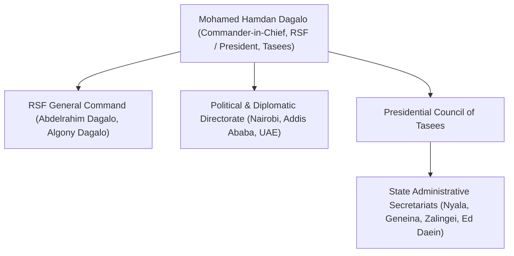

# Mohamed Hamdan Dagalo

## 1. Identity, Classification & Leadership Anchor

> [!NOTE] Identity, Classification & Leadership Anchor
> **Mohamed Hamdan Dagalo** (widely known as **Hemedti** / *حميدتي*) is the Commander of the paramilitary **[[Rapid Support Forces]]** (RSF) and the President of the Presidential Council of **[[Tasees]]**, the de facto civilian governance apparatus established across RSF-held territories. Formerly the Deputy Chairman of Sudan's Transitional Sovereignty Council until April 2023, Dagalo commands a sprawling paramilitary coalition spanning camel-herding Rizeigat networks, border militias, and foreign mercenary recruits, sustained by extensive gold-mining revenue and backing from the [[United Arab Emirates]].

## 2. Historical Lineage, Factions & Command Structure

Rising to prominence during the Darfur conflict as a leader of the state-sponsored Janjaweed militias, Dagalo formalized his forces as the Rapid Support Forces under President Omar al-Bashir in 2013. Following Bashir's ouster in 2019, Dagalo consolidated vast political and commercial assets. Tensions with SAF Commander Abdel Fattah al-Burhan over RSF integration into the regular military culminated in the outbreak of full-scale war in Khartoum on 15 April 2023.

## 3. Strategic Objectives, Ideology & Political Economy ("Why")

- **Territorial Dominion & Parallel Governance**: Securing complete territorial dominion over Darfur and Kordofan, formalized through [[Tasees]] to project institutional parity with the Port Sudan sovereign council.
- **Transnational Resource Extraction**: Controlling artisanal gold extraction across Jebel Amer and Darfur to finance arms procurements, drone supply chains, and mercenary recruitment.
- **Narrative Framing**: Framing the RSF’s war as a revolutionary struggle to dismantle the historic riverine Arab-Islamist oligarchy (*Kizan*) and establish a federal democracy.

## 4. Operational Capabilities, Alliances & Foreign Backing

- **Foreign Proxy Architecture**: Backed by extensive logistical, financial, and military supply networks operated by the [[United Arab Emirates]], including transshipment hubs in eastern Chad (Amdjarass) and western Ethiopia ([[Assosa]]).
- **Unmanned Aerial Drone Fleet**: Deploys long-range kamikaze and surveillance drones targeting SAF military bases, power grids, and municipal fuel depots nationwide.

## 5. Chronological Event Footprint & Accountability Record

| Date | Key Event / Decree | Context |
| :--- | :--- | :--- |
| **2023-04-15** | Launched armed confrontation against SAF garrisons across Khartoum and Darfur | Outbreak of nationwide Sudan conflict |
| **2026-10-31** | Issued Presidential Decree No. (19) of 2026 dissolving state civil administrations | Centralized governance under transitional secretariats within Tasees |

## Related Primitives

- **Paramilitary Force**: [[Rapid Support Forces]]
- **Governance Apparatus**: [[Tasees]]
- **International Backer**: [[United Arab Emirates]]
- **Primary Adversary**: [[Sudanese Armed Forces]]
- **Citations**: [[2026-10-31 Mohamed Hamdan Dagalo Decree Dissolving RSF Civil Administrations]]
