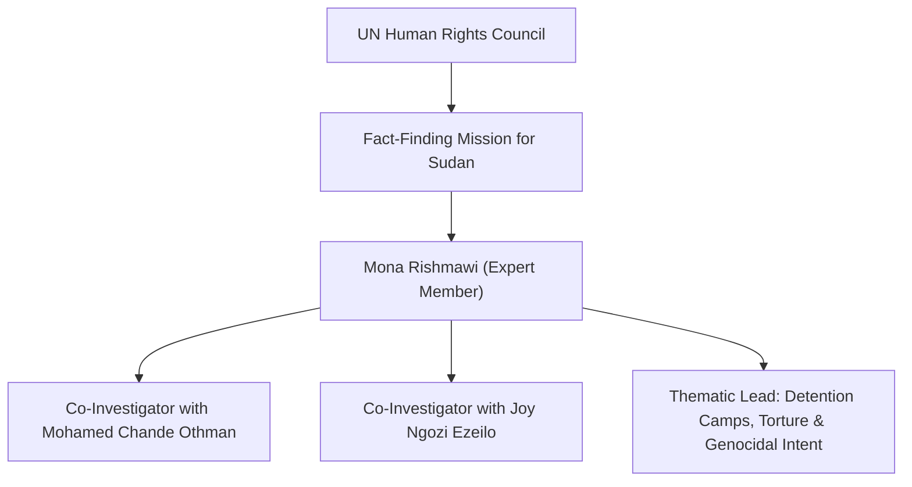

# Mona Rishmawi

## 1. Identity, Classification & Leadership Anchor

> [!NOTE] Identity, Classification & Leadership Anchor
> **Mona Rishmawi** is an internationally acclaimed Palestinian jurist, human rights advocate, and former senior United Nations official serving as an expert member of the [[Independent International Fact-Finding Mission for the Sudan]] (FFM). Appointed in December 2023 by the [[UN Human Rights Council]], Rishmawi brings over three decades of international human rights and rule-of-law expertise, specializing in the investigation of arbitrary detentions, systematic torture, and genocidal intent.

## 2. Historical Lineage, Factions & Command Structure

Rishmawi previously served as the Head of the Rule of Law, Equality and Non-Discrimination Branch at the Office of the UN High Commissioner for Human Rights (OHCHR) in Geneva and was the UN Independent Expert on the Situation of Human Rights in Somalia (2000–2001). Her extensive career with the International Commission of Jurists (ICJ) and various UN international commissions of inquiry gives her specialized authority on international humanitarian law and criminal accountability.

## 3. Strategic Objectives, Ideology & Political Economy ("Why")

Rishmawi’s investigative mandate within the FFM focuses on:
- **Detention Facility Forensics**: Exposing secret, arbitrary, and inhumane detention facilities operated by both the [[Rapid Support Forces]] (e.g., in Khartoum and Kordofan) and SAF Military Intelligence.
- **Genocidal Mens Rea Analysis**: Analyzing patterns of ethnically targeted executions, racial slurs, and community displacement in Darfur to establish genocidal intent (*dolus specialis*) under the 1948 Genocide Convention.
- **Protection of Civic Space**: Documenting the targeting, forced disappearance, and torture of lawyers, Emergency Response Room volunteers, and human rights defenders.

## 4. Operational Capabilities, Alliances & Foreign Backing

- **Legal Analysis**: Applies rigorous evidentiary standards to witness testimonies gathered from Sudanese refugees across East Africa and the Sahel.
- **Institutional Advocacy**: Regularly addresses international press conferences, diplomatic briefings, and Human Rights Council interactive dialogues.

## 5. Chronological Event Footprint & Accountability Record

| Date | Investigative Contribution | Key Focus Area |
| :--- | :--- | :--- |
| **2026-02-19** | UN Briefing on El Fasher Atrocities | Detailed RSF genocidal targeting of Zaghawa and Fur civilian populations |
| **2026-10-28** | UNGA Third Committee Briefing | Exposed horrific detention conditions, torture, and denial of food/medicine in El Obeid |

## ## Related Primitives
- **Sources**: [[sources/2026-10-28-ohchr-ffm-el-obeid-drone-warfare-repression]], [[sources/2026-02-19-un-news-el-fasher-hallmarks-of-genocide]]
- **Themes**: [[International Accountability and Fact-Finding Mechanisms in Sudan]], [[Ethnic Cleansing and Genocidal Patterns in Darfur]], [[State Surveillance and Civic Space Contraction in Sudan]]
- **Events**: [[2025-10 El Fasher Siege and RSF Takeover Atrocities]], [[2026-10 El Obeid Siege and Drone Warfare Escalation]]
- **Actors**: [[Independent International Fact-Finding Mission for the Sudan]], [[Mohamed Chande Othman]], [[Joy Ngozi Ezeilo]], [[Rapid Support Forces]], [[Sudanese Armed Forces]]
- **Locations**: [[El Fasher]], [[El Obeid]], [[Geneva]]
