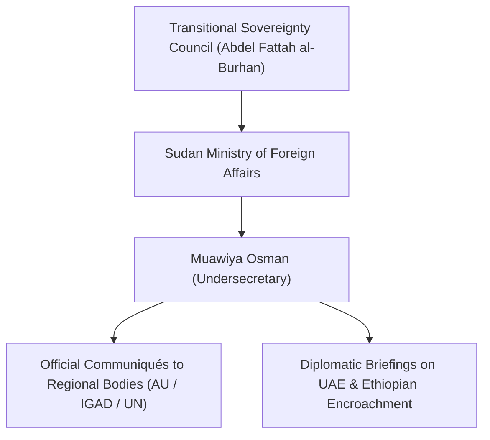

# Muawiya Osman

## 1. Identity, Classification & Leadership Anchor

> [!NOTE] Identity, Classification & Leadership Anchor
> **Muawiya Osman** (Ambassador Muawiya Osman Khalid) is a senior Sudanese career diplomat currently serving as the Undersecretary of the [[Ministry of Foreign Affairs (Sudan)]] in the wartime administrative seat of [[Port Sudan]]. Acting as one of the primary diplomatic voices for the Sovereign Council and the [[Sudanese Armed Forces]] (SAF), Osman directs official state communications regarding cross-border proxy warfare, regional aggression, and sovereignty violations.

## 2. Historical Lineage, Factions & Command Structure

A veteran diplomat within Sudan's foreign service, Ambassador Osman previously served in high-profile ambassadorial postings across Africa and multilateral missions. In his wartime leadership role at the Foreign Ministry in Port Sudan, Osman coordinates state diplomatic strategy to isolate the [[Rapid Support Forces]] (RSF) internationally and file legal and diplomatic complaints against external governments aiding the militia.

## 3. Strategic Objectives, Ideology & Political Economy ("Why")

Osman's diplomatic posture is defined by:
- **Exposing Regional Proxy Logistics**: Systematically naming and lodging diplomatic protests against the [[United Arab Emirates]] and neighboring countries facilitating RSF drone and weapons transfers.
- **Sovereign Non-Intervention Doctrine**: Rejecting foreign mediation mechanisms that circumvent the institutional authority of the Sudanese state apparatus or seek to legitimize paramilitary forces.
- **Strategic Resource Defense**: Framing attacks on oil export corridors and electrical grids as acts of external economic terrorism aimed at collapsing the residual Sudanese state economy.

## 4. Operational Capabilities, Alliances & Foreign Backing

- **Diplomatic Representation**: Represents the de facto government at regional summits, ministerial conferences, and bilateral negotiations with key regional partners including Egypt, Saudi Arabia, and Turkey.
- **Crisis Communications**: Issues emergency press briefings in the immediate aftermath of strategic infrastructure strikes, establishing the state's narrative of attribution.

## 5. Chronological Event Footprint & Accountability Record

| Date | Diplomatic Engagement / Public Statement | Key Subject Matter |
| :--- | :--- | :--- |
| **2024-06** | Diplomatic Demarches on Border Security | Addressed cross-border arms influxes via Western and Eastern frontiers |
| **2026-10-31** | Official Statement on Haiya Drone Attack | Formally accused Ethiopian-based UAE proxies of staging drone strikes against Sudan's oil and power grids |

## ## Related Primitives
- **Sources**: [[sources/2026-10-31-dabanga-haiya-oil-electricity-drone-attack]]
- **Themes**: [[Energy Infrastructure Targeting in the Sudan War.md|Energy Infrastructure Targeting in the Sudan War]], [[Regional Proxy Warfare and Transnational Drone Supply Networks in Sudan]]
- **Events**: [[2026-10-31 Haiya Oil Pumping and Power Station Drone Strike]]
- **Actors**: [[Ministry of Foreign Affairs (Sudan)]], [[Sudanese Armed Forces]], [[United Arab Emirates]], [[Government of Ethiopia]], [[Rapid Support Forces]]
- **Locations**: [[Port Sudan]], [[Haiya]], [[Assosa]], [[Red Sea State.md|Red Sea State]]
