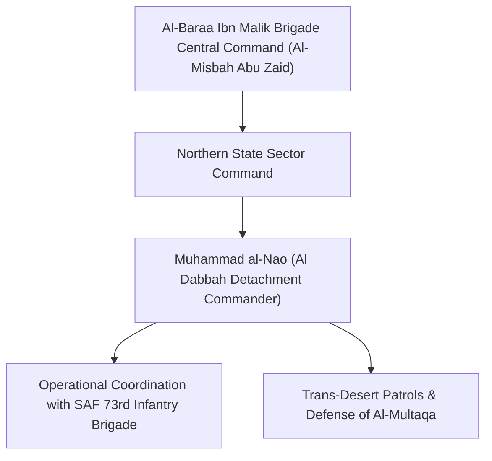

# Muhammad al-Nao

## 1. Identity, Classification & Leadership Anchor

> [!NOTE] Identity, Classification & Leadership Anchor
> **Muhammad al-Nao** (`محمد النو`) was a senior field commander within the Islamist [[Al-Baraa Ibn Malik Brigade]], leading brigade elements deployed in [[Al Dabbah]] (`SD05004`) in [[Northern State]]. Serving alongside the SAF 73rd Infantry Brigade, al-Nao was responsible for coordinating auxiliary volunteer troop mobilizations and securing logistics junctions guarding the southern approaches to Dongola.

## 2. Historical Lineage, Factions & Command Structure

Al-Nao rose through the ranks of the popular Islamist youth mobilization movement aligned with the Islamic Movement and the SAF following the outbreak of the April 2023 conflict, establishing a strong auxiliary presence across Northern State.

## 3. Strategic Objectives, Ideology & Political Economy ("Why")

- **Defense of SAF Rear Strongholds**: Neutralizing RSF deep-reconnaissance patrols and securing Northern State from paramilitary incursions.
- **Islamist Auxiliary Power**: Embedding Al-Baraa operational units within formal SAF brigade structures in northern riverine cities.

## 4. Operational Capabilities, Alliances & Foreign Backing

- Direct operational integration with the SAF 73rd Infantry Brigade in Al Dabbah, utilizing fortified bases and fuel infrastructure in Al-Multaqa.

## 5. Chronological Event Footprint & Accountability Record

| Date | Key Event | Context |
| :--- | :--- | :--- |
| **2026-11-01** | Killed in action during an RSF drone strike on the 73rd Brigade base in Al Dabbah | Confirmed targeted decapitation of allied militia leadership in Northern State |

## Related Primitives

- **Brigade**: [[Al-Baraa Ibn Malik Brigade]]
- **Allied Force**: [[Sudanese Armed Forces]]
- **Location**: [[Al Dabbah]], [[Northern State]]
- **Incident**: [[2026-11-01 Abu Hamad and Al Dabbah Power Stations Drone Strikes]]
